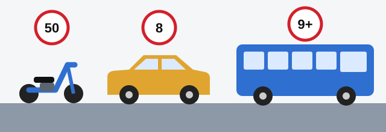

# افراد و وسایل نقلیه

مقرراتی که باید رعایت کنید به این بستگی دارد که قانون شما و وسیله نقلیه‌تان را چه می‌نامد. همه تعریف‌های این درس از ماده 2 قانون جمهوری ارمنستان «درباره تأمین ایمنی ترافیک جاده‌ای» آمده‌اند و آزمون اغلب فقط یک کلمه از آن‌ها را تغییر می‌دهد.

## چه کسی راننده محسوب می‌شود؟

کسی که پشت فرمان است، و دو نفر دیگر:

- **آموزش‌دهنده رانندگی.** کسی که به دیگری رانندگی یاد می‌دهد در حکم راننده است و وظایف و مسئولیت راننده را دارد.
- **کسی که حیوانات باربر یا سواری، یا دام‌ها را در امتداد راه می‌راند.** عبارت «در امتداد راه» تعیین‌کننده است: کسی که حیوانات را در مزرعه می‌راند راننده نیست.

## چه کسی مسافر محسوب می‌شود؟

**مسافر** شخصی است که در وسیله نقلیه یا روی آن قرار دارد، و همچنین شخصی که سوار یا پیاده می‌شود، به استثنای راننده و آموزش‌دهنده رانندگی. پس از لحظه‌ای که سوار شدن را شروع می‌کنید تا وقتی کاملاً پیاده شوید مسافر هستید.

## چه کسی عابر پیاده محسوب می‌شود؟

**عابر پیاده** شخصی است که خارج از وسیله نقلیه روی راه قرار دارد. یک استثنا وجود دارد: شخصی که صلاحیت انجام کار روی راه را دارد و آن کار را به ترتیب مقرر در قانون انجام می‌دهد.

این افراد هم در حکم عابر پیاده هستند:

- معلولانی که با ویلچر بدون موتور جابه‌جا می‌شوند.
- معلولانی که با ویلچر موتوردار و با سرعت عابر پیاده حرکت می‌کنند.
- کسانی که دوچرخه، موپد یا موتورسیکلت را پیاده هدایت می‌کنند.
- کسانی که چرخ‌دستی، سورتمه، کالسکه کودک یا ویلچر را می‌کشند یا هل می‌دهند.

> **به یاد داشته باشید:** با سوار شدن راننده می‌شوید. با هل دادن عابر پیاده می‌شوید.

## چه کسی می‌تواند حرکت را تنظیم کند؟

اصطلاح قانون **تنظیم‌کننده حرکت** است. یعنی کسی که اختیار تنظیم حرکت را دارد و این کار را به ترتیب مقرر در قانون انجام می‌دهد. هر دو بخش لازم است. راننده یا مسافری که پیاده می‌شود و برای خودروها دست تکان می‌دهد چنین اختیاری ندارد.

## وضعیت اضطراری چیست؟

**وضعیت اضطراری** در نتیجه اقدام یا عدم اقدام یکی از کاربران راه، یا تنظیم‌کننده حرکت، پدید می‌آید و خطر واقعی تصادف رانندگی ایجاد می‌کند. پس خطر ممکن است از سوی کسی که حرکت را هدایت می‌کند هم باشد.

> **دام رایج:** گزینه نادرست با «یکی از کاربران راه» تمام می‌شود. تعریف کامل، تنظیم‌کننده حرکت را هم در بر می‌گیرد.

## چه چیزی وسیله نقلیه محسوب می‌شود؟

**وسیله نقلیه** دستگاهی است برای جابه‌جایی افراد، بار یا تجهیزات نصب‌شده بر روی آن در راه. معیار، کاربرد آن است نه نوعش. بنابراین یدک، دوچرخه و گاری اسبی هم وسیله نقلیه هستند، نه فقط خودرو و موتورسیکلت.

*سه عدد برای حفظ کردن. موپد: 50، هم برای حجم موتور و هم برای سرعت. خودروی سواری: تا 8 صندلی مسافر. اتوبوس: 9 صندلی یا بیشتر.*

| اصطلاح | تعریف به زبان ساده |
|---|---|
| **خودرو** | وسیله نقلیه موتوری برای جابه‌جایی افراد یا بار در راه، یا برای یدک‌کشی وسیله نقلیه حامل بار. شامل تراکتورهای کشاورزی هم می‌شود که این کار برایشان کارکردی اضافی است. |
| **خودروی سواری سبک** | خودرویی با حداکثر 8 صندلی مسافر، ساخته‌شده برای جابه‌جایی ایمن و راحت مسافران و توشه. |
| **اتوبوس** | همان، اما با بیش از 8 صندلی مسافر. |
| **کامیون** | خودرویی ساخته‌شده برای جابه‌جایی بار. در این تعریف وزنی ذکر نشده است. |
| **موپد** | دو یا سه چرخ، موتوری با حجم حداکثر 50 سانتی‌متر مکعب و حداکثر سرعت 50 کیلومتر بر ساعت. |
| **دوچرخه** | دست‌کم دو چرخ، که معمولاً با نیروی عضلانی شخص روی آن، با رکاب یا دسته، حرکت می‌کند. ویلچر مستثناست. ممکن است موتور کوچکی با حداکثر 0.25 کیلووات هم داشته باشد. |
| **یدک (نیمه‌یدک)** | وسیله نقلیه‌ای بدون موتور که وسیله نقلیه موتوری آن را به حرکت درمی‌آورد و با آن یک مجموعه واحد را تشکیل می‌دهد. یدک ویژه هم جزو آن است. |
| **وسیله نقلیه عمومی** | وسیله نقلیه‌ای که نقاط توقف دارد، در مسیرهای معین حرکت می‌کند و مسافر و (یا) توشه جابه‌جا می‌کند: تراموا، ترولی‌بوس یا اتوبوس. |

> **دام رایج:** «بیش از 8» با «8 یا بیشتر» فرق دارد. وسیله نقلیه‌ای با دقیقاً 8 صندلی مسافر خودروی سواری سبک است، نه اتوبوس.

> **دام رایج:** تاکسی وسیله نقلیه عمومی نیست، چون ایستگاه و مسیر ثابت ندارد. وسیله نقلیه‌ای که در مسیر گردشگری حرکت می‌کند هم وسیله نقلیه عمومی نیست.

وسیله نقلیه موتوری یدک‌شده به یدک تبدیل نمی‌شود، چون هنوز موتور خودش را دارد.

## حداکثر جرم مجاز چیست؟

جرم وسیله نقلیه به‌طور کامل تجهیزشده و سوخت‌گیری‌شده **همراه با راننده، مسافران و بار** است که سازنده آن را به‌عنوان حداکثر مجاز تعیین کرده است. این وزن پر است، نه وزن خالی، و همه بخش‌های تعریف اهمیت دارند.

## خودتان امتحان کنید

**موتورسیکلت شما بنزین تمام کرده و آن را در راه هل می‌دهید.** الان چه هستید؟ **عابر پیاده**، چون کسی که موتورسیکلت را پیاده هدایت می‌کند در حکم عابر پیاده است.

**یک ون صندلی راننده و 8 صندلی مسافر دارد.** آیا اتوبوس است؟ **نه.** اتوبوس باید بیش از 8 صندلی مسافر داشته باشد، پس این ون همچنان خودروی سواری سبک است.

**آموزش‌دهنده کنار هنرجو نشسته است.** آیا مسافر است؟ **نه.** آموزش‌دهنده از تعریف «مسافر» مستثناست و در حکم راننده است.

## نکات کلیدی

- آموزش‌دهنده رانندگی و کسی که حیوانات را در امتداد راه می‌راند در حکم راننده هستند.
- سوار و پیاده شدن هم بخشی از مسافر بودن است.
- پیاده هدایت کردن دوچرخه، موپد یا موتورسیکلت شما را عابر پیاده می‌کند. کارگر راه که کار قانونی انجام می‌دهد عابر پیاده نیست.
- خودروی سواری: تا 8 صندلی مسافر. اتوبوس: بیش از 8. موپد: 50 سانتی‌متر مکعب و 50 کیلومتر بر ساعت.
- در تعریف کامیون وزنی نیامده است. یدک موتور ندارد.
- وسایل نقلیه عمومی تراموا، ترولی‌بوس و اتوبوس هستند، و هرگز تاکسی نیستند.
- حداکثر جرم مجاز رقم وسیله پر است که سازنده تعیین کرده است.

{{practice}}
