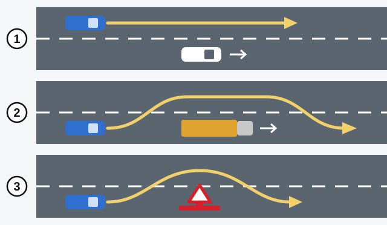
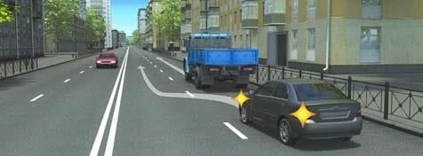

# کارها در راه

قاعده‌ای درباره «سبقت» یا «پارک کردن» فقط وقتی معنا دارد که بدانید این کلمه دقیقاً چه چیزی را در بر می‌گیرد. این اصطلاحات در ماده 2 قانون جمهوری ارمنستان «درباره تأمین ایمنی ترافیک جاده‌ای» و بند 3 مقررات راهنمایی و رانندگی تعریف شده‌اند و آزمون متن دقیق آن‌ها را می‌سنجد.

## توقف یا پارک کردن؟

هر دو یعنی وسیله نقلیه را عمداً بی‌حرکت کردن. زمان و هدف آن‌ها را از هم جدا می‌کند.

- **توقف:** تا 5 دقیقه، یا زمانی که برای سوار یا پیاده شدن مسافر یا بارگیری و تخلیه لازم است.
- **پارک کردن:** بیش از 5 دقیقه، به جز برای جلوگیری از برخورد با کاربر دیگر راه یا مانع، برای سوار یا پیاده شدن مسافر، برای بارگیری یا تخلیه، و موارد دیگری که قانون پیش‌بینی کرده است.

> **دام رایج:** «توقف چون مسافر خواسته است» تعریف توقف نیست. قانون به زمان و هدف نگاه می‌کند، نه به اینکه چه کسی خواسته است.

## توقف اجباری چیست؟

**توقف اجباری** توقفی است که خودتان انتخاب نکرده‌اید. وسیله نقلیه به این دلایل بی‌حرکت می‌شود:

- نقص فنی وسیله نقلیه.
- وضعیت جسمی یا روانی راننده یا مسافر.
- باری که حمل می‌شود.
- خطر یا مانع دیگری که در راه پیش می‌آید.
- علامت ممنوع‌کننده چراغ راهنمایی یا افسر راهنمایی، یا لزوم راه دادن.

پس چراغ قرمز غیرمنتظره و راه‌بندان هم در این تعریف می‌گنجند. اگر پرسشی این‌ها را کنار خرابی فهرست کند، پاسخ «همه موارد ذکرشده» است.

## مانع چیست؟

طبق بند 3 مقررات راهنمایی و رانندگی، **مانع** شیء ثابتی در خط عبور است که رانندگان را از ادامه حرکت در آن خط بازمی‌دارد: وسیله نقلیه آسیب‌دیده یا معیوب، شیء خارجی، خرابی سطح راه و مانند آن.

> **دام رایج:** خودرویی که در راه‌بندان متوقف شده مانع نیست. این خودرو بخشی از جریان ترافیک است و با حرکت جریان به راه می‌افتد.

## «راه دادن» واقعاً یعنی چه؟

**راه دادن** یعنی نباید حرکت را ادامه دهید، از سر بگیرید یا مانوری انجام دهید، اگر این کار ممکن است رانندگان دیگر را مجبور کند جهت یا سرعت خود را **ناگهانی** تغییر دهند.

کلمه «ناگهانی» پاسخ پرسش آزمون را تعیین می‌کند. راه دادن وظیفه مانع نشدن است، نه دستور توقف در هر بار.

## کدام حرکت‌ها نام خاص خود را دارند؟

| اصطلاح | معنا |
|---|---|
| **شروع حرکت** | لحظه‌ای که وسیله نقلیه از محل توقف یا پارک حرکت می‌کند، چه به خط عبور مجاور برود و چه نرود. |
| **تغییر خط عبور** | ترک خط عبور خود، یا ترک ردیف خود در محدوده خط عبور خط‌کشی‌شده، با حفظ جهت اولیه حرکت. |
| **گردش** | مانوری برای ورود به راه دیگر یا محوطه مجاور راه. |
| **دور زدن** | مانوری برای تغییر جهت حرکت به جهت مخالف. |

رفتن به داخل حیاط یا پارکینگ هم گردش است. دور زدن خود مانور است، نه رانندگی پس از آن.

**مانور دادن** نام همه این گروه است: شروع حرکت (با ورود به خط عبور مجاور)، تغییر خط عبور، تغییر جهت حرکت (گردش یا دور زدن)، توقف (با تغییر خط عبور) و حرکت با دنده عقب.

> **به یاد داشته باشید:** عبارت‌های داخل پرانتز بخشی از تعریف هستند. به راه افتادن یا توقف فقط وقتی مانور است که به خط عبور دیگری بروید.

## عبور از کنار، سبقت یا عبور از کنار مانع؟

در هر سه از چیزی جلو می‌زنید. دو پرسش بپرسید: آیا آن چیز در حال حرکت است؟ و آیا از خط عبور خود خارج شدید؟

| | نام | از چه چیزی جلو می‌زنید | از خط عبور خود خارج می‌شوید؟ |
|---|---|---|---|
| 1 | **عبور از کنار** | یک یا چند وسیله نقلیه در حال حرکت | نه |
| 2 | **سبقت** | یک یا چند وسیله نقلیه در حال حرکت | بله |
| 3 | **عبور از کنار مانع** | مانعی ثابت در خط عبور شما | بله |

> **دام رایج:** سبقت لازم نیست با ورود به خط عبور مقابل باشد. ترک خط عبوری که در آن هستید کافی است.

## «دید ناکافی» و «هنگام تاریکی شبانه‌روز» یعنی چه؟

**دید ناکافی** یعنی دید راه یا فاصله دید تا 300 متر در مه، باران، بارش برف یا هوای نامساعد دیگر برای ایمنی ترافیک. هوا بخشی از تعریف است، پس تاریکی به‌تنهایی دید ناکافی محسوب نمی‌شود.

**هنگام تاریکی شبانه‌روز** فاصله میان پایان گرگ‌ومیش شامگاهی و آغاز گرگ‌ومیش بامدادی است. قانون ساعت مشخصی برای آن تعیین نکرده و با غروب خورشید هم شروع نمی‌شود: در گرگ‌ومیش هنوز کمی روشنایی هست.

## خودتان امتحان کنید

**راننده خودروی خاکستری چه مانوری انجام می‌دهد؟**

**سبقت.** کامیون در حال حرکت است و خودرو از خط عبور خود خارج شده است. اگر خودرو در خط خود می‌ماند عبور از کنار بود، و اگر کامیون مانعی ثابت بود عبور از کنار مانع.

**برای تخلیه جعبه‌ها توقف می‌کنید و 12 دقیقه طول می‌کشد.** آیا پارک کرده‌اید؟ **نه.** بیش از 5 دقیقه برای تخلیه اشکالی ندارد، پس این همچنان توقف است.

## نکات کلیدی

- توقف: تا 5 دقیقه، یا به اندازه زمان سوار و پیاده شدن یا بارگیری و تخلیه. پارک کردن: طولانی‌تر و به دلایل دیگر.
- توقف اجباری شامل خرابی، خطر، بار، چراغ قرمز و راه‌بندان می‌شود.
- خودرویی که در راه‌بندان در صف است مانع نیست.
- راه دادن یعنی دیگران را مجبور به تغییر ناگهانی سرعت یا جهت نکنید.
- گردش می‌تواند به راه دیگر یا محوطه مجاور راه باشد.
- در عبور از کنار در خط خود می‌مانید. در سبقت از آن خارج می‌شوید. در عبور از کنار مانع، چیزی ثابت را دور می‌زنید.
- دید ناکافی: تا 300 متر در هوای بد. هنگام تاریکی شبانه‌روز: از گرگ‌ومیش تا گرگ‌ومیش.

{{practice}}
