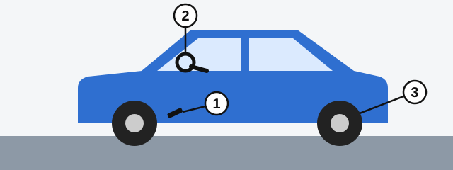

# وظایف و مدارک شما

داشتن گواهینامه وظایفی به همراه دارد که پیش از روشن کردن خودرو شروع می‌شوند. قانون جمهوری ارمنستان «درباره تأمین ایمنی ترافیک جاده‌ای» این وظایف را تعیین کرده و آزمون می‌پرسد چه کسی مسئول چه کاری است.

## چه چیزهایی باید همراهم باشد؟

طبق ماده 24 این قانون، راننده وسیله نقلیه موتوری باید این مدارک را همراه داشته باشد و برای بررسی ارائه کند:

- گواهینامه رانندگی برای آن رده از وسیله نقلیه.
- مدارک ثبت وسیله نقلیه.

> **دام رایج:** برای راندن وسیله نقلیه شخص دیگر به وکالت‌نامه نیاز ندارید. قانون فعلی آن را لازم نمی‌داند، پس «همه مدارک ذکرشده» نادرست است.

## پیش از حرکت چه چیزهایی را باید بررسی کنم؟

*1: سامانه ترمز. 2: سامانه فرمان. 3: ارتفاع باقی‌مانده آج لاستیک، که باید با معیارهای مقررشده مطابق باشد.*

قانون هر سه را لازم می‌داند، نه فقط ترمز و فرمان را.

مطلب تکمیلی: یک دقیقه گشت دور خودرو

*این مطلب از بانک سؤالات نیامده است.*

پیش از سوار شدن، یک بار دور خودرو بچرخید. به دنبال لاستیک کم‌باد یا آسیب‌دیده و نشتی تازه در زیر خودرو باشید و ببینید چراغ‌ها و شیشه‌ها تمیز باشند. هنگام به راه افتادن، ترمز را آرام فشار دهید تا مطمئن شوید واکنش نشان می‌دهد.

## چه کسی وسیله نقلیه را سالم نگه می‌دارد؟

**مالک یا استفاده‌کننده** وسیله نقلیه، طبق ماده 14. نه فروشنده و نه سازمانی که آخرین معاینه فنی را انجام داده است.

## وسیله نقلیه خریداری‌شده را تا چه زمانی باید ثبت کنم؟

**ظرف 15 روز.** طبق ماده 13، وسیله نقلیه را ظرف 15 روز از روز به‌دست آوردن آن، یعنی از روز امضای معامله، برای ثبت دولتی به نهادهای پلیس راه ارائه می‌کنید.

## چه زمانی باید وسیله نقلیه‌ام را در اختیار دیگران بگذارم؟

باید به‌منظور کمک آن را در اختیار این افراد قرار دهید:

- کارکنان پلیس، برای انتقال افرادی که به کمک فوری پزشکی نیاز دارند به مؤسسه درمانی.
- کارکنان درمانی که برای ارائه کمک پزشکی در همان جهت حرکت می‌کنند، با رضایت شما.

## ماده 24 دیگر چه می‌خواهد؟

این موارد در ادامه کتاب دوباره می‌آیند:

- اگر درگیر تصادف شدید، فوراً توقف کنید، چراغ خطر را روشن کنید و چیزی را که به تصادف مربوط است جابه‌جا نکنید.
- هنرجویی که پشت فرمان است باید کمربند ایمنی ببندد.
- با موتورسیکلت، موپد یا دوچرخه در سواره‌رو، کلاه ایمنی بسته‌شده بر سر داشته باشید.

## خودتان امتحان کنید

**خودروی دوستتان را قرض گرفته‌اید و افسر مدارک شما را می‌خواهد.** چه چیزی نشان می‌دهید؟ **گواهینامه خود و مدارک ثبت خودرو.** به وکالت‌نامه نیازی نیست.

## نکات کلیدی

- گواهینامه و مدارک ثبت را همراه داشته باشید.
- پیش از حرکت ترمز، فرمان و آج لاستیک را بررسی کنید.
- مالک یا استفاده‌کننده مسئول وضعیت فنی وسیله نقلیه است.
- وسیله نقلیه را ظرف 15 روز ثبت کنید.
- وسیله نقلیه خود را برای موارد فوری پزشکی در اختیار پلیس، و با رضایت خود در اختیار کارکنان درمانی بگذارید.

{{practice}}
