# چراغ راهنمایی

چراغ راهنمایی به شما می‌گوید چه زمانی می‌توانید حرکت کنید، و وقتی دو راننده همزمان اجازه حرکت دارند مشخص می‌کند چه کسی اول برود. قرمز و سبز بخش ساده کار است، پس بیشتر این درس به پیکان‌ها، تراموا و خطوط عبور برگشت‌پذیر می‌پردازد.

## هر چراغ چه معنایی دارد؟

| چراغ | معنا | شما چه کنید |
|---|---|---|
| سبز | حرکت مجاز است | بروید و هر جا این درس می‌گوید راه بدهید |
| سبز چشمک‌زن | حرکت مجاز است، اما مدت آن رو به پایان است و به‌زودی چراغ بازدارنده روشن می‌شود | همین حالا بسنجید که آیا می‌توانید بدون ترمز شدید توقف کنید |
| زرد | توقف کنید، با یک استثنا (بند 19) | در محل‌هایی که پایین‌تر آمده توقف کنید |
| قرمز | حرکت ممنوع است | توقف کنید |
| قرمز و زرد با هم | حرکت ممنوع است و به‌زودی چراغ سبز روشن می‌شود | آماده باشید، اما منتظر سبز بمانید |
| زرد چشمک‌زن | حرکت مجاز است و تقاطع بدون کنترل به شمار می‌آید | از تابلوهای حق تقدم و قواعد حق تقدم پیروی کنید |

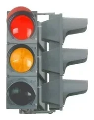

*قرمز و زرد با هم، بند 7: حرکت همچنان ممنوع است.*

> **دام رایج:** قرمز همراه با زرد هشدار آماده شدن است، نه اجازه حرکت. این یک مرحله عادی از کار چراغ سالم است. نه به معنای خرابی چراغ است و نه خبر از نزدیک شدن خودروی امدادی می‌دهد.

## وقتی چراغ زرد روشن می‌شود، می‌توانم ادامه بدهم؟

فقط اگر نتوانید بدون ترمز شدید توقف کنید (بند 19). اگر می‌توانید با آرامش توقف کنید، توقف کنید.

## دقیقاً کجا باید توقف کنم؟

بند 18 این ترتیب را تعیین می‌کند:

1. کنار خط‌کشی «خط ایست» یا تابلوی 6.16 «خط ایست».
2. اگر هیچ‌کدام نبود، پیش از تقاطع، در لبه سواره‌روی متقاطع.
3. در جاهای دیگر، پیش از چراغ راهنمایی.

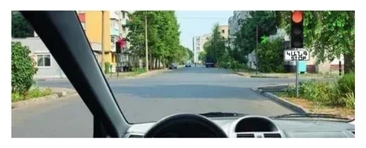

*تابلوی 6.16 کنار چراغ نصب شده است، پس پیش از چراغ راهنمایی توقف می‌کنید.*

تقاطع‌های بزرگ ممکن است در میانه خود خط ایست دومی داشته باشند. در این حالت طبق بند 93 از هر چراغ جداگانه پیروی می‌کنید. سبز اول شما را فقط تا خط دوم می‌رساند.

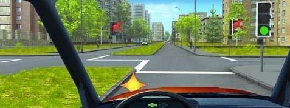

*اگر اینجا به چپ می‌پیچید، وارد تقاطع می‌شوید، پیش از «خط ایست» دوم توقف می‌کنید و منتظر سبز آن می‌مانید.*

دور زدن از کنار چراغی با تابلوی 6.16 هم همین‌طور است. دور زدن را فقط با چراغ سبز تمام می‌کنید، حتی اگر نیمی از آن را انجام داده باشید.

## وقتی چراغ کار می‌کند، تابلوها هم معتبرند؟

تابلوهای حق تقدم نه. طبق بند 173، اگر چراغ با تابلوی حق تقدم تناقض داشته باشد، از چراغ پیروی می‌کنید. این قاعده فقط از تابلوهای حق تقدم نام می‌برد، پس تابلوهای ممنوعیت و دستوری را بی‌اثر نمی‌کند.

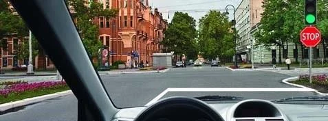

*چراغ سبز با تابلوی 2.5 «حرکت بدون توقف ممنوع» در زیر آن: لازم نیست توقف کنید.*

> **به یاد داشته باشید:** تابلوهای حق تقدم زیر چراغ منتظر می‌مانند. وقتی چراغ خاموش یا زرد چشمک‌زن باشد، آن‌ها فرمان را به دست می‌گیرند.

## در چراغ سبز ساده چه کسی راه می‌دهد؟

- **گردش به چپ یا دور زدن:** به وسایل نقلیه‌ای که از روبه‌رو مستقیم می‌روند یا به راست می‌پیچند راه بدهید (بند 90).
- **گردش به راست:** به ترافیک روبه‌رو بدهکار نیستید، چون مسیرهایتان یکدیگر را قطع نمی‌کنند. اما باید به عابران پیاده و دوچرخه‌سواران راهی که وارد آن می‌شوید راه بدهید (بند 87).
- **وسیله نقلیه با چراغ گردان آبی و علامت صوتی ویژه:** حتی با چراغ سبز خودتان به آن راه بدهید، همان‌طور که بند 28 می‌خواهد.

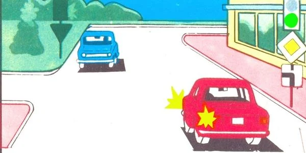

*هر دو خودرو چراغ سبز دارند. خودروی قرمز به چپ می‌پیچد، پس خودروی آبی اول می‌رود.*

مطلب تکمیلی: چراغ سبز به معنای خالی بودن راه نیست

*این مطلب از بانک سؤالات نیامده است.*

پیش از حرکت با چراغ سبز، نگاهی به چپ و راست بیندازید. ممکن است راننده یا عابری دیرتر از موعد هنوز در حال عبور باشد. یک ثانیه نگاه کردن برای شما هزینه‌ای ندارد.

## پیکان سبز کنار چراغ قرمز یعنی چه؟

این پیکان در یک **بخش اضافی** کنار چراغ اصلی قرار دارد. به شما اجازه می‌دهد در جهت آن حرکت کنید، در حالی که بقیه منتظر می‌مانند.

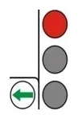

**پیکان به شما اجازه رفتن می‌دهد، نه اجازه زودتر رفتن.** طبق بند 91، راننده‌ای که با پیکان روشن کنار چراغ قرمز حرکت می‌کند باید به وسایل نقلیه‌ای که از جهت‌های دیگر می‌آیند راه بدهد. این قاعده به هر سمتی که پیکان باشد، حتی مستقیم، و برای اتوبوسی که از ایستگاه بیرون می‌آید هم برقرار است.

پیکان فقط در جهت خودش اثر دارد (بند 8):

- **پیکان راست:** فقط از نزدیک‌ترین دهانه بپیچید. رسیدن به دهانه دوم یعنی مستقیم رفتن، و چراغ قرمز آن را ممنوع کرده است.
- **پیکان چپ:** فقط جایی دور زدن را هم در بر می‌گیرد که تابلوهای 5.15.1 یا 5.15.2 گردش به چپ را از خط عبور کناری چپ مجاز کرده باشند. از خط عبور راست فقط می‌توانید به چپ بپیچید.

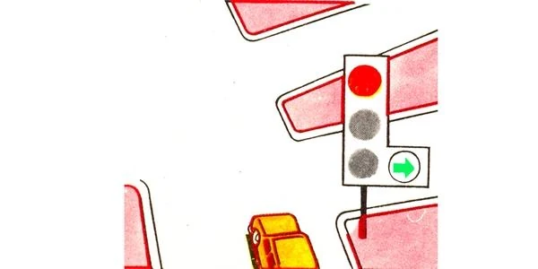

*فقط به راست، از دهانه اول.*

چراغ سبز اصلی هم ممکن است بخش اضافی داشته باشد:

- **بخشی که خاموش است** حرکت در جهت خودش را ممنوع می‌کند (بند 8).
- **پیکان سیاه با خطوط محیطی روی سبز اصلی** نشان می‌دهد این سبز کدام جهت‌ها را در بر می‌گیرد و خبر می‌دهد که برای بقیه جهت‌ها بخش اضافی وجود دارد (بند 10). این پیکان جهت‌های دیگر را ممنوع نمی‌کند: تصمیم با بخش مربوط به خود آن‌هاست.

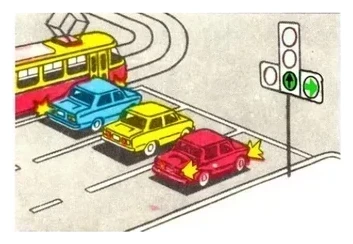

*مستقیم و راست باز است، پس خودروهای زرد و قرمز می‌توانند حرکت کنند. بخش چپ خاموش است، پس تراموا و خودروی آبی منتظر می‌مانند.*

## تراموا چه زمانی اول می‌رود؟

| وضعیت | چه کسی اول می‌رود |
|---|---|
| چراغ‌ها به تراموا و وسایل نقلیه دیگر همزمان اجازه حرکت می‌دهند | تراموا، به هر سمتی که برود (بند 92) |
| تراموا با پیکانی کنار قرمز یا زرد خودش حرکت می‌کند | بقیه. تراموا راه می‌دهد (بندهای 91 و 92) |
| چراغ تراموا جهت حرکت آن را مجاز نمی‌کند | شما. تراموا باید منتظر بماند |
| تراموا و اتوبوس هر دو با پیکان حرکت می‌کنند و مسیرشان یکدیگر را قطع می‌کند | اول تراموا، بعد اتوبوس |
| تراموا و خودرو هر دو با پیکان حرکت می‌کنند و مسیرشان یکدیگر را قطع نمی‌کند | با هم می‌روند |

## چراغ تراموا را چگونه بخوانم؟

چهار علامت سفید مهتابی به شکل حرف T چیده شده‌اند. این چراغ برای تراموا و سایر وسایل نقلیه عمومی در خطوط جداشده است (بند 14). حرکت فقط وقتی مجاز است که علامت **پایین** و یکی از علامت‌های بالا با هم روشن باشند:

- بالا چپ: به چپ.
- بالا وسط: مستقیم.
- بالا راست: به راست.

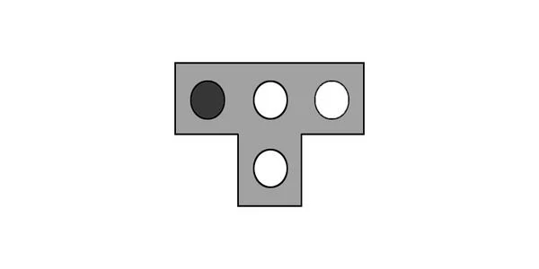

*مستقیم و راست مجاز است. فقط چپ ممنوع است.*

اگر علامت پایین خاموش باشد، تراموا باید بایستد، هر چند علامت‌های بالا روشن باشند.

## چراغ‌های برگشت‌پذیر چیستند؟

این چراغ‌ها بالای تک‌تک خطوط عبور نصب می‌شوند، به‌ویژه خطوطی که جهت حرکت در آن‌ها می‌تواند برعکس شود. هر چراغ فقط خط عبور زیر خودش را کنترل می‌کند، نه کل سواره‌رو را (بند 13).

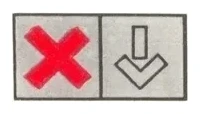

| چراغ بالای خط عبور | معنا |
|---|---|
| ضربدر قرمز | حرکت در این خط عبور ممنوع است، پس برای سبقت هم نمی‌توانید وارد آن شوید |
| پیکان سبز رو به پایین | حرکت در این خط عبور مجاز است، برای رانندگی عادی و نه فقط سبقت |
| خاموش، با خط‌کشی 1.9 در دو طرف خط عبور | ورود ممنوع است |

> **دام رایج:** چراغ برگشت‌پذیر خاموش یعنی ممنوعیت، نه خط عبور آزاد. برای سبقت هم نمی‌توانید وارد آن شوید، حتی اگر راه خالی باشد و وسیله نقلیه جلویی کند برود.

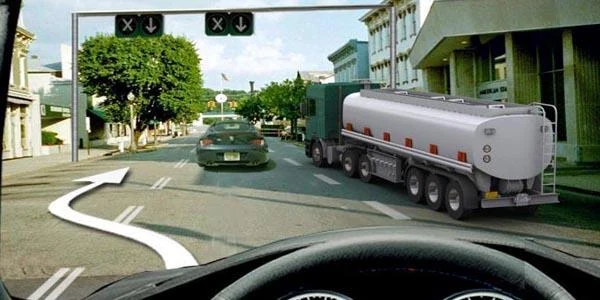

*چراغ‌ها خاموش‌اند، پس این مسیر ممنوع است. گردش به چپ هم از این خط عبور انجام نمی‌شود: آن را از خط عبور کناری مناسب انجام دهید.*

## خودتان امتحان کنید

**شما راننده خودروی قرمز در کنار خودروی آبی هستید.** چراغ اصلی شما قرمز است و پیکان سبز راست روشن است. خودروی سبزی در راه متقاطع قرار دارد.

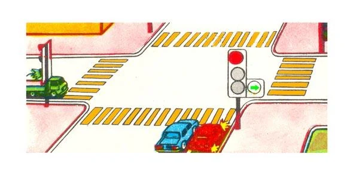

چه کسی اول عبور می‌کند؟ **خودروی سبز.** شما و خودروی آبی می‌توانید به راست بپیچید، اما طبق بند 91 باید به آن راه بدهید.

**با چراغ سبز به چپ می‌پیچید.** تراموای کنار شما هم راهنمای چپ زده است، اما فقط علامت پایین و بالا وسط آن روشن است.

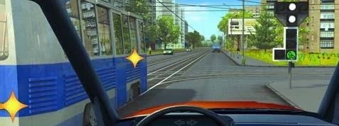

چه کسی اول می‌رود؟ **شما.** چراغ تراموا فقط اجازه مستقیم رفتن می‌دهد، پس پیچیدن آن مجاز نیست و بر شما حق تقدم ندارد (بند 92).

**سه وسیله نقلیه، یک چراغ.** خودرو چراغ سبز ساده دارد. تراموا و اتوبوس روبه‌روی قرمز با پیکان راست هستند.

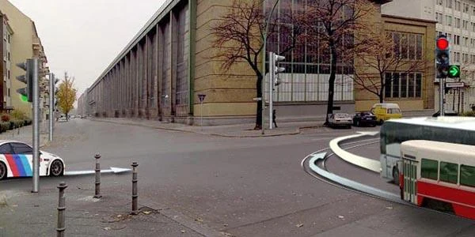

ترتیب عبور چیست؟ **خودرو، تراموا، اتوبوس.** پیکان هر دو را پس از خودرو قرار می‌دهد (بند 91) و بند 92 تراموا را جلوتر از اتوبوس می‌گذارد.

## نکات کلیدی

- قرمز همراه با زرد هنوز یعنی توقف. سبز چشمک‌زن هنوز یعنی حرکت، اما نه برای مدت زیاد.
- اگر زرد غافلگیرتان کرد و نمی‌توانید بدون ترمز شدید توقف کنید، می‌توانید ادامه بدهید.
- چراغ سالم فقط بر تابلوهای حق تقدم برتری دارد.
- در چراغ سبز، گردش به چپ یا دور زدن باید به ترافیک روبه‌رویی که مستقیم یا به راست می‌رود راه بدهد.
- پیکان سبز کنار قرمز یعنی پس از راه دادن بروید، و فقط در همان جهت.
- وقتی هر دو اجازه حرکت دارید تراموا اول می‌رود، مگر اینکه با پیکان کنار قرمز یا زرد خودش حرکت کند.
- چراغ برگشت‌پذیر یک خط عبور را کنترل می‌کند و وقتی خاموش است، ورود ممنوع است.

{{practice}}
