# افسران راهنمایی

علامت افسر راهنمایی بر چراغ و تابلو برتری دارد، پس یک برداشت اشتباه می‌تواند شما را مستقیم به میان ترافیک متقاطع بفرستد. فقط سه علامت برای یاد گرفتن وجود دارد و هر کدام به یک پرسش ساده برمی‌گردد: شما روبه‌روی کدام سمت بدن افسر هستید؟

## آیا افسر واقعاً بر چراغ و تابلو برتری دارد؟

بله. طبق بند 20 باید از علامت‌های افسر پیروی کنید، حتی اگر با چراغ راهنمایی یا الزامات تابلوها و خط‌کشی‌ها تناقض داشته باشند. او همین حالا وضعیت تقاطع را می‌بیند، اما تابلو نمی‌بیند.

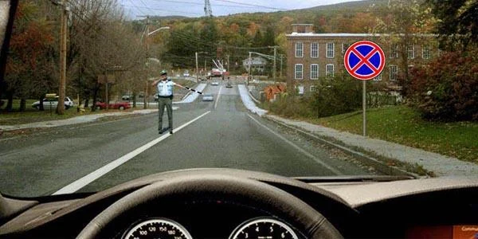

*افسر به شما دستور می‌دهد اینجا توقف کنید. باید توقف کنید، با اینکه تابلوی 3.27 «توقف ممنوع» نصب شده است.*

در پرسش‌های تمرینی گاهی به او مأمور تنظیم ترافیک هم گفته می‌شود. منظور همان شخص است.

## کدام علامت‌ها را باید بشناسم؟

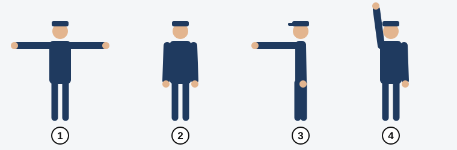

*1: بازوها گشوده به طرفین. 2: بازوها پایین. 3: بازوی راست رو به جلو. 4: بازوی بالا برده‌شده. وضعیت‌های 1 و 2 دقیقاً یک معنا دارند.*

برای هر علامت ببینید کدام بخش بدن افسر رو به شماست: سینه، پشت، سمت چپ یا سمت راست او. در جدول‌های زیر «غیرریلی» یعنی همه وسایل نقلیه به جز تراموا.

## بازوها گشوده یا پایین

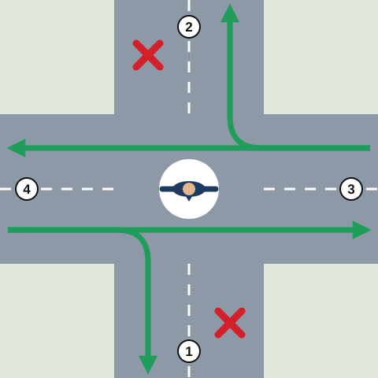

*نمای از بالا. 1: سینه او. 2: پشت او. 3: سمت چپ او. 4: سمت راست او. پیکان‌های سبز حرکت مجاز را نشان می‌دهند و ضربدرهای قرمز جایی را که هیچ‌کس نباید حرکت کند.*

| از این سمت او می‌آیید | وسایل نقلیه غیرریلی | تراموا |
|---|---|---|
| سمت چپ یا راست | مستقیم و راست | مستقیم |
| سینه یا پشت | بدون حرکت | بدون حرکت |

افسر را دیواری تصور کنید که در امتداد بازوهایش کشیده شده است. می‌توانید به موازات دیوار برانید، اما نه از میان آن. فرقی هم ندارد بازوهایش گشوده باشد یا پایین: دیوار همان جاست.

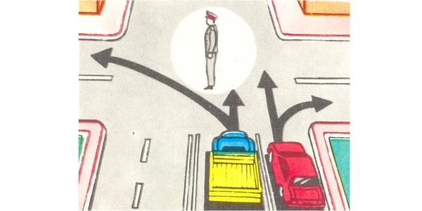

*شما از پهلوی او نزدیک می‌شوید. خودروی قرمز می‌تواند مستقیم یا به راست برود. کامیون می‌تواند مستقیم برود، اما به چپ نه.*

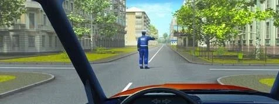

*پشت او رو به شماست، پس در هیچ جهتی نمی‌توانید حرکت کنید.*

> **دام رایج:** نمی‌توانید برای گردش به چپ وارد تقاطع شوید و آنجا منتظر بمانید، یا پس از راه دادن به ترافیک روبه‌رو به چپ بپیچید. کنار «خط ایست» توقف کنید و منتظر علامتی بمانید که آن را مجاز کند (بند 18).

## بازوی راست رو به جلو

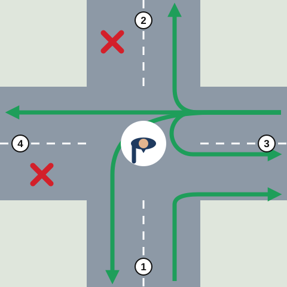

*همان شماره‌ها: 1 سینه او، 2 پشت او، 3 سمت چپ او، 4 سمت راست او.*

| از این سمت او می‌آیید | وسایل نقلیه غیرریلی | تراموا |
|---|---|---|
| سمت چپ | همه جهت‌ها: مستقیم، راست، چپ، دور زدن | فقط چپ |
| سینه | فقط راست | فقط راست |
| سمت راست یا پشت | بدون حرکت | بدون حرکت |

در ذهن خود دور او بچرخید. سمت چپ او سمت باز است، پس آنجا همه چیز مجاز است. روبه‌روی سینه‌اش فقط می‌توانید به راست بروید. پشت سر او یا سمت راستش منتظر می‌مانید.

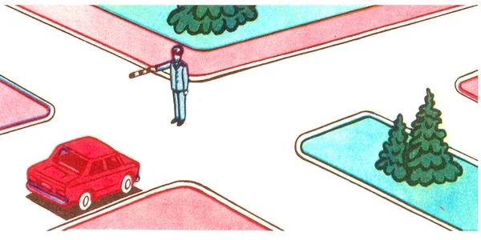

*خودروی قرمز روبه‌روی سینه اوست، پس فقط می‌تواند از دهانه اول به راست بپیچد.*

تراموا این علامت را با دقت دنبال می‌کند. تراموای سمت چپ او فقط می‌تواند به چپ برود، پس تراموایی که ریل‌هایش مستقیم است باید منتظر بماند، در حالی که خودروهای کنارش حرکت می‌کنند.

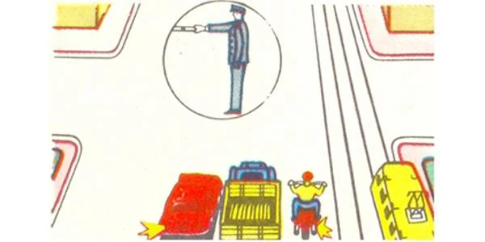

*خودرو، کامیون و موتورسیکلت همگی می‌توانند حرکت کنند. تراموا نمی‌تواند.*

> **دام رایج:** حق تقدم معمول تراموا به تراموایی که افسر متوقفش کرده کمکی نمی‌کند. اگر از سمت سینه او به راست بپیچید و تراموا از سمت پشت او بیاید، شما اول می‌روید.

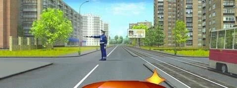

*گردش به راست شما مجاز است. علامت افسر تراموا را متوقف کرده است.*

## هنگام پیچیدن مراقب چه کسانی باشم؟

وقتی از سمت مجاز می‌پیچید، باز هم نباید مانع عابران پیاده‌ای شوید که از راهی که وارد آن می‌شوید عبور می‌کنند (بند 87). وقتی بازوی راست رو به جلوست، عابران می‌توانند از پشت افسر عبور کنند.

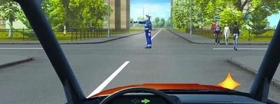

*شما از سمت چپ او می‌آیید، پس گردش به راست مجاز است، اما فقط بدون ایجاد مانع برای عابر.*

گردش به راست از سمت سینه او مسیر خودرویی را که از سمت چپ او می‌آید قطع نمی‌کند. به آن خودرو بدهکار نیستید و اول می‌روید.

## اگر بازویش را بالا ببرد چه؟

مانند چراغ زرد عمل می‌کند. در محل‌هایی که بند 18 تعیین کرده توقف کنید: اول خط ایست، سپس لبه سواره‌روی متقاطع. اگر نتوانید بدون ترمز شدید توقف کنید، می‌توانید به راه خود ادامه بدهید (بند 19).

## سوت او چه معنایی دارد؟

توجه شما را به او جلب می‌کند و نه بیشتر (بند 17). دستور توقف نیست. دستورها را بازوهای او می‌دهند.

مطلب تکمیلی: اگر علامت را نفهمیدید چه کنید

*این مطلب از بانک سؤالات نیامده است.*

اگر مطمئن نیستید افسر چه می‌خواهد، زودتر سرعت را کم کنید و تا مطمئن نشده‌اید وارد تقاطع نشوید. سعی کنید با او تماس چشمی برقرار کنید. مکث کردن از حدس زدن امن‌تر است و او می‌تواند علامت را تکرار کند یا به شما اشاره کند.

## خودتان امتحان کنید

**پنج خودرو، یک افسر.** بازوهای او گشوده است. خودروی سبز روبه‌روی پشت او و خودروی سفید روبه‌روی سینه اوست. خودروی آبی در پهلوی اوست و راهنمای چپ زده است. خودروهای قرمز و زرد در پهلوهای او هستند و مستقیم یا به راست می‌روند.

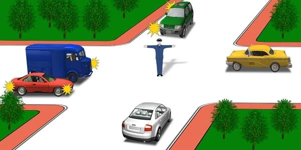

چه کسانی نباید حرکت کنند؟ **خودروهای آبی، سبز و سفید.** پشت و سینه بسته است و پهلوها فقط مستقیم و راست را مجاز می‌کنند، پس خودروی آبی نمی‌تواند به چپ بپیچد.

**بازوی راست افسر رو به جلوست.** یک موتورسیکلت روبه‌روی سینه او، یک خودرو سمت چپ او، یک کامیون سمت راست او و یک اتوبوس پشت سر اوست.

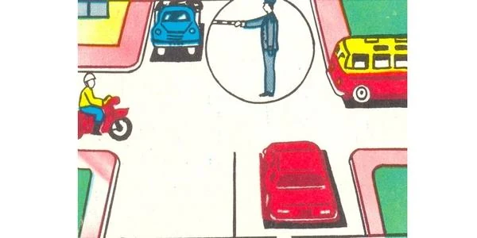

چه کسی می‌تواند مستقیم برود؟ **فقط خودرو.** موتورسیکلت فقط می‌تواند به راست بپیچد و کامیون و اتوبوس باید منتظر بمانند.

**چراغ قرمز و افسر با هم.** بازوی راست او رو به جلوست و هر دو وسیله نقلیه از سمت چپ او می‌آیند. اتوبوس زرد به چپ و خودروی آبی به راست می‌پیچد.

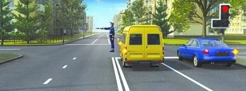

چه کسی می‌تواند ادامه بدهد؟ **هر دو راننده.** افسر بر چراغ برتری دارد (بند 20) و سمت چپ او به همه جهت‌ها باز است.

## نکات کلیدی

- علامت‌های افسر بر چراغ، تابلو و خط‌کشی برتری دارند (بند 20).
- بازوهای گشوده و پایین یک معنا دارند: پهلوها مستقیم یا راست، تراموا مستقیم، سینه و پشت توقف.
- بازوی راست رو به جلو: سمت چپ همه جهت‌ها، سینه فقط راست، سمت راست و پشت توقف.
- وقتی بازوی راست رو به جلوست، تراموا از سمت چپ او فقط به چپ می‌رود.
- از سمت سینه او، «راست» فقط یعنی دهانه اول. هنگام پیچیدن مانع عابران نشوید.
- بازوی بالا برده‌شده مانند زرد است. فقط اگر نتوانید بدون ترمز شدید توقف کنید می‌توانید ادامه بدهید.
- سوت فقط توجه را جلب می‌کند.

{{practice}}
