# تابلوهای هشداردهنده

تابلوی هشداردهنده پیش از آنکه چیزی را ببینید از آن خبر می‌دهد تا برای کم کردن سرعت وقت داشته باشید. آزمون سه چیز را می‌سنجد: هر تصویر چه معنایی دارد، تابلو چقدر جلوتر نصب شده و چه کاری را انجام نمی‌دهد.

## تابلوی هشداردهنده را چگونه بشناسم؟

دنبال **مثلثی با حاشیه قرمز که رأسش رو به بالاست** بگردید. شکل تابلو تکلیف را روشن می‌کند: تابلویی که از چیزی در جلو هشدار می‌دهد، مثلث است.

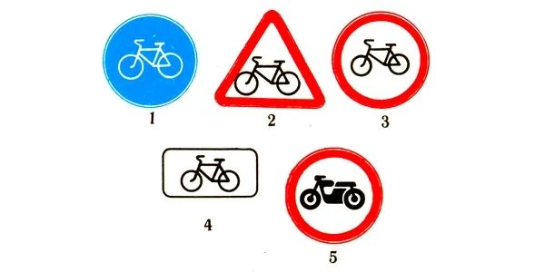

*فقط شماره 2، یعنی مثلث، هشدار می‌دهد: این تابلوی 1.24 «تقاطع با مسیر دوچرخه» است. دایره آبی دستور می‌دهد، حلقه‌های قرمز ممنوع می‌کنند و تابلوی کوچک فقط اطلاعاتی به تابلوی دیگر اضافه می‌کند.*

> **به یاد داشته باشید:** تابلوی هشداردهنده فقط هشدار می‌دهد. نه وظیفه راه دادن ایجاد می‌کند و نه چیزی را ممنوع می‌کند. تابلوی 1.5 نمی‌گوید به تراموا راه بدهید و تابلوی 1.24 نمی‌گوید به دوچرخه‌سوار راه بدهید. نوبت عبور را قواعد حق تقدم تعیین می‌کنند.

## تابلو چقدر جلوتر از خطر نصب می‌شود؟

تابلوهای 1.1، 1.2 و 1.5 تا 1.33 پیش از آغاز قطعه خطرناک نصب می‌شوند. فاصله فقط به این بستگی دارد که کجا هستید:

| محل | فاصله تابلو تا خطر |
|---|---|
| در محدوده شهری | 50 تا 100 متر |
| خارج از محدوده شهری | 150 تا 300 متر |

پس در محدوده شهری خطر دست‌کم 50 متر بعد از تابلو و خارج از آن دست‌کم 150 متر بعد از تابلو شروع می‌شود. اگر فاصله دیگری لازم باشد، روی تابلوی تکمیلی 8.1.1 «فاصله تا محل» نوشته می‌شود.

> **دام رایج:** خطر از خود تابلو شروع نمی‌شود. این فاصله برای آن است که وقت کم کردن سرعت داشته باشید. 300 تا 500 متر، 25 تا 50 متر و 100 تا 150 متر فاصله‌هایی نیستند که مقررات برای این تابلوها به کار ببرد.

## گذرگاه‌های راه‌آهن

| تابلو | شماره | نام | معنا |
|---|---|---|---|
| 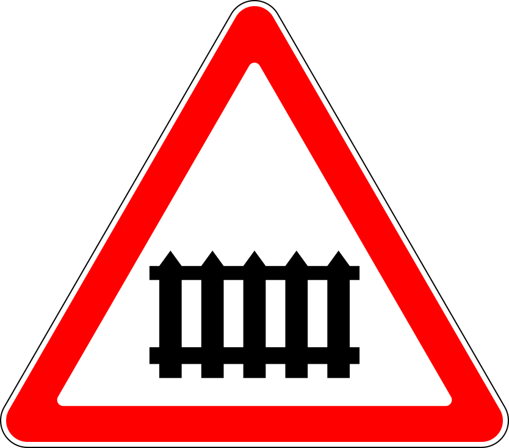 | 1.1 | گذرگاه راه‌آهن دارای راه‌بند | گذرگاه جلو راه‌بند دارد |
| 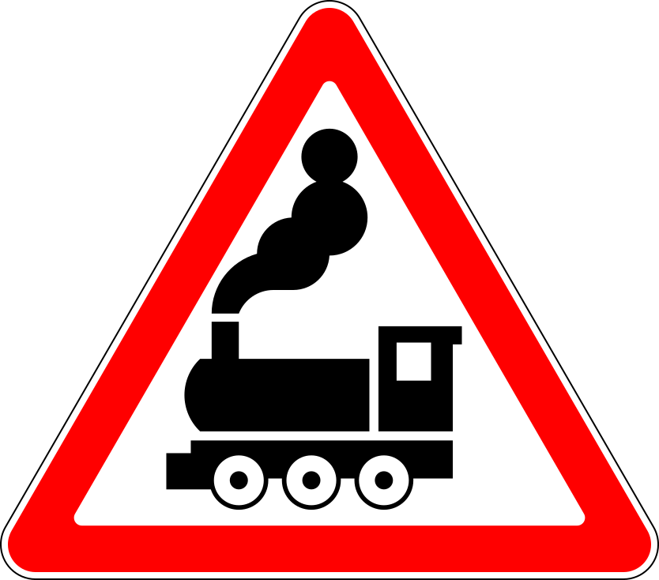 | 1.2 | گذرگاه راه‌آهن بدون راه‌بند | گذرگاه جلو راه‌بند ندارد |
| 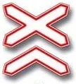 | 1.3.2 | راه‌آهن چندخطه | گذرگاهی با دو خط آهن یا بیشتر را مشخص می‌کند |

روی 1.1 راه‌بند را تصور کنید و روی 1.2 قطاری را که باید مراقبش باشید. هیچ‌کدام تعداد خطوط آهن را نمی‌گویند. این را فقط تخته‌های ضربدری می‌گویند: یک ضربدر تنها تابلوی 1.3.1 «راه‌آهن یک‌خطه» است و ضربدر با نوار هشتی‌شکل زیرش تابلوی 1.3.2.

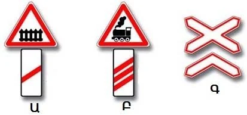

*تیرک‌های راه‌راه زیر تابلوهای 1.1 و 1.2 از گروه 1.4 «نزدیک شدن به گذرگاه راه‌آهن» هستند. فقط Գ (C) از وجود دو خط آهن یا بیشتر خبر می‌دهد.*

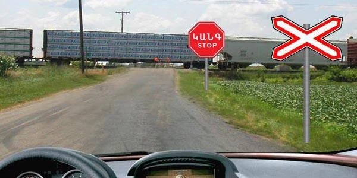

*ضربدر تنها در سمت راست تابلوی 1.3.1 است و خود گذرگاه را مشخص می‌کند.*

## تقاطع‌ها و افراد روی راه

| تابلو | شماره | نام | معنا |
|---|---|---|---|
| 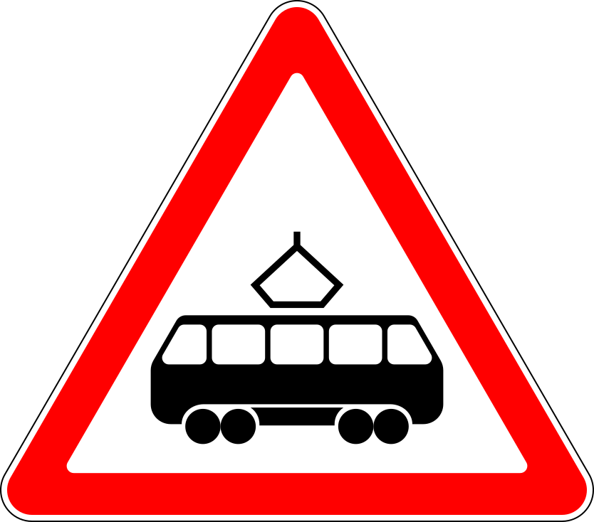 | 1.5 | تقاطع با خط تراموا | راه از ریل تراموا می‌گذرد |
|  | 1.6 | تقاطع راه‌های هم‌ارزش | تقاطعی با بازوهای هم‌ضخامت: هیچ‌کدام از دو راه اصلی نیست |
| 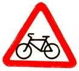 | 1.24 | تقاطع با مسیر دوچرخه | راه از مسیر دوچرخه می‌گذرد |
| 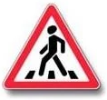 | 1.22 | گذرگاه عابر پیاده | گذرگاهی که با تابلوهای 5.19.1 و 5.19.2 یا خط‌کشی مشخص شده است |
| 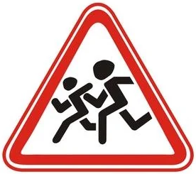 | 1.23 | کودکان | درباره حضور کودکان روی راه هشدار می‌دهد |
| 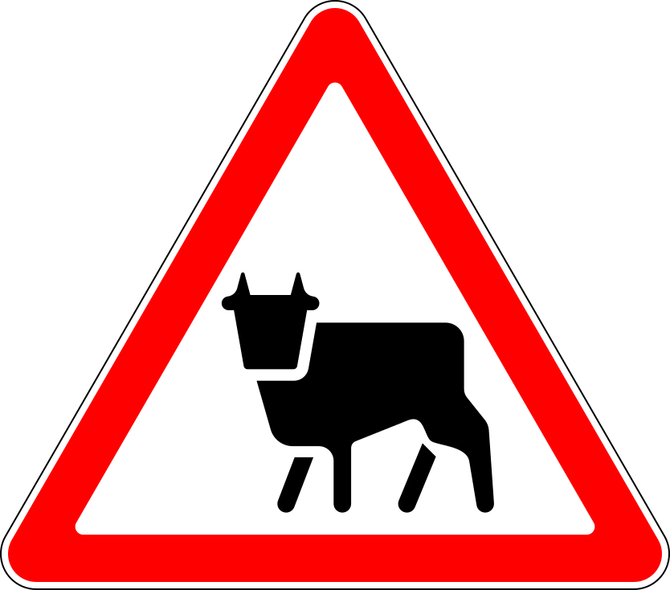 | 1.26 | عبور دام | درباره عبور دادن دام از راه هشدار می‌دهد |

دو تابلوی دیگر هم در آزمون می‌آیند: **1.8 «کنترل با چراغ راهنمایی»**، مثلثی با سه چراغ (شماره 4 در تصویر زیر)، و **1.33 «خطرهای دیگر»**، مثلثی با علامت تعجب (شماره 5).

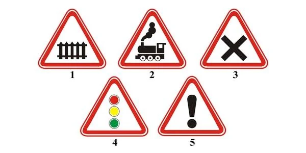

## پیچ‌ها، شیب‌ها و سطح راه

| تابلو | شماره | نام | معنا |
|---|---|---|---|
| 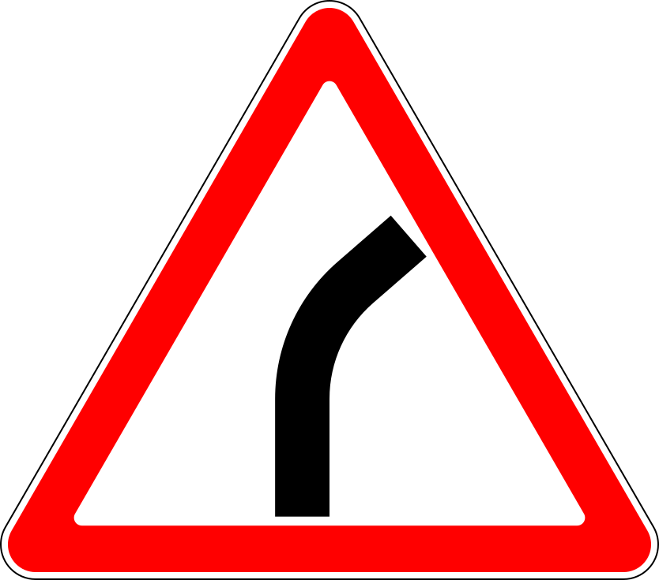 | 1.11.1 | پیچ خطرناک | پیچ به راست |
| 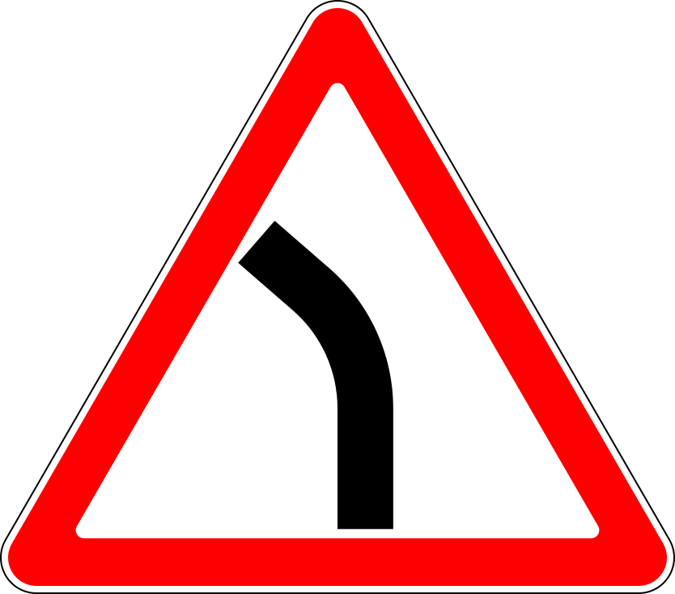 | 1.11.2 | پیچ خطرناک | پیچ به چپ |
| 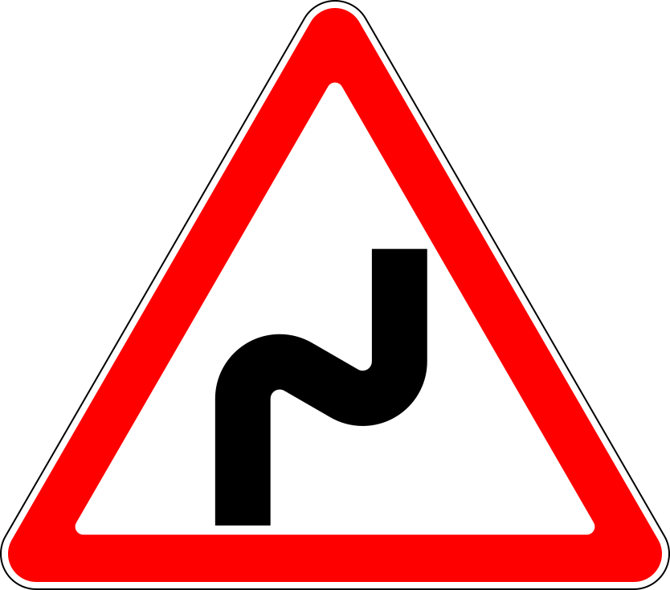 | 1.12.1 | پیچ‌های خطرناک | چند پیچ که اولی به راست است |
| 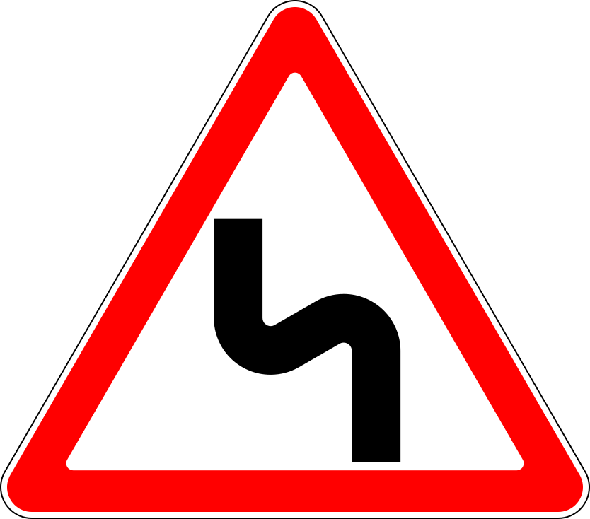 | 1.12.2 | پیچ‌های خطرناک | چند پیچ که اولی به چپ است |
| 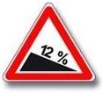 | 1.13 | سرازیری تند | راه در جلو تند پایین می‌رود |
| 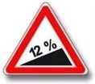 | 1.14 | سربالایی تند | راه در جلو تند بالا می‌رود |
| 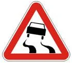 | 1.15 | راه لغزنده | سواره‌رو به‌طور غیرعادی لغزنده است |
| 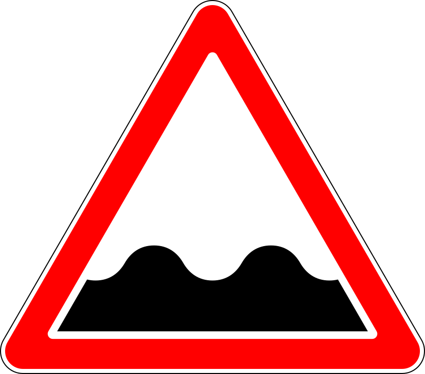 | 1.16 | راه ناهموار | سطح راه ناهموار است |
| 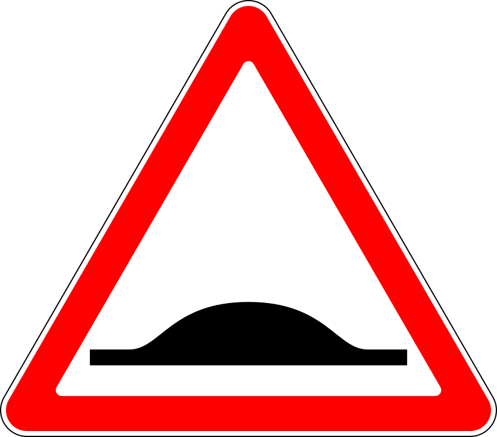 | 1.17 | سرعت‌گیر مصنوعی | هشدار پیشاپیش درباره سرعت‌گیر |
| 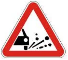 | 1.18 | پرتاب سنگ‌ریزه | ممکن است شن و سنگ‌ریزه از زیر چرخ‌ها پرتاب شود |
| 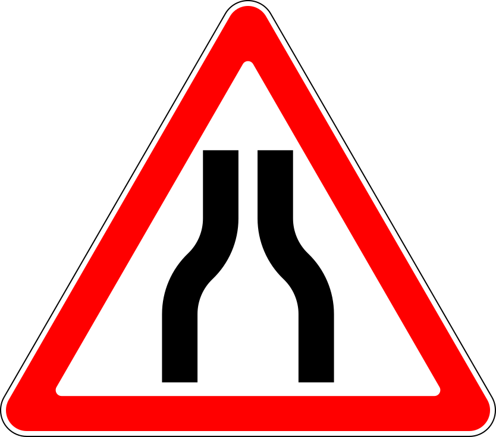 | 1.20.1 | تنگ شدن راه | راه از دو طرف تنگ می‌شود |
| 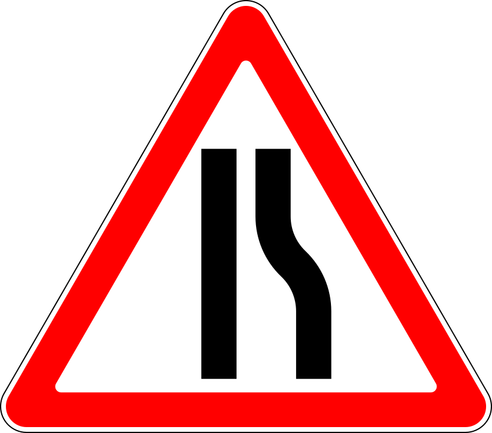 | 1.20.2 | تنگ شدن راه | راه از سمت راست تنگ می‌شود |
| 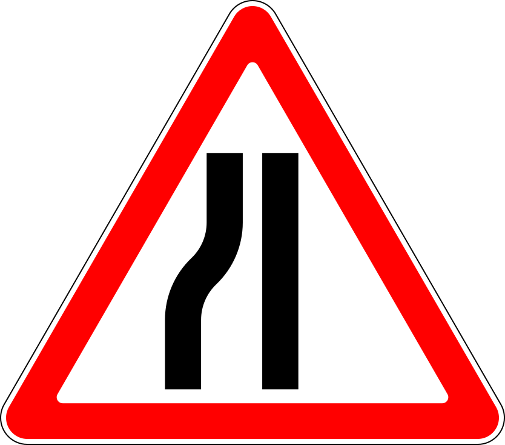 | 1.20.3 | تنگ شدن راه | راه از سمت چپ تنگ می‌شود |
| 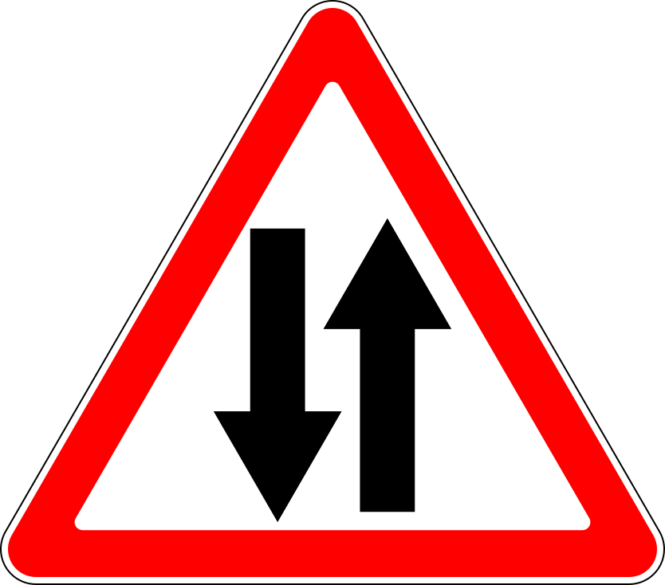 | 1.21 | حرکت دوطرفه | قطعه‌ای با حرکت روبه‌رو در جلو شروع می‌شود |

در قطعه‌ای با تابلوهای 1.13 و 1.14، اگر عبور دشوار باشد، راننده‌ای که سرازیر می‌رود باید راه بدهد، چون حرکت دوباره در سربالایی بسیار دشوارتر است (بند 46).

## خطرهای دیگر در جلو

| تابلو | شماره | نام | معنا |
|---|---|---|---|
| 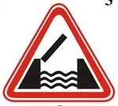 | 1.9 | پل متحرک | پل متحرک یا گذرگاه کشتی |
| 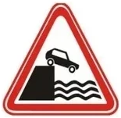 | 1.10 | خروج به اسکله | راه به اسکله یا ساحل می‌رسد |
| 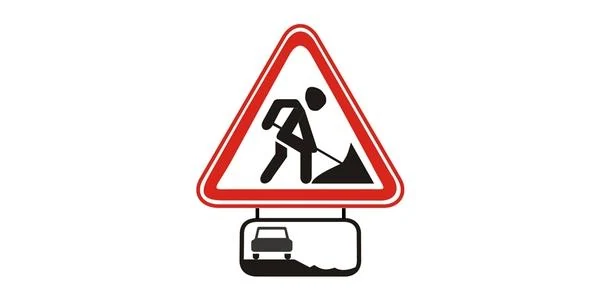 | 1.25 | عملیات راهسازی | تعمیرات در جریان است. تابلوی کوچک این تصویر 8.12 است |
| 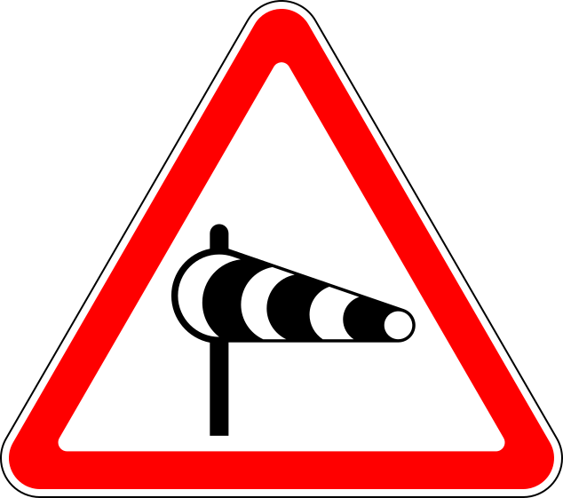 | 1.29 | باد جانبی | باد از پهلو |
| 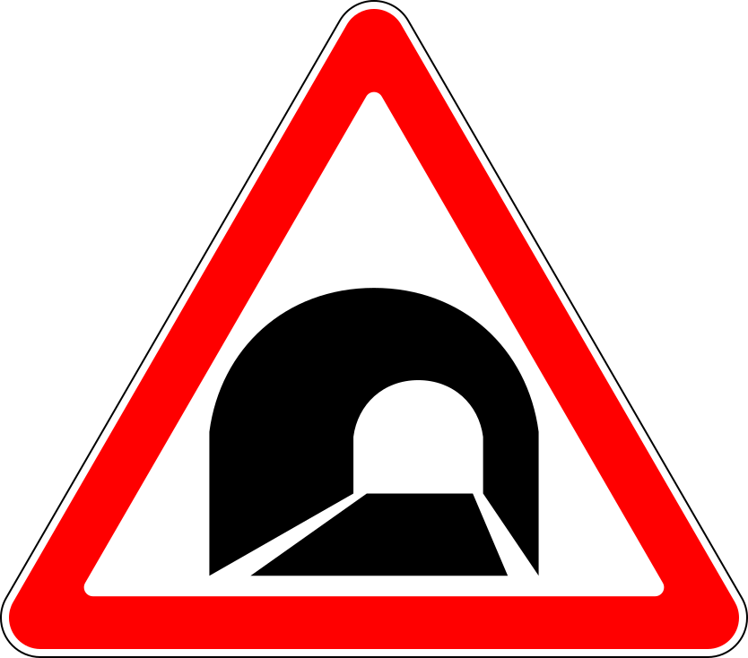 | 1.31 | تونل | تونلی بدون روشنایی مصنوعی، یا با ورودی کم‌دید |

## دو تابلو که قاعده مثلث را می‌شکنند

| تابلو | شماره | نام | معنا |
|---|---|---|---|
| 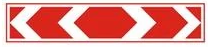 | 1.34.3 | جهت گردش | در تقاطع T شکل یا محل انشعاب، جهت‌های ممکن را نشان می‌دهد و چیزی را ممنوع نمی‌کند |
| 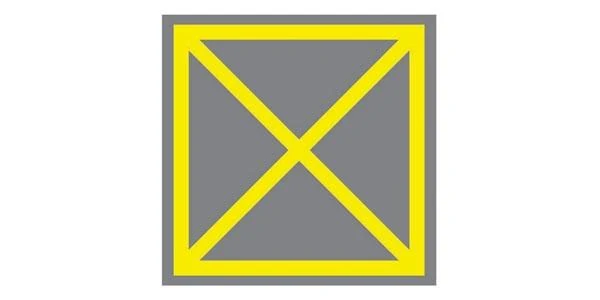 | 1.35 | محدوده تقاطع | تقاطعی را نشان می‌دهد که با شبکه زرد، یعنی خط‌کشی 1.26، مشخص شده است |

تابلوی 1.35 اصلاً شبیه تابلوی هشداردهنده نیست و یک قاعده واقعی هم با خود دارد. **اگر راه‌بندان جلو شما را ناچار می‌کند داخل تقاطع توقف کنید، وارد آن نشوید**، چون راه حرکت عرضی را می‌بندید. گردش به راست یا چپ از این قاعده مستثناست.

این شرط مهم است. راه‌بندان به‌تنهایی کافی نیست: ممنوعیت وقتی است که راه‌بندان شما را همان‌جا به توقف وادار کند.

تابلوی 1.35 در مرز تقاطع نصب می‌شود. در تقاطع پیچیده، اگر نصب آن در مرز ممکن نباشد، حداکثر 30 متر دورتر از مرز قرار می‌گیرد.

## خودتان امتحان کنید

**در راهی جنگلی، خارج از محدوده شهری هستید.**

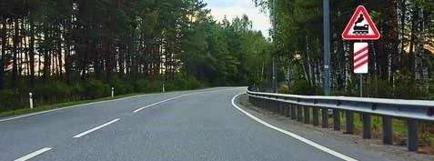

چه چیزی در جلو است؟ **گذرگاه راه‌آهن بدون راه‌بند، 150 تا 300 متر جلوتر.** لوکوموتیو یعنی راه‌بند نیست و این راه خارج از محدوده شهری است. تابلو چیزی درباره تعداد خطوط آهن نمی‌گوید.

**در محدوده شهری هستید و این تابلو را می‌بینید.**

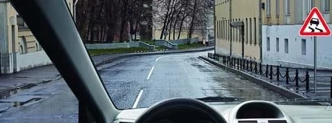

قطعه لغزنده از کجا شروع می‌شود؟ **دست‌کم 50 متر بعد از تابلو.** نه بلافاصله بعد از آن و نه دست‌کم 100 متر بعد: 50 متر کمترین فاصله در محدوده شهری است.

## نکات کلیدی

- تابلوهای هشداردهنده مثلث با حاشیه قرمز هستند. هشدار می‌دهند و خودشان وظیفه‌ای ایجاد نمی‌کنند.
- در محدوده شهری 50 تا 100 متر پیش از خطر، خارج از آن 150 تا 300 متر. هر فاصله دیگر روی تابلوی تکمیلی 8.1.1 می‌آید.
- 1.1 راه‌بند را نشان می‌دهد و 1.2 لوکوموتیو را. فقط تخته‌های ضربدری 1.3 تعداد خطوط آهن را می‌گویند.
- 1.6 ضربدر ساده با بازوهای هم‌ضخامت است: هیچ‌کدام از دو راه اصلی نیست.
- 1.31 درباره تونلی بدون روشنایی مصنوعی یا با ورودی کم‌دید هشدار می‌دهد.
- با تابلوی 1.35، اگر راه‌بندان شما را داخل تقاطع متوقف می‌کند وارد نشوید. این تابلو حداکثر 30 متر از مرز فاصله دارد.

{{practice}}
