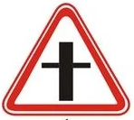
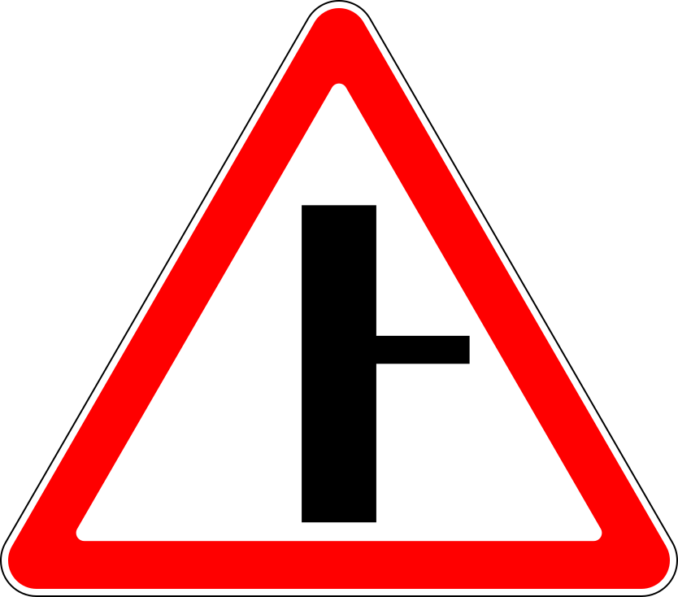
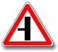
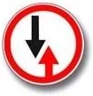
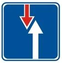
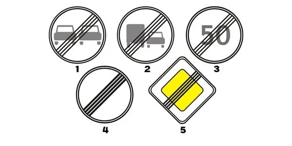
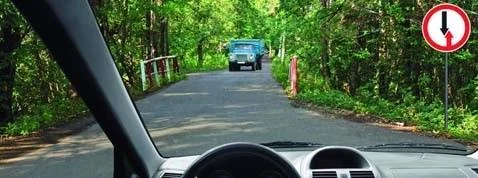
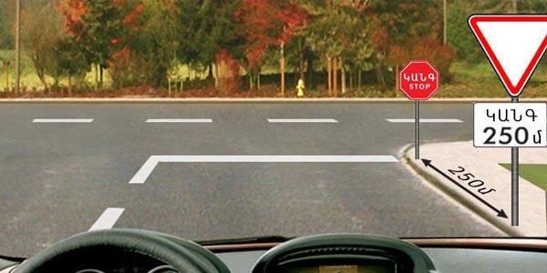
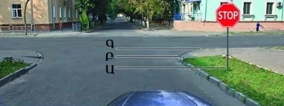
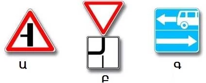

# تابلوهای حق تقدم

تابلوهای حق تقدم به یک پرسش پاسخ می‌دهند: چه کسی اول می‌رود؟ این تابلوها جایی کار می‌کنند که چیز دیگری تکلیف را روشن نکرده باشد، پس دقیق یاد بگیرید هر کدام از شما چه می‌خواهد، چون آزمون «راه دادن» را از «توقف و راه دادن» جدا می‌کند.

## تابلوهای حق تقدم چه شکلی هستند؟

این خانواده شکل واحدی ندارد، پس هر تابلو را جداگانه یاد بگیرید.

| تابلو | شماره | نام | معنا |
|---|---|---|---|
|  | 2.1 | راه اصلی | در تقاطع‌های بدون کنترل حق تقدم با شماست |
|  | 2.3.1 | تقاطع با راه فرعی | راه شما اصلی است و یک راه فرعی آن را قطع می‌کند |
|  | 2.3.2 | پیوستن راه فرعی | راه شما اصلی است و یک راه فرعی از راست به آن می‌پیوندد |
|  | 2.3.3 | پیوستن راه فرعی | راه شما اصلی است و یک راه فرعی از چپ به آن می‌پیوندد |
|  | 2.4 | حق تقدم بدهید | به وسایل نقلیه راه متقاطع راه بدهید |
|  | 2.5 | حرکت بدون توقف ممنوع | توقف کنید، سپس به وسایل نقلیه راه متقاطع راه بدهید |
|  | 2.6 | حق تقدم با عبور و مرور روبه‌رو | در قطعه باریک به وسایل نقلیه روبه‌رو راه بدهید |
|  | 2.7 | حق تقدم نسبت به حرکت روبه‌رو | در قطعه باریک شما اول می‌روید |

تابلوی 2.2 «پایان راه اصلی» همان لوزی زرد است با نوارهای سیاه روی آن، شماره 5 در این تصویر:

> **دام رایج:** در تابلوهای 2.3.1 تا 2.3.3 مثلث به این معنا نیست که باید به کسی راه بدهید. خط ضخیم راه شماست، پس حق تقدم با شماست. تابلوی 1.6 را با آن مقایسه کنید که ضربدر ساده‌اش بازوهای هم‌ضخامت دارد: آنجا هیچ‌کدام از دو راه اصلی نیست.

تابلوهای حق تقدم فقط در تقاطع‌های بدون کنترل نوبت عبور را تعیین می‌کنند. اگر چراغ راهنمایی کار می‌کند، از چراغ پیروی کنید.

## «حق تقدم بدهید» و «ایست» چه فرقی دارند؟

هر دو شما را به راه دادن وادار می‌کنند. فقط یکی شما را به توقف وادار می‌کند.

- **تابلوی 2.4 «حق تقدم بدهید»:** به وسایل نقلیه راه متقاطع راه بدهید. اگر کسی نمی‌آید، به راه خود ادامه می‌دهید.
- **تابلوی 2.5 «حرکت بدون توقف ممنوع»:** در هر حال توقف کنید، چه کسی بیاید و چه نیاید. بعد راه بدهید و با تشخیص خودتان حرکت کنید.

با تابلوی 2.4 باید به همه وسایل نقلیه راه بدهید، نه فقط وسایل نقلیه موتوری. دوچرخه، موتورگازی و گاری اسبی هم حساب می‌شوند.

اگر تابلوی 2.4 همراه با تابلوی تکمیلی 8.13 «جهت راه اصلی» باشد، باید به هر کسی که در راه اصلی است راه بدهید، از هر جهتی که بیاید، حتی اگر از چپ شما بیاید.

> **به یاد داشته باشید:** با تابلوی 2.5 **پشت خط ایست** توقف کنید. اگر خطی نیست، **در لبه سواره‌روی متقاطع** توقف کنید، جایی که واقعاً حرکت عرضی را می‌بینید. در تقاطع، خود تابلو محل توقف نیست. فقط پیش از گذرگاه راه‌آهنی که خط ندارد راننده کنار تابلو توقف می‌کند.

پس می‌توانید از کنار تابلو بگذرید و تا خط جلو بروید.

## در قطعه باریک چه کسی اول می‌رود؟

تابلوهای 2.6 و 2.7 جفتی کار می‌کنند: 2.7 رو به یک راننده است و 2.6 رو به راننده‌ای که از سمت مقابل می‌آید.

*تابلوی 2.6: اگر ورود شما مانع حرکت روبه‌رو می‌شود وارد قطعه باریک نشوید، و به وسایل نقلیه‌ای که در آن هستند یا به آن نزدیک می‌شوند راه بدهید.*

این نکته را به خاطر بسپارید: **پیکان قرمز همان راننده‌ای است که راه می‌دهد.** در 2.6 پیکان قرمز رو به بالا و در جهت شماست، پس شما راه می‌دهید. در 2.7 رو به پایین و به سمت راننده روبه‌روست، پس شما اول می‌روید.

> **دام رایج:** تابلوی 2.6 شبیه تابلوی ممنوعیت است، اما عبور را ممنوع نمی‌کند و فقط نوبت را تعیین می‌کند. تابلوی 2.7 شبیه تابلوی اطلاعاتی است، اما به شما حق تقدم می‌دهد. این حق تقدم فقط نسبت به حرکت روبه‌رو در قطعه باریک است، نه نسبت به وسایل نقلیه راه متقاطع.

## خودتان امتحان کنید

**تابلوی «حق تقدم بدهید» در سمت راست است، همراه با تابلوی کوچکی که ایست و 250 متر را نشان می‌دهد.**

کجا باید توقف کنید؟ **پشت خط ایست.** تابلوی اول و تابلوی کوچک زیرش فقط خبر می‌دهند که تابلوی 2.5 در 250 متر جلوتر است. کنار هیچ‌کدام از تابلوها توقف نکنید.

**تابلوی ایست در سمت راست است و خط ایستی کشیده نشده.**

کجا توقف می‌کنید؟ **در لبه سواره‌روی متقاطع، یعنی موقعیت Գ (C).** وقتی خطی نیست، تابلو این نقطه را تعیین می‌کند.

**باید به رانندگانی که از چپ می‌آیند راه بدهید. کدام تابلو این را می‌گوید؟**

**فقط Բ (B).** تابلوی 2.4 با تابلوی تکمیلی 8.13 شما را در راه فرعی قرار می‌دهد. با Ա (A) شما در راه اصلی هستید.

## نکات کلیدی

- تابلوی 2.1 و گروه 2.3 شما را در راه اصلی قرار می‌دهند. خط ضخیم مال شماست.
- 2.4: به همه وسایل نقلیه راه متقاطع راه بدهید. اگر راه باز است توقف لازم نیست.
- 2.5: همیشه توقف کنید، پشت خط ایست یا در لبه سواره‌روی متقاطع. سپس راه بدهید.
- با تابلوی تکمیلی 8.13، از هر جهتی به راه اصلی راه بدهید.
- 2.6: شما در قطعه باریک راه می‌دهید. 2.7: شما اول می‌روید. پیکان قرمز راه می‌دهد.
- تابلوهای حق تقدم فقط در تقاطع‌های بدون کنترل نوبت را تعیین می‌کنند.

{{practice}}
