# تابلوهای ممنوعیت

تابلوی ممنوعیت محدودیتی را برقرار یا برطرف می‌کند: ممنوعیت ورود، سرعت، وزن یا یک مانور. برای پاسخ دادن در آزمون باید درباره هر تابلو سه چیز بدانید: چه چیزی را ممنوع می‌کند، چه کسانی را شامل می‌شود و کجا تمام می‌شود.

## این تابلوها چه شکلی هستند؟

سه ظاهر همه این خانواده را پوشش می‌دهد:

- **حلقه قرمز:** چیزی ممنوع است. تصویر یا عدد داخل آن می‌گوید چه چیزی.
- **حلقه قرمز روی زمینه آبی:** ممنوعیت توقف یا پارک.
- **دایره سفید با نوارهای مورب سیاه:** پایان یک محدودیت.

هر تابلوی با حاشیه قرمز به این خانواده تعلق ندارد. مثلث وارونه 2.4 «حق تقدم بدهید» و حلقه قرمز 2.6 تابلوی حق تقدم هستند.

## تابلوهایی که راه را می‌بندند

| تابلو | شماره | نام | معنا |
|---|---|---|---|
| 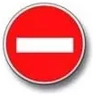 | 3.1 | ورود ممنوع | ورود از این جهت ممنوع است و برای ساکنان استثنایی ندارد |
| 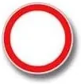 | 3.2 | عبور ممنوع | هیچ وسیله نقلیه‌ای حق عبور ندارد. کسانی که در آن محدوده زندگی یا کار می‌کنند می‌توانند وارد شوند |
| 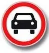 | 3.3 | حرکت وسایل نقلیه موتوری ممنوع | همه وسایل نقلیه موتوری را ممنوع می‌کند، نه فقط خودروها را |
| 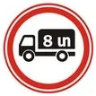 | 3.4 | عبور کامیون ممنوع | بدون عدد: کامیون بیش از 3.5 تن ممنوع است. با عدد: کامیون بیشتر از آن وزن |
| 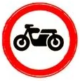 | 3.5 | حرکت موتورسیکلت‌ها ممنوع | موتورسیکلت را ممنوع می‌کند |
| 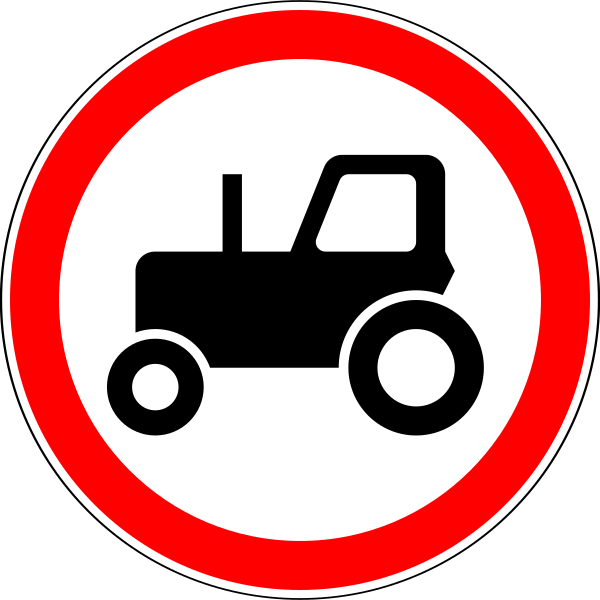 | 3.6 | حرکت تراکتورها ممنوع | تراکتور و ماشین‌های خودگرد را ممنوع می‌کند |
| 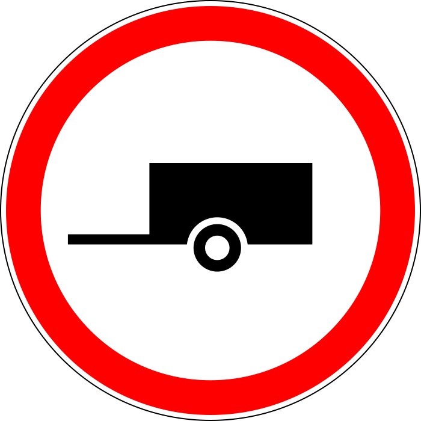 | 3.7 | حرکت با یدک ممنوع | کامیون و تراکتور با هر نوع یدک و نیز یدک‌کشی وسیله نقلیه موتوری را ممنوع می‌کند |
| 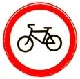 | 3.9 | حرکت با دوچرخه ممنوع | دوچرخه را ممنوع می‌کند |
| 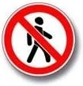 | 3.10 | تردد عابران پیاده ممنوع | تردد عابران را در طرفی که نصب شده ممنوع می‌کند |

> **دام رایج:** تصویر خودرو روی تابلوی 3.3 نماینده همه وسایل نقلیه موتوری است. خودرو، موتورسیکلت و موتورسیکلت با سبد جانبی همگی آن را نقض می‌کنند. تابلوی 3.7 هم شامل خودروی سواری با یدک نمی‌شود، چون خودروی سواری نه کامیون است و نه تراکتور.

**چه کسانی معاف هستند؟** ممنوعیت تابلوهای 3.1 تا 3.3، 3.18.1، 3.18.2 و 3.19 شامل وسایل نقلیه عمومی نمی‌شود. تابلوی 3.2 همچنین وسایل نقلیه‌ای را معاف می‌کند که به اماکن داخل محدوده خدمات می‌دهند یا متعلق به کسانی هستند که در آنجا زندگی یا کار می‌کنند. اینها از نزدیک‌ترین تقاطع به مقصدشان وارد و خارج می‌شوند. تابلوهای 3.1 و 3.3 چنین استثنایی برای ساکنان ندارند.

## تابلوهایی که حد تعیین می‌کنند

| تابلو | شماره | نام | معنا |
|---|---|---|---|
| 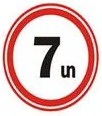 | 3.11 | محدودیت وزن | وسیله نقلیه یا قطار جاده‌ای با وزن کل بیشتر از عدد روی تابلو ممنوع است |
| 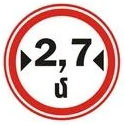 | 3.14 | محدودیت عرض | عرض کلی وسیله نقلیه را محدود می‌کند |
| 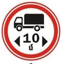 | 3.15 | محدودیت طول | طول کلی وسیله نقلیه را محدود می‌کند |
| 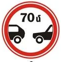 | 3.16 | محدودیت حداقل فاصله | به وسیله نقلیه جلویی نزدیک‌تر از عدد روی تابلو حرکت نکنید |
| 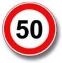 | 3.24 | محدودیت حداکثر سرعت | تندتر از عدد روی تابلو نروید |
| 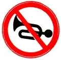 | 3.26 | استفاده از علامت صوتی ممنوع | از بوق استفاده نکنید، مگر برای جلوگیری از تصادف |

تابلوی 3.11 کل قطار جاده‌ای را حساب می‌کند. کامیون 5 تنی با یدک 4 تنی 9 تن وزن دارد، پس نمی‌تواند از کنار تابلوی 5 تن بگذرد.

## تابلوهایی که تا گرفتن اجازه شما را نگه می‌دارند

| تابلو | شماره | نام | معنا |
|---|---|---|---|
| 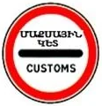 | 3.17.1 | ایست بازرسی گمرک | از کنار ایست بازرسی بدون توقف نگذرید |
| 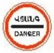 | 3.17.2 | خطر | به دلیل تصادف، آتش‌سوزی، خرابی یا خطر دیگر، هیچ وسیله نقلیه‌ای حق ادامه دادن ندارد |

پس از تابلوی 3.17.2 فقط با گرفتن اجازه می‌توانید دوباره حرکت کنید. تنها پلیس، آمبولانس، خدمات امداد و کسانی که برای رفع خطر کار می‌کنند مستثنا هستند. این درست برعکس تابلوی 2.5 است که خودتان زمان حرکت را تشخیص می‌دهید.

## گردش و سبقت

| تابلو | شماره | نام | معنا |
|---|---|---|---|
| 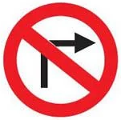 | 3.18.1 | گردش به راست ممنوع | گردش به راست در این تقاطع ممنوع است |
| 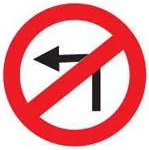 | 3.18.2 | گردش به چپ ممنوع | گردش به چپ در این تقاطع ممنوع است |
| 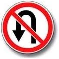 | 3.19 | دور زدن ممنوع | فقط دور زدن را ممنوع می‌کند |
|  | 3.20 | سبقت ممنوع | سبقت را ممنوع می‌کند |
|  | 3.22 | سبقت گرفتن کامیون‌ها ممنوع | سبقت کامیون‌های بیش از 3.5 تن را ممنوع می‌کند |

تابلوهای 3.18.1 و 3.18.2 درست پیش از همان محل تقاطع سواره‌روها نصب می‌شوند که بر آن اثر دارند. هر تابلو همان جایی اثر می‌کند که نصب شده است: اگر 3.18.1 فقط کنار خروجی دوم سمت راست باشد، خروجی اول باز می‌ماند.

> **دام رایج:** ممنوعیت گردش به معنای ممنوعیت دور زدن نیست. با تابلوهای 3.18.1 و 3.18.2 هنوز می‌توانید دور بزنید. فقط 3.19 این کار را ممنوع می‌کند، و 3.19 هم مستقیم، چپ و راست را باز می‌گذارد.

تابلوی 3.20 همه انواع وسایل نقلیه را در بر می‌گیرد و استثناهای متعارف آن از وسایل نقلیه کندرو، گاری‌های اسبی، موتورسیکلت‌های دوچرخ بدون سبد جانبی، موتورگازی‌ها و دوچرخه‌ها نام می‌برد. تابلوی 3.22 موتورسیکلت، خودروی سواری، اتوبوس و کامیون تا 3.5 تن را در سبقت گرفتن آزاد می‌گذارد.

## توقف و پارک

| تابلو | شماره | نام | معنا |
|---|---|---|---|
|  | 3.27 | توقف ممنوع | توقف و پارک را ممنوع می‌کند |
|  | 3.28 | پارک ممنوع | فقط پارک را ممنوع می‌کند |
|  | 3.29 | پارک در روزهای فرد ماه ممنوع | یک خط: روزهای فرد |
|  | 3.30 | پارک در روزهای زوج ماه ممنوع | دو خط: روزهای زوج |

با تابلوی 3.28 هنوز می‌توانید کوتاه توقف کنید، مثلاً برای سوار کردن مسافر. خط‌های 3.29 و 3.30 را بشمارید: یک خط فرد است و دو خط زوج.

> **به یاد داشته باشید:** تابلوهای 3.10 و 3.27 تا 3.30 فقط در همان طرف راه اثر دارند که نصب شده‌اند.

## ممنوعیت کجا تمام می‌شود؟

اثر تابلوهای 3.16، 3.20، 3.22، 3.24 و 3.26 تا 3.30 از محل تابلو تا **نزدیک‌ترین تقاطع بعد از آن** ادامه دارد. در محدوده شهری بدون تقاطع، تا پایان محدوده شهری ادامه دارد.

محل‌های دور زدن، بریدگی‌های نوار جداکننده و خروجی‌های محوطه‌های مجاور اثر تابلو را تمام نمی‌کنند. تقاطع یا تابلوی پایان این کار را می‌کند.

| تابلو | شماره | نام | معنا |
|---|---|---|---|
| 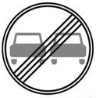 | 3.21 | پایان محدوده ممنوعیت سبقت | به تابلوی 3.20 پایان می‌دهد |
| 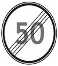 | 3.25 | پایان محدوده محدودیت حداکثر سرعت | به محدودیتی با همان عدد پایان می‌دهد |
| 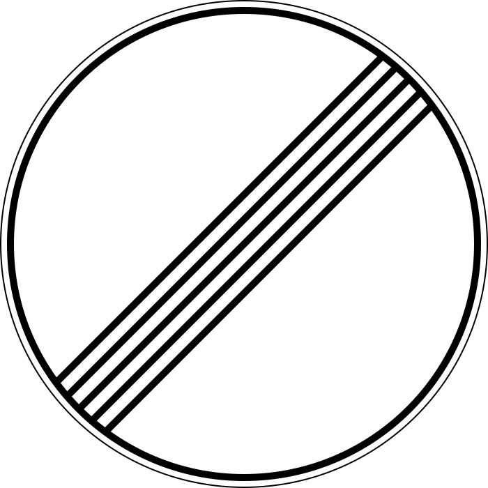 | 3.31 | پایان محدوده همه محدودیت‌ها | به 3.16، 3.20، 3.22، 3.24 و 3.26 تا 3.30 یکجا پایان می‌دهد |

تابلوی 3.23 به ممنوعیت سبقت کامیون‌ها پایان می‌دهد. این تابلو شماره 2 در تصویر زیر است و 3.21، 3.25 و 3.31 شماره‌های 1، 3 و 4 هستند:

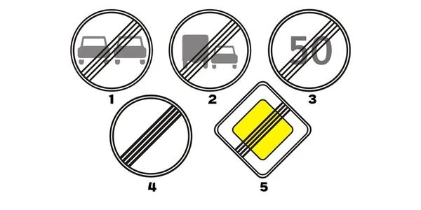

تابلوی ساده 3.24 یا 3.28 با تابلوی سفید «منطقه» که همان تصویر را دارد فرق می‌کند. تابلوی منطقه کل یک محدوده را تا تابلوی پایان منطقه پوشش می‌دهد. به درس تابلوهای مقررات ویژه مراجعه کنید.

## خودتان امتحان کنید

**راننده بعد از محل دور زدن توقف کرده است.**

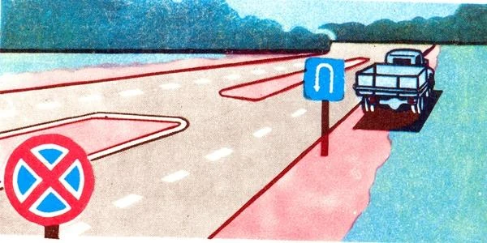

آیا تابلوی 3.27 آنجا هم اثر دارد؟ **بله.** میان تابلو و کامیون تقاطعی نیست و محل دور زدن اثر تابلو را تمام نمی‌کند.

**راننده کامیونی با حداکثر وزن مجاز دقیقاً 3.5 تن هستید.** حلقه قرمزی با تصویر کامیون و بدون عدد در راه روبه‌رو نصب شده است.

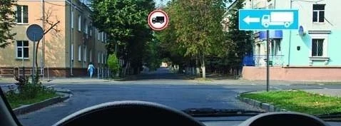

به کدام جهت می‌توانید بروید؟ **به هر جهتی.** تابلوی 3.4 بدون عدد شامل کامیون‌های بیش از 3.5 تن است و کامیون شما بیشتر از این نیست.

## نکات کلیدی

- حلقه قرمز: ممنوعیت. حلقه قرمز روی آبی: توقف یا پارک. نوار سیاه روی سفید: پایان.
- 3.3 همه وسایل نقلیه موتوری را ممنوع می‌کند. 3.7 به خودروی سواری با یدک کاری ندارد.
- وسایل نقلیه عمومی از 3.1 تا 3.3، 3.18.1، 3.18.2 و 3.19 معاف‌اند. فقط 3.2 به ساکنان و شاغلان اجازه ورود می‌دهد.
- 3.27 توقف و پارک را ممنوع می‌کند و 3.28 فقط پارک را. یک خط روزهای فرد است و دو خط روزهای زوج.
- 3.17.2: فقط با اجازه ادامه دهید.
- بیشتر ممنوعیت‌ها در نزدیک‌ترین تقاطع تمام می‌شوند. محل دور زدن یا بریدگی نوار جداکننده آنها را تمام نمی‌کند.

{{practice}}
