# تابلوهای دستوری

تابلوی دستوری فرمان می‌دهد: از این طرف برو، از این سمت عبور کن، این سرعت را حفظ کن. آزمون می‌سنجد هر فرمان تا کجا اعتبار دارد، چون یک پیکان واحد پیش از تقاطع معنایی دارد و در ابتدای یک قطعه از راه معنایی دیگر.

## این تابلوها چه شکلی هستند؟

دنبال **تابلوی گرد آبی با تصویر سفید** بگردید.

> **به یاد داشته باشید:** شکل می‌گوید تابلوی آبی را چقدر باید جدی گرفت. **دایره** آبی الزام می‌کند. **مستطیل** یا **مربع** آبی اطلاع می‌دهد یا راه را توصیف می‌کند. تابلوی 4.1.1 به شما دستور می‌دهد مستقیم بروید، اما مربع آبی 5.5 فقط می‌گوید راه یک‌طرفه است.

## به کدام جهت می‌توانم بروم؟

| تابلو | شماره | نام | معنا |
|---|---|---|---|
| 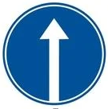 | 4.1.1 | فقط مستقیم | فقط مستقیم |
| 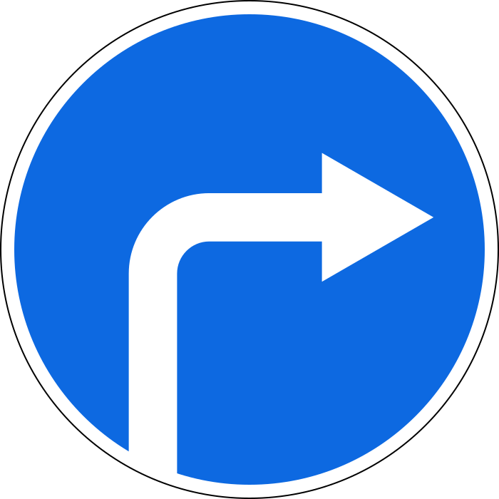 | 4.1.2 | حرکت به راست | فقط به راست. همه رانندگان باید به راست گردش کنند |
| 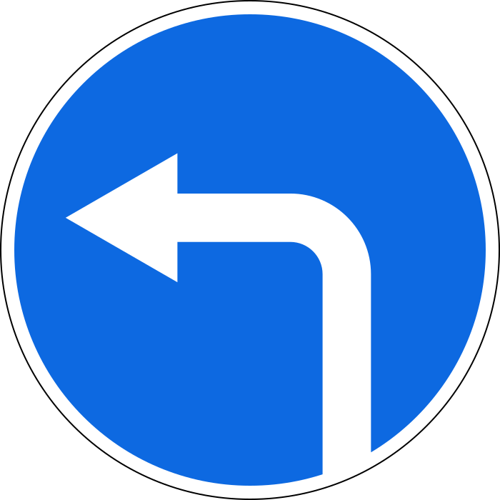 | 4.1.3 | حرکت به چپ | فقط به چپ، و دور زدن هم مجاز است |
| 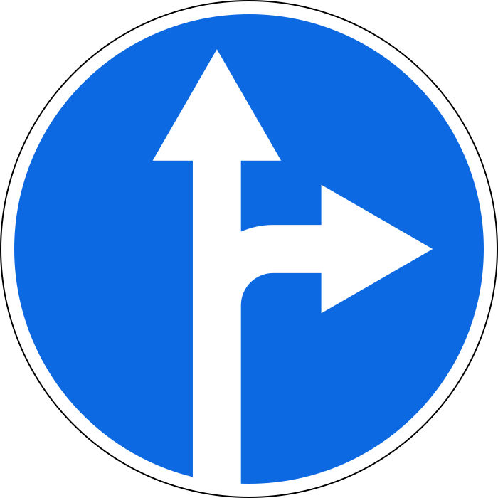 | 4.1.4 | حرکت مستقیم یا به راست | مستقیم یا راست |
| 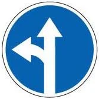 | 4.1.5 | حرکت مستقیم یا به چپ | مستقیم یا چپ، و دور زدن هم مجاز است |
| 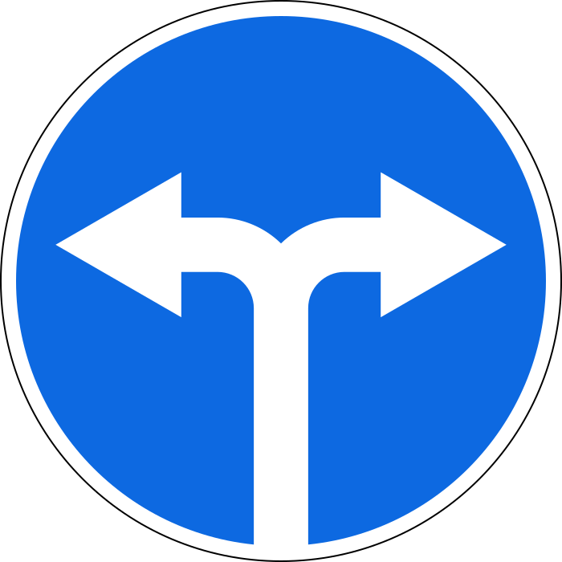 | 4.1.6 | حرکت به راست یا به چپ | راست یا چپ، و دور زدن هم مجاز است. مستقیم نه |

فقط می‌توانید به سمتی بروید که پیکان‌ها نشان می‌دهند، با یک اضافه: **تابلویی که گردش به چپ را مجاز می‌کند، دور زدن را هم مجاز می‌کند.** خط عبور درست هم لازم است. بند 40 شما را برای گردش به چپ یا دور زدن به خط عبور کناری چپ و برای گردش به راست به خط عبور کناری راست می‌فرستد، پس با تابلوی 4.1.6 از خط عبور چپ نمی‌توان به راست گردش کرد.

## فرمان تا کجا اعتبار دارد؟

به محل نصب تابلو بستگی دارد.

**پیش از تقاطع،** تابلو فقط بر همان محل تقاطع سواره‌روها اثر دارد. اگر راه متقاطع نوار جداکننده داشته باشد، با دو محل تقاطع سواره‌روها روبه‌رو می‌شوید. تابلو اولی را در بر می‌گیرد و دومی بیرون از اثر آن است.

**در ابتدای یک قطعه از راه،** تابلوی 4.1.1 تا نزدیک‌ترین تقاطع اثر دارد. تقاطع بعد از آن دوباره آزاد است. در این قطعه نمی‌توانید به چپ گردش کنید یا دور بزنید، اما تابلو مانع گردش به **راست** به‌سوی حیاط یا محوطه‌های مجاور راه نمی‌شود.

> **دام رایج:** استثنای حیاط فقط برای سمت راست است. ورود از چپ به گردش به چپ نیاز دارد که تابلوی 4.1.1 آن را ممنوع می‌کند. مربع آبی که محل دور زدن را در جلوتر نشان می‌دهد هم در اینجا به شما اجازه نمی‌دهد.

## عبور از کنار مانع

| تابلو | شماره | نام | معنا |
|---|---|---|---|
| 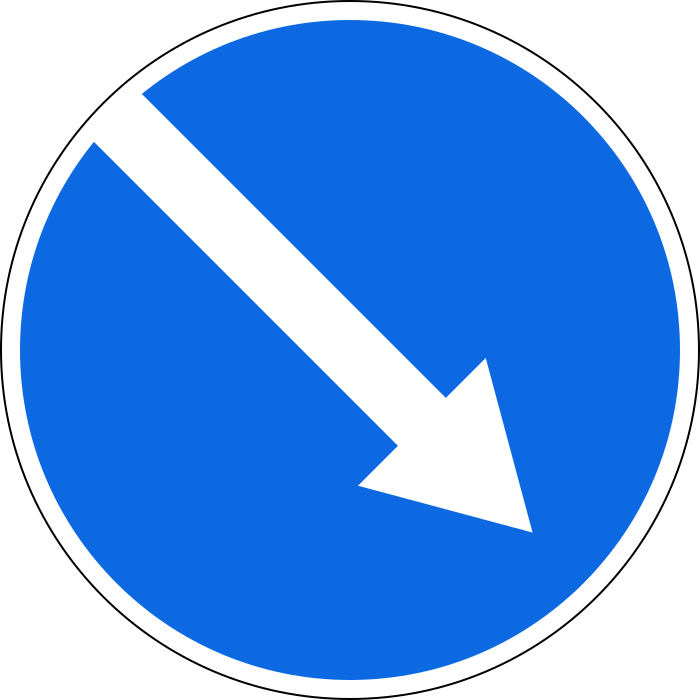 | 4.2.1 | عبور از مانع از راست | فقط از سمت راست عبور کنید |
| 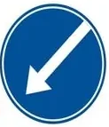 | 4.2.2 | عبور از مانع از چپ | فقط از سمت چپ عبور کنید |
| 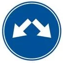 | 4.2.3 | عبور از مانع از راست یا چپ | از هر دو طرف می‌توانید عبور کنید |

این پیکان‌ها مورب و رو به پایین هستند، در حالی که پیکان‌های تابلوهای جهت خمیده یا مستقیم‌اند. این تابلو ممکن است روی تخته‌ای راه‌راه نصب شود که تابلوی تکمیلی 8.22 «مانع» است.

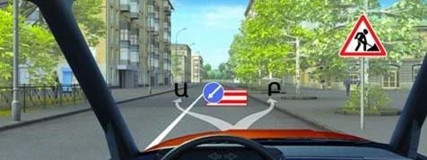

*تابلوی 4.2.2 روی تخته قرمز و سفید. فقط می‌توانید از سمت چپ، یعنی مسیر Ա (A)، عبور کنید.*

## فرمان‌های دیگر

| تابلو | شماره | نام | معنا |
|---|---|---|---|
|  | 4.3 | حرکت دورانی | فقط در جهت پیکان‌ها و دور جزیره مرکزی حرکت کنید |
| 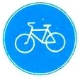 | 4.4.1 | مسیر دوچرخه | مسیر دوچرخه را مشخص می‌کند |
| 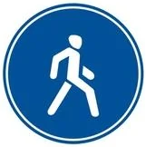 | 4.5.1 | مسیر پیاده | مسیری را مشخص می‌کند که فقط برای عابران پیاده است |
| 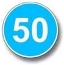 | 4.6 | محدودیت حداقل سرعت | فقط با این سرعت یا بیشتر حرکت کنید |

سه تابلو تصویر عابر پیاده دارند و سه کار متفاوت می‌کنند:

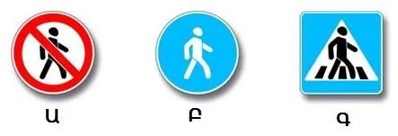

*Ա (A) تابلوی 3.10 است که عابران را ممنوع می‌کند. Բ (B) تابلوی 4.5.1 است، تنها تابلویی که مسیر پیاده را مشخص می‌کند. Գ (C) تابلوی 5.19.1 است که گذرگاه را مشخص می‌کند.*

سه تابلو هم سرعت را نشان می‌دهند. دایره آبی 4.6 کف سرعت است. حلقه قرمز 3.24 سقف سرعت است. مربع آبی 6.2 فقط توصیه است.

## خودتان امتحان کنید

**تابلوی جلوی شما 4.1.1 است و راه متقاطع نوار جداکننده دارد.**

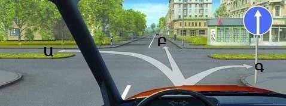

کدام مسیرها بازند؟ **Ա (A) یا Բ (B).** مستقیم همان چیزی است که تابلو دستور می‌دهد. گردش به چپ در سواره‌روی دوم بیرون از اثر تابلوست. گردش به راست در سواره‌روی اول، یعنی Գ (C)، همان چیزی است که تابلو ممنوع می‌کند.

**سه راننده، سه مانور.** تابلوی 4.1.1 در تصویرهای 1 و 2 و تابلوی 5.5 در تصویر 3 است.

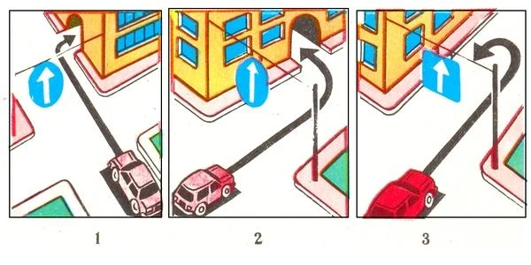

کدام درست است؟ **تصویر 1.** گردش به راست به‌سوی حیاط همان استثناست. گردش به چپ در تصویر 2 استثنا نیست و دور زدن در راه یک‌طرفه طبق بند 50 ممنوع است.

**مانعی در جلو است و این تابلو روی آن نصب شده.**

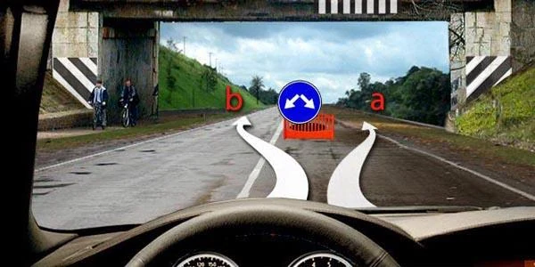

کدام مسیر مجاز است؟ **هر دو.** تابلوی 4.2.3 اجازه می‌دهد از هر دو طرف عبور کنید.

## نکات کلیدی

- گرد و آبی یعنی فرمان. فقط به سمتی بروید که پیکان‌ها نشان می‌دهند.
- تابلویی که گردش به چپ را مجاز می‌کند، دور زدن را هم مجاز می‌کند.
- پیش از تقاطع، تابلو فقط بر همان محل تقاطع سواره‌روها اثر دارد.
- در ابتدای یک قطعه، 4.1.1 تا نزدیک‌ترین تقاطع اعتبار دارد و گردش به راست به‌سوی حیاط مجاز می‌ماند.
- 4.2.1 از راست، 4.2.2 از چپ، 4.2.3 از هر دو طرف.
- 4.6 حداقل سرعت را تعیین می‌کند. آن را با 3.24 یا 6.2 اشتباه نگیرید.

{{practice}}
