# تابلوهای مقررات ویژه

این تابلوها قواعد راهی را که در آن هستید تغییر می‌دهند: ترافیک به کدام سمت می‌رود، چه کسی می‌تواند از یک خط عبور استفاده کند و کدام حد سرعت اعمال می‌شود. ظاهرشان بی‌خطر است، چون بیشترشان مستطیل‌های ساده آبی هستند، اما چند تا از آنها کاری را که مجازید انجام دهید تغییر می‌دهند.

## این تابلوها چه شکلی هستند؟

بیشتر آنها **مربع یا مستطیل آبی** با تصویر سفید هستند. سه تفاوت مهم است:

- **سبز** یعنی تابلوی 5.1، آزادراه.
- **سفید** برای تابلوهای شهری است که مقررات محدوده شهری را برقرار می‌کنند.
- **خط مورب قرمز** یعنی پایان چیزی که تابلو شروع کرده بود: 5.6 به 5.5 پایان می‌دهد، 5.9 به 5.8 و 5.22 به 5.21.

بعضی از این تابلوها، مانند تابلوهای خروج 5.7.1 و 5.7.2، فقط وضعیت راه جلو را گزارش می‌کنند و خودشان هیچ مانوری را ممنوع نمی‌کنند.

## نوع راه

| تابلو | شماره | نام | معنا |
|---|---|---|---|
| 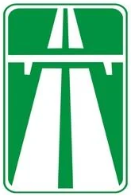 | 5.1 | آزادراه | آزادراه شروع می‌شود |
| 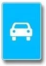 | 5.3 | راه ویژه خودروها | فقط خودروها، از جمله اتوبوس‌ها، و موتورسیکلت‌ها |

موتورگازی، دوچرخه، گاری اسبی، تراکتور و ماشین‌های خودگرد حق ندارند از راهی با تابلوی 5.3 استفاده کنند. در هر دو راه، حرکت وسایل نقلیه‌ای که سرعتشان نمی‌تواند از 40 کیلومتر بر ساعت بیشتر شود ممنوع است (بندهای 116 و 117). با این حال در تابلوی 5.3 نوع وسیله نقلیه مقدم است: حتی تراکتور سریع هم نمی‌تواند وارد شود.

## راه‌های یک‌طرفه و برگشت‌پذیر

| تابلو | شماره | نام | معنا |
|---|---|---|---|
| 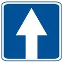 | 5.5 | راه با حرکت یک‌طرفه | ترافیک در تمام عرض راه در یک جهت است |
|  | 5.6 | پایان راه یک‌طرفه | حرکت روبه‌رو در جلوتر شروع می‌شود |
| 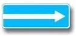 | 5.7.1 | خروج به راه با حرکت یک‌طرفه | راه متقاطع در جهت پیکان یک‌طرفه است |
| 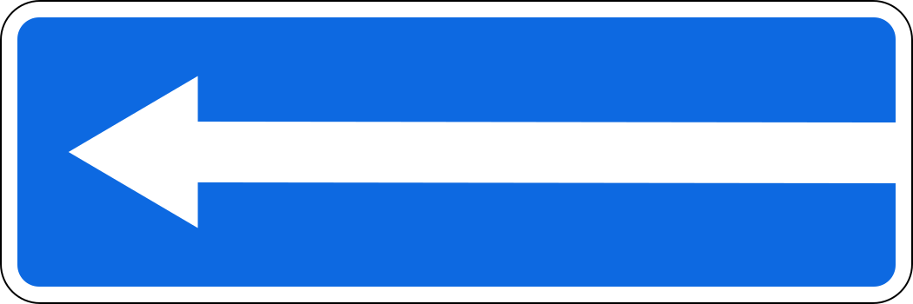 | 5.7.2 | خروج به راه با حرکت یک‌طرفه | همان، با حرکت به سمت چپ |
| 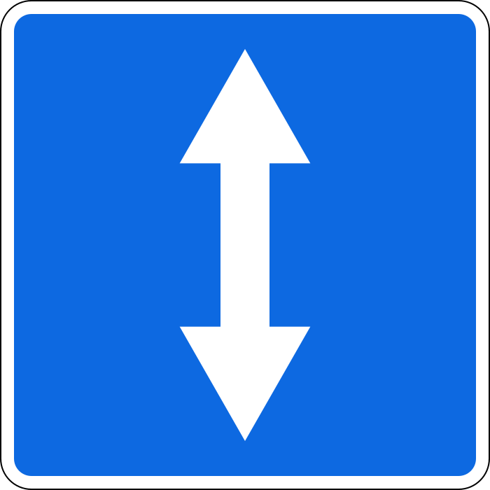 | 5.8 | حرکت برگشت‌پذیر | جهت حرکت یک یا چند خط عبور می‌تواند برعکس شود |
|  | 5.9 | پایان حرکت برگشت‌پذیر | حرکت برگشت‌پذیر تمام می‌شود |
| 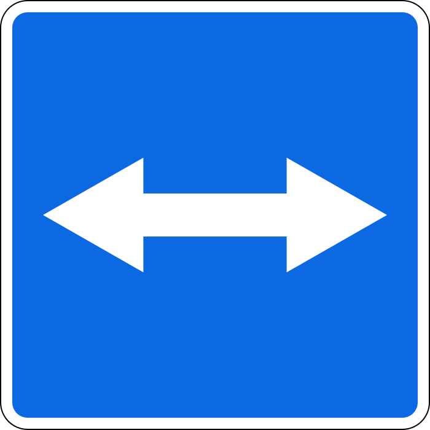 | 5.10 | خروج به راهی با حرکت برگشت‌پذیر | راه متقاطع حرکت برگشت‌پذیر دارد |

> **دام رایج:** دور زدن در راه یک‌طرفه ممنوع است (بند 50)، پس با تابلوی 5.5 می‌توانید مستقیم، به راست یا به چپ بروید، اما نمی‌توانید برگردید. تا از تابلوی 5.6 نگذشته‌اید، راه هنوز یک‌طرفه است.

تابلوهای 5.7.1 و 5.7.2 خودشان چیزی را ممنوع نمی‌کنند و دور زدن را هم منع نمی‌کنند. فقط خبر می‌دهند که گردش خلاف پیکان یعنی حرکت خلاف جهت ترافیک.

## خطوط عبور

| تابلو | شماره | نام | معنا |
|---|---|---|---|
|  | 5.11.1 | راه دارای خط ویژه وسایل نقلیه عمومی | خطی برای وسایل نقلیه خطی در خلاف جهت حرکت عمومی وجود دارد |
| 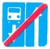 | 5.12.1 | پایان راه دارای خط ویژه وسایل نقلیه عمومی | آن راه تمام می‌شود |
| 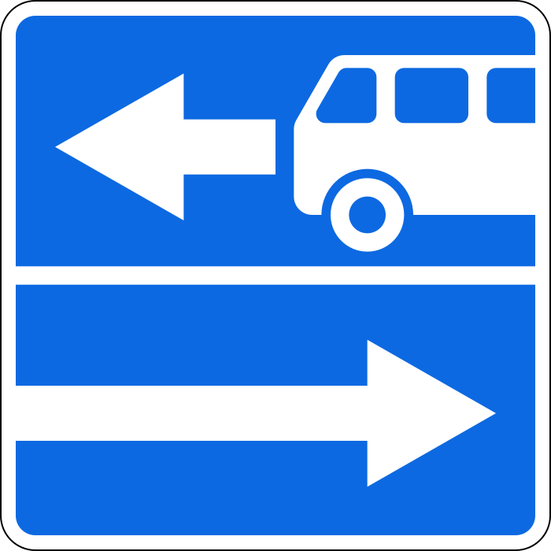 | 5.13.1 | خروج به راهی دارای خط ویژه وسایل نقلیه عمومی | راه متقاطع چنین خطی دارد |
|  | 5.14 | خط ویژه وسایل نقلیه عمومی | این خط عبور برای وسایل نقلیه خطی است |
| 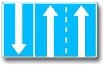 | 5.15.1 | جهت‌های حرکت در خطوط عبور | هر خط عبور به کدام سمت می‌تواند برود |
| 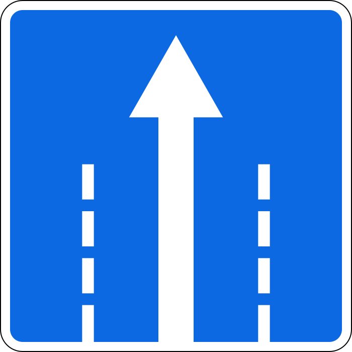 | 5.15.2 | جهت‌های حرکت در هر خط عبور | همان، جداگانه برای هر خط عبور |
| 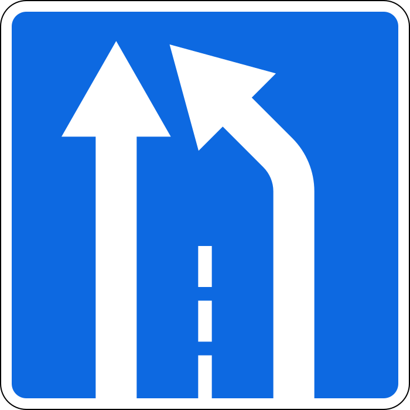 | 5.15.5 | پایان خط عبور | خط عبور تمام می‌شود، پس به خط کناری بروید |

تابلوی 5.15.3 «آغاز خط» از شروع یک خط عبور اضافی خبر می‌دهد:

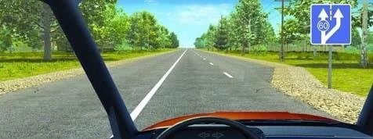

**تابلوهای خروج با تصویر اتوبوس را چگونه بخوانم؟** تابلوی 5.13.2 تصویر آینه‌ای 5.13.1 است. پیکان ساده حرکت عمومی را نشان می‌دهد و پیکان با اتوبوس خط ویژه را. از پیکان ساده پیروی کنید.

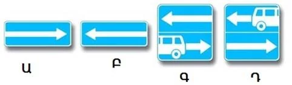

*هیچ‌کدام از اینها دور زدن را ممنوع نمی‌کند. فقط تابلوی 3.19 این کار را می‌کند.*

وسایل نقلیه دیگر نمی‌توانند در این خط عبور یا توقف کنند (بند 124). اگر خط‌چین آن را جدا کرده باشد، می‌توانید برای خروج از راه، یا برای سوار و پیاده کردن مسافر، وارد آن شوید، بدون آنکه مانع وسایل نقلیه خطی شوید.

> **به یاد داشته باشید:** با تابلوهای 5.15.1 و 5.15.2 فقط به سمتی بروید که پیکان‌های خط عبور شما نشان می‌دهند. هیچ چراغ سبزی جهت تازه‌ای اضافه نمی‌کند. تابلویی که گردش به چپ را از **خط عبور کناری چپ** مجاز کند، دور زدن از همان خط را هم مجاز می‌کند، اما گردش به چپ از خطوط دیگر چنین نیست.

## ایستگاه‌ها، گذرگاه‌ها و سرعت‌گیرها

| تابلو | شماره | نام | معنا |
|---|---|---|---|
| 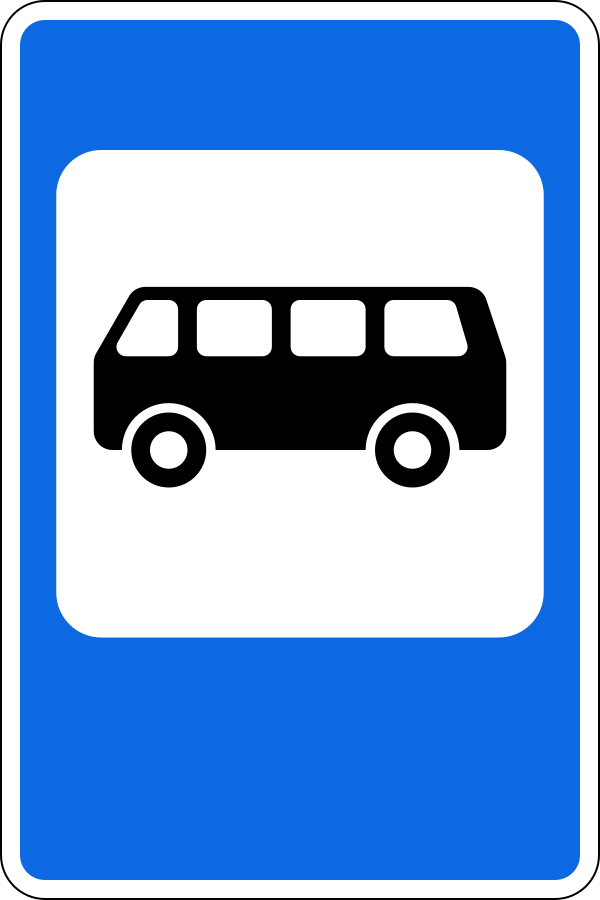 | 5.16 | ایستگاه اتوبوس و (یا) ترولی‌بوس | محل توقف وسایل نقلیه عمومی |
| 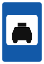 | 5.18 | محل پارک تاکسی‌های سواری سبک | جایی که تاکسی‌ها پارک می‌کنند |
| 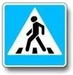 | 5.19.1 | گذرگاه عابر پیاده | گذرگاه را مشخص می‌کند. بدون خط‌کشی، در مرز دورتر نصب می‌شود |
| 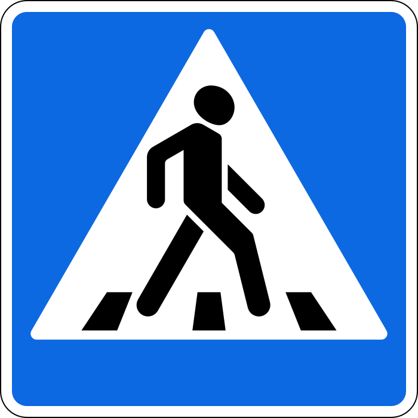 | 5.19.2 | گذرگاه عابر پیاده | گذرگاه را مشخص می‌کند. بدون خط‌کشی، در مرز نزدیک‌تر نصب می‌شود |
| 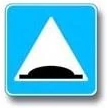 | 5.20 | سرعت‌گیر مصنوعی | خود سرعت‌گیر را در مرز نزدیک آن مشخص می‌کند |

> **دام رایج:** همین تصویر در مثلث قرمز فقط پیشاپیش هشدار می‌دهد. تابلوهای 1.22 و 1.17 از آنچه در راه است خبر می‌دهند. تابلوهای 5.19.1، 5.19.2 و 5.20 خود محل را مشخص می‌کنند. در گذرگاه باید به عابران راه بدهید.

## منطقه مسکونی

| تابلو | شماره | نام | معنا |
|---|---|---|---|
| 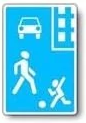 | 5.21 | منطقه مسکونی | مقررات منطقه مسکونی شروع می‌شود |
| 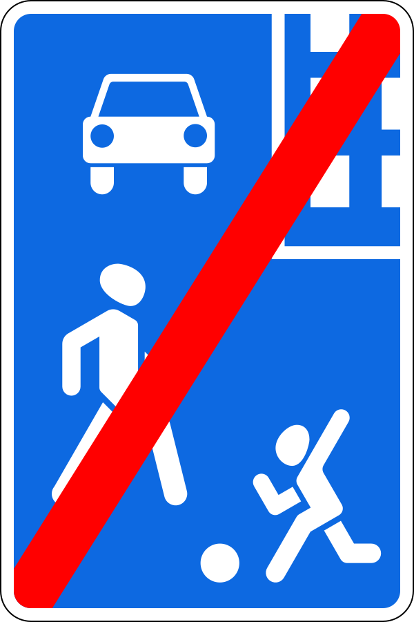 | 5.22 | پایان منطقه مسکونی | آن مقررات تمام می‌شود |

در این منطقه حد سرعت برای همه وسایل نقلیه 20 کیلومتر بر ساعت است. عابران می‌توانند هم در پیاده‌رو و هم در سواره‌رو راه بروند و حق تقدم با آنهاست. **عبور و مرور ترانزیتی و رانندگی آموزشی ممنوع است.**

خروج از منطقه به شما حق تقدم نمی‌دهد، بلکه آن را می‌گیرد: در تابلوی 5.22 باید به وسایل نقلیه دیگر راه بدهید و مانع عابران نشوید.

## محدوده شهری

در اینجا رنگ همه چیز را تعیین می‌کند.

| تابلو | شماره | نام | معنا |
|---|---|---|---|
| 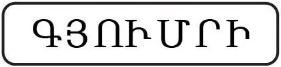 | 5.23.1 | آغاز محدوده شهری | مقررات محدوده شهری شروع می‌شود، پس 60 کیلومتر بر ساعت |
| 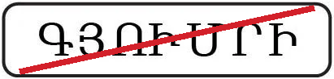 | 5.24.1 | پایان محدوده شهری | آن مقررات تمام می‌شود |
| 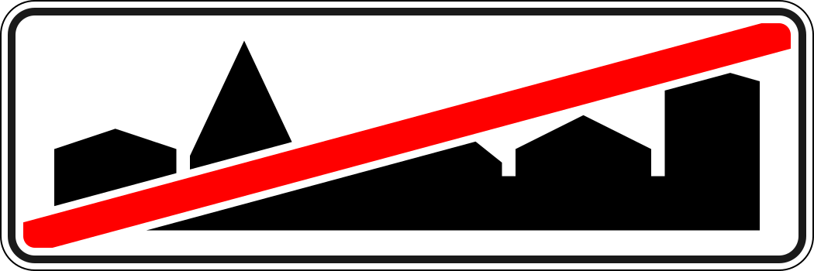 | 5.24.2 | پایان محدوده شهری | آن مقررات تمام می‌شود |
| 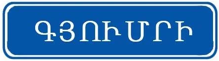 | 5.25 | آغاز محدوده شهری | فقط نام را می‌گوید. مقررات محدوده شهری اعمال **نمی‌شود** |
| 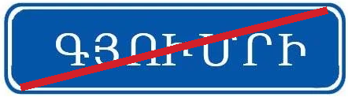 | 5.26 | پایان محدوده شهری | آن نقطه تمام می‌شود. مقررات محدوده شهری اینجا هم اعمال نمی‌شود |

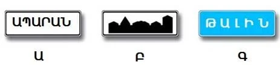

*Ա (A) تابلوی 5.23.1 و Բ (B) تابلوی 5.23.2، یعنی نسخه نمای شهر است. هر دو مقررات محدوده شهری را برقرار می‌کنند. Գ (C) تابلوی 5.25 است و این کار را نمی‌کند.*

مقررات از تابلوی سفید شروع می‌شود، نه از جایی که ساختمان‌ها شروع می‌شوند.

## تابلوهای منطقه

مستطیل سفید با کلمه «منطقه» (به ارمنی ԳՈՏԻ) یک محدوده کامل را پوشش می‌دهد. اثر آن با تقاطع بعدی تمام نمی‌شود، بلکه با تابلوی پایان مربوط به خودش تمام می‌شود.

| تابلو | شماره | نام | معنا |
|---|---|---|---|
|  | 5.28 | پایان منطقه با محدودیت پارک | به منطقه 5.27 پایان می‌دهد |

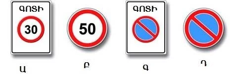

*Ա (A) تابلوی 5.31 «منطقه با محدودیت حداکثر سرعت» است که با تابلوی 5.32 تمام می‌شود. Գ (C) تابلوی 5.27 «منطقه با محدودیت پارک» است. Բ (B) و Դ (D) تابلوهای معمولی هستند که تا نزدیک‌ترین تقاطع اثر دارند.*

تابلوی 5.33 «منطقه عابر پیاده» عبور همه وسایل نقلیه، از جمله دوچرخه، را ممنوع می‌کند.

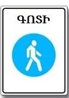

## خودتان امتحان کنید

**مربع آبی جلوی شما تابلوی 5.5 است.**

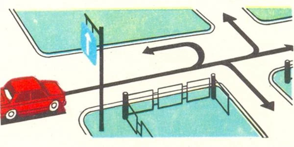

کدام جهت‌ها بازند؟ **مستقیم، راست و چپ.** مسیر چهارم دور زدن است که در راه یک‌طرفه ممنوع است.

**از منطقه مسکونی خارج می‌شوید و کامیونی از چپ نزدیک می‌شود.**

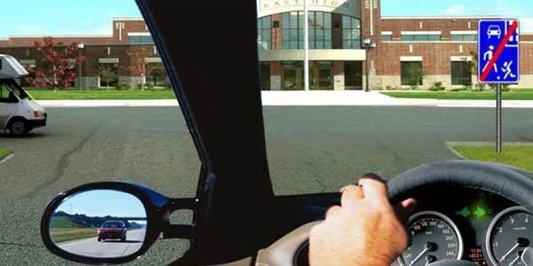

آیا باید راه بدهید؟ **بله.** خروج از منطقه مسکونی به شما حق تقدم نمی‌دهد.

**در خط عبور سمت چپ هستید و تابلوی بالای آن فقط گردش به چپ را نشان می‌دهد.**

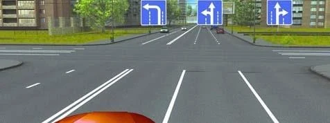

کجا می‌توانید بروید؟ **به چپ یا دور زدن.** خط عبور کناری چپ دور زدن را هم با خود می‌آورد و این تابلو پیکان مستقیم ندارد.

## نکات کلیدی

- مستطیل‌های آبی راه را توصیف می‌کنند. خط مورب قرمز به کار تابلوی همتا پایان می‌دهد.
- در راه یک‌طرفه دور زدن ممنوع است. تا از تابلوی 5.6 نگذشته‌اید، راه هنوز یک‌طرفه است.
- تابلوهای 5.7 و 5.13 هیچ مانوری را ممنوع نمی‌کنند. با تابلوی 5.13 از پیکان ساده پیروی کنید.
- گردش به چپ مجاز از خط عبور کناری چپ یعنی دور زدن هم مجاز است. فقط از همان خط.
- منطقه مسکونی: 20 کیلومتر بر ساعت، عابر مقدم، عبور و مرور ترانزیتی ممنوع، رانندگی آموزشی ممنوع، هنگام خروج راه بدهید.
- تابلوی سفید شهر: مقررات محدوده شهری. تابلوی آبی شهر: بدون تغییر.
- تابلوی منطقه تا تابلوی پایان خودش اعتبار دارد، نه تا تقاطع بعدی.

{{practice}}
