# تابلوهای اطلاعاتی و خدماتی

بیشتر این تابلوها چیزی را اطلاع می‌دهند و دستور نمی‌دهند. ترفند رایج این است که یکی از آنها مثل یک قاعده الزامی جلوه داده شود، پس به یاد داشته باشید که مربع یا مستطیل آبی در این دو خانواده فقط اطلاع یا توصیه می‌دهد.

## تابلوهای اطلاعاتی (خانواده 6)

بیشتر آنها **مربع یا مستطیل آبی** هستند. تابلوی 6.16 سفید و تابلوی 6.19.1 زرد است.

| تابلو | شماره | نام | معنا |
|---|---|---|---|
| 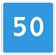 | 6.2 | سرعت توصیه‌شده | سرعت ترجیحی این قطعه از راه. فقط توصیه |
| 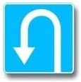 | 6.3.1 | محل دور زدن | جایی که برای دور زدن در نظر گرفته شده است. گردش به چپ در اینجا ممنوع است |
| 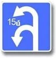 | 6.3.2 | محدوده دور زدن | عدد داخل تابلو طول محدوده دور زدن را می‌گوید |
|  | 6.4 | محل پارک | اینجا برای پارک در نظر گرفته شده است |
| 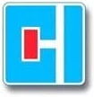 | 6.8.1 | بن‌بست | راه عبور ندارد. ورود ممنوع نیست |
| 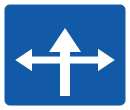 | 6.9 | نشانگر مقدماتی جهت | اطلاعات مسیر و جهت |
| 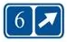 | 6.14.2 | شماره مسیر | شماره مسیر را می‌گوید |
| 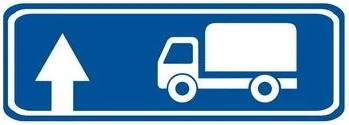 | 6.15.1 | جهت حرکت برای کامیون‌ها | مسیر توصیه‌شده برای کامیون‌ها، مستقیم |
|  | 6.15.2 | جهت حرکت برای کامیون‌ها | همان، به راست |
| 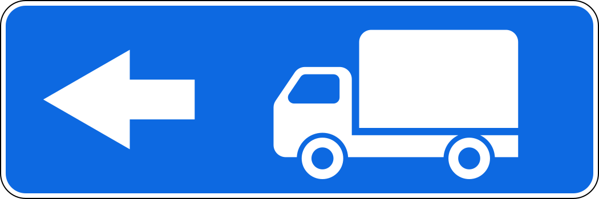 | 6.15.3 | جهت حرکت برای کامیون‌ها | همان، به چپ |
| 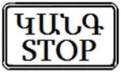 | 6.16 | خط ایست | محل توقف هنگام علامت بازدارنده |
| 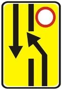 | 6.19.1 | نشانگر مقدماتی تغییر مسیر به سواره‌روی دیگر | راه عبور از کنار سواره‌روی بسته در راهی با نوار جداکننده |

> **دام رایج:** عدد 50 روی مربع آبی فقط پیشنهاد است. نه حداکثر است (آن حلقه قرمز 3.24 است) و نه حداقل (آن دایره آبی 4.6 است). با تابلوی تکمیلی 8.16 «سطح خیس» زیر آن هم همین‌طور است: «توصیه می‌شود»، نه «مجاز است».

اگر تابلوی 6.2 کنار تابلوی هشداردهنده باشد، تا پایان همان قطعه خطرناک اعتبار دارد.

**تابلوی 6.15** هم توصیه است. این تابلو مسیری را برای کامیون‌ها، تراکتورها و ماشین‌های خودگرد پیشنهاد می‌کند، در جایی که حرکت آنها در تقاطع به سمتی ممنوع باشد. چیزی را نمی‌بندد. این کار را فقط تابلوی ممنوعیت می‌کند، آن هم فقط در جهت خودش.

**تابلوی 6.19.1** شما را به سواره‌روی دیگر می‌فرستد، چون سواره‌روی شما در جلو بسته است. این تابلو نشانگر عبور از کنار یک مانع محلی نیست. وقتی آن را می‌بینید نمی‌توانید مستقیم ادامه دهید: همان‌طور که نشان می‌دهد به سواره‌روی مقابل بروید. تابلوهای 6.19.1 و 6.19.2 راه بازگشت را هم نشان می‌دهند.

## تابلوهای خدماتی (خانواده 7)

دنبال **مستطیل آبی با مربع سفید** در داخل آن بگردید. این تابلوها شما را به چیزی مفید راهنمایی می‌کنند.

| تابلو | شماره | نام | معنا |
|---|---|---|---|
| 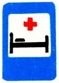 | 7.2 | بیمارستان | تخت با صلیب |
| 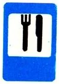 | 7.7 | محل غذاخوری | کارد و چنگال |
| 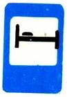 | 7.9 | هتل یا متل | تخت بدون صلیب |
| 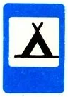 | 7.10 | اردوگاه | چادر |
| 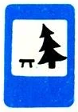 | 7.11 | محل استراحت | میز و درخت |
| 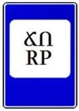 | 7.12 | پاسگاه گشت راهنمایی و رانندگی | فقط می‌گوید پاسگاهی آنجاست |

## خودتان امتحان کنید

**در کدام حالت طول محدوده دور زدن نشان داده شده است؟**

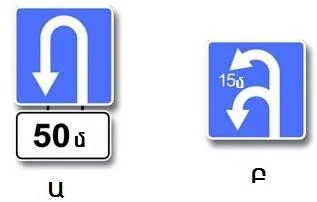

**فقط Բ (B).** عدد داخل تابلو، یعنی 6.3.2، طول محدوده است. تابلوی کوچک جداگانه در Ա (A) همان 8.1.1 است: فاصله از تابلو تا آن محل، یعنی 50 متر.

**راننده کامیون هستید.** تابلوی 3.4 در راه مستقیم روبه‌رو نصب شده و تابلوی آبی کامیون‌ها به راست اشاره می‌کند.

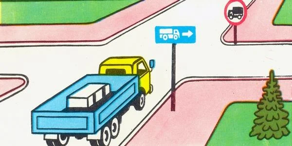

کجا می‌توانید بروید؟ **راست، چپ یا جهت مخالف.** فقط مستقیم ممنوع است. تابلوی آبی توصیه می‌کند و الزام نمی‌کند.

**این تابلو کنار راهی جنگلی نصب شده است.**

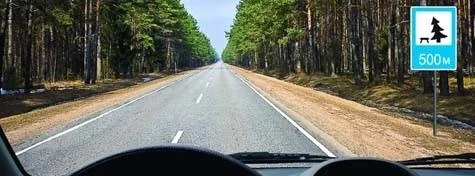

چه می‌گوید؟ **پس از 500 متر محل استراحت است.** تابلوی کوچک فاصله تا آن را می‌گوید، نه طول یک قطعه را. هشدار درباره درخت افتاده هم نیست، چون آبی است و مثلث نیست.

## نکات کلیدی

- مربع‌ها و مستطیل‌های آبی این خانواده‌ها اطلاع یا توصیه می‌دهند.
- 6.2 فقط سرعت را توصیه می‌کند، حتی با تابلوی تکمیلی.
- 6.3.1 محل دور زدن است و گردش به چپ آنجا ممنوع است. 6.3.2 طول محدوده را داخل تابلو نشان می‌دهد.
- 6.8.1 یعنی راه عبور نیست، اما می‌توانید وارد شوید.
- 6.15 مسیری را برای کامیون‌ها توصیه می‌کند و چیزی را ممنوع نمی‌کند.
- 6.19.1 تابلوی زردی است که شما را به سواره‌روی دیگر می‌برد.
- تابلوهای خدماتی: 7.2 تخت با صلیب است و 7.9 تخت بدون صلیب.

{{practice}}
