# تابلوهای تکمیلی

تابلوی تکمیلی همان تابلوی کوچک سفید زیر تابلوی اصلی است. این تابلو معنای تابلوی اصلی را تغییر می‌دهد، پس خواندن تابلو و نادیده گرفتن تابلوی تکمیلی سریع‌ترین راه از دست دادن نمره است. هر تابلوی تکمیلی به یک پرسش پاسخ می‌دهد: چقدر دور، چقدر طولانی، کدام جهت، چه کسی یا چه زمانی.

## تابلوی تکمیلی را چگونه بشناسم؟

دنبال **مستطیل سفید کوچکی** بگردید که زیر تابلوی دیگری نصب شده است. تابلوی تکمیلی به‌تنهایی وظیفه‌ای ایجاد نمی‌کند: فقط تابلوی بالای خود را تغییر می‌دهد.

## چقدر دور یا چقدر طولانی؟

این تمایزی است که آزمون بیش از همه می‌سنجد. یک عدد ساده به **چقدر دور** پاسخ می‌دهد. پیکان در دو سر عدد به **چقدر طولانی** پاسخ می‌دهد.

| تابلو | شماره | نام | معنا |
|---|---|---|---|
| 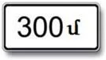 | 8.1.1 | فاصله تا محل | از تابلو تا جایی که خطر یا قاعده شروع می‌شود |
| 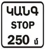 | 8.1.2 | فاصله تا محل | از تابلوی 2.4 تا تقاطعی با تابلوی 2.5 |
| 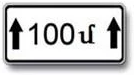 | 8.2.1 | محدوده اثر | طول قطعه‌ای که تابلو پوشش می‌دهد |
| 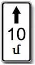 | 8.2.2 | محدوده اثر | طول محدوده ممنوعیت‌های توقف و پارک 3.27 تا 3.30 |
|  | 8.2.3 | محدوده اثر | محدوده تابلوی 3.27 تا 3.30 اینجا **تمام می‌شود** |
|  | 8.2.4 | محدوده اثر | شما **داخل** محدوده تابلوی 3.27 تا 3.30 هستید |

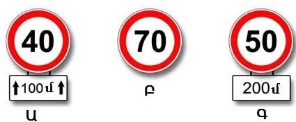

*Ա (A): عدد 40 از همین‌جا و برای 100 متر اعمال می‌شود. Բ (B): عدد 70 از همین‌جا تا نزدیک‌ترین تقاطع اعمال می‌شود. Գ (C): عدد 50 فقط پس از 200 متر اعمال می‌شود.*

> **دام رایج:** با تابلوی تکمیلی 8.2.4 ممنوعیت در هر دو طرف تابلو برقرار است. توقف هم پیش از تابلو ممنوع است و هم بعد از آن. با 8.2.3 ممنوعیت در تابلو تمام می‌شود، پس بعد از آن پارک مجاز است.

تابلوهای هشداردهنده هم همین الگو را دارند. تابلوی هشداردهنده با 8.2.1 همچنان در فاصله معمول خود نصب می‌شود: خارج از محدوده شهری، تنگ‌شدگی به طول 100 متر از 150 تا 300 متر بعد از تابلو شروع می‌شود. با 8.1.1، عدد جای آن فاصله را می‌گیرد.

تابلوی 8.1.2 کلمه ایست را دارد تا خبر دهد که توقف اجباری در راه است، نه یک راه دادن دیگر.

## کدام جهت؟

| تابلو | شماره | نام | معنا |
|---|---|---|---|
| 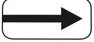 | 8.3.1 | جهت‌های اثر | تابلو به سمت راست اثر دارد. با پیکان برعکس، به سمت چپ |
| 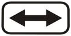 | 8.3.3 | جهت‌های اثر | تابلو به چپ و راست اثر دارد |
| 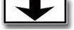 | 8.14 | خط عبور | تابلو فقط بر خط عبوری اثر دارد که بالای آن آویخته است |

این تابلوها ممنوعیت را کوچک می‌کنند. تابلوی 3.2 بدون تابلوی تکمیلی همه جهت‌ها را می‌بندد. با 8.3.3 زیر آن فقط چپ و راست بسته است، پس می‌توانید مستقیم بروید یا دور بزنید. تابلوی 3.5 با پیکان رو به راست موتورسیکلت‌ها را فقط به سمت راست ممنوع می‌کند.

## برای چه کسانی اعمال می‌شود؟

| تابلو | شماره | نام | معنا |
|---|---|---|---|
|  | 8.4.1 | نوع وسیله نقلیه | فقط کامیون‌های **بیش از** 3.5 تن |
| 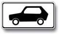 | 8.4.3 | نوع وسیله نقلیه | خودروهای سواری **و** کامیون‌های تا 3.5 تن. نه موتورسیکلت |
| 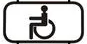 | 8.17 | معلولان | تابلو فقط شامل سه‌چرخه‌های موتوری معلولان و خودروهای دارای علامت «معلول» می‌شود |
|  | 8.18 | به‌جز معلولان | تابلو شامل همان وسایل نقلیه نمی‌شود |

> **به یاد داشته باشید:** تابلوی 8.4.1 تصویر کامیون دارد، پس خودروی سواری یا کامیون 3 تنی تابلوی بالای آن را نادیده می‌گیرد. تابلوی 8.4.3 تصویر خودرو دارد، اما کامیون‌های تا 3.5 تن را هم در بر می‌گیرد.

تاکسی‌ها از 8.18 چیزی به دست نمی‌آورند: این استثنا فقط برای دارندگان علامت «معلول» است.

## چه زمانی؟

| تابلو | شماره | نام | معنا |
|---|---|---|---|
| 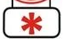 | 8.5.1 | شنبه، یکشنبه و روزهای تعطیل | تابلو در این روزها اعمال می‌شود |
| 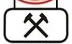 | 8.5.2 | روزهای کاری | تابلو در روزهای کاری اعمال می‌شود |
| 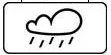 | 8.16 | سطح خیس | تابلو فقط وقتی اعمال می‌شود که سواره‌رو خیس باشد |

ستاره به معنای برف نیست. تابلوی 8.16 یعنی خیس، نه یخ‌زده. این تابلو توصیه را به محدودیت تبدیل نمی‌کند و محدودیت را هم به توصیه تبدیل نمی‌کند: عدد 40 در حلقه قرمز در راه خیس حداکثر است و عدد 40 روی مربع آبی در راه خیس توصیه است.

## چگونه پارک کنم؟

| تابلو | شماره | نام | معنا |
|---|---|---|---|
|  | 8.6.1 | شیوه قرار دادن وسیله نقلیه در محل‌های پارک | روی سواره‌رو و در امتداد پیاده‌رو، برای **همه** وسایل نقلیه |
|  | 8.6.2 | شیوه قرار دادن وسیله نقلیه در محل پارک | روی لبه پیاده‌رو، فقط برای **خودروهای سواری و موتورسیکلت‌ها** |
| 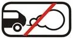 | 8.7 | پارک کردن با موتور خاموش | با موتور خاموش پارک کنید |
| 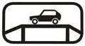 | 8.10 | محل بازدید خودروها | جایی برای بازدید وسایل نقلیه |

تابلوهای 8.6.2 تا 8.6.9 همگی مانند 8.6.2 عمل می‌کنند. بند 81 هم همین را می‌گوید: کامیون با این تابلوها نمی‌تواند روی لبه پیاده‌رو پارک کند.

## تابلوهایی که معنا اضافه می‌کنند

| تابلو | شماره | نام | معنا |
|---|---|---|---|
| 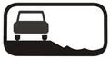 | 8.12 | شانه خطرناک | همراه تابلوی 1.25: رفتن روی شانه به دلیل تعمیرات خطرناک است |
|  | 8.13 | جهت راه اصلی | خط ضخیم تنها مسیر راه اصلی است |
| 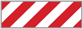 | 8.22 | مانع | همراه تابلوهای 4.2.1 تا 4.2.3 مانع محلی را مشخص می‌کند. در تصویرهای پرسش‌ها قرمز و سفید است |

تابلوی 8.12 چیزی را ممنوع نمی‌کند. می‌گوید «خطرناک»، نه «ممنوع»، پس به توقف کاری ندارد. در تابلوی 8.13، خط نازکی که مستقیم ادامه دارد راه فرعی است. اگر خط ضخیم به چپ خم شود، راه اصلی فقط به چپ می‌رود.

## خودتان امتحان کنید

**تابلوی 3.2 با این تابلوی تکمیلی پیش از تقاطع نصب شده است.**

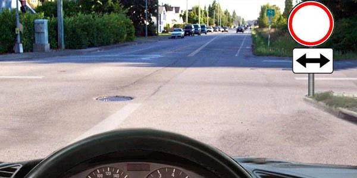

کجا می‌توانید بروید؟ **مستقیم یا برگشت از همان راه.** این تابلو فقط چپ و راست را می‌بندد.

**راننده خودروی سواری هستید.** تابلوی 4.1.4 بالای خط عبور آویخته است و تابلوی تکمیلی 8.4.1 زیر آن است.

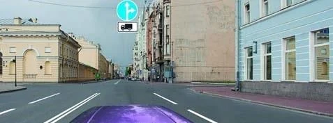

کجا می‌توانید بروید؟ **مستقیم، چپ یا برگشت.** این تابلو فقط کامیون‌های بیش از 3.5 تن را ملزم می‌کند. در سمت راست خروجی نیست، پس آنجا جایی برای گردش وجود ندارد.

## نکات کلیدی

- عدد ساده فاصله است. پیکان در دو سر عدد آن را طول می‌کند.
- 8.2.3 ممنوعیت توقف را تمام می‌کند. 8.2.4 می‌گوید داخل آن هستید.
- تابلوهای 8.3 اثر تابلو را به یک جهت محدود می‌کنند. 8.14 آن را به یک خط عبور محدود می‌کند.
- 8.4.1: کامیون‌های بیش از 3.5 تن. 8.4.3: خودروهای سواری و کامیون‌های تا 3.5 تن.
- ستاره: تعطیلات آخر هفته و روزهای تعطیل. چکش‌ها: روزهای کاری. ابر: سطح خیس.
- 8.6.1 برای همه وسایل نقلیه است. 8.6.2 تا 8.6.9 فقط برای خودروهای سواری و موتورسیکلت‌ها.
- در 8.13 خط ضخیم راه اصلی است.

{{practice}}
