# خط‌کشی راه

خط‌کشی‌ها هم مانند تابلوها دستور می‌دهند و درست زیر چرخ‌های شما هستند. پرسش‌های تمرینی اغلب یک خط‌کشی را به‌تنهایی نشان می‌دهند، پس این درس آن‌ها را به ترتیب شماره مرور می‌کند.

خط‌کشی‌های **افقی** (شماره‌هایی که با 1 شروع می‌شوند) روی سطح راه کشیده می‌شوند. خط‌کشی‌های **عمودی** (شماره‌هایی که با 2 شروع می‌شوند) روی سازه‌های کنار و بالای راه رنگ می‌شوند.

> **به یاد داشته باشید:** خط‌کشی دائمی سفید و خط‌کشی موقت نارنجی است. اگر با هم تناقض داشتند، از خط‌کشی نارنجی پیروی کنید (بندهای 170 و 174). این خط‌کشی وضعیت امروز راه را نشان می‌دهد، مثلاً هنگام تعمیرات.

## از کدام خطوط می‌توانم عبور کنم؟

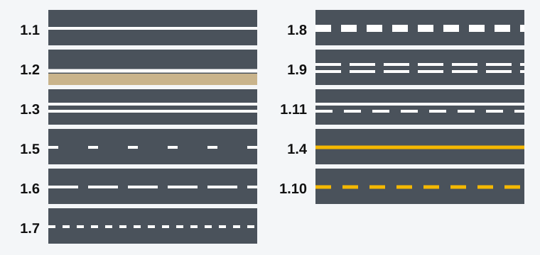

*خطوط به ترتیب شماره، به شکل ساده‌شده. خطوط زرد 1.4 و 1.10 جلوتر توضیح داده شده‌اند.*

| شماره | شکل | معنا و عبور |
|---|---|---|
| 1.1 | خط ممتد | جریان‌های ترافیک را جدا می‌کند و دور محل‌های پارک و جزیره‌ها کشیده می‌شود. عبور نکنید، مگر برای ورود به محل پارک یا خروج از آن |
| 1.2 | خط ممتد لبه | لبه سواره‌رو را نشان می‌دهد. فقط برای توقف در شانه راه، جایی که توقف مجاز است، عبور کنید |
| 1.3 | خط ممتد دوتایی | جریان‌های مخالف را در راه‌های چهار خط عبوری یا بیشتر جدا می‌کند. عبور نکنید |
| 1.5 | خط منقطع | جریان‌های مخالف را در راه‌های دو یا سه خط عبوری جدا می‌کند. از هر دو طرف می‌توان از آن عبور کرد |
| 1.6 | خط‌تیره‌هایی حدود سه برابر بلندتر از فاصله‌ها | هشدار می‌دهد که خط ممتد 1.1 یا 1.11 در راه است. همین حالا سبقت را تمام کنید |
| 1.7 | خط‌تیره‌های کوتاه با فاصله‌های برابر | خطوط عبور را داخل تقاطع نشان می‌دهد تا در خط عبور درست از آن خارج شوید. جهت‌های مجاز را نشان نمی‌دهد |
| 1.8 | خط منقطع پهن | خط عبور اصلی را از خط شتاب‌گیری یا خط کاهش سرعت جدا می‌کند |
| 1.9 | خط منقطع دوتایی | مرز خطوط عبور برگشت‌پذیر است |
| 1.11 | خط ممتد در کنار خط منقطع | از سمت خط منقطع عبور کنید. از سمت خط ممتد فقط برای تمام کردن سبقت یا عبور از کنار مانع |

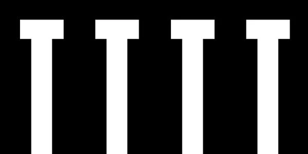

*1.1 در مرز محل‌های پارک. برای پارک کردن یا بیرون آمدن می‌توانید از آن عبور کنید.*

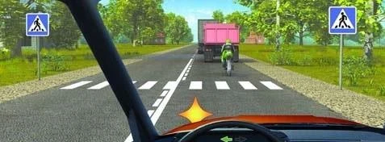

*1.1 پیش از گذرگاه عابر پیاده 1.14.1 و خط منقطع پس از آن. فقط پس از گذرگاه می‌توانید از خط عبور کنید.*

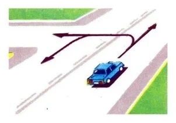

*1.3 در سمت چپ شما. گردش به چپ و دور زدن هر دو از آن عبور می‌کنند، پس فقط می‌توانید مستقیم بروید.*

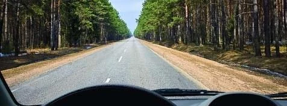

*خط میانی منقطع. برای سبقت، عبور از کنار مانع یا دور زدن می‌توانید از آن عبور کنید، اما آن طرف خط، طرف شما نیست. در سمت چپ خط یا روی آن حرکت نکنید و پس از پایان مانور برگردید.*

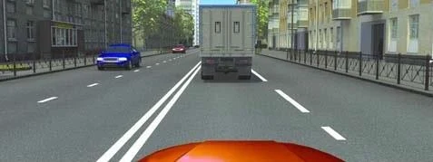

*1.6 در سمت راست. خط‌تیره‌ها بلندتر شده‌اند، پس خط به‌زودی ممتد می‌شود.*

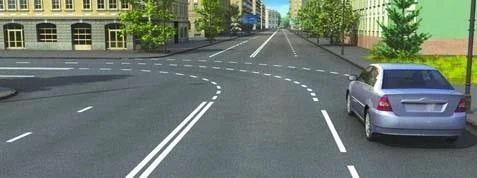

*1.7 شما را در تقاطع هدایت می‌کند.*

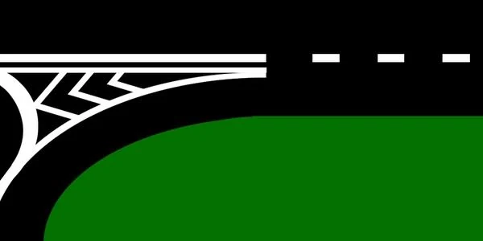

*1.8 در جایی که راه فرعی می‌پیوندد: مرز خط شتاب‌گیری.*

خط منقطع در کنار راه دوخطه فقط لبه سواره‌رو را نشان می‌دهد. به شما حق توقف در شانه راه یا حرکت روی آن را نمی‌دهد.

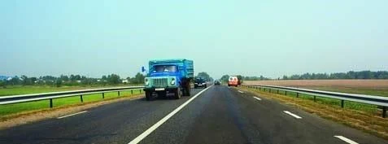

### خط‌کشی 1.9 و خطوط عبور برگشت‌پذیر

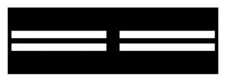

*1.9: مرز خطوط عبور با حرکت برگشت‌پذیر.*

چراغ‌های برگشت‌پذیر این خطوط را کنترل می‌کنند. وقتی چراغ‌ها خاموش یا اصلاً نصب نشده‌اند، 1.9 جریان‌های مخالف را جدا می‌کند و فقط وقتی می‌توانید از آن عبور کنید که در سمت **راست** شما باشد. پس با چراغ خاموش نمی‌توانید از خطی که سمت چپ شماست عبور کنید، حتی برای سبقت.

## خطوط زرد کنار راه چه معنایی دارند؟

- **1.4، زرد ممتد:** توقف و پارک ممنوع. نزدیک لبه سواره‌رو یا روی سطح بالایی سنگ جدول کشیده می‌شود، به‌تنهایی یا همراه با تابلوی 3.27 «توقف ممنوع».
- **1.10، زرد منقطع:** پارک ممنوع. به‌تنهایی یا همراه با تابلوی 3.28 «پارک کردن ممنوع» به کار می‌رود.

> **به یاد داشته باشید:** زرد ممتد یعنی توقف ممنوع. زرد منقطع یعنی پارک ممنوع.

## خط زیگزاگ چه معنایی دارد؟

**1.17** ایستگاه وسایل نقلیه عمومی را مشخص می‌کند. جایی که تابلوی 5.18 «محل پارک تاکسی‌های سواری سبک» نصب شده باشد، محل پارک تاکسی را هم نشان می‌دهد.

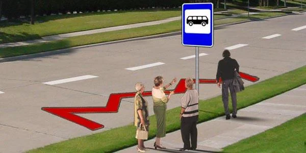

*1.17 با تابلوی ایستگاه اتوبوس و بدون تابلوی 5.18، پس اینجا فقط ایستگاه است.*

## کدام خط‌کشی‌ها به من می‌گویند توقف کنم یا راه بدهم؟

- **1.12 «خط ایست»:** جایی که در چراغ بازدارنده یا کنار تابلوی 2.5 «حرکت بدون توقف ممنوع» توقف می‌کنید.
- **1.13، ردیفی از مثلث‌ها:** جایی که در صورت لزوم توقف می‌کنید تا به وسایل نقلیه راه متقاطع راه بدهید.
- **1.20، مثلث بزرگ:** هشدار می‌دهد که 1.13 در راه است.
- **1.21، کلمه استوپ:** هشدار می‌دهد که 1.12 در راه است، جایی که آن خط همراه با تابلوی 2.5 به کار رفته باشد. این خط‌کشی را در چراغ راهنمایی نمی‌بینید.

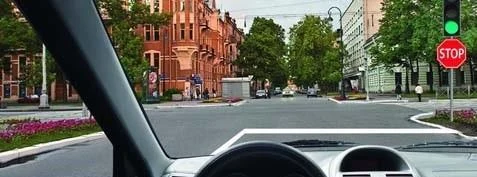

*1.12 «خط ایست».*

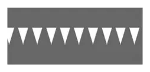

*1.13. کنار خط‌کشی توقف می‌کنید: نه روی آن، نه 5 متر عقب‌تر از آن و نه کنار تابلو.*

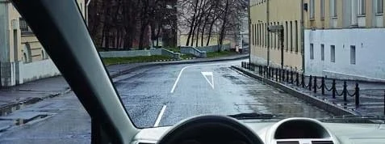

*1.20 پیش از محل راه دادن.*

*1.21.*

## مربع‌ها و شبکه‌ها چه معنایی دارند؟

- **1.14.1، نوارهای پهن:** گذرگاه عابر پیاده.
- **1.15، ردیف‌های مربع:** جایی که مسیر دوچرخه از سواره‌رو می‌گذرد.
- **1.25، نوار شطرنجی:** برجستگی مصنوعی، همراه با تابلوی 5.20 «برجستگی مصنوعی». هشدار می‌دهد که سرعت را کم کنید و چیزی را ممنوع نمی‌کند.
- **1.26، شبکه زرد:** بخشی از تقاطع که اگر راه‌بندان جلوتر شما را مجبور به توقف در آن کند نباید واردش شوید. این قاعده هنگام گردش به راست یا چپ اعمال نمی‌شود. به‌تنهایی یا همراه با تابلوی 1.35 «محدوده تقاطع» به کار می‌رود.

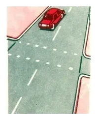

*1.15.*

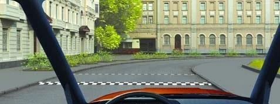

*1.25.*

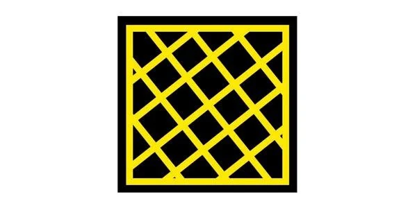

*1.26. اگر روی شبکه گیر کنید، راه ترافیک متقاطع را می‌بندید، پس پیش از آن منتظر بمانید.*

## پیکان‌ها، حروف و اعداد روی راه چه معنایی دارند؟

**1.18، پیکان‌های خط عبور،** جهت‌های مجاز حرکت از هر خط عبور را نشان می‌دهند. پیکان چپ در خط عبور کناری چپ دور زدن را هم مجاز می‌کند.

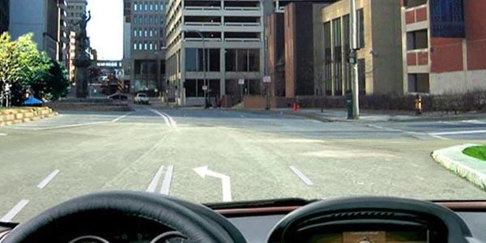

*1.18: چپ و دور زدن مجاز است، اما مستقیم نه.*

اگر پیکان خط عبور شما جهت مورد نظرتان را نشان نمی‌دهد، به‌موقع خط عوض کنید. مستقیم رفتن در این راه ممنوع نیست، فقط از این خط عبور ممنوع است.

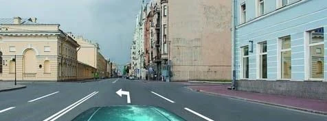

*برای مستقیم رفتن، اول به خط عبور راست بروید.*

**1.19، پیکان‌های خمیده،** هشدار می‌دهند که خط عبور شما رو به پایان است، چون تعداد خطوط عبور در جهت شما به‌زودی کم می‌شود. ممکن است با تابلوهای 1.20.1 تا 1.20.3 «تنگ‌شدن راه» به کار روند. از پیچ راه خبر نمی‌دهند.

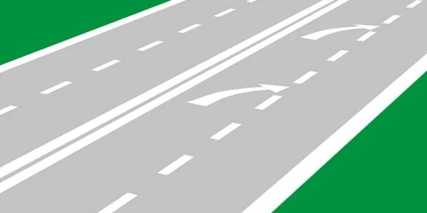

*1.19.*

**1.22** شماره راه یا مسیر را نشان می‌دهد. مسافتی را نشان نمی‌دهد.

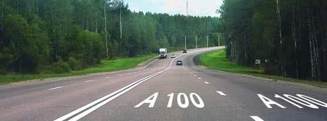

*1.22.*

**1.23، حرف A،** خط عبور ویژه وسایل نقلیه عمومی را مشخص می‌کند. ربطی به گواهینامه رده A ندارد و خط عبور تاکسی هم نیست.

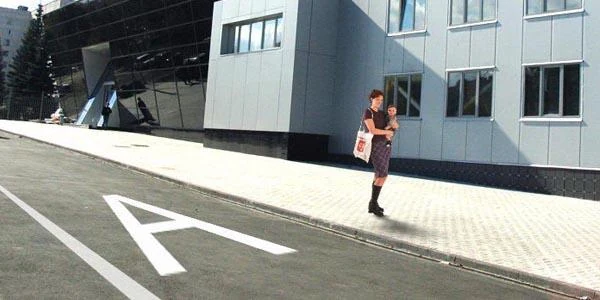

*1.23.*

**1.24.2، عدد داخل دایره،** تابلوی 3.24 «محدودیت حداکثر سرعت» را تکرار می‌کند. یک حد سرعت است، نه توصیه.

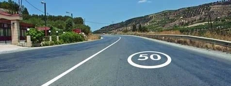

*1.24.2.*

## می‌توانم از روی جزیره هدایت‌کننده بگذرم؟

نه. **1.16** ناحیه‌ای هاشورخورده است که با خطوط سفید پهن محصور شده. از مرز ممتد آن نمی‌توان عبور کرد، پس اصلاً نمی‌توانید وارد آن شوید، نه برای توقف و نه هنگام حرکت با دنده عقب. نوع 1.16.1 جایی کشیده می‌شود که جریان‌های مخالف از هم جدا می‌شوند و 1.16.3 جایی که جریان‌ها به هم می‌پیوندند.

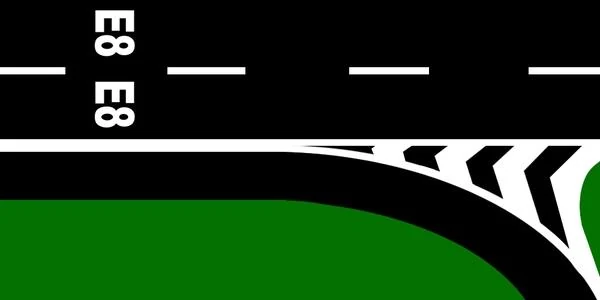

*1.16.3.*

## خط‌کشی‌های عمودی برای چیستند؟

- **2.1.1 تا 2.1.3، نوارهای مورب سیاه و سفید:** روی بخش‌هایی از سازه‌های راه که برای ترافیک خطر ایجاد می‌کنند، نه روی هر چیزی که کنار راه است.
- **2.2:** لبه پایینی دهانه تونل، پل یا روگذر، همان بخشی که وسیله نقلیه بلند به آن برخورد می‌کند.
- **2.5، نوارهای روی حفاظ:** از یک قطعه خطرناک راه می‌گذرید، مانند قوس تند یا سراشیبی تند.

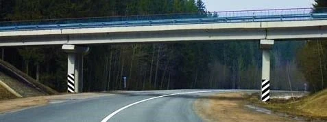

*2.1 روی پایه‌های روگذر.*

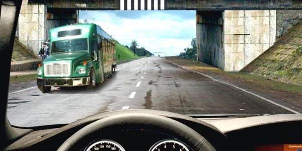

*2.2.*

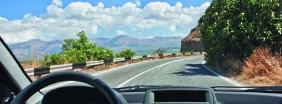

*2.5.*

مطلب تکمیلی: وقتی خط‌کشی‌ها به‌سختی دیده می‌شوند

*این مطلب از بانک سؤالات نیامده است.*

برف، باران و رنگ فرسوده می‌توانند خط‌کشی‌ها را پنهان کنند. وقتی آن‌ها را نمی‌بینید، سرعت را کم کنید، به تابلوها نگاه کنید و ببینید ترافیک جلوی شما چگونه حرکت می‌کند. فقط چون خطی را نمی‌بینید، فرض نکنید خطی وجود ندارد.

## خودتان امتحان کنید

**کدام مسیر خط‌کشی را رعایت می‌کند؟** این خط 1.11 است و سمت منقطع آن رو به خودروی صورتی است. مسیر Ա (A) از یک محوطه کناری بیرون می‌آید و مسیر Բ (B) مسیر خودروی صورتی است.

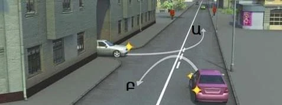

**فقط Բ (B).** این مسیر از سمت خط منقطع عبور می‌کند. مسیر Ա (A) از سمت خط ممتد عبور می‌کند و پایان سبقت هم نیست.

**کدام راننده برای توقف می‌تواند از خط ممتد عبور کند؟** خودروی روبه‌رو به شانه راه می‌رود و مسیر شما از جزیره هاشورخورده سمت راست می‌گذرد.

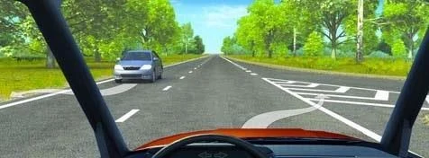

**فقط راننده روبه‌رو.** او برای توقف در شانه راه از خط لبه 1.2 عبور می‌کند که مجاز است. شما از مرز ممتد جزیره 1.16.2 عبور می‌کنید که مجاز نیست.

**برای توقف از کدام خط لبه می‌توانید عبور کنید؟** خارج از محدوده شهری هستید. مسیر Ա (A) به چپ و مسیر Բ (B) به راست می‌رود.

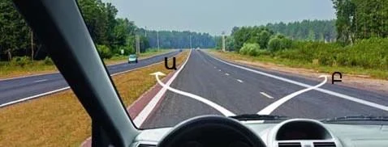

**فقط Բ (B).** از خط 1.2 فقط برای توقف در جایی که توقف مجاز است می‌توان عبور کرد و خارج از محدوده شهری، آن‌جا سمت راست راه است (بندهای 78 و 79).

## نکات کلیدی

- خط ممتد یعنی عبور نکنید. استثناها 1.1 در محل پارک و 1.2 برای توقف در شانه راه هستند.
- 1.3 برای راه‌های چهار خط عبوری یا بیشتر و 1.5 برای راه‌های دو یا سه خط عبوری است.
- خط‌تیره‌های بلندتر (1.6) هشدار می‌دهند که خط ممتد در راه است.
- 1.11: سمتی را بخوانید که به شما نزدیک‌تر است.
- زرد ممتد 1.4 یعنی توقف ممنوع و زرد منقطع 1.10 یعنی پارک ممنوع.
- 1.20 از 1.13 خبر می‌دهد و 1.21 از 1.12.
- نارنجی بر سفید برتری دارد.

{{practice}}
