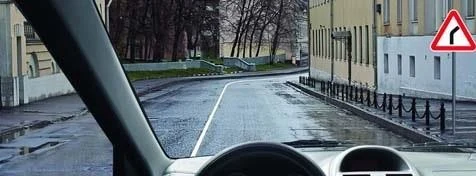
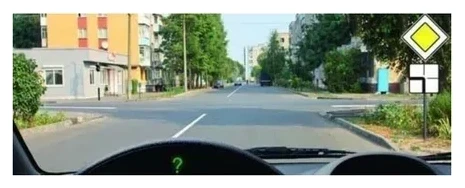
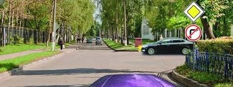
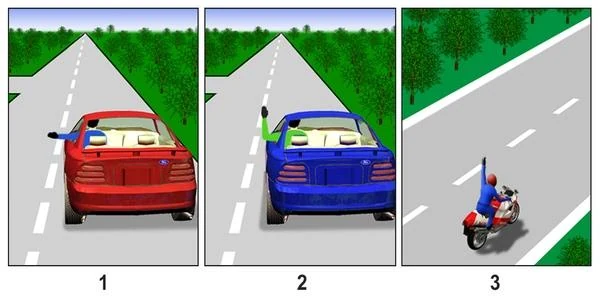
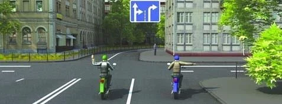
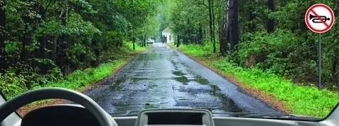
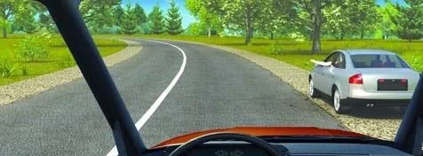
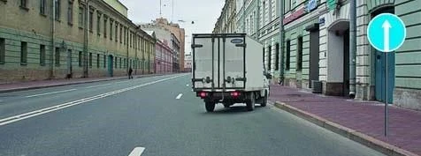

# علامت دادن و بوق

علامت دادن تنها راهی است که به دیگران بگویید چه کاری می‌خواهید بکنید، و برای اثر کردن به زمان نیاز دارد. آزمون می‌پرسد چه زمانی باید علامت بدهید، چه زمانی آن را قطع کنید و علامت چه چیزی به شما نمی‌دهد. بوق ساده‌تر است: مقررات آن را فقط در دو مورد مجاز می‌داند.

## چه زمانی باید علامت بدهم؟

بند 36 مقررات راهنمایی و رانندگی می‌گوید: پیش از به راه افتادن و پیش از هر مانور، با چراغ راهنمای سمتی که به آن می‌روید علامت بدهید. به راه افتادن، تغییر خط، گردش، دور زدن و توقف همگی مانور به حساب می‌آیند. اگر چراغ راهنما ندارید یا خراب است، با دست علامت بدهید.

این وظیفه هیچ شرطی ندارد، چون ممکن است کسانی که شما آن‌ها را نمی‌بینید علامتتان را بخوانند. پس علامت می‌دهید:

- در روز و شب، داخل و خارج از محدوده شهری.
- چه کسی پشت سرتان، روبه‌رویتان یا در نزدیکی‌تان باشد و چه نباشد.
- در منطقه مسکونی، در محوطه پارکینگ و در جایگاه سوخت.
- وقتی تابلو شما را به گردش وادار می‌کند، مانند تابلوی 4.1.2 «حرکت به راست».
- وقتی اتوبوس خطی می‌رانید. مسیر ثابت معافیتی نمی‌آورد.
- وقتی خط عبور شما تمام می‌شود، یا برای عبور از کنار حیوانات روی راه از خط خود خارج می‌شوید.

## آیا جایی هست که علامت لازم نباشد؟

بله، فقط در یک مورد: وقتی پیچ راه را دنبال می‌کنید و در خط خود می‌مانید. در این حالت مانوری انجام نمی‌دهید، چون این راه است که می‌پیچد. به همین دلیل تابلوی 1.11.1 «پیچ خطرناک» چراغ راهنما نمی‌خواهد.

*راه فقط پیچ دارد. در خط خود بمانید؛ علامت دادن لازم نیست.*

تقاطع فرق دارد، حتی اگر راه اصلی در آن بپیچد. شما باز هم از یک راه به راه دیگر می‌روید، پس این کار گردش است.

*اینجا راه اصلی به چپ می‌پیچد. دنبال کردن آن گردش است، پس باید علامت بدهید.*

## کدام چراغ راهنما؟

معمولاً جهت روشن است. این موارد روشن نیستند:

- **توقف در لبه چپ راه یک‌طرفه:** مقصد شما همان لبه است، پس چراغ راهنمای چپ را روشن کنید.
- **دو حرکت پشت سر هم:** برای هر کدام علامت بدهید. اگر اول به راست می‌روید و بعد به چپ دور می‌زنید، ابتدا راست و سپس چپ علامت بدهید.
- **میدان:** هنگام ورود و خروج از چراغ راهنمای راست استفاده کنید، حتی وقتی برای دور زدن دور جزیره میانی می‌چرخید. علامت چپ رانندگان دیگر را گمراه می‌کند.

## علامت کی شروع و کی قطع می‌شود؟

| نوع علامت | شروع | قطع |
|---|---|---|
| چراغ راهنما | از قبل، پیش از مانور | بلافاصله پس از پایان مانور |
| علامت با دست | از قبل، پیش از مانور | بلافاصله پیش از آغاز مانور |

دیگران برای دیدن علامت شما زمان لازم دارند، پس علامت باید زودتر بیاید. علامت دست را زودتر قطع می‌کنید، چون برای انجام مانور به هر دو دست روی فرمان نیاز دارید.

> **دام رایج:** «بلافاصله پیش از آغاز مانور» برای چراغ راهنما درست به نظر می‌رسد، اما به کسی فرصت واکنش نمی‌دهد. پاسخ درست «از قبل» است. عبارت «بلافاصله پیش از» مربوط به قطع کردن علامت دست است.

هنگام سبقت، چراغ راهنمای چپ همراه با رفتن به خط چپ است. به محض قرار گرفتن در آن خط، چراغ را خاموش کنید، نه پس از گذشتن از وسیله نقلیه جلویی. اگر روشن بماند، به رانندگان پشت سر می‌گوید هنوز به چپ می‌روید.

یک مورد هست که علامت زودهنگام گمراه‌کننده است: می‌خواهید درست بعد از تقاطع توقف کنید و راهی از سمت راست به راه شما می‌پیوندد.

*چراغ راهنمای راست را فقط پس از ورود به تقاطع روشن کنید. اگر زودتر روشن کنید، به نظر می‌رسد می‌خواهید به همان راه بپیچید.*

## آیا علامت دادن به من حق تقدم می‌دهد؟

نه. علامت فقط دیگران را از قصد شما آگاه می‌کند. باز هم باید به همه کسانی که حق تقدم دارند راه بدهید و تا وقتی مانور ایمن نیست آن را شروع نکنید.

> **به یاد داشته باشید:** علامت درخواست است، نه حق. در هیچ وضعیتی، چه هنگام به راه افتادن و چه هنگام تغییر خط، به شما برتری نمی‌دهد.

## علامت‌های دست چه معنایی دارند؟

علامت دست جای چراغ راهنمای نداشته یا خراب را می‌گیرد، در هر ساعتی از شبانه‌روز. اگر چراغ راهنما کار می‌کند، علامت دست جای آن را نمی‌گیرد. بند 37 معنای علامت‌ها را تعیین می‌کند:

| علامت | معنا |
|---|---|
| دست چپ کشیده به پهلو، یا دست راست خم‌شده از آرنج رو به بالا | گردش به چپ یا دور زدن |
| دست راست کشیده به پهلو، یا دست چپ خم‌شده از آرنج رو به بالا | گردش به راست |
| دست راست یا چپ که مستقیم رو به بالا برده شده | ترمز کردن |

برای حرکت مستقیم هیچ علامت دستی وجود ندارد.

یک راه ساده برای به خاطر سپردن: دست صاف به سمتی اشاره می‌کند که می‌روید، دست خم‌شده یعنی سمت مخالف، و دست رو به بالا یعنی ترمز.

*تصویر 1 گردش به چپ، تصویر 2 گردش به راست و تصویر 3 ترمز کردن است.*

*دو راه برای گفتن یک چیز: هر دو موتورسوار علامت گردش به راست می‌دهند.*

مطلب تکمیلی: چراغ‌های راهنمای خود را بررسی کنید

*این مطلب از بانک سؤالات نیامده است.*

گاهی با چراغ راهنمای روشن دور خودرو بچرخید، یا از کسی بخواهید آن را نگاه کند. در بسیاری از خودروها، اگر چراغ راهنما ناگهان خیلی تندتر از معمول چشمک بزند، یعنی لامپی سوخته است.

## چه زمانی می‌توانم بوق بزنم؟

بند 136 استفاده از بوق را فقط در دو مورد مجاز می‌داند:

- **خارج از محدوده شهری،** برای آگاه کردن راننده دیگر از قصد سبقت.
- **وقتی برای جلوگیری از تصادف لازم است،** در هر جایی.

این فهرست کامل است. بوق برای شما حق تقدم نمی‌آورد و رانندگان وسایل نقلیه عمومی هم مورد اضافه‌ای ندارند.

> **دام رایج:** هشدار سبقت با بوق خارج از محدوده شهری مجاز است، نه داخل آن. گزینه‌هایی که «در محدوده شهری» می‌گویند نادرست‌اند.

## خودتان امتحان کنید

**در این راه می‌رانید و می‌خواهید به راننده جلویی خبر بدهید که قصد سبقت دارید.** تابلوی 3.26 «استفاده از علامت صوتی ممنوع» در سمت راست قرار دارد.

آیا می‌توانید بوق بزنید؟ **نه.** با این تابلو، بوق فقط برای جلوگیری از تصادف مجاز است. هشدار سبقت جزو استثنا نیست.

**خودرویی در لبه راه ایستاده و راننده‌اش دستش را بیرون می‌آورد.**

این یعنی چه؟ **می‌خواهد به راه بیفتد.** راننده‌ای که چراغ راهنمای سالم ندارد، پیش از به راه افتادن با دست به دیگران خبر می‌دهد.

**کامیون زیر تابلوی 4.1.1 «فقط مستقیم» به راست و به داخل حیاطی می‌پیچد.** چراغ راهنمای آن روشن نیست.

کدام قاعده نقض شده است؟ **فقط قاعده علامت دادن.** تابلوی 4.1.1 گردش به راست به حیاط‌ها و محوطه‌های مجاور راه را ممنوع نمی‌کند، اما راننده باید علامت می‌داد.

## نکات کلیدی

- پیش از به راه افتادن و پیش از هر مانور همیشه علامت بدهید، هر کسی که اطرافتان باشد.
- تنها استثنا: دنبال کردن پیچ راه بدون تغییر خط.
- چراغ راهنما: از قبل روشن، بلافاصله پس از مانور خاموش. علامت دست: بلافاصله پیش از مانور قطع.
- علامت دادن حق تقدم نمی‌آورد.
- علامت‌های دست: دست صاف جهت را نشان می‌دهد، دست خم‌شده یعنی سمت مخالف، دست رو به بالا یعنی ترمز. این علامت‌ها فقط برای چراغ راهنمای نداشته یا خراب است.
- بوق: فقط خارج از محدوده شهری برای هشدار سبقت، یا برای جلوگیری از تصادف. زیر تابلوی 3.26 فقط برای جلوگیری از تصادف.

{{practice}}
