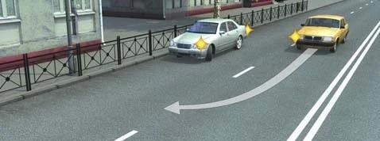
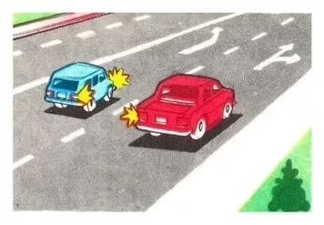
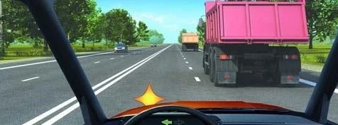
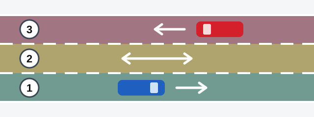
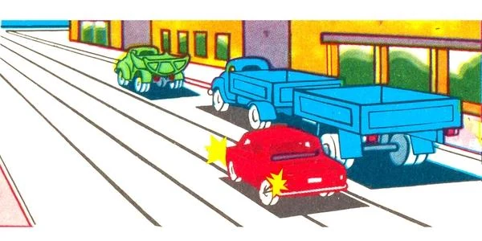
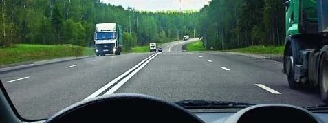
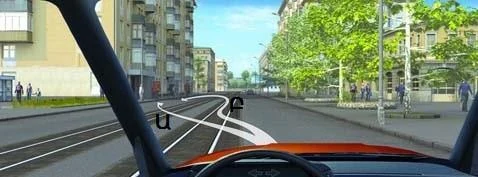

# حرکت و تغییر خط

بیشتر پرسش‌های این بخش به یک چیز برمی‌گردد: چه کسی از قبل آنجا بوده است. یاد بگیرید کدام بخش راه مال شماست، و به خاطر بسپارید راننده‌ای که جابه‌جا می‌شود به راننده‌ای که جابه‌جا نمی‌شود راه می‌دهد.

## کدام سمت راه مال من است؟

در ارمنستان از سمت راست حرکت می‌شود. ماده 7 قانون جمهوری ارمنستان «درباره تأمین ایمنی ترافیک جاده‌ای» حرکت از سمت راست را در همه راه‌های این کشور تعیین کرده است.

در راه دوطرفه بدون خط‌کشی، نیمه چپ سواره‌رو سمت ترافیک روبه‌رو است (بند 52). پس نمی‌توانید از وسط راه برانید، حتی اگر هیچ خودرویی نیاید. نیمه چپ بنا به تعریف سمت روبه‌رو است.

جایی که هیچ خطی راه را به خط عبور تقسیم نکرده، تعداد خطوط عبور به عرض سواره‌رو، اندازه وسایل نقلیه و فاصله لازم میان آن‌ها بستگی دارد. راهی که فقط خط میانی دارد هم می‌تواند چهار خط عبور داشته باشد.

*خط جداکننده خطوط عبور وجود ندارد، اما در هر سمت دو وسیله نقلیه کنار هم جا می‌شوند، پس این راه چهار خط عبور دارد.*

## هنگام به راه افتادن چه کسی اول می‌رود؟

همه کسانی که از قبل در حرکت‌اند. به راه افتادن یک مانور است: علامت می‌دهید و این علامت برتری‌ای به شما نمی‌دهد. فقط وقتی می‌توانید حرکت کنید که مانع کسی در راه نشوید. ترافیکی که به آن می‌پیوندید هرگز مجبور نیست برای شما جا باز کند.

- کامیونی از پشت سر در خط عبور می‌آید: فقط اگر مانع آن نشوید می‌توانید حرکت کنید.
- راننده‌ای روی راه در حال دور زدن است: صبر می‌کنید تا کارش تمام شود، با اینکه او در حال دور زدن است.
- راننده‌ای که روی راه است می‌خواهد کنار جدول، جایی که شما از آن خارج می‌شوید، توقف کند: به او راه می‌دهید.
- دو خودرو هم‌زمان از محل پارک حرکت می‌کنند: خودروی عقبی به خودروی جلویی راه می‌دهد.

*خودروی نقره‌ای در حال به راه افتادن است، پس به خودروی زردی که از قبل روی راه است راه می‌دهد.*

## هنگام تغییر خط چه کسی راه می‌دهد؟

بند 39 دو قاعده دارد.

**فقط شما تغییر خط می‌دهید:** به وسایل نقلیه‌ای که در آن خط، در همان جهت و بدون تغییر مسیر می‌روند راه بدهید. دلیل تغییر خط هر چه باشد، این قاعده برقرار است:

- خط عبور شما با تابلوی 5.15.5 «پایان خط عبور» تمام می‌شود، یا راه با تابلوی 1.20.2 باریک می‌شود. تمام شدن خط عبور به شما حق نمی‌دهد خود را جا بدهید.
- پس از سبقت به خط خود برمی‌گردید. پایان سبقت حق تقدمی نمی‌آورد.
- جرثقیل با چراغ گردان نارنجی می‌رانید. این چراغ‌ها فقط هشدار می‌دهند و حق تقدم نمی‌آورند.

**دو وسیله نقلیه هم‌زمان تغییر خط می‌دهند:** آنکه در سمت چپ است راه می‌دهد. مهم نیست هر کدام به کجا می‌روند.

*هر دو خودرو هم‌زمان به خط وسط می‌روند. خودروی قرمز در سمت راست است، پس خودروی آبی راه می‌دهد.*

> **به یاد داشته باشید:** یک خودرو تغییر خط می‌دهد: همان خودرو راه می‌دهد. دو خودرو هم‌زمان: آنکه در چپ است راه می‌دهد.

هنگام پیوستن به راه هم همین منطق برقرار است. در خط شتاب‌گیری، به وسایل نقلیه راهی که به آن می‌پیوندید راه می‌دهید (بند 47). این خط برای آن است که سرعت خود را با آن‌ها هماهنگ کنید، نه اینکه آن‌ها برای شما جا باز کنند.

مطلب تکمیلی: نقطه کور را بررسی کنید

*این مطلب از بانک سؤالات نیامده است.*

آینه‌ها همه کنار خودرو را نشان نمی‌دهند. پیش از به راه افتادن یا تغییر خط، به آینه‌ها نگاه کنید و بعد نگاهی کوتاه از روی شانه به جایی بیندازید که در آینه دیده نمی‌شود. موتورسیکلت می‌تواند آنجا پنهان باشد.

## در کدام خط عبور برانم؟

به محل شما بستگی دارد.

| محل | قاعده |
|---|---|
| خارج از محدوده شهری | تا جایی که می‌توانید به راست نزدیک بمانید. وقتی خطوط راست آزادند نباید خطوط چپ را اشغال کنید (بند 55). |
| داخل محدوده شهری | می‌توانید از هر خط عبوری که برایتان مناسب است استفاده کنید (بند 56). |

پس خارج از محدوده شهری، پس از سبقت اگر خط راست آزاد است به آن برگردید. اگر کامیون‌ها آن خط را پر کرده‌اند، می‌توانید در خط چپ بمانید، چون خط راست آزاد نیست. در محدوده شهری اصلاً مجبور نیستید برگردید.

*خط راست اشغال است، پس ماندن در خط چپ مجاز است.*

> **دام رایج:** پس از سبقت، پاسخ «نه، لازم نیست برگردم» به‌تنهایی نادرست است. گزینه درست شرط را هم می‌گوید: فقط جایی که مقررات محدوده شهری اعمال می‌شود.

**وسایل نقلیه عمومی در خطوط منظم مسافری:** جایی که در یک جهت 3 خط عبور یا بیشتر وجود دارد، در هر راهی، فقط برای گردش به چپ یا دور زدن می‌توانند وارد خط عبور کناری چپ شوند. سبقت این خط را برایشان باز نمی‌کند (بند 57).

## راه‌های سه‌خطه چگونه کار می‌کنند؟

در راه دوطرفه سه‌خطه خط‌کشی‌شده که خط وسط آن برای هر دو جهت است، هر خط عبور یک کار دارد.

*خط 1 خط شماست. خط 2 مشترک است: فقط برای سبقت، عبور از کنار مانع، گردش به چپ یا دور زدن وارد آن شوید. خط 3 فقط برای ترافیک روبه‌رو است: هرگز نباید وارد آن شوید.*

این قاعده از بند 54 می‌آید. هرگز نمی‌توانید فقط در امتداد خط وسط برانید. اگر به چپ می‌پیچید، از خط وسط گردش می‌کنید، چون چپ‌ترین خطی است که برای شما باز است. فرقی ندارد خط راست شلوغ باشد یا آزاد.

> **دام رایج:** هر گزینه‌ای که یکی از این چهار دلیل را می‌گوید درست ولی ناقص است. گزینه‌ای را انتخاب کنید که همه را در بر می‌گیرد.

## آیا می‌توانم روی خطوط تراموا برانم؟

فقط روی خطوط هم‌جهت با خودتان، در سمت چپتان و هم‌سطح با راه. بند 59 این کار را در دو گروه از موارد اجازه می‌دهد، به شرط آنکه مانع تراموا نشوید:

- همه خطوط عبور جهت شما اشغال باشند.
- در حال سبقت، عبور از کنار مانع، گردش به چپ یا دور زدن باشید.

اگر پیش از تقاطع تابلوی 5.15.1 یا 5.15.2 «جهت‌های حرکت در خطوط عبور» نصب شده باشد، نمی‌توانید در آن تقاطع روی خطوط تراموا برانید. در این حالت حتی گردش به چپ یا دور زدن هم از روی خطوط تراموا ممکن نیست.

## خودتان امتحان کنید

**کامیون آبی خط راست جهت شما را پر کرده و شما خودروی قرمز هستید.**

آیا می‌توانید روی خطوط تراموا برانید؟ **بله.** همه خطوط عبور جهت شما اشغال است، پس بند 59 آن را مجاز می‌داند، به شرط آنکه مانع تراموا نشوید.

**خارج از محدوده شهری از کامیون گذشته‌اید و خط راست جلوی شما آزاد است.**

کجا ادامه می‌دهید؟ **فقط در خط راست.** بند 55 اشغال خطوط چپ را وقتی خطوط راست آزادند ممنوع می‌کند.

**عابری کنار جدول سمت چپ این خیابان تراموادار منتظر است.** می‌خواهید او را سوار کنید.

از کدام مسیر؟ **فقط Բ (B).** مسیر Ա (A) به‌صورت مورب به سمت روبه‌رو می‌رود. مسیر Բ (B) در سمت خودتان ادامه می‌یابد و سپس به‌صورت یک مانور درست از روی خطوط تراموا به چپ می‌پیچد.

## نکات کلیدی

- حرکت از سمت راست است. در راه دوطرفه بدون خط‌کشی، نیمه چپ مال ترافیک روبه‌رو است.
- به راه افتادن: به همه کسانی که از قبل روی راه‌اند راه بدهید.
- تغییر خط: به ترافیک آن خط راه بدهید. دو خودرو هم‌زمان: آنکه در چپ است راه می‌دهد.
- خارج از محدوده شهری به راست نزدیک بمانید. داخل محدوده شهری از هر خطی می‌توانید استفاده کنید.
- سه خط: خط وسط فقط برای سبقت، عبور از کنار مانع، گردش به چپ یا دور زدن. هرگز وارد خط دورتر نشوید.
- خطوط تراموای هم‌جهت: فقط اگر خطوط عبور پر باشند یا در حال مانور باشید، و نه در تقاطعی با تابلوی 5.15.1 یا 5.15.2.

{{practice}}
