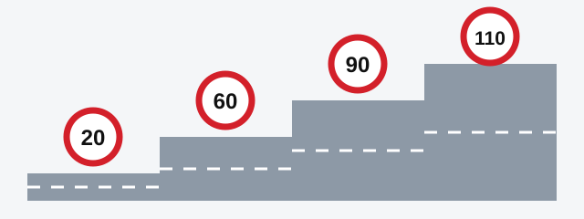
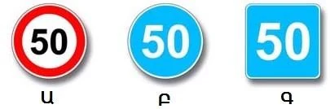
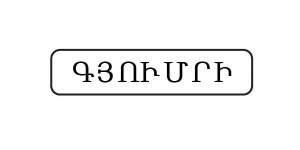
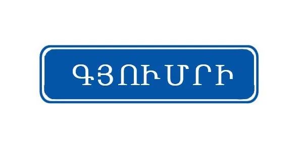
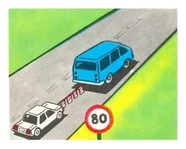
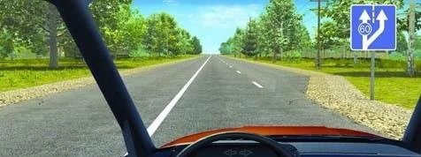

# سرعت

سرعت تعیین می‌کند وقتی مشکلی پیش می‌آید چقدر زمان دارید. آزمون این موضوع را با عدد می‌سنجد، پس این درس یک جدول کوچک برای حفظ کردن و سه قاعده برای پرسش‌های گمراه‌کننده به شما می‌دهد.

## سرعت مجاز خودرو چقدر است؟

سه پرسش حد سرعت خودروی سواری را مشخص می‌کند: آیا در محدوده شهری هستید، در منطقه مسکونی، یا در آزادراه؟

*از چپ به راست، حد سرعت خودروی سواری: 20 کیلومتر بر ساعت در منطقه مسکونی یا حیاط، 60 کیلومتر بر ساعت در محدوده شهری، 90 کیلومتر بر ساعت در راه‌های خارج از محدوده شهری، و 110 کیلومتر بر ساعت در آزادراه.*

## وسایل نقلیه دیگر چطور؟

| وسیله نقلیه | محدوده شهری | خارج از محدوده شهری | آزادراه |
|---|---|---|---|
| خودروی سواری یا کامیون تا 3.5 تن | 60 | 90 | 110 |
| اتوبوس حومه‌ای، بین‌منطقه‌ای یا بین‌شهری | 60 | 90 | 90 |
| سایر اتوبوس‌ها | 60 | 70 | 90 |
| کامیون بیش از 3.5 تن | 60 | 70 | به مقررات راهنمایی و رانندگی مراجعه کنید |
| خودروی سواری با تریلر | 60 | 70 | 90 |

همه اعداد بر حسب کیلومتر بر ساعت و برگرفته از بندهای 68 و 69 مقررات راهنمایی و رانندگی است. در منطقه مسکونی یا حیاط، حد سرعت برای همه وسایل نقلیه 20 کیلومتر بر ساعت است.

> **دام رایج:** اتوبوس بین‌شهری در همه راه‌های خارج از محدوده شهری تا 90 کیلومتر بر ساعت مجاز است، اما در آزادراه هم بیشتر از این نمی‌تواند برود. فقط خودروهای سواری و کامیون‌های تا 3.5 تن به 110 کیلومتر بر ساعت می‌رسند. اتوبوس در محدوده شهری هم مانند بقیه به 60 کیلومتر بر ساعت برمی‌گردد.

## کدام حد سرعت به نوع راه بستگی ندارد؟

بند 71 دو حد سرعت تعیین می‌کند که در هر نوع راهی اعمال می‌شوند:

- **یدک‌کشی وسیله نقلیه مکانیکی: 50 کیلومتر بر ساعت**، چه با اتصال سخت و چه با اتصال انعطاف‌پذیر.
- **حمل افراد در اتاق بار مجهز کامیون، یا حمل گروه سازمان‌یافته کودکان: 60 کیلومتر بر ساعت.**

هیچ تابلویی نمی‌تواند این حدها را بالا ببرد. اگر تابلو 80 کیلومتر بر ساعت را مجاز کند و شما در حال یدک‌کشی باشید، حد سرعت شما همچنان 50 کیلومتر بر ساعت است. همیشه حد سخت‌گیرانه‌تر حاکم است.

> **به یاد داشته باشید:** برداشته شدن محدودیتی که تابلو گذاشته، محدودیتی را که مقررات برای کار شما تعیین کرده برنمی‌دارد. تابلوی 3.25 «پایان محدوده محدودیت حداکثر سرعت» شما را از حد سرعت یدک‌کشی آزاد نمی‌کند.

## تابلوی سرعت را چگونه بخوانم؟

روی سه تابلو عدد می‌بینید. فقط شکل و رنگ تابلو معنای عدد را مشخص می‌کند.

- **حلقه قرمز، تابلوی 3.24 «محدودیت حداکثر سرعت»:** سقف سرعت است. تندتر نروید.
- **دایره آبی، تابلوی 4.6 «محدودیت حداقل سرعت»:** کف سرعت است. کندتر نروید.
- **مربع آبی، تابلوی 6.2 «سرعت توصیه‌شده»:** فقط توصیه است و محدودیت الزامی ایجاد نمی‌کند.

تابلوی نام شهر هم مهم است. ظاهرش بی‌خطر است، اما رنگش حد سرعت شما را تغییر می‌دهد.

*سیاه روی سفید، تابلوی 5.23.1: از اینجا مقررات محدوده شهری اعمال می‌شود، پس حد سرعت 60 کیلومتر بر ساعت است.*

*سفید روی آبی، تابلوی 5.25: مقررات محدوده شهری اعمال نمی‌شود، پس حد سرعت راه‌های خارج از محدوده شهری همچنان معتبر است.*

> **دام رایج:** دیدن نام یک شهر همیشه به معنای 60 کیلومتر بر ساعت نیست. اول رنگ تابلو را نگاه کنید.

مطلب تکمیلی: چرا با دو برابر شدن سرعت، مسافت ترمز حدود چهار برابر می‌شود

*این مطلب از بانک سؤالات نیامده است.*

انرژی خودروی در حال حرکت با مجذور سرعت آن افزایش می‌یابد و ترمزها باید همه این انرژی را از بین ببرند. اگر سرعت را دو برابر کنید، انرژی حدود چهار برابر می‌شود، پس ترمز کردن هم حدود چهار برابر مسافت می‌برد. مسافت واکنش را هم به این اضافه کنید: تا خطر را ببینید و پایتان را حرکت دهید، خودرو با همان سرعت کامل به راه خود ادامه می‌دهد.

## آیا رعایت حد سرعت کافی است؟

نه. حد سرعت بیشترین سرعت مجاز است، نه سرعتی که باید با آن برانید. بند 65 از شما می‌خواهد وضعیت سطح راه و میزان دید در جهت حرکت را در نظر بگیرید. بند 66 سرعتی را می‌طلبد که کنترل کامل وسیله نقلیه را در دست شما نگه دارد.

همچنین نباید:

- از حداکثر سرعت فنی وسیله نقلیه خود فراتر بروید.
- از سرعت درج‌شده روی علامت شناسایی «محدودیت سرعت» نصب‌شده روی وسیله نقلیه خود فراتر بروید.
- بدون ضرورت با سرعت بسیار کم برانید، اگر این کار مانع حرکت وسایل نقلیه دیگر شود.
- ناگهانی ترمز کنید، مگر اینکه برای جلوگیری از تصادف لازم باشد.

## چه زمانی باید سرعتم را کم کنم؟

مقررات از شما می‌خواهد در این موارد سرعت را کم کنید:

- وقتی مانع یا خطری برای حرکت پیش می‌آید (بند 67).
- وقتی نور چشم شما را خیره می‌کند (بند 129).
- وقتی به وسیله نقلیه‌ای با علامت «حمل کودکان» نزدیک می‌شوید و کودکان در حال سوار یا پیاده شدن هستند (بند 156).
- وقتی به وسیله نقلیه‌ای با چراغ گردان آبی و قرمز و آژیر ویژه، یا به وسیله نقلیه متوقفی با چراغ گردان روشن نزدیک می‌شوید (بندهای 29 و 30).

## خودتان امتحان کنید

**شما راننده ون آبی هستید.** خودروی سفید را با اتصال انعطاف‌پذیر یدک می‌کشید و تابلو عدد 80 را نشان می‌دهد.

حد سرعت شما چقدر است؟ **50 کیلومتر بر ساعت.** تابلو 80 را مجاز می‌کند، اما بند 71 سرعت یدک‌کشی را به 50 محدود کرده و حد سخت‌گیرانه‌تر حاکم است.

**در حال یدک‌کشی خودرویی هستید و این تابلو جلوی شما ظاهر می‌شود.** خط عبور اصلی دست‌کم 60 کیلومتر بر ساعت می‌خواهد و یک خط عبور اضافی از سمت راست آغاز می‌شود.

از کدام خط عبور می‌توانید بروید؟ **فقط خط راست.** یدک‌کشی سرعت شما را به 50 کیلومتر بر ساعت محدود می‌کند، پس نمی‌توانید به 60 کیلومتر بر ساعتی که خط عبور اصلی لازم دارد برسید.

## نکات کلیدی

- خودروی سواری: 20 در منطقه مسکونی، 60 در محدوده شهری، 90 در خارج از آن، 110 در آزادراه.
- اتوبوس بین‌شهری: 90 در همه راه‌های خارج از محدوده شهری، از جمله آزادراه.
- یدک‌کشی: 50 کیلومتر بر ساعت. افراد در اتاق بار کامیون یا گروه سازمان‌یافته کودکان: 60 کیلومتر بر ساعت. هیچ تابلویی این حدها را بالا نمی‌برد.
- حلقه قرمز یعنی حداکثر، دایره آبی یعنی حداقل، مربع آبی یعنی توصیه.
- تابلوی شهر با زمینه سفید یعنی 60 کیلومتر بر ساعت. تابلوی با زمینه آبی این معنا را ندارد.
- حد سرعت یک سقف است: سرعت خود را با راه، میزان دید و کنترل وسیله نقلیه هماهنگ کنید.

{{practice}}
