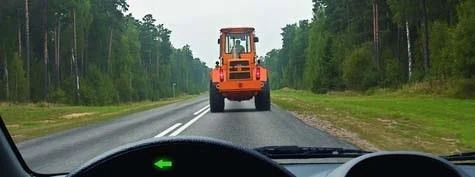
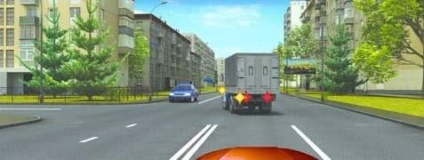
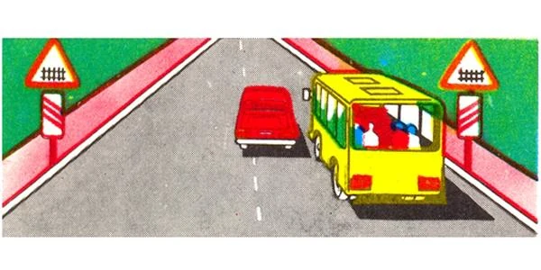
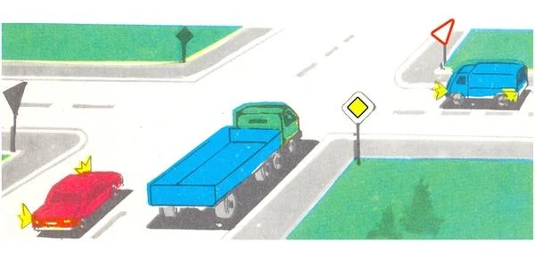
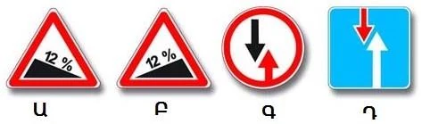
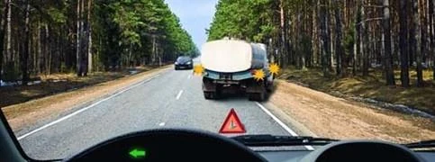
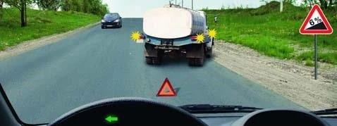
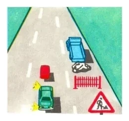

# سبقت و ترافیک روبه‌رو

سبقت شما را برای مدتی به سمت اشتباه راه می‌برد، پس مقررات تعیین می‌کند چه زمانی می‌توانید شروع کنید و کجا هرگز نباید این کار را بکنید. این درس همچنین می‌گوید وقتی دو وسیله نقلیه نمی‌توانند از کنار هم بگذرند، چه کسی راه می‌دهد.

## پیش از شروع چه چیزهایی را بررسی کنم؟

در راهی که در هر جهت یک خط عبور دارد، سبقت یعنی استفاده از خط عبور روبه‌رو. بند 73 همه این‌ها را با هم می‌خواهد:

- خط عبور روبه‌رو تا فاصله کافی آزاد باشد.
- راننده پشت سر شما سبقت از شما را شروع نکرده باشد.
- راننده جلویی علامت گردش به چپ نداده باشد.
- بتوانید بدون ایجاد مانع برای کسی، با ایمنی به خط خود برگردید.

خط‌کشی هم باید اجازه بدهد. از روی خط منقطع می‌توانید بگذرید. در خط ممتد همراه با خط منقطع، یعنی خط‌کشی 1.11، نمی‌توانید سبقت را از سمت ممتد شروع کنید. تراکتور کند جلوی شما این را تغییر نمی‌دهد.

*سمت ممتد خط‌کشی مال شماست، پس نمی‌توانید برای سبقت از خط خارج شوید.*

نوع وسیله نقلیه شما و سرعت دیگری به‌تنهایی سبقت را ممنوع نمی‌کنند: جایی که ممنوعیتی نیست، کامیون می‌تواند از اتوبوسی که با سرعت 60 کیلومتر بر ساعت می‌رود سبقت بگیرد.

## از کدام سمت سبقت بگیرم؟

از چپ (بند 74). فقط یک استثنا هست: اگر راننده جلویی علامت گردش به چپ داده و مانور را شروع کرده باشد، از راست می‌گذرید. می‌توانید هم صبر کنید تا او برود.

*می‌توانید از راست بگذرید یا صبر کنید. هر دو مجاز است.*

گذشتن از راست به یک خط عبور در سواره‌رو نیاز دارد. بند 61 حرکت روی شانه راه را ممنوع کرده است، پس اگر کنار او فقط شانه راه هست، صبر کنید.

## کجا سبقت ممنوع است؟

| محل | قاعده |
|---|---|
| تقاطع‌ها | ممنوع، چه کنترل‌شده و چه کنترل‌نشده (بند 77) |
| گذرگاه‌های راه‌آهن | ممنوع، روی آن‌ها و تا 100 متر پیش از آن‌ها |
| گذرگاه‌های عابر پیاده | ممنوع، چه کسی در حال عبور باشد و چه نباشد |

ممنوعیت راه‌آهن شروع و پایان مشخصی دارد. خارج از محدوده شهری، نخستین تابلوی 1.1 «گذرگاه راه‌آهن با راه‌بند» 150 تا 300 متر پیش از گذرگاه نصب می‌شود، پس کنار آن اگر خط‌کشی اجازه بدهد هنوز می‌توانید سبقت بگیرید. ممنوعیت در گذرگاه تمام می‌شود: می‌توانید درست پس از آن شروع کنید و 100 متر صبر لازم نیست.

*این‌ها نخستین تابلوهای هشدار هستند و محدوده 100 متری هنوز شروع نشده، پس این سبقت مجاز است.*

در تقاطع، کل سبقت باید پیش از رسیدن به آن تمام شود. تابلوی هشدار در جلو یعنی فقط در صورتی می‌توانید سبقت بگیرید که بتوانید آن را پیش از تقاطع کامل کنید.

**اگر در راه اصلی باشم چه؟** پرسش‌هایی که مستقیماً این را می‌پرسند می‌گویند ممنوعیت همچنان برقرار است. حق تقدم به شما اجازه می‌دهد اول از تقاطع بگذرید، نه اینکه در آن سبقت بگیرید. توضیح پرسش 1097 این ممنوعیت را جور دیگری بیان می‌کند، اما در تصویر آن راه اصلی وجود ندارد، پس پاسخ آن در هر حال همان است.

*خودروی قرمز در راه اصلی است، اما کامیون در تقاطع است، پس سبقت ممنوع است.*

## آیا می‌توانم از کسی که در حال سبقت است سبقت بگیرم؟

نه. اگر وسیله نقلیه جلویی در حال سبقت یا عبور از کنار مانع باشد، نمی‌توانید از آن سبقت بگیرید. کاری که می‌کند تعیین‌کننده است، نه سرعتش.

> **دام رایج:** بسیاری از گزینه‌ها می‌گویند «اگر سرعت آن کمتر از 30 کیلومتر بر ساعت باشد». در این پرسش‌ها این شرط هرگز پاسخ درست نیست. سرعت، ممنوعیت را در تقاطع، گذرگاه یا پشت وسیله نقلیه‌ای که در حال سبقت است برنمی‌دارد.

## تابلوهای سبقت چه معنایی دارند؟

*تابلوی 3.20 «سبقت ممنوع»: سبقت برای همه انواع وسایل نقلیه ممنوع است. با این حال همچنان می‌توانید از وسایل نقلیه کندرو، گاری‌های اسبی، موتورسیکلت‌های دوچرخ بدون سایدکار، موتورگازی‌ها و دوچرخه‌ها سبقت بگیرید.*

*تابلوی 3.22 «سبقت گرفتن کامیون‌ها ممنوع»: موتورسیکلت‌ها، خودروهای سواری، اتوبوس‌ها و کامیون‌های با حداکثر جرم مجاز تا 3.5 تن همچنان می‌توانند سبقت بگیرند.*

زیر تابلوی 3.20 پرسش این است که وسیله نقلیه جلویی چیست. کامیون با هر سرعتی کامیون است. زیر تابلوی 3.22 پرسش این است که شما چه می‌رانید.

## اگر کسی از من سبقت بگیرد چه؟

وظیفه راه دادن ندارید، اما نباید با افزایش سرعت یا هر کار دیگری مانع او شوید (بند 75). این ممنوعیت فقط مربوط به مانع شدن در برابر سبقت است: افزایش سرعت برای خالی کردن تقاطع اشکالی ندارد.

مطلب تکمیلی: چرا خودروی روبه‌رو زودتر از آنچه به نظر می‌رسد می‌رسد

*این مطلب از بانک سؤالات نیامده است.*

اگر شما و خودروی روبه‌رو هر کدام با سرعت 90 کیلومتر بر ساعت برانید، فاصله میان شما با سرعت 180 کیلومتر بر ساعت کم می‌شود، یعنی 50 متر در هر ثانیه. سبقت هم بیشتر از آنچه بیشتر رانندگان فکر می‌کنند طول می‌کشد. اگر شک دارید، پشت سر بمانید.

## وقتی نمی‌توانیم از کنار هم بگذریم چه کسی راه می‌دهد؟

سه حالت همه موارد را پوشش می‌دهد:

- **قسمت باریک با تابلوی 2.6 یا 2.7:** از تابلو پیروی کنید.
- **شیب با تابلوی 1.13 یا 1.14:** راننده‌ای که سرازیر می‌رود راه می‌دهد، مانع هر جا که باشد (بند 46).
- **هر حالت دیگر:** راننده‌ای که مانع در سمت اوست راه می‌دهد (بند 46).

*از چپ به راست: 1.13 «سرازیری تند»، 1.14 «سربالایی تند»، 2.6 «حق تقدم با عبور و مرور روبه‌رو» و 2.7 «حق تقدم نسبت به عبور و مرور روبه‌رو». تابلوی اول و سوم شما را به راه دادن وادار می‌کنند.*

**قسمت‌های باریک:** تابلوی 2.7 به شما حق تقدم می‌دهد و راننده روبه‌رو تابلوی 2.6 را می‌بیند. تابلوی 2.6 راه را نمی‌بندد. اگر مانع کسی که از روبه‌رو می‌آید نشوید، می‌توانید وارد شوید.

**شیب‌ها:** توقف در سربالایی و دوباره به راه افتادن بسیار دشوارتر است، پس وسیله نقلیه‌ای که بالا می‌رود اول می‌گذرد. وسایل نقلیه عمومی در اینجا حق تقدم ویژه‌ای ندارند.

> **به یاد داشته باشید:** قاعده شیب بر قاعده مانع مقدم است. در سرازیری راه می‌دهید، حتی اگر سنگ‌ها در سمت مقابل باشند. در سربالایی اول می‌روید، حتی اگر کامیون خراب در سمت شما باشد.

ببینید کدام تابلو را دارید. تابلوی 1.13 شما را به راه دادن وادار می‌کند، اما تابلوی ریزش سنگ تابلوی شیب نیست، پس قاعده مانع اعمال می‌شود.

**مانع‌های ثابت:** در راه دوطرفه بدون تابلو، خط‌کشی یا نوار جداکننده، از جزیره‌های ایمنی، استوانه‌های راهنما و پایه‌های پل از سمت راست بگذرید (بند 64). رفتن از چپ شما را به خط عبور روبه‌رو می‌برد.

## خودتان امتحان کنید

**شما پشت تانکر هستید.** تانکر با چراغ‌های خطر روشن و مثلث هشدار پشت سرش در خط شما ایستاده است. خودرویی از روبه‌رو می‌آید.

آیا باید راه بدهید؟ **بله.** مانع در سمت شماست و تابلوی شیب هم وجود ندارد.

**همان تانکر، اما این بار تابلوی 1.14 «سربالایی تند» کنار راه است.**

آیا باید راه بدهید؟ **نه، می‌توانید اول بروید.** راننده‌ای که پایین می‌آید راه می‌دهد، با اینکه مانع در سمت شماست.

**شما خودروی سبز هستید و خودروی قرمز جلویی در حال عبور از کنار محل تعمیرات راه است.**

آیا می‌توانید سبقت بگیرید؟ **نه.** خودروی قرمز در حال عبور از کنار مانع است، پس سبقت از آن ممنوع است.

## نکات کلیدی

- پیش از سبقت: خط روبه‌روی آزاد، کسی در حال سبقت از شما نباشد، علامت چپ در جلو نباشد، بازگشت ایمن باشد. همه با هم.
- از چپ سبقت بگیرید، یا از راست اگر راننده جلویی علامت داده و گردش به چپ را شروع کرده است. هرگز از شانه راه.
- سبقت ممنوع است در تقاطع‌ها، روی گذرگاه عابر پیاده، و روی گذرگاه راه‌آهن و تا 100 متر پیش از آن.
- هرگز از وسیله نقلیه‌ای که در حال سبقت یا عبور از کنار مانع است سبقت نگیرید. سرعت 30 کیلومتر بر ساعت چیزی را تغییر نمی‌دهد.
- وقتی از شما سبقت می‌گیرند: سرعت را زیاد نکنید و مانع نشوید.
- چه کسی راه می‌دهد: از تابلوهای 2.6 و 2.7 پیروی کنید. در شیب مشخص‌شده، راننده‌ای که پایین می‌رود. در غیر این صورت، راننده‌ای که مانع در سمت اوست.

{{practice}}
