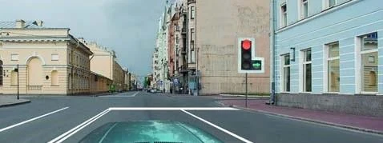
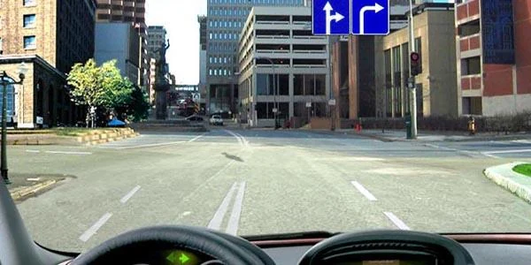
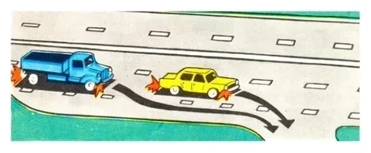
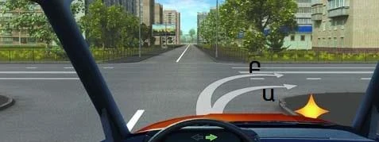
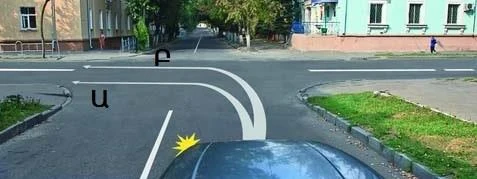
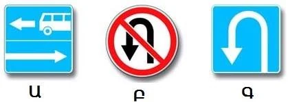
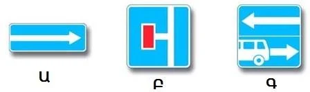
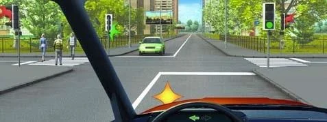
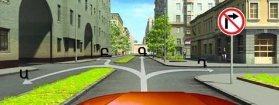
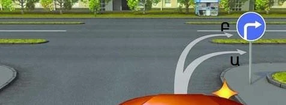

# گردش

گردش خوب خیلی پیش از پیچ، در خط عبور درست و کنار لبه درست شروع می‌شود. این درس می‌گوید خودرو را کجا قرار دهید، از چه مسیری بروید، به چه کسانی راه بدهید و کدام تابلوها واقعاً جلوی شما را می‌گیرند.

## از کدام خط عبور گردش کنم؟

بند 40 می‌گوید: از قبل به خط عبور کناری جهت خود بروید. برای گردش به راست از خط عبور کناری راست، و برای گردش به چپ یا دور زدن از خط عبور کناری چپ استفاده کنید.

اگر تا آخرین لحظه صبر کنید، باید از عرض خطوط دیگر بگذرید. برای همین حتی پیکان سبز هم اگر در خط اشتباه باشید کمکی به شما نمی‌کند.

*خط راست آزاد است و شما در خط چپ هستید. با وجود پیکان سبز نمی‌توانید از اینجا به راست بپیچید.*

همین قاعده در قسمت یک‌طرفه هم برقرار است، جایی که خط چپ هم مال جهت شماست. اول به آن خط بروید و بعد به چپ بپیچید.

**استثنا:** تابلو یا خط‌کشی می‌تواند گردش از خطوط دیگر را هم مجاز کند. جایی که تابلوی 5.15.2 «جهت‌های حرکت در هر خط عبور» یا پیکان‌های روی راه گردش به راست را از خط شما اجازه می‌دهند، می‌توانید در همان خط بمانید. رفتن به خط راست هم مجاز است. هر دو درست است.

*اینجا هر دو خط می‌توانند به راست بپیچند، پس از هر کدام می‌توانید گردش کنید.*

سه خط ویژه هم بر گردش اثر می‌گذارند:

- **خط کاهش سرعت:** اگر وجود دارد، اول وارد آن شوید، بعد سرعت را کم کنید و از همان خط گردش کنید (بند 47). این‌طور جلوی ترافیک خط اصلی را نمی‌گیرید.
- **خط ویژه وسایل نقلیه عمومی با خط منقطع:** اگر کنار لبه راست است و با خط منقطع جدا شده، برای گردش به راست باید وارد آن شوید (بند 124).
- **خطوط تراموا در سمت چپ شما و هم‌سطح با راه:** معمولاً بدون ایجاد مانع برای تراموا از روی خطوط به چپ گردش می‌کنید (بند 40). اگر پیش از تقاطع تابلوی 5.15.1 یا 5.15.2 نصب شده باشد، به جای آن از خط عبور گردش می‌کنید.

*کامیون آبی درست عمل می‌کند. خودروی زرد با گردش از خط اصلی قاعده را نقض می‌کند.*

## از چه مسیری بروم؟

بند 41 یک قاعده برای همه گردش‌ها دارد: وقتی از محل تقاطع سواره‌روها خارج می‌شوید، نباید در سمت ترافیک روبه‌رو قرار بگیرید. گردش به راست قاعده دومی هم دارد: تا جایی که ممکن است نزدیک لبه راست بمانید.

**گردش به راست:** به جدول نزدیک بمانید. قوس باز ممنوع است.

*Ա (A) لبه راست را دنبال می‌کند و مجاز است. Բ (B) قوس باز می‌زند و مجاز نیست.*

**گردش به چپ:** مقررات مسیری داخل تقاطع تعیین نکرده است. فقط پایان مسیر مهم است. هر مسیری که شما را در سمت خودتان از راه متقاطع بیرون بیاورد مجاز است، به هر یک از خطوط عبور آن.

*Ա (A) گوشه را می‌بُرد و در نیمه روبه‌رو تمام می‌شود. Բ (B) در نیمه خود شما تمام می‌شود، پس فقط Բ (B) مجاز است.*

> **به یاد داشته باشید:** گردش به راست: مسیر مهم است، پس نزدیک لبه بمانید. گردش به چپ: خروج مهم است، پس در سمت روبه‌رو تمام نکنید.

**گردش به راه یک‌طرفه:** سمت روبه‌رویی وجود ندارد، پس هر مسیر گردش به چپ که درست تمام شود مجاز است.

**راهی با نوار جداکننده:** این راه دو سواره‌رو دارد. گردش به راست به سواره‌روی نزدیک‌تر انجام می‌شود. مسیری که از نوار می‌گذرد شما را به سواره‌روی ترافیک روبه‌رو می‌برد و ممنوع است.

## به چه کسی راه بدهم؟

هنگام گردش در تقاطع ممکن است با سه گروه روبه‌رو شوید.

| چه کسی | چه زمانی | بند |
|---|---|---|
| عابرانی که از راه مقصد می‌گذرند و دوچرخه‌سواران در مسیر دوچرخه | هر گردش، به راست یا چپ | 87 |
| وسایل نقلیه روبه‌رو که مستقیم می‌روند یا به راست می‌پیچند | گردش به چپ با چراغ سبز | 90 |
| تراموا، به هر جهتی که برود | وقتی چراغ به تراموا و وسایل نقلیه دیگر هم‌زمان اجازه حرکت می‌دهد | 92 |

در حرکت مستقیم هیچ‌کدام از این وظایف گردش را ندارید.

با چراغ سبز پشت خط ایست صبر نکنید. وارد تقاطع شوید، همان‌جا راه بدهید و سپس گردش را تمام کنید.

> **دام رایج:** کسانی که از روبه‌رو به راست می‌پیچند هم حساب می‌شوند. گزینه‌ای که این وظیفه را به ترافیک مستقیم روبه‌رو محدود کند نادرست است.

جایی که چراغ راهنمایی کار می‌کند، تابلوهای حق تقدم تقاطع ترتیب عبور را تعیین نمی‌کنند. نوع مانور تعیین می‌کند، پس اتوبوسی که به چپ می‌پیچد منتظر ترافیک روبه‌رو می‌ماند.

خارج از تقاطع، در گردش به چپ یا دور زدن باید به وسایل نقلیه روبه‌رو و به ترامواهای هم‌جهت راه بدهید (بند 44).

مطلب تکمیلی: هنگام انتظار چرخ‌ها را صاف نگه دارید

*این مطلب از بانک سؤالات نیامده است.*

وقتی برای گردش به چپ منتظر هستید، چرخ‌های جلو را تا زمان حرکت صاف نگه دارید. اگر خودرویی از پشت به شما بزند، چرخ‌های صاف شما را در سمت خودتان به جلو می‌برند. چرخ‌های چرخانده‌شده ممکن است شما را به میان ترافیک روبه‌رو هل بدهند.

## کدام تابلوها جلوی گردش به چپ را می‌گیرند؟

فقط بعضی از آن‌ها. تابلوهای هشداردهنده هشدار می‌دهند و تابلوهای اطلاعاتی اطلاع‌رسانی می‌کنند.

| تابلو | گردش به چپ؟ |
|---|---|
| 1.11.1 «پیچ خطرناک» و تابلوهای هشداردهنده مشابه | مجاز: فقط هشدار می‌دهند |
| 6.8.1 «بن‌بست» | مجاز: راه فقط خروجی ندارد |
| 3.19 «دور زدن ممنوع» | مجاز: فقط دور زدن را ممنوع می‌کند |
| 6.3.1 «محل دور زدن» | ممنوع |
| 5.7.1 «خروج به راه با حرکت یک‌طرفه» با پیکان رو به راست | ممنوع: خلاف جهت ترافیک می‌روید |

تابلوی 5.13.1 «خروج به راهی دارای خط ویژه وسایل نقلیه عمومی» به دقت بیشتری نیاز دارد. پیکان ساده ترافیک عمومی را نشان می‌دهد و پیکان همراه با اتوبوس، خط ویژه اتوبوس را.

*در تابلوی اول پیکان ساده به راست است، پس ترافیک عمومی به راست می‌رود و گردش به چپ به این راه ممنوع است. محل دور زدن (راست) هم گردش به چپ را ممنوع می‌کند. دور زدن ممنوع (وسط) این کار را نمی‌کند.*

*اینجا پیکان ساده تابلوی سوم به چپ است، پس گردش به چپ مجاز است. بن‌بست (وسط) هم آن را مجاز می‌داند. تابلوی اول با پیکان رو به راست مجاز نمی‌داند.*

## خودتان امتحان کنید

**با چراغ سبز به چپ می‌پیچید.** خودرویی از روبه‌رو می‌آید و عابران از راه سمت چپ شما می‌گذرند.

به چه کسی راه می‌دهید؟ **به هر دو.** بند 90 خودرو را در بر می‌گیرد و بند 87 عابران را.

**جلوی شما این تابلو است و چهار مسیر رسم شده است.**

کدام‌ها مجازند؟ **Ա (A) یا Գ (C).** تابلو Դ (D) را کنار می‌گذارد و Բ (B) در سواره‌روی ترافیک روبه‌رو در راه جداشده تمام می‌شود.

**تابلوی 4.1.2 «حرکت به راست» اینجا نصب شده و راه متقاطع نوار جداکننده دارد.**

از کدام مسیر؟ **فقط Ա (A).** این مسیر نزدیک لبه راست وارد سواره‌روی نزدیک‌تر می‌شود. Բ (B) به سواره‌روی دورتر می‌رود که برای ترافیک روبه‌رو است.

## نکات کلیدی

- از قبل به خط عبور کناری درست بروید، مگر اینکه تابلو یا خط‌کشی خطوط دیگر را هم مجاز کند.
- اول وارد خط کاهش سرعت شوید، بعد سرعت را کم کنید.
- گردش به راست: نزدیک لبه راست بمانید. گردش به چپ: در سمت روبه‌رو تمام نکنید.
- گردش به چپ با چراغ سبز: وارد شوید، سپس به وسایل نقلیه روبه‌رو که مستقیم یا به راست می‌روند و به تراموا راه بدهید.
- در هر گردش: به عابران در حال عبور و دوچرخه‌سواران در مسیر دوچرخه راه بدهید.
- تابلوهای هشداردهنده و اطلاعاتی گردش را ممنوع نمی‌کنند. تابلوی 6.3.1 و پیکان یک‌طرفه رو به راست جلوی گردش به چپ را می‌گیرند.

{{practice}}
