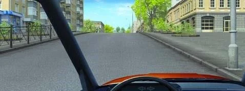
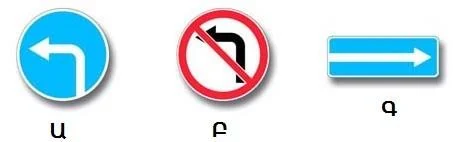
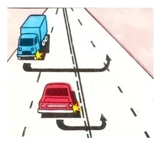
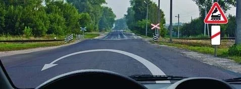
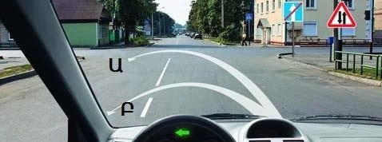
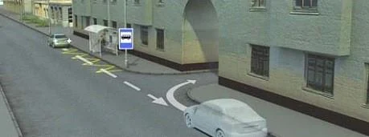

# دور زدن و حرکت با دنده عقب

هر دو مانور شما را خلاف جریان ترافیک قرار می‌دهند، پس مقررات جاهایی را که نباید این کارها را بکنید فهرست کرده است. یک فهرست کوتاه را یاد بگیرید تا بتوانید تقریباً به همه پرسش‌های این بخش پاسخ بدهید، چون همین فهرست هم برای دور زدن است و هم برای حرکت با دنده عقب.

## دور زدن کجا ممنوع است؟

بند 50 این جاها را فهرست کرده است:

- روی گذرگاه‌های عابر پیاده.
- در تونل‌ها.
- روی و زیر پل‌ها، روگذرها و راه‌های مرتفع.
- روی گذرگاه‌های راه‌آهن.
- جایی که دید حتی در یک جهت کمتر از 100 متر باشد.
- در محل ایستگاه وسایل نقلیه عمومی.
- در راه‌های یک‌طرفه.

این ممنوعیت‌ها به محل مربوط‌اند، نه به ترافیک. اینکه اتوبوسی در ایستگاه نباشد یا مانع کسی نشوید کمکی نمی‌کند. روی پل، دید خوب هم فایده‌ای ندارد: شرط 100 متر ردیف جداگانه خودش را در فهرست دارد.

> **دام رایج:** در راه یک‌طرفه پاسخ «در هیچ حالتی» است. نه میزان دید و نه خلوت بودن راه دور زدن را مجاز نمی‌کند، چون شما را رو در روی کل جریان ترافیک قرار می‌دهد.

ممنوعیت راه یک‌طرفه تا پایان قسمت یک‌طرفه ادامه دارد. تابلوهای 5.6 «پایان راه یک‌طرفه» و 1.21 «حرکت دوطرفه» می‌گویند این قسمت جلوتر تمام می‌شود، پس جایی که این تابلوها نصب شده‌اند هنوز در راه یک‌طرفه هستید.

## چه زمانی دور زدن مجاز است؟

دور زدن مجاز است، مگر اینکه تابلو، خط‌کشی یا بند 50 جلوی آن را بگیرد. پس در تقاطع معمولی یا راه مستقیم و باز می‌توانید دور بزنید.

**آزمون دید:** جایی که دست‌کم 100 متر را در هر دو جهت می‌بینید، می‌توانید دور بزنید. پیچ یا بالای سربالایی می‌تواند این دید را بگیرد، پس پاسخ درست اغلب «اگر دید 100 متر یا بیشتر باشد مجاز است» است. اینکه بتوانید در یک حرکت دور بزنید، معیاری نیست که مقررات به کار ببرد.

*بالای سربالایی میزان دید شما را محدود می‌کند. فقط اگر در هر دو جهت 100 متر می‌بینید اینجا دور بزنید.*

تابلوهای هشداردهنده چیزی را ممنوع نمی‌کنند. تابلوی هشدار پیچ، گذرگاه عابر پیاده یا گذرگاه راه‌آهن فقط می‌گوید جلوتر چه خبر است. ممنوعیت از خود گذرگاه شروع می‌شود، پس دور زدن پیش از آن مجاز است.

## کدام تابلوها و خط‌ها مهم‌اند؟

| تابلو | دور زدن؟ |
|---|---|
| 3.19 «دور زدن ممنوع» | ممنوع. این همان تابلویی است که آن را ممنوع می‌کند. |
| 3.18.2 «گردش به چپ ممنوع» | مجاز: فقط گردش به چپ را ممنوع می‌کند |
| 4.1.3 «حرکت به چپ» | مجاز: تابلوهایی که گردش به چپ را مجاز می‌کنند دور زدن را هم مجاز می‌کنند |
| 5.7.1 «خروج به راه با حرکت یک‌طرفه» | مجاز: چیزی را ممنوع نمی‌کند |
| 6.3.1 «محل دور زدن» | در همان محل مجاز است. تابلوی تکمیلی 200 متر می‌گوید آن محل چقدر جلوتر است. |
| 5.15.1 «جهت‌های حرکت در خطوط عبور» | فقط اگر خط عبور کناری چپ پیکان گردش به چپ داشته باشد مجاز است |
| 3.1 «ورود ممنوع» در راهی که به آن می‌رسید | آن مسیر ممنوع است. مسیری را انتخاب کنید که وارد آن راه نشود. |

*هر سه تابلو دور زدن را مجاز می‌دانند.*

**تابلوی 4.1.1 «فقط مستقیم»:** تا وقتی این تابلو اعتبار دارد فقط می‌توانید مستقیم بروید، پس دور زدن در قسمت پیش از تقاطع ممنوع است. پس از آنکه مستقیم از تقاطع گذشتید، اثر تابلو تمام شده و می‌توانید دور بزنید. پرسش‌ها درباره دور زدن در خود تقاطع با هم اختلاف دارند، پس این درس آن را باز می‌گذارد. آن تصویرها را از پاسخ‌های بخش تمرین یاد بگیرید.

**خط‌ها:** دور زدن می‌تواند از روی خط منقطع بگذرد. از روی خط ممتد نمی‌تواند.

## دور زدن را از کجا شروع کنم؟

از خط عبور کناری چپ شروع کنید (بند 40). اگر در خط اشتباه هستید و خط ممتد نمی‌گذارد به خط چپ بروید، اصلاً نمی‌توانید آن دور زدن را به شکل قانونی انجام دهید.

*خودروی قرمز خط کنار خط میانی را گرفته است، پس درست عمل می‌کند. کامیون آبی از عرض یک خط دیگر دور می‌زند.*

- **خطوط تراموای هم‌جهت در سمت چپ شما و هم‌سطح با راه:** بدون ایجاد مانع برای تراموا از روی خطوط دور بزنید، مگر اینکه تابلوهای 5.15.1، 5.15.2 یا خط‌کشی 1.18 چیز دیگری بگویند (بند 40).
- **راه با نوار جداکننده:** از انتهای نوار دور بزنید و در سمت درست تمام کنید. در سمت ترافیک روبه‌رو قرار نگیرید (بند 41).
- **گذرگاه عابر پیاده در نزدیکی:** مسیر شما نباید از روی آن بگذرد.

جایی که محدودیت دیگری نیست، مقررات مسیر خاصی برای دور زدن تعیین نکرده است، پس هر مسیری که شما را درست قرار دهد مجاز است.

علامت افسر راهنمایی ممکن است دور زدن را مجاز کند، اما به شما حق تقدم نمی‌دهد. اگر مسیرهایتان یکدیگر را قطع می‌کنند و مقررات ترتیبی تعیین نکرده، به وسیله نقلیه‌ای که از سمت راست شما نزدیک می‌شود راه بدهید (بند 45).

## چه زمانی می‌توانم با دنده عقب بروم؟

فقط وقتی ایمن است و مانع کسی نمی‌شود (بند 48). اگر پشت سر خود را نمی‌بینید، از کسی کمک بخواهید. بوق یا چراغ‌های خطر فقط به دیگران هشدار می‌دهند و پشت خودرو را به شما نشان نمی‌دهند.

بند 49 حرکت با دنده عقب را در این جاها ممنوع می‌کند:

- در تقاطع‌ها.
- هنگام خروج از محوطه مجاور به راه.
- در همه جاهای بند 50: گذرگاه‌های عابر پیاده، تونل‌ها، پل‌ها، گذرگاه‌های راه‌آهن، ایستگاه‌های وسایل نقلیه عمومی و بقیه.

> **به یاد داشته باشید:** جایی که بند 50 دور زدن را ممنوع کرده، حرکت با دنده عقب هم ممنوع است. «اگر مانع کسی نشود» آن را مجاز نمی‌کند.

پس نمی‌توانید روی پل، در تونل یا در ایستگاه اتوبوس با دنده عقب به سمت مسافر بروید. در قسمت خلوتی که هیچ‌کدام از این‌ها را ندارد، می‌توانید. اگر پیچ خود را در تقاطع رد کردید، با دنده عقب برنگردید: ادامه بدهید و جایی که مجاز است دور بزنید.

ممنوعیت به محل بستگی دارد، نه به خط عبور. حرکت با دنده عقب در خطی غیر از خط کناری راست به‌خودی‌خود ممنوع نیست.

رفتن با دنده عقب به ورودی حیاط برای دور زدن مجاز است، اگر مانع کسی نشود و در یکی از جاهای ممنوع نباشد.

مطلب تکمیلی: پیش از سوار شدن نگاه کنید

*این مطلب از بانک سؤالات نیامده است.*

کودکان خردسال و اشیای کوتاه ممکن است پشت خودرو پنهان باشند، حتی با دوربین عقب. پیش از حرکت با دنده عقب دور خودرو بچرخید، آهسته برانید و علاوه بر آینه‌ها از شیشه عقب هم نگاه کنید.

## خودتان امتحان کنید

**پیکان یک دور زدن را پیش از این گذرگاه راه‌آهن نشان می‌دهد.**

آیا مجاز است؟ **بله.** ممنوعیت مربوط به خود گذرگاه است و شما روی آن نیستید. شرطی درباره قطار هم وجود ندارد.

**می‌خواهید پس از این دو تابلو دور بزنید.**

از کدام مسیر؟ **هیچ‌کدام.** هنوز در راه یک‌طرفه هستید، پس دور زدن از هر دو مسیر ممنوع است.

**می‌خواهید با دنده عقب وارد حیاط سمت راست شوید و ایستگاه اتوبوس با خط‌کشی آن نزدیک است.**

آیا مجاز است؟ **نه.** حرکت با دنده عقب در ایستگاه‌های وسایل نقلیه عمومی ممنوع است، حتی اگر مانع کسی نشوید.

## نکات کلیدی

- دور زدن ممنوع است روی گذرگاه عابر پیاده، در تونل، روی یا زیر پل، روی گذرگاه راه‌آهن، در ایستگاه وسایل نقلیه عمومی و در راه یک‌طرفه.
- با دید کمتر از 100 متر حتی در یک جهت، دور نزنید.
- فقط تابلوی 3.19 دور زدن را با نام ممنوع می‌کند. «گردش به چپ ممنوع» این کار را نمی‌کند.
- از خط عبور کناری چپ شروع کنید و هرگز از خط ممتد نگذرید.
- فقط وقتی ایمن است با دنده عقب بروید. اگر نمی‌بینید، کمک بگیرید.
- حرکت با دنده عقب ممنوع است در تقاطع، هنگام خروج از محوطه مجاور و در همه جاهای بند 50.

{{practice}}
