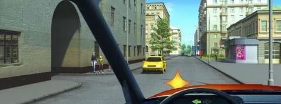

# حیاط‌ها و ورودی‌های کناری

در حیاط یا خروجی جایگاه سوخت شبیه تقاطع کوچکی است، اما تقاطع نیست و به شما حقی نمی‌دهد. در هر دو جهت، کسانی که از مسیرشان می‌گذرید اول می‌روند.

## هنگام خروج چه کسی اول می‌رود؟

آن‌ها. بند 38 می‌گوید وقتی از محوطه مجاور، مانند حیاط یا جایگاه سوخت، به راه می‌آیید باید:

- به همه وسایل نقلیه‌ای که در راه حرکت می‌کنند راه بدهید.
- مانع عابران پیاده نشوید.

*هنگام خروج از این دروازه‌ها، به رانندگان و عابران پیاده از هر دو طرف راه می‌دهید.*

> **دام رایج:** «رانندگانی که از سمت راست نزدیک می‌شوند» قاعده تقاطع است. اینجا اعمال نمی‌شود، چون اینجا تقاطع نیست.

پس اگر شما از قبل روی راه باشید، نسبت به کامیونی که از جایگاه سوخت بیرون می‌آید حق تقدم دارید. حتی اگر راننده کامیون با دست علامت بدهد هم همین‌طور است.

## هنگام ورود چه کسی اول می‌رود؟

بند 38 ورود از راه به محوطه مجاور را هم پوشش می‌دهد. به دوچرخه‌سوارانی که از مسیرشان می‌گذرید راه بدهید و مانع عابران پیاده نشوید.

هنگام گردش به چپ به داخل حیاط از سمت روبه‌رو هم می‌گذرید، پس باید به وسایل نقلیه روبه‌رو هم راه بدهید (بند 44).

تابلوی 4.1.1 «فقط مستقیم» گردش به راست به داخل حیاط را ممنوع نمی‌کند. باز هم باید علامت بدهید.

## خودتان امتحان کنید

**به راست و به داخل حیاط می‌پیچید.** دوچرخه‌سواری در سمت راست شما می‌رود و عابرانی نزدیک ورودی هستند.

به چه کسی راه می‌دهید؟ **به دوچرخه‌سوار و عابران پیاده.** هر دو در مسیر گردش شما هستند.

**به چپ و به داخل حیاط می‌پیچید.** خودروی زردی از روبه‌رو می‌آید و دو عابر کنار ورودی ایستاده‌اند.

به چه کسی راه می‌دهید؟ **به راننده و عابران پیاده.** بند 44 خودرو را در بر می‌گیرد و بند 38 عابران را.

## نکات کلیدی

- خروج از حیاط: به وسایل نقلیه روی راه راه بدهید و مانع عابران پیاده نشوید.
- ورود: به دوچرخه‌سواران راه بدهید و مانع عابران پیاده نشوید.
- گردش به چپ به داخل حیاط: به وسایل نقلیه روبه‌رو هم راه بدهید.
- خروجی حیاط تقاطع نیست، پس قواعد تقاطع کمکی نمی‌کند.

{{practice}}
