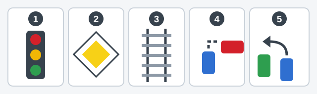
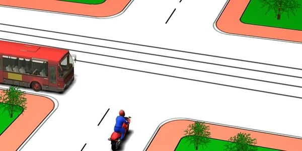
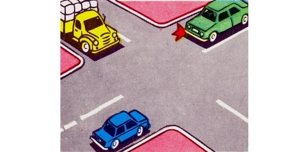
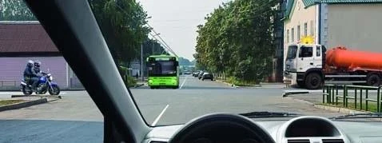
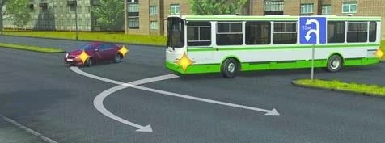
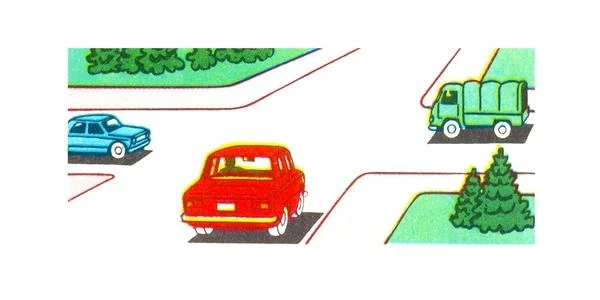
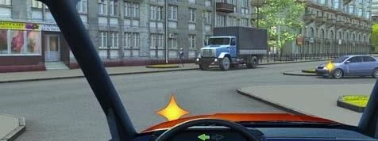
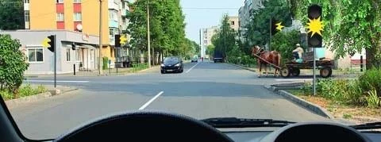

# تقاطع: راه‌های هم‌ارز

پرسش‌های ترتیب عبور از شما می‌خواهند چند وسیله نقلیه را در یک صف بچینید، و در تقاطع راه‌های هم‌ارز هیچ تابلویی پاسخ را به شما نمی‌گوید. این درس روشی پنج‌مرحله‌ای به شما می‌دهد که می‌توانید روی هر تصویری تکرارش کنید، و بعد دو مرحله‌ای را آموزش می‌دهد که تکلیف راه‌های هم‌ارز را روشن می‌کنند.

## روش پنج‌مرحله‌ای چیست؟

پنج کلمه، همیشه با همین ترتیب: **چراغ، تابلو، ریل، راست، چپ.**

*کادرهای 1 تا 5 همان پنج مرحله‌اند: چراغ، تابلو، ریل، راست، چپ.*

| مرحله | بپرسید | نتیجه |
|---|---|---|
| 1. چراغ | آیا افسر راهنمایی یا چراغ راهنمایی روشن و فعال ترتیب را تعیین می‌کند؟ | از علامت پیروی کنید. چراغ خاموش یا زرد چشمک‌زن به حساب نمی‌آید، پس ادامه دهید. |
| 2. تابلو | آیا تابلوهای حق تقدم یا سطح راه، یکی از راه‌ها را اصلی می‌کند؟ | راه فرعی منتظر راه اصلی می‌ماند. مرحله‌های 3 تا 5 را درون هر گروه اجرا کنید. |
| 3. ریل | آیا ترامویی در راهی هم‌ارز با راه شما هست؟ | تراموا پیش از وسایل نقلیه غیرریلی می‌رود. |
| 4. راست | آیا وسیله نقلیه‌ای از سمت راست شما نزدیک می‌شود؟ | به آن راه بدهید. |
| 5. چپ | آیا به چپ می‌پیچید یا دور می‌زنید و کسی از روبه‌رو مستقیم یا به راست می‌رود؟ | به او راه بدهید. |

مرحله‌های 3 تا 5 با هم جمع می‌شوند، پس ممکن است همزمان به چند وسیله نقلیه راه بدهکار باشید. وقتی مرحله‌ها را اجرا کردید، **صف را بسازید:**

1. هر کس منتظر هیچ‌کس نیست، اول می‌رود.
2. او را خط بزنید و دوباره بپرسید.
3. وسایل نقلیه‌ای که مسیرشان یکدیگر را قطع نمی‌کند، با هم می‌روند.

این درس مرحله‌های 1، 4 و 5 را پوشش می‌دهد. درس «تراموا در تقاطع» به مرحله 3 می‌پردازد. درس‌های «تقاطع: راه اصلی و فرعی» و «وقتی راه اصلی می‌پیچد» به مرحله 2 می‌پردازند.

## راه‌ها چه زمانی هم‌ارزند؟

تقاطع وقتی *تنظیم‌شده* است که افسر راهنمایی یا چراغ راهنمایی ترتیب را تعیین کند (بند 89). اگر هیچ‌کدام این کار را نکنند، تقاطع *تنظیم‌نشده* است. چراغ خاموش یا زرد چشمک‌زن هم تقاطع را تنظیم‌نشده می‌کند (بند 95). زرد چشمک‌زن حرکت را مجاز می‌کند، پس منتظر چراغ سبز نمانید.

تقاطع تنظیم‌نشده‌ای که تابلوی حق تقدم ندارد، تقاطع راه‌های هم‌ارز است. تابلوی 1.6 «تقاطع راه‌های هم‌ارزش» از پیش به شما هشدار می‌دهد که چنین تقاطعی در راه است.

> **دام رایج:** تابلوی «بن‌بست» کنار راه متقاطع هیچ حق تقدمی تعیین نمی‌کند. این تابلو فقط می‌گوید آن راه خروجی ندارد، پس کامیونی که از آن راه و از سمت راست شما بیرون می‌آید همچنان اول می‌رود.

## چه کسی اول می‌رود؟ وسیله نقلیه سمت راست

بند 98 یک آزمون ساده می‌دهد: در تقاطع راه‌های هم‌ارز، به وسایل نقلیه‌ای که از سمت راست شما نزدیک می‌شوند راه بدهید. این آزمون به چیز دیگری کار ندارد:

- **اندازه:** اتوبوس به موتورسیکلت سمت راستش راه می‌دهد.
- **نوع:** دوچرخه یا گاری اسبی هم مانند هر وسیله نقلیه دیگری حساب می‌شود.
- **جهت:** جهت حرکت شما برتری‌ای به شما نمی‌دهد. چه مستقیم بروید و چه به چپ بپیچید، باز هم به سمت راست راه می‌دهید.

*موتورسیکلت در سمت راست اتوبوس است، پس اتوبوس راه می‌دهد.*

این قاعده فقط در یک جهت کار می‌کند. وسیله نقلیه سمت چپ شما برتری‌ای بر شما ندارد، چه مستقیم بروید، چه به چپ بپیچید و چه به راست.

## تصویرها را چگونه بخوانم؟

- **خودتان را روی صندلی هر راننده بگذارید.** تصویرها اغلب از زاویه کشیده شده‌اند. بپرسید سمت راست آن راننده چیست، نه سمت راست صفحه.
- **به پیکان سبز روی داشبورد نگاه کنید.** این پیکان جهتی را نشان می‌دهد که می‌خواهید بروید.
- **به ستاره‌های زرد روی وسیله نقلیه نگاه کنید.** این‌ها چراغ راهنمای روشن آن هستند.

## اگر به چپ بپیچم چه؟

بند 99 وظیفه دومی اضافه می‌کند. وقتی به چپ می‌پیچید یا دور می‌زنید، به وسایل نقلیه‌ای که از روبه‌رو مستقیم یا به راست می‌روند راه می‌دهید. شما مسیر آن‌ها را قطع می‌کنید، پس صبر می‌کنید، چه پیش از تقاطع و چه داخل آن، و بعد گردش را تمام می‌کنید.

| وقتی به چپ می‌پیچید، چه کس دیگری هست؟ | چه باید بکنید |
|---|---|
| از روبه‌رو، مستقیم یا به راست | راه بدهید |
| از روبه‌رو، او هم به چپ می‌پیچد | هیچ‌کدام راه نمی‌دهد. می‌توانید همزمان بپیچید و از سمت چپ یکدیگر بگذرید |
| در سمت راست شما | راه بدهید (مرحله 4 همچنان برقرار است) |
| فقط در سمت چپ شما | اول بروید |

این وظیفه شامل دوچرخه‌سواران هم می‌شود. اگر خودرویی که به چپ می‌پیچد و دوچرخه‌سوار روبه‌رو که به راست می‌پیچد به سوی یک ورودی بروند، خودرو راه می‌دهد.

گردش به راست ساده‌تر است. مسیر شما با وسیله نقلیه روبه‌رویی که مستقیم می‌رود تلاقی نمی‌کند، و خودروی روبه‌رو که به همان راه به چپ می‌پیچد باید به شما راه بدهد.

> **دام رایج:** «چون به چپ می‌پیچید، همیشه آخر می‌روید» درست نیست. اگر فقط خودرویی در سمت چپ شما باشد، شما اول می‌روید.

## اگر سه وسیله نقلیه یا بیشتر با هم برسند چه؟

صف را بسازید. وسیله نقلیه‌ای را پیدا کنید که کسی در سمت راستش نیست، چون او اول می‌رود. وسیله‌ای که او را در سمت راست داشت نفر بعدی است، و به همین ترتیب دور تقاطع ادامه دهید.

دو وسیله نقلیه وقتی با هم می‌روند که مسیرشان یکدیگر را قطع نکند. این شامل وسایلی می‌شود که روبه‌روی هم مستقیم می‌روند، و وسایلی که کنار هم در خط‌های عبور مجاور حرکت می‌کنند.

*آبی و سبز روبه‌روی هم مستقیم می‌روند، پس با هم می‌روند. آبی در سمت راست زرد است، پس زرد آخر می‌رود.*

## اگر همه کسی را در سمت راستشان داشته باشند چه؟

وقتی در هر چهار راه وسیله نقلیه‌ای باشد، هر راننده کسی را در سمت راستش دارد و آزمون در یک دایره می‌چرخد. مقررات تکلیف این حالت را تعیین نمی‌کند، پس رانندگان با احترام متقابل عبور می‌کنند.

> **به یاد داشته باشید:** یک راه آزاد دایره را می‌شکند. اگر چیزی نتواند از سمت راست بیاید، مثلاً در راه متقاطع یک‌طرفه، صف نقطه شروع دارد.

مطلب تکمیلی: هرگز فرض نکنید راننده دیگر راه می‌دهد

*این مطلب از بانک سؤالات نیامده است.*

داشتن حق تقدم خودروی دیگر را متوقف نمی‌کند. پیش از حرکت، بررسی کنید راننده‌ای که باید صبر کند واقعاً سرعتش را کم می‌کند. یک لحظه تردید چند ثانیه از شما می‌گیرد، و این هزینه کمی است.

## اگر مسیرها بیرون از تقاطع تلاقی کنند چه؟

بند 45 از همین فکر استفاده می‌کند. جایی که مسیرها تلاقی می‌کنند و مقررات ترتیبی تعیین نکرده، راننده‌ای که وسیله نقلیه‌ای از سمت راستش نزدیک می‌شود راه می‌دهد.

*تابلوی 6.3.1 «محل دور زدن» به هر دو اجازه می‌دهد اینجا دور بزنند. خودرو در سمت راست اتوبوس است، پس اتوبوس راه می‌دهد.*

## خودتان امتحان کنید

**شما راننده خودروی قرمز هستید.** تابلویی وجود ندارد. کامیون سبزی در راه سمت راست شما و خودروی آبی در راه سمت چپ شما منتظر است.

چه کسی آخر عبور می‌کند؟ **خودروی آبی.** چراغ: نیست. تابلو: نیست. ریل: ترامویی نیست. راست: کامیون کسی را در سمت راستش ندارد، پس اول می‌رود. شما کامیون را در سمت راستتان دارید، پس دوم می‌روید. خودروی آبی شما را در سمت راستش دارد، پس آخر می‌رود.

**شما به چپ می‌پیچید.** پیکان روی داشبورد گردش شما را نشان می‌دهد. کامیونی از روبه‌رو می‌آید و خودروی آبی از سمت راست نزدیک می‌شود.

به چه کسی راه می‌دهید؟ **به هر دو.** راست: خودرو در سمت راست شماست. چپ: شما به چپ می‌پیچید و از جلوی کامیونی می‌گذرید که مستقیم به سوی شما می‌آید.

**چراغ راهنمایی زرد چشمک‌زن است.** خودروی تیره‌ای از روبه‌رو می‌آید و گاری اسبی از سمت راست نزدیک می‌شود.

چه می‌کنید؟ **با راه دادن به گاری عبور می‌کنید.** چراغ: زرد چشمک‌زن به حساب نمی‌آید و چراغ سبزی هم در کار نیست. تابلو: نیست. راست: گاری هم مانند هر وسیله نقلیه دیگری حساب می‌شود و در سمت راست شماست.

## نکات کلیدی

- پنج مرحله، به ترتیب: چراغ، تابلو، ریل، راست، چپ. بعد صف را بسازید.
- چراغ خاموش یا زرد چشمک‌زن تقاطع را تنظیم‌نشده می‌کند.
- در راه‌های هم‌ارز به سمت راست راه بدهید. اندازه، نوع و جهت اهمیتی ندارد.
- هنگام گردش به چپ یا دور زدن، به وسایل روبه‌رو که مستقیم یا به راست می‌روند راه بدهید.
- دو راننده روبه‌رو که به چپ می‌پیچند می‌توانند همزمان بپیچند.
- مسیرهایی که یکدیگر را قطع نمی‌کنند با هم می‌روند.
- چهار وسیله نقلیه در یک دایره: مقررات تکلیف را تعیین نمی‌کند، پس با احترام متقابل عبور کنید.

{{practice}}
