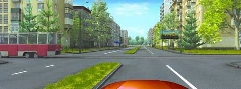
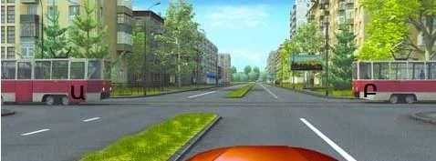
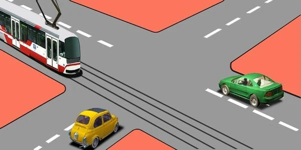
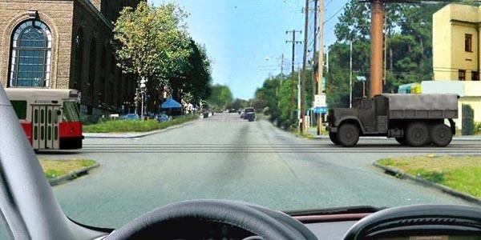

# تراموا در تقاطع

تراموا همان مرحله 3 روش، یعنی «ریل»، است و از قاعده دست راست جلوتر است. یاد بگیرید این حق تقدم کجا برقرار است و کجا تمام می‌شود، تا این پرسش‌ها جزو ساده‌ترین پرسش‌های تقاطع شوند.

## چه کسی اول می‌رود، تراموا یا من؟

تراموا. در تقاطع راه‌های هم‌ارز، تراموا در هر جهتی که برود بر وسایل نقلیه غیرریلی حق تقدم دارد (بند 98). بند 100 اضافه می‌کند که این حق شامل وسایل نقلیه غیرریلی‌ای می‌شود که هم‌جهت با تراموا یا در جهت مخالف آن حرکت می‌کنند.

پس مهم نیست تراموا از کجا می‌آید یا شما به کجا می‌روید:

| تراموا کجاست؟ | آیا راه می‌دهید؟ |
|---|---|
| از سمت راست شما می‌آید | بله |
| از سمت چپ شما می‌آید | بله، با اینکه قاعده دست راست چنین چیزی نمی‌خواهد |
| از روبه‌رو می‌آید و به چپ می‌پیچد | بله، با اینکه وسیله نقلیه‌ای که به چپ می‌پیچد معمولاً منتظر شما می‌ماند |
| کنار شما و هم‌جهت با شماست، و شما مستقیم می‌روید یا به چپ می‌پیچید | بله |

*تراموا از سمت چپ می‌آید و شما باز هم راه می‌دهید. در راه‌های هم‌ارز، ریل مقدم است.*

دو تراموا با هم؟ به هر دو راه می‌دهید. هر تراموا، از هر طرف که بیاید، بر خودروی شما حق تقدم دارد.

> **دام رایج:** «می‌توانیم همزمان با تراموا عبور کنیم» وقتی تراموا کنار شماست منصفانه به نظر می‌رسد. اما غلط است: شما به آن راه می‌دهید.

مطلب تکمیلی: چرا تراموا جای بیشتری لازم دارد

*این مطلب از بانک سؤالات نیامده است.*

تراموا نمی‌تواند از کنار شما بگذرد: باید روی ریل بماند و تنها کاری که می‌تواند بکند ترمز است. تراموا سنگین هم هست، پس مسافت زیادی برای توقف لازم دارد و شاید مسافرانش ایستاده باشند. جلوی آن نپیچید.

## بعد از تراموا چه می‌شود؟

تراموا فقط مرحله «ریل» را روشن می‌کند. مرحله‌های 4 و 5 برای بقیه همچنان برقرارند، پس رانندگان غیرریلی با قاعده دست راست مرتب می‌شوند. اگر ترامویی در سمت چپ و کامیونی در سمت راست شما باشد، به هر دو راه می‌دهید. هیچ‌کدام به‌تنهایی پاسخ کامل نیست.

مسیرهایی که یکدیگر را قطع نمی‌کنند همچنان با هم می‌روند. ترامویی و خودرویی در یک راه، که در خلاف جهت هم و هر دو مستقیم می‌روند، همزمان عبور می‌کنند.

*تراموا و خودروی سبز با هم می‌روند. خودروی زرد به تراموا و به خودروی سبز سمت راستش راه می‌دهد، پس آخر می‌رود.*

اگر مستقیم می‌روید، خودروی روبه‌رو که به چپ می‌پیچد کسی نیست که منتظرش بمانید: او منتظر شما می‌ماند. اگر چنین خودرویی با ترامویی از روبه‌رو همراه باشد، فقط به تراموا راه می‌دهید.

## حق تقدم تراموا کجا تمام می‌شود؟

حق تقدم تراموا در تقاطع راه‌های هم‌ارز برقرار است. مرحله 2 پیش از مرحله 3 می‌آید، پس ترامویی که در راه فرعی است، مانند هر وسیله نقلیه دیگری، به وسایل نقلیه راه اصلی راه می‌دهد.

> **به یاد داشته باشید:** اول تابلو، بعد ریل. پیش از آنکه به تراموا راه بدهید، تابلوهای حق تقدم را بررسی کنید.

ترولی‌بوس تراموا نیست. با سیم کار می‌کند نه ریل، و حق تقدم ویژه‌ای ندارد.

## خودتان امتحان کنید

**ترامویی، خودروی سبزی و اتوبوس زردی به تقاطعی بدون تابلو می‌رسند.** تراموا از بالا و چپ تصویر می‌آید و خودروی سبز در سمت راست اتوبوس است.

ترتیب چیست؟ **تراموا، خودرو، اتوبوس.** چراغ و تابلو: نیست. ریل: تراموا اول می‌رود. راست: خودرو در سمت راست اتوبوس است، پس دوم می‌رود و اتوبوس آخر.

**می‌خواهید به چپ بپیچید.** ترامویی از سمت چپ و کامیونی از سمت راست شما نزدیک می‌شود.

به چه کسی راه می‌دهید؟ **به همه.** ریل: تراموا حق تقدم دارد. راست: کامیون در سمت راست شماست.

**شما مستقیم می‌روید.** ترامویی از روبه‌رو راهنمای چپ زده است. کنار آن، خودرویی از روبه‌رو هم راهنمای چپ زده است.

به چه کسی راه می‌دهید؟ **فقط به تراموا.** ریل: حق تقدم تراموا شامل گردش به چپ آن هم می‌شود. چپ: خودرویی که به چپ می‌پیچد باید به شما راه بدهد.

## نکات کلیدی

- در راه‌های هم‌ارز، تراموا در هر جهتی که برود پیش از وسایل نقلیه غیرریلی عبور می‌کند.
- مهم نیست تراموا از راست، چپ، روبه‌رو یا کنار شما بیاید.
- اگر دو تراموا باشد، به هر دو راه بدهید.
- بعد از تراموا، قاعده دست راست و قاعده گردش به چپ بقیه را مرتب می‌کنند.
- تراموا و وسیله نقلیه‌ای که مسیرشان یکدیگر را قطع نمی‌کند با هم می‌روند.
- ترامویی که در راه فرعی است به راه اصلی راه می‌دهد. ترولی‌بوس حق تقدم تراموا را ندارد.

{{practice}}
