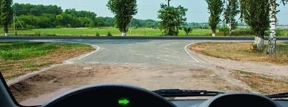
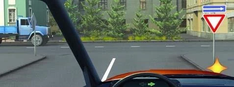
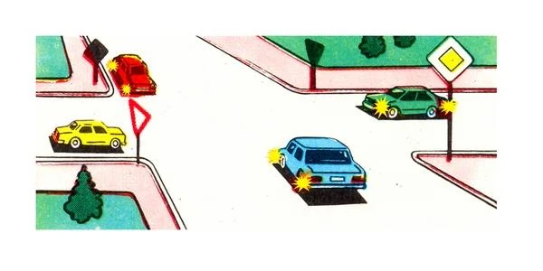
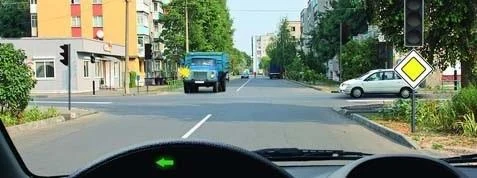
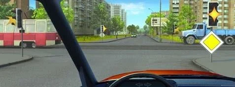

# تقاطع: راه اصلی و فرعی

مرحله 2 روش، یعنی «تابلو»، ترافیک را به دو گروه تقسیم می‌کند و همه ترتیب از همین تقسیم بیرون می‌آید. اول راه اصلی را پیدا کنید، چون قاعده دست راست را بین این دو گروه از کار می‌اندازد.

## از کجا بدانم کدام راه اصلی است؟

سه تابلو این را به شما می‌گویند، و وقتی چراغ راهنمایی خاموش یا زرد چشمک‌زن است، مرحله 1 کار را به آن‌ها می‌سپارد.

| تابلو | نام | برای شما چه معنایی دارد |
|---|---|---|
|  | 2.1 «راه اصلی» | شما در راه اصلی هستید. |
|  | 2.4 «حق تقدم بدهید» | شما در راه فرعی هستید. به ترافیک راه متقاطع راه بدهید. |
|  | 2.5 «حرکت بدون توقف ممنوع» | شما در راه فرعی هستید. توقف کنید و بعد راه بدهید. |

تصویرها تابلوهایی را هم که رانندگان دیگر می‌بینند نشان می‌دهند. لوزی تیره پشت تابلوی 2.1 است، پس آن راننده در راه اصلی است.

سطح راه هم می‌تواند تعیین‌کننده باشد. راهی با روکش سخت، مانند آسفالت‌بتن یا سیمان‌بتن، نسبت به راه خاکی راه اصلی است (بند 3). یک قطعه کوتاه روکش‌دار درست پیش از تقاطع این را تغییر نمی‌دهد: راه خاکی فرعی می‌ماند.

اگر به خاطر تاریکی، گل یا برف نمی‌توانید تشخیص دهید راه روکش دارد یا نه و تابلوی حق تقدمی هم نیست، فرض کنید در راه فرعی هستید (بند 101). این حدس ایمن است.

## چه کسی اول می‌رود؟

بند 96: راننده راه فرعی به وسایل نقلیه راه اصلی راه می‌دهد، به هر جهتی که بعد از آن بروند. مستقیم رفتن برتری‌ای بر خودروی راه اصلی که در حال گردش است به شما نمی‌دهد.

قاعده دست راست بین این دو گروه کاربرد ندارد، چون مخصوص راه‌های هم‌ارز است.

> **دام رایج:** کامیونی از راه خاکی و از سمت راست شما بیرون می‌آید و شما روی آسفالت هستید. شما راه نمی‌دهید: او راه می‌دهد. «از سمت راست آمد» فقط در راه‌های هم‌ارز کار می‌کند.

## هر گروه را چگونه مرتب کنم؟

مرحله‌های 3 تا 5 را درون هر گروه اجرا کنید، طوری که انگار آن گروه در راه‌های هم‌ارز است.

**در راه اصلی،** قاعده گردش به چپ همچنان برقرار است. اگر در راه اصلی به چپ بپیچید یا دور بزنید، به وسایل روبه‌رو که مستقیم یا به راست می‌روند راه می‌دهید. خودروی راه فرعی در سمت راستتان به شما راه می‌دهد. بودن در راه اصلی شما را از راه دادن به وسیله نقلیه روبه‌رو معاف نمی‌کند.

**در راه فرعی،** بند 97 می‌گوید رانندگان با یکدیگر طبق قواعد راه‌های هم‌ارز رفتار کنند. به سمت راست راه بدهید، و هنگام گردش به چپ به ترافیک روبه‌رو راه بدهید. اگر از راهی با تابلوی 2.4 دور می‌زنید، هم به راه اصلی و هم به وسیله نقلیه روبه‌رو راه می‌دهید.

**تراموا** هم از همین تقسیم پیروی می‌کند. ترامویی که در راه اصلی است اول می‌رود. ترامویی که در راه فرعی است به راه اصلی راه می‌دهد، اما باز هم پیش از خودرویی که در راه فرعی است می‌رود.

## آیا راه دادن یعنی توقف؟

نه همیشه. راه دادن یعنی راننده دارای حق تقدم را مجبور به تغییر سرعت یا جهت نکنید. فرض کنید کنار تابلوی 2.4 به راست و به سوی راهی یک‌طرفه می‌پیچید و کامیونی در خط عبور چپ آن راه می‌گذرد. گردش شما به خط عبور سمت راست می‌رسد، پس می‌توانید همزمان بپیچید، به شرطی که مزاحمتی برای کامیون ایجاد نکنید.

> **به یاد داشته باشید:** «فقط بعد از عبور کامیون» سخت‌گیرانه‌تر از مقررات است. آزمون این است که آیا مزاحمتی برای آن ایجاد می‌کنید یا نه.

## اگر زیر تابلو یک تابلوی تکمیلی سفید باشد چه؟

تابلوی تکمیلی 8.13 «جهت راه اصلی» یعنی راه اصلی در این تقاطع می‌پیچد. همه کسانی که در راه فرعی هستند همچنان منتظر همه کسانی می‌مانند که در راه اصلی‌اند. درس بعدی خواندن این تابلوی تکمیلی را نشان می‌دهد.

## خودتان امتحان کنید

**چهار خودرو کنار تابلوهای نشان‌داده‌شده به هم می‌رسند.** قرمز و آبی در راه اصلی هستند و زرد و سبز تابلوی 2.4 را می‌بینند. قرمز به راست می‌پیچد، آبی به چپ می‌پیچد، زرد مستقیم می‌رود و سبز به چپ می‌پیچد.

چه کسی سوم عبور می‌کند؟ **خودروی زرد.** تابلو: قرمز و آبی پیش از زرد و سبز می‌روند. چپ: در گروه اصلی، آبی به چپ می‌پیچد و منتظر قرمز می‌ماند، پس قرمز اول و آبی دوم می‌رود. باز هم چپ: در گروه فرعی، سبز به چپ می‌پیچد و منتظر زرد می‌ماند. زرد سوم است و سبز آخر.

**در راه اصلی هستید و به چپ می‌پیچید.** کامیونی از روبه‌رو می‌آید و خودروی سفیدی در سمت راست منتظر است.

به چه کسی راه می‌دهید؟ **فقط به کامیون.** تابلو: خودروی سفید در راه فرعی است، پس منتظر شما می‌ماند. چپ: کامیون از روبه‌رو در همان راه اصلی شما می‌آید و شما از جلوی آن می‌پیچید.

**مستقیم می‌روید و چراغ زرد چشمک‌زن است.** تابلوی 2.1 را می‌بینید. ترامویی از چپ و کامیونی از راست می‌آید.

چه کسی اول می‌رود؟ **شما.** چراغ: زرد چشمک‌زن به حساب نمی‌آید. تابلو: شما در راه اصلی هستید، پس هر دو به شما راه می‌دهند. تراموا اینجا حق تقدمی ندارد، چون این حق مخصوص راه‌های هم‌ارز است.

## نکات کلیدی

- تابلوی 2.1 شما را در راه اصلی قرار می‌دهد. تابلوهای 2.4 و 2.5 شما را در راه فرعی قرار می‌دهند.
- روکش سخت نسبت به راه خاکی اصلی است. یک قطعه کوتاه روکش‌دار این را تغییر نمی‌دهد.
- سطح راه را نمی‌بینید و تابلویی نیست؟ فرض کنید در راه فرعی هستید.
- راه فرعی منتظر راه اصلی می‌ماند، به هر جهتی که هر کس برود.
- قاعده دست راست بین راه اصلی و فرعی کاربرد ندارد.
- درون هر گروه از ریل، راست و چپ استفاده کنید.
- راه دادن یعنی مزاحمت ایجاد نکردن، پس گاهی می‌توانید همزمان بروید.

{{practice}}
