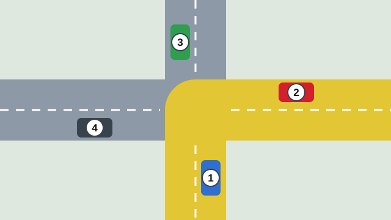
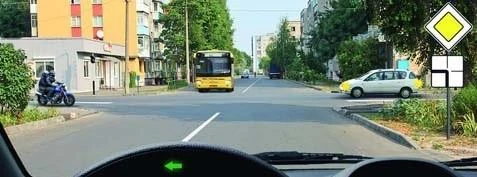
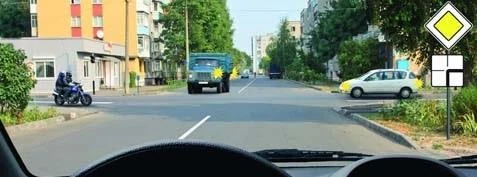
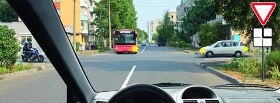
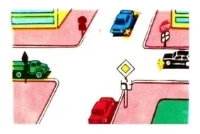

# وقتی راه اصلی می‌پیچد

این تصویرها شلوغ به نظر می‌رسند، اما هر کدام همان کار مرتب‌سازی‌ای است که از قبل بلدید. وقتی بتوانید تابلوی تکمیلی را بخوانید، فقط به دو گروه و سه مرحله درس راه‌های هم‌ارز نیاز دارید.

## تابلوی 8.13 را چگونه بخوانم؟

تابلوی تکمیلی 8.13 «جهت راه اصلی» زیر یک تابلوی حق تقدم نصب می‌شود. این تابلوی تکمیلی تقاطع را از بالا نشان می‌دهد و راه شما در پایین آن است.

- **خط ضخیم:** راه اصلی، که اینجا به چپ می‌پیچد.
- **خط‌های نازک:** راه‌های فرعی.

تابلوی 2.1 بالای تابلوی تکمیلی شما را روی خط ضخیم قرار می‌دهد. تابلوهای 2.4 و 2.5 شما را روی خط نازک قرار می‌دهند.

## ترتیب را چگونه پیدا کنم؟

1. **همه را روی تابلوی تکمیلی بگذارید.** وسیله نقلیه روبه‌رو در بالاست. وسیله نقلیه سمت چپ شما روی شاخه چپ است و وسیله نقلیه سمت راست شما روی شاخه راست.
2. **دو گروه بسازید.** خط ضخیم و خط‌های نازک.
3. **خط ضخیم پیش از خط نازک می‌رود،** به هر جهتی که هر کس برود (بند 96).
4. **درون هر گروه از قواعد راه‌های هم‌ارز استفاده کنید** (بند 97): ریل، راست، چپ.

*هر چهار خودرو مستقیم می‌روند. خودروهای 1 و 2 در راه اصلی (زرد) هستند و 3 و 4 در راه‌های فرعی. خودروی 2 در سمت راست خودروی 1 است، پس 2 اول و 1 دوم می‌رود. خودروی 4 در سمت راست خودروی 3 است، پس 4 سوم و 3 آخر می‌رود.*

## اگر در راه اصلی باشم چه؟

تابلوی 2.1 بالای تابلوی تکمیلی است. وظیفه شما به این بستگی دارد که خط ضخیم به کدام سمت می‌پیچد.

| راه اصلی می‌پیچد | وسیله نقلیه سمت راست شما | وسیله نقلیه سمت چپ شما | وسیله نقلیه روبه‌رو |
|---|---|---|---|
| به راست | در راه اصلی: شما راه می‌دهید | در راه فرعی: او راه می‌دهد | در راه فرعی: او راه می‌دهد |
| به چپ | در راه فرعی: او راه می‌دهد | در راه اصلی: او راه می‌دهد، چون شما در سمت راست او هستید | در راه فرعی: او راه می‌دهد |

این جدول چه مستقیم بروید، چه به چپ بپیچید و چه دور بزنید برقرار است. دنبال کردن پیچ راه حق تقدم بیشتری به شما نمی‌دهد و ترک کردن آن هم چیزی از شما نمی‌گیرد. بین دو وسیله نقلیه راه اصلی، فقط آزمون دست راست تصمیم می‌گیرد.

*راه اصلی به چپ می‌پیچد و شما به چپ می‌پیچید. موتورسیکلت هم در راه اصلی است، اما شما در سمت راست آن هستید. اتوبوس و خودروی سفید در راه‌های فرعی‌اند. شما به هیچ‌کس راه نمی‌دهید.*

> **دام رایج:** راه اصلی از شما دور می‌پیچد و شما به چپ می‌پیچید یا دور می‌زنید. وسیله نقلیه روبه‌رو حالا در راه فرعی است، پس او به شما راه می‌دهد. بند 99 فقط وسایل نقلیه روبه‌رو در راه هم‌ارز را در بر می‌گیرد.

## اگر در راه فرعی باشم چه؟

تابلوی 2.4 یا 2.5 بالای تابلوی تکمیلی است. به همه کسانی که روی خط ضخیم هستند راه می‌دهید، به هر جا که بروند. معمولاً این یعنی دو وسیله نقلیه، پس پاسخی که فقط یکی را نام ببرد غلط است.

وسیله نقلیه‌ای که روی خط نازک دیگر است در گروه شماست، پس شما و او از قاعده دست راست استفاده می‌کنید:

- **در سمت راست شماست:** به او هم راه می‌دهید.
- **در سمت چپ شماست:** او به شما راه می‌دهد.

اگر بتوانید بدون ایجاد مزاحمت برای وسیله نقلیه دارای حق تقدم عبور کنید، می‌توانید بپیچید. گردش ممنوع نیست: فقط باید اول راه بدهید.

## چه چیز دیگری ترتیب را تغییر می‌دهد؟

- **ترامویی که روی خط نازک است** مانند هر وسیله نقلیه دیگری بعد از خط ضخیم می‌رود. تراموا بودن برتری‌ای بر راه اصلی به آن نمی‌دهد.
- **ترامویی که با شما روی خط ضخیم است** بر شما حق تقدم دارد، حتی از سمت چپ. خودرویی که در همان سمت چپ است چنین حقی ندارد.
- **ترامویی که بین وسایل راه فرعی است** پیش از وسایل غیرریلی می‌رود.
- **آمبولانسی که چراغ گردان و آژیرش خاموش است** یک وسیله نقلیه عادی است.
- **ترولی‌بوس** وسیله نقلیه غیرریلی است و حق تقدم ویژه‌ای ندارد.
- **دوچرخه‌سواری** که با شما در راه اصلی است مانند هر کس دیگری در آزمون دست راست حساب می‌شود.

زرد چشمک‌زن اینجا چیزی را تغییر نمی‌دهد: تقاطع تنظیم‌نشده است، پس تابلوها تصمیم می‌گیرند.

وقتی مسیرها یکدیگر را قطع نمی‌کنند، کسی منتظر نمی‌ماند. اتوبوسی که به چپ می‌پیچد و خودرویی که به راست می‌پیچد، هر دو در امتداد راه اصلی، می‌توانند همراه با کامیونی که از راه فرعی به راست می‌پیچد با هم عبور کنند.

## خودتان امتحان کنید

**مستقیم می‌روید و تابلوی 2.1 با تابلوی تکمیلی که به راست می‌پیچد را می‌بینید.** خودروی سفیدی در سمت راست شماست، کامیونی از روبه‌رو می‌آید و موتورسیکلتی در سمت چپ شماست.

به چه کسی راه می‌دهید؟ **به خودروی سفید.** تابلو: شما و خودرو روی خط ضخیم هستید، و کامیون و موتورسیکلت روی خط‌های نازک‌اند و منتظر شما می‌مانند. راست: خودرو در سمت راست شماست.

**کنار تابلوی 2.4 هستید و تابلوی تکمیلی نشان می‌دهد راه اصلی از روبه‌رو می‌آید و به سمت راست شما می‌پیچد.** اتوبوسی روبه‌روست، خودروی سفیدی در سمت راست شما و موتورسیکلتی در سمت چپ شماست.

به چه کسی راه می‌دهید؟ **به اتوبوس و خودرو.** تابلو: هر دو روی خط ضخیم هستند. راست: موتورسیکلت مانند شما روی خط نازک است و شما در سمت راست آن هستید، پس او به شما راه می‌دهد.

**چهار وسیله نقلیه به هم می‌رسند.** قرمز و سبز در راه اصلی هستند و این راه اینجا می‌پیچد. آبی و مشکی در راه‌های فرعی‌اند و تابلوی 2.5 کنار خودروی مشکی است.

ترتیب چیست؟ **قرمز، سبز، آبی، مشکی.** تابلو: قرمز و سبز اول می‌روند. راست: قرمز در سمت راست سبز است، پس قرمز جلوتر است. باز هم راست: آبی در سمت راست مشکی است، پس آبی سوم و مشکی آخر می‌رود.

## نکات کلیدی

- خط ضخیم: راه اصلی. خط‌های نازک: راه‌های فرعی. راه شما در پایین تابلوی تکمیلی است.
- تابلوی 2.1 شما را روی خط ضخیم قرار می‌دهد و تابلوهای 2.4 و 2.5 روی خط نازک.
- خط ضخیم پیش از خط نازک می‌رود، به هر جهتی که هر کس برود.
- درون هر گروه از ریل، راست و چپ استفاده کنید.
- وقتی راه اصلی به راست می‌پیچد: به وسیله نقلیه سمت راستتان راه بدهید.
- وقتی راه اصلی به چپ می‌پیچد: به هیچ‌کس راه نمی‌دهید، مگر ترامویی با شما در راه اصلی باشد.
- روی خط نازک: به همه روی خط ضخیم، و به وسیله نقلیه سمت راستتان راه بدهید.
- تراموا فقط در برابر وسایل گروه خودش حق تقدم دارد.

{{practice}}
