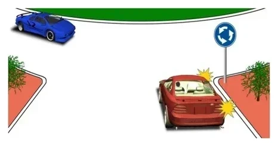
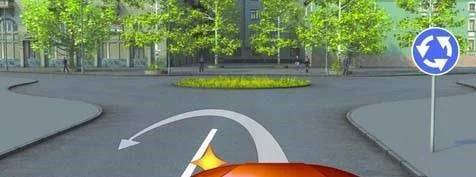
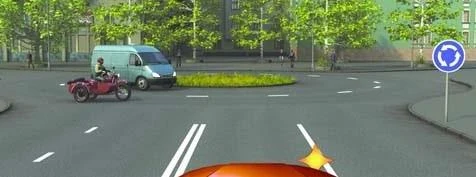
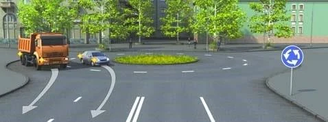
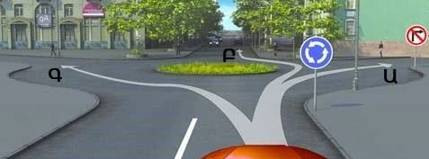

# میدان‌ها

میدان قاعده دست راست را وارونه می‌کند و آزمون دقیقاً همین را می‌سنجد. یاد بگیرید چه کسی صبر می‌کند، از کدام طرف دور می‌زنید و کدام خط عبور را لازم دارید، تا این نمره‌ها را راحت بگیرید.

## چه کسی اول می‌رود؟

کسی که از قبل در میدان است. وقتی وارد تقاطعی با تابلوی 4.3 «حرکت دورانی» می‌شوید، به وسایل نقلیه‌ای که در آن حرکت می‌کنند راه می‌دهید (بند 98.1). در روش پنج‌مرحله‌ای، این را تابلو در مرحله 2 روشن می‌کند.

*خودروی قرمز در حال ورود است، پس به خودروی آبی داخل میدان راه می‌دهد.*

> **دام رایج:** «خودروی قرمز در سمت راست خودروی آبی است» اینجا پاسخ غلط است. قاعده دست راست در تقاطع دارای تابلوی 4.3 کاربرد ندارد.

## از کدام طرف دور بزنم؟

از پیکان‌های تابلوی 4.3 پیروی کنید و جزیره را در سمت راست خود نگه دارید. از جلوی جزیره میان‌بر نزنید، حتی برای دور زدن: باید دور آن بچرخید.

*این دور زدن ممنوع است: مسیر از جلوی جزیره میان‌بر می‌زند.*

## از کدام خط عبور بروم؟

- **ورود:** از هر خط عبوری، هر کاری که بعداً بخواهید بکنید. بند 40 معمولاً شما را پیش از گردش به خط عبور کناری می‌فرستد، اما برای ورود به میدان استثنا قائل شده است.
- **خروج:** از خط عبور کناری راست. خروج هم مانند هر گردش به راست دیگری است.

> **به یاد داشته باشید:** ورود از هر خط عبوری، خروج از خط عبور کناری.

## خودتان امتحان کنید

**از کنار تابلوی 4.3 وارد میدان می‌شوید.** یک کامیون سبک و یک موتورسیکلت سایدکاردار از قبل در میدان هستند.

به چه کسی راه می‌دهید؟ **به هر دو.** همه کسانی که در میدان هستند بر شما حق تقدم دارند.

**دو وسیله نقلیه طبق پیکان‌ها از میدان خارج می‌شوند.** کامیون در خط عبور کناری است. خودرو از خط عبور داخلی مسیر آن را قطع می‌کند.

چه کسی تخلف می‌کند؟ **خودرو.** از خطی خارج شده که خط عبور کناری نیست.

**تابلوی 3.18.1 «گردش به راست ممنوع» کنار تابلوی 4.3 قرار دارد.** مسیرهای Ա، Բ و Գ جلوی شما شروع می‌شوند.

از کدام مسیر می‌توانید بروید؟ **فقط Բ.** Ա همان گردش به راست ممنوع است و Գ از سمت چپ جزیره می‌گذرد.

## نکات کلیدی

- کنار تابلوی 4.3، وسیله نقلیه‌ای که وارد می‌شود به وسایل داخل میدان راه می‌دهد.
- قاعده دست راست آنجا کاربرد ندارد.
- در جهت پیکان‌ها دور جزیره بچرخید و آن را در سمت راست نگه دارید.
- از هر خط عبوری وارد شوید. از خط عبور کناری راست خارج شوید.

{{practice}}
