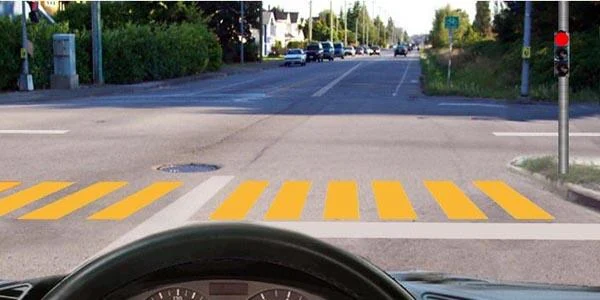
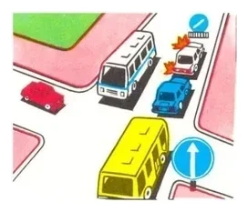
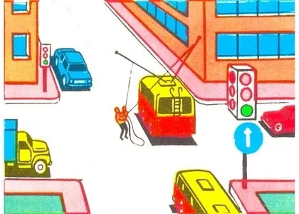
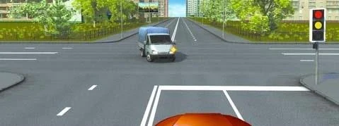

# ورود به تقاطع

پیش از آنکه بفهمید چه کسی اول می‌رود، باید بررسی کنید اصلاً باید وارد شوید یا نه. حتی با چراغ سبز هم به راه خروج باز در آن سوی تقاطع نیاز دارید.

## با چه سرعتی نزدیک شوم؟

آن‌قدر آهسته که بتوانید توقف کنید. بند 86.1 از شما می‌خواهد به‌ویژه هوشیار باشید و با سرعتی برانید که بتوانید توقف کنید و به وسایل نقلیه دارای حق تقدم راه بدهید. پایین‌تر از حد سرعت ماندن کافی نیست.

## چراغ راهنمایی از من چه می‌خواهد؟

تقاطع وقتی تنظیم‌شده است که چراغ راهنمایی یا افسر راهنمایی ترتیب را تعیین کند (بند 89).

- **علامت بازدارنده:** پیش از خط‌کشی 1.12 «خط ایست» توقف کنید (بند 18). فقط اگر خط ایست نباشد، به سواره‌روی متقاطع یا چراغ راهنمایی نگاه می‌کنید.
- **چراغ سبز:** بدون توقف ادامه دهید، حتی اگر خط ایست را می‌بینید. این خط فقط با علامت بازدارنده کار می‌کند.

چراغ سبز تقاطع را برای شما خالی نمی‌کند. وقتی روشن می‌شود، به عابران پیاده و وسایل نقلیه‌ای که هنوز عبورشان را تمام نکرده‌اند راه می‌دهید (بند 94).

## آیا می‌توانم وارد تقاطع مسدود شوم؟

نه. بند 88 ورود را ممنوع می‌کند اگر راه‌بندان شما را مجبور کند آنجا توقف کنید و مزاحم ترافیک عرضی شوید. این قاعده:

- **حتی با چراغ سبز برقرار است:** علامت اجازه‌دهنده تقاطع مسدود را باز نمی‌کند.
- **برای همه است:** اتوبوس مسیر تعیین‌شده استثنا نیست.
- **به عامل انسداد بستگی ندارد:** چه صفی در آن سوی تقاطع باشد و چه وسیله نقلیه‌ای که در آن گیر کرده است.

اگر فقط راه مستقیم مسدود است، باز هم می‌توانید برای گردش یا دور زدن وارد شوید، چون به راهی باز خارج می‌شوید و جلوی کسی را نمی‌گیرید.

*این صف اتوبوس زرد را وسط تقاطع نگه می‌دارد، پس باید صبر کند.*

> **به یاد داشته باشید:** پیش از ورود بپرسید وسیله نقلیه‌تان کجا می‌ایستد. اگر پاسخ «داخل تقاطع» است، صبر کنید.

## خودتان امتحان کنید

**راننده اتوبوس هستید و چراغ شما سبز است.** ترولی‌بوسی با میله‌های جداشده از سیم وسط تقاطع ایستاده و کارگری در حال برگرداندن آن‌هاست.

آیا می‌توانید وارد شوید؟ **نه.** نمی‌توانید از تقاطع خارج شوید، و چراغ سبز و مسیر شما چیزی را تغییر نمی‌دهند.

**چراغ در آستانه سبز شدن است و یک کامیون سبک هنوز در حال عبور است.**

وقتی چراغ سبز می‌شود چه کسی اول می‌رود؟ **کامیون.** به وسایل نقلیه‌ای که عبورشان را تمام می‌کنند راه می‌دهید.

## نکات کلیدی

- با سرعتی نزدیک شوید که بتوانید برای وسایل نقلیه دارای حق تقدم توقف کنید.
- با علامت بازدارنده پشت خط ایست توقف کنید. با چراغ سبز ادامه دهید.
- با چراغ سبز هم به کسانی که عبورشان را تمام می‌کنند راه بدهید.
- اگر راه‌بندان شما را داخل تقاطع نگه می‌دارد، هرگز وارد نشوید.
- این قاعده شامل همه می‌شود، حتی اتوبوس‌های مسیر تعیین‌شده.
- وقتی راه مستقیم مسدود است، باز هم می‌توانید برای گردش یا دور زدن وارد شوید.

{{practice}}
