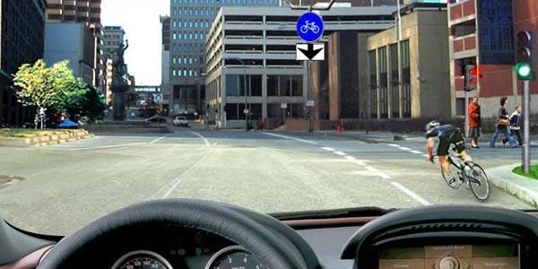
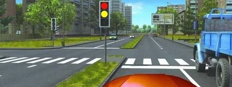
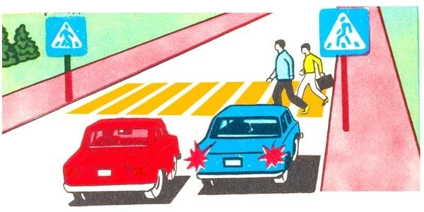
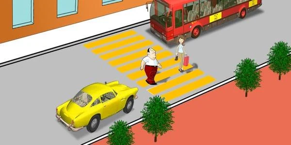

# عابران و گذرگاه‌ها

اگر در گذرگاه اشتباه کنید، عابر پیاده هیچ محافظی ندارد؛ برای همین مقررات از شما می‌خواهد صبر کنید. آزمون سه لحظه را می‌سنجد: در حال گردش هستید، چراغ تازه عوض شده، یا وسیله نقلیه دیگری کنار گذرگاه ایستاده است.

## هنگام گردش به چه کسانی باید راه بدهم؟

وقتی به راست یا چپ می‌پیچید و از تقاطع خارج می‌شوید، بند 87 شما را موظف می‌کند به عابران پیاده‌ای که از سواره‌رو عبور می‌کنند **و** به دوچرخه‌سواران در مسیر دوچرخه راه بدهید. این حکم برای هر راننده‌ای که گردش می‌کند و در هر دو جهت یکسان است.

*هنگام گردش به راست در اینجا، هم به عابران و هم به دوچرخه‌سوار راه می‌دهید، نه فقط به یکی از آن‌ها.*

> **دام رایج:** «پیش از خط توقف بایستید تا مانع عابران نشوید» هنگام چراغ سبز نادرست است. چراغ سبز اجازه ورود می‌دهد، پس وارد تقاطع شوید و اگر لازم بود همان‌جا بایستید تا مانع آن‌ها نشوید.

## چراغ سبز شد. آیا می‌توانم فوری حرکت کنم؟

نه پیش از آنکه مطمئن شوید. بند 94 شما را موظف می‌کند به عابرانی که عبورشان تمام نشده است راه بدهید.

*کامیون بخشی از گذرگاه را پوشانده است. وقتی چراغ سبز می‌شود، مطمئن شوید کسی آنجا هنوز در حال عبور نیست.*

## اگر وسیله نقلیه دیگری پیش از گذرگاه بایستد چه؟

در گذرگاه عابر پیاده تنظیم‌نشده، که با تابلوهای 5.19.1 و 5.19.2 و خط‌کشی عابر پیاده مشخص شده است، باید به عابرانی که عبور می‌کنند راه بدهید (بند 103). اگر وسیله نقلیه‌ای در خط عبور کناری شما پیش از گذرگاه سرعتش را کم کند یا بایستد، گذرگاه را از دید شما پنهان می‌کند. سرعت را کم کنید، در صورت لزوم بایستید و فقط وقتی ادامه دهید که مطمئن شدید جلوی آن عابری نیست (بند 104).

*خودروی آبی ایستاده و عابران در حال عبورند، پس خودروی قرمز نباید ادامه دهد.*

> **دام رایج:** لازم نیست منتظر حرکت اتوبوس بمانید. شرط این است که عابری روی گذرگاه نباشد، نه اینکه اتوبوس بعد از آن چه می‌کند.

## اگر کودکان در حال سوار یا پیاده شدن باشند چه؟

وقتی به وسیله نقلیه‌ای با علامت «حمل کودکان» نزدیک می‌شوید و کودکان در حال سوار یا پیاده شدن هستند، سرعت را کم کنید (بند 156).

## خودتان امتحان کنید

**شما راننده خودروی زرد هستید.** اتوبوس ایستاده و دو عابر روی گذرگاه هستند.

چه کسی باید بایستد؟ **شما.** اتوبوس قبلاً ایستاده است، پس حالا این وظیفه بر عهده خودرویی است که نزدیک می‌شود.

## نکات کلیدی

- هنگام گردش به راست یا چپ: به عابران و به دوچرخه‌سواران مسیر دوچرخه راه بدهید.
- سبز شدن چراغ وظیفه شما را در برابر عابرانی که هنوز در حال عبورند از بین نمی‌برد، حتی عابرانی که نمی‌بینید.
- اگر وسیله نقلیه‌ای پیش از گذرگاه تنظیم‌نشده ایستاده است، فقط وقتی ادامه دهید که گذرگاه خالی باشد.

{{practice}}
