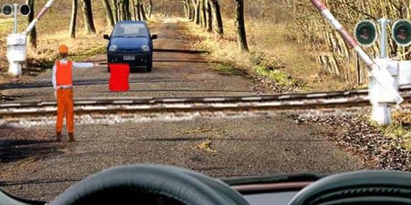
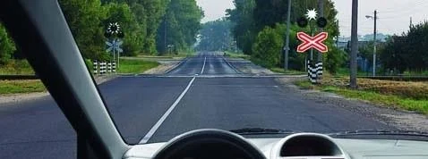
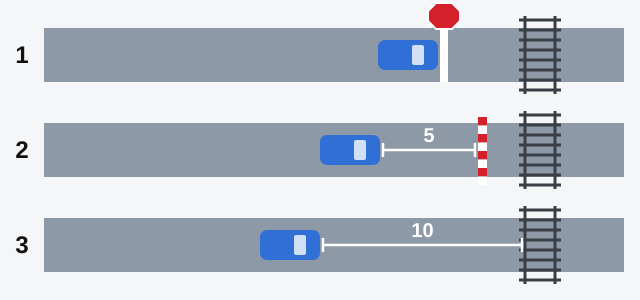
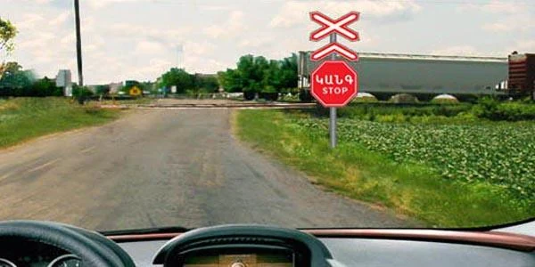
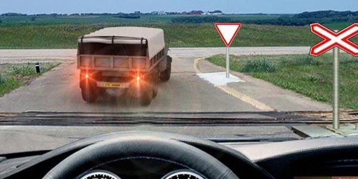

# گذرگاه‌های راه‌آهن

قطار نمی‌تواند از کنار شما بگذرد، پس در گذرگاه راه‌آهن جای زیادی برای تشخیص شخصی نمی‌ماند. مقررات می‌گوید کجا عبور کنید، کجا منتظر بمانید و چه وقت وارد نشوید، و آزمون همین جزئیات را با دقت می‌سنجد.

## کجا می‌توانم عبور کنم و به چه چیزی توجه کنم؟

فقط از گذرگاه‌های راه‌آهن می‌توانید از خطوط راه‌آهن بگذرید و باید به قطار راه بدهید (بند 109). هر چقدر هم جایی راحت یا خلوت به نظر برسد، محل عبور را خودتان انتخاب نمی‌کنید.

هنگام نزدیک شدن، بند 110 از شما می‌خواهد همه این موارد را رعایت کنید و مطمئن شوید قطاری نزدیک نمی‌شود:

- دستورهای مأمور گذرگاه، یعنی کسی که مسئول گذرگاه است.
- چراغ‌های راهنمایی، تابلوها و خط‌کشی گذرگاه.
- وضعیت راه‌بند.

## چه وقت نباید وارد شوم؟

بند 113 ورود به گذرگاه را در هر یک از این موارد ممنوع می‌کند:

| آنچه می‌بینید | معنای آن |
|---|---|
| راه‌بند بسته است یا در حال بسته شدن است | وارد نشوید، چراغ هر چه نشان بدهد |
| چراغ راهنمایی علامت بازدارنده نشان می‌دهد | وارد نشوید، راه‌بند در هر وضعیتی که باشد |
| مأمور گذرگاه علامت بازدارنده می‌دهد | وارد نشوید، حتی اگر راه‌بند باز باشد |
| بعد از گذرگاه راهبندان است | وارد نشوید، اگر مجبور می‌شوید روی گذرگاه بایستید |

مأمور گذرگاه با این علامت‌ها ورود را ممنوع می‌کند: ایستادن با سینه یا پشت رو به شما، نشان دادن باتوم، چراغ قرمز یا پرچمِ بالا برده‌شده بالای سر، یا باز کردن دست‌ها به دو طرف.

*راه‌بند باز است، اما مأمور پشتش به شماست. نباید وارد شوید.*

> **دام رایج:** «قطاری نمی‌آید» در هیچ‌کدام از این موارد چیزی را عوض نمی‌کند. اینکه مأمور خودروی روبه‌رو را هم متوقف کرده نیز کمکی نمی‌کند: همان علامت شما را هم متوقف می‌کند.

### چراغ سفید چه معنایی دارد؟

چراغ گرد مهتابی‌سفید چشمک‌زن اجازه عبور می‌دهد (بند 15). اگر چراغ مهتابی‌سفید و چراغ قرمز هر دو خاموش باشند، می‌توانید در حد میدان دید عبور کنید، به شرطی که قطاری نزدیک نشود.

*چراغ سفید روشن است و چراغ قرمزی روشن نیست، پس می‌توانید عبور کنید.*

## دقیقاً کجا باید بایستم؟

بند 111 یک زنجیره تعیین می‌کند. از بالا پایین بیایید و اولین مرحله‌ای را که با گذرگاه شما می‌خواند به کار ببرید.

*1: کنار خط توقف 1.12، تابلوی 2.5 «حرکت بدون توقف ممنوع» یا چراغ راهنمایی. 2: اگر هیچ‌کدام نبود، دست‌کم 5 متر مانده به راه‌بند. 3: اگر راه‌بند هم نبود، دست‌کم 10 متر مانده به نزدیک‌ترین ریل.*

در مرحله 1 درست کنار خط یا تابلو می‌ایستید و فاصله اضافه‌ای لازم نیست. تابلوی ضربدری که گذرگاه را نشان می‌دهد محل توقف را تعیین نمی‌کند، پس اگر تابلوی 2.5 جلوتر است، کنار آن نایستید. این زنجیره مخصوص گذرگاه‌های راه‌آهن است. برای تابلوی 2.5 در تقاطع، درس تابلوهای حق تقدم را ببینید.

> **دام رایج:** 5 متر از راه‌بند و 10 متر از ریل اندازه‌گیری می‌شود. «5 متر از نزدیک‌ترین ریل» نادرست است و ایستادن درست کنار راه‌بند هم نادرست است. مقررات در اینجا فاصله 1.5، 2.5، 3 یا 7 متر تعیین نکرده است.

## چه کارهای دیگری ممنوع است؟

- **باز کردن راه‌بند توسط خودتان یا دور زدن آن.** برای مأموریت اداری، نبودن مأمور گذرگاه، یا تشخیص خودتان که قطاری نزدیک نیست، استثنایی وجود ندارد.
- **رفتن به خط عبور مقابل** برای جلو زدن از وسایل نقلیه‌ای که پیش از گذرگاه منتظرند.
- **عبور دادن ماشین‌آلات کشاورزی، راه‌سازی، ساختمانی و مانند آن** از گذرگاه، مگر در وضعیت حمل، یعنی آماده برای جابه‌جایی و نه برای کار. داشتن راه‌بند در این حکم اثری ندارد.
- **عبور بدون اجازه رئیس بخش راه‌آهن** با ماشین‌های کندرو با سرعت کمتر از 8 کیلومتر بر ساعت یا با تراکتورهای متصل به غلتک.

> **آیا می‌دانستید؟** مقررات برای عبور از گذرگاه حد 30 کیلومتر بر ساعت تعیین نکرده است. آزمون این عدد را به‌عنوان گزینه نادرست می‌آورد.

## اگر مجبور شوم روی گذرگاه بایستم چه؟

بند 112 می‌گوید کنار وسیله نقلیه بمانید و علامت خطر عمومی بدهید، یعنی **یک علامت صوتی بلند و سه کوتاه** که تکرار می‌شود. آن را یک بوق بلند و بعد بوق-بوق-بوق تصور کنید. این علامت برای همه رانندگان یکسان است، رانندگان اتوبوس هم همین‌طور.

برای متوقف کردن قطار، **دست را به حالت دورانی حرکت دهید**. در روز پارچه‌ای پررنگ یا هر شیء کاملاً قابل دیدن در دست بگیرید. در شب از مشعل یا چراغ‌قوه استفاده کنید.

مطلب تکمیلی: روی گذرگاه مسدود، سرنشینان در اولویت‌اند

*این مطلب از بانک سؤالات نیامده است.*

اگر وسیله نقلیه شما روی ریل گیر کرد، سرنشینان را پیاده کنید و آن‌ها را از ریل‌ها دور کنید. وسیله نقلیه جایگزین‌پذیر است. وقتی ممکن است قطاری بیاید، کسی نباید کنار آن بایستد.

## خودتان امتحان کنید

**تابلوی ایست قرمز و سفید پیش از گذرگاه چندخطه قرار دارد و قطاری در حال عبور است.**

چه کار می‌کنید؟ **پیش از تابلو می‌ایستید و وقتی امن شد عبور می‌کنید.** تابلوی 2.5 توقف را الزامی می‌کند.

**کامیون جلویی درست بعد از ریل‌ها ایستاده است.** قطاری دیده نمی‌شود.

آیا می‌توانید عبور کنید؟ **نه.** مجبور می‌شوید روی گذرگاه بایستید و بند 113 این را ممنوع می‌کند.

## نکات کلیدی

- فقط از گذرگاه راه‌آهن عبور کنید و از مأمور، چراغ‌ها، تابلوها، خط‌کشی و راه‌بند پیروی کنید.
- راه‌بند بسته یا در حال بسته شدن، چراغ یا مأمور بازدارنده، یا صف بعد از ریل‌ها: وارد نشوید.
- کنار خط، تابلو یا چراغ بایستید. در غیر این صورت 5 متر از راه‌بند. در غیر این صورت 10 متر از نزدیک‌ترین ریل.
- هرگز راه‌بند را باز نکنید و آن را دور نزنید.
- گیر کردن روی گذرگاه: کنار وسیله نقلیه بمانید و یک علامت بلند و سه کوتاه بدهید.
- قطار را با حرکت دورانی دست متوقف کنید.

{{practice}}
