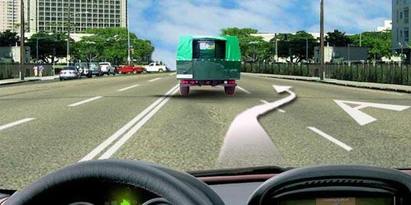
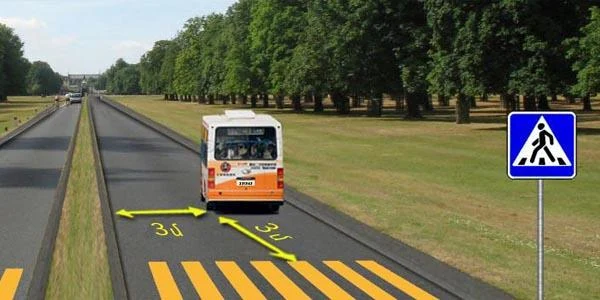
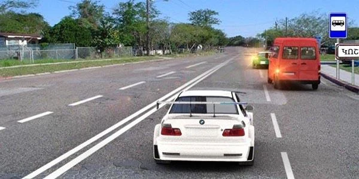
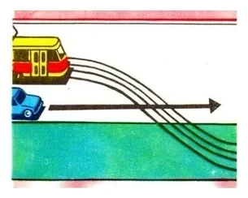
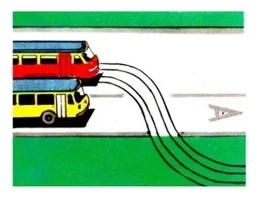
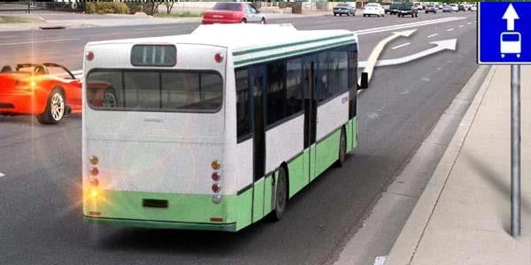

# تراموا و حمل‌ونقل عمومی

اتوبوس، ترولی‌بوس و تراموا افراد زیادی را در مسیرهای ثابت جابه‌جا می‌کنند، برای همین مقررات به آن‌ها خط عبور و ایستگاه خودشان و در چند جای مشخص حق تقدم داده است. آزمون می‌سنجد چه وقت می‌توانید وارد خط عبور آن‌ها شوید و در ایستگاه چه کسی اول می‌رود.

## وسیله نقلیه عمومی یعنی چه؟

طبق ماده 2 قانون جمهوری ارمنستان «درباره تأمین ایمنی ترافیک جاده‌ای»، وسیله نقلیه عمومی تراموا، ترولی‌بوس یا اتوبوسی است که مسافر را در مسیری با ایستگاه‌های مشخص جابه‌جا می‌کند. ایستگاه جایی در مسیر است برای سوار و پیاده شدن مسافران که به تابلوهای مربوط مجهز شده است.

پس تاکسی وسیله نقلیه عمومی نیست، اتوبوس گردشگری هم نیست، چون در مسیر تعیین‌شده با ایستگاه‌های ثابت حرکت نمی‌کند.

## خط عبور آن‌ها را چگونه بشناسم؟

سه چیز آن را مشخص می‌کند:

*تابلوی 5.14 «خط ویژه وسایل نقلیه عمومی» بر یکی از خطوط عبور راهی که در آن هستید اثر دارد.*

*تابلوی 5.11.1: خط عبور کناری چپ برای وسایل نقلیه عمومی است که خلاف جهت جریان حرکت می‌کنند.*

سومی حرف بزرگ **A** است که روی خط عبور کشیده می‌شود، یعنی خط‌کشی 1.23.

فقط وسایل نقلیه عمومی می‌توانند در این خط عبور حرکت کنند: ترولی‌بوس‌ها و اتوبوس‌های عمومی، نه هر اتوبوسی. بند 124 حرکت و توقف سایر وسایل نقلیه را در آن ممنوع می‌کند.

## چه وقت می‌توانم وارد آن خط عبور شوم؟

به خطی نگاه کنید که آن را از بقیه سواره‌رو جدا می‌کند.

| خط | حرکت در امتداد خط عبور | ورود برای خروج از راه با گردش | ورود برای پیاده یا سوار کردن مسافر |
|---|---|---|---|
| ممتد | نه | نه | نه |
| بریده | نه | بله، با راه دادن به وسایل نقلیه عمومی | بله، در لبه راست، بدون ایجاد مانع برای آن‌ها |

*خط بریده است، پس می‌توانید برای پیاده کردن مسافر مسیر پیکان را بروید. برای سبقت از کامیون نمی‌توانید.*

تابلوی 5.11.1 هم همین‌طور عمل می‌کند. اگر خط عبور آن با خط‌کشی بریده جدا شده باشد، می‌توانید برای خروج از راه، مثلاً ورود به حیاط، از آن بگذرید و به وسایل نقلیه عمومی راه بدهید.

> **دام رایج:** به فعل دقت کنید. اتوبوس گردشگری می‌تواند از روی خط بریده برای گردش یا پیاده کردن مسافر به خط عبور A *وارد شود*، اما نمی‌تواند در امتداد آن *حرکت کند*.

## اتوبوس کجا می‌تواند توقف کند؟

وسایل نقلیه عمومی فقط در ایستگاه‌های خود می‌توانند توقف کنند، مگر در توقف اجباری (بند 85). اتوبوس خطی حق ندارد هر جا راننده خواست بایستد، حتی برای سوار کردن کسی که منتظر است.

*اینجا ایستگاه نیست، پس اتوبوس مسیر برنامه‌ریزی‌شده نمی‌تواند برای مسافر اینجا بایستد.*

## آیا باید به اتوبوسی که از ایستگاه خارج می‌شود راه بدهم؟

در محدوده شهری، بله. بند 125 شما را موظف می‌کند به ترولی‌بوس‌ها و اتوبوس‌هایی که از ایستگاه‌های مجهز و علامت‌گذاری‌شده حرکت می‌کنند راه بدهید.

*خودروی سفید باید راه بدهد، حتی اگر اتوبوس به خط عبور آن وارد می‌شود.*

راننده اتوبوس هم وظیفه‌ای دارد: فقط پس از اطمینان از اینکه به او راه می‌دهید حرکت کند. او باید از چراغ راهنما استفاده کند و علامت صوتی لازم نیست.

> **دام رایج:** این حق تقدم فقط در محدوده شهری وجود دارد. در راهی با تابلوی آبی شهر 5.25، مقررات محدوده شهری اعمال نمی‌شود، پس اتوبوسی که از ایستگاه خارج می‌شود باید به شما راه بدهد.

## وقتی تراموا از راه می‌گذرد چه کسی اول می‌رود؟

بیرون از تقاطع‌ها، جایی که خطوط تراموا از سواره‌رو می‌گذرد، تراموا نسبت به وسایل نقلیه بدون ریل حق تقدم دارد (بند 123). تنها استثنا ترامواست که از گاراژ خارج می‌شود. مستقیم رفتن هم برای شما امتیازی نیست.

*خطوط از مسیر خودرو می‌گذرند و تراموا از گاراژ خارج نمی‌شود، پس خودرو راه می‌دهد.*

## خودتان امتحان کنید

**شما راننده اتوبوسی در مسیر تعیین‌شده هستید.** خطوط تراموا با انحنا از راه جلوی شما می‌گذرند.

آیا باید راه بدهید؟ **بله.** بودن در مسیر تعیین‌شده در اینجا به اتوبوس حق تقدمی نسبت به تراموا نمی‌دهد.

**اتوبوس از خط عبور خود به چپ می‌رود و خودروی قرمز به راست، به همان خط عبور می‌آید.**

چه کسی اول می‌رود؟ **اتوبوس.** راننده‌ای که وارد این خط عبور می‌شود باید به وسایل نقلیه عمومی راه بدهد. همچنین وقتی دو وسیله نقلیه هم‌زمان خط عوض می‌کنند، آنکه سمت چپ است راه می‌دهد (بند 39).

## نکات کلیدی

- وسایل نقلیه عمومی تراموا، ترولی‌بوس و اتوبوس خطی هستند. تاکسی و اتوبوس گردشگری نیستند.
- خط ممتد: وارد این خط عبور نشوید. خط بریده: فقط برای گردش یا مسافر وارد شوید، نه برای حرکت در آن.
- وسایل نقلیه عمومی فقط در ایستگاه‌های خود توقف می‌کنند، مگر در توقف اجباری.
- در محدوده شهری، به اتوبوس و ترولی‌بوسی که از ایستگاه علامت‌گذاری‌شده خارج می‌شود راه بدهید.
- بیرون از محدوده شهری این حق تقدم وجود ندارد.
- بیرون از تقاطع‌ها، تراموایی که از راه می‌گذرد اول می‌رود، مگر اینکه از گاراژ خارج شود.

{{practice}}
