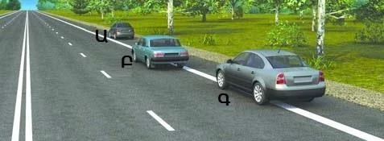
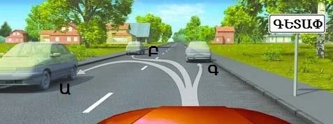
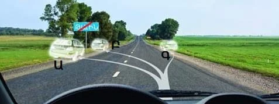
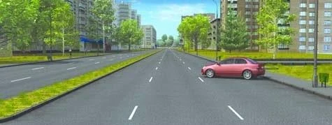
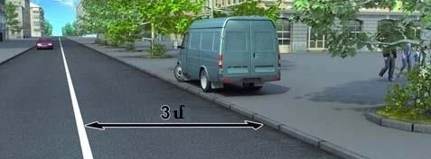
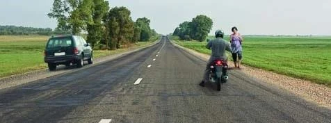

# کجا توقف و پارک کنیم

بسیاری از پرسش‌های این بخش به یک کلمه برمی‌گردد: آن ایستادن توقف بود یا پارک؟ اول این تفاوت را یاد بگیرید، بعد سمت راه و شکل قرار گرفتن وسیله نقلیه را.

## توقف یا پارک: کدام را انجام می‌دهم؟

هر دو یعنی وسیله نقلیه را عمداً به حالت سکون برسانید. قانون جمهوری ارمنستان «درباره تأمین ایمنی ترافیک جاده‌ای» آن‌ها را فقط با دو چیز از هم جدا می‌کند: زمان و هدف.

| | توقف | پارک کردن |
|---|---|---|
| **زمان** | تا 5 دقیقه | بیش از 5 دقیقه |
| **مسافر و بار** | به اندازه‌ای که سوار و پیاده شدن یا بارگیری و تخلیه لازم دارد، حتی بیش از 5 دقیقه | پارک نیست، هر چقدر هم طول بکشد |

*سبز توقف و آبی پارک است و زمان بر حسب دقیقه است. نوار 1 ایستادن معمولی است. نوار 2 ایستادن برای مسافر یا برای بارگیری و تخلیه است.*

این را روی چند مثال واقعی امتحان کنید:

| ایستادن شما... | این یعنی |
|---|---|
| 3 دقیقه برای دیدن نقشه | توقف |
| 20 دقیقه برای تخلیه بار وانت | توقف |
| 10 دقیقه برای انتظار دوست | پارک کردن |

ایستادن برای جلوگیری از برخورد هم پارک نیست، هر چقدر هم طول بکشد.

> **به یاد داشته باشید:** ممنوعیت توقف، پارک کردن را هم ممنوع می‌کند. ممنوعیت پارک کردن، توقف را ممنوع نمی‌کند.

## کدام سمت راه؟

از سمت راست راه استفاده کنید (بند 78). جای ایستادن به امکانات راه بستگی دارد:

1. کنار پیاده‌رو یا روی شانه راه.
2. فقط اگر هیچ‌کدام نبود، در لبه سواره‌رو.

اگر شانه راه وجود دارد، تمام وسیله نقلیه باید روی آن باشد. برای این کار می‌توانید از خط لبه 1.2 بگذرید.

*خودروی Ա (A) کاملاً روی شانه راه است و درست ایستاده. خودروی Բ (B) روی سواره‌رو است و Գ (C) روی خط ایستاده و سمت چپش هنوز روی سواره‌رو است. هر دو نادرست‌اند.*

## چه وقت می‌توانم از سمت چپ استفاده کنم؟

فقط در محدوده شهری و فقط در یکی از این راه‌ها (بند 79):

- راه یک‌طرفه.
- راهی با یک خط عبور در هر جهت و بدون خطوط تراموا در وسط.

کامیون‌هایی با حداکثر جرم مجاز بیش از 3.5 تن در سمت چپ فقط برای بارگیری، تخلیه یا پیاده و سوار کردن مسافر می‌توانند توقف کنند. اتوبوس چنین محدودیتی ندارد. بیرون از محدوده شهری اصلا نمی‌توانید از سمت چپ استفاده کنید، پس به تابلوی شهر نگاه کنید.

*سیاه روی سفید: مقررات محدوده شهری در این راه اعمال می‌شود، پس هر سه جا مجاز است.*

*آبی و خط‌خورده، تابلوی 5.26: مقررات محدوده شهری اعمال نمی‌شود، پس فقط Գ (C) که روی شانه راست راه است درست ایستاده.*

> **دام رایج:** اجازه استفاده از سمت چپ، قاعده‌های دیگر را لغو نمی‌کند. خودرویی که در سمت چپ راه یک‌طرفه ایستاده، اگر خیلی نزدیک به گذرگاه باشد یا ورودی حیاط را ببندد، باز هم خطا کرده است.

## وسیله نقلیه چگونه باید بایستد؟

موازی با لبه سواره‌رو و در یک ردیف (بند 80). دو استثنا وجود دارد:

- جایی، مانند عریض‌شدگی موضعی سواره‌رو، که خط‌کشی شکل دیگری را مجاز می‌کند.
- وسایل نقلیه دوچرخ بدون سایدکار که می‌توانند دو تا کنار هم بایستند.

*با زاویه ایستاده و خط‌کشی‌ای این را مجاز نکرده است. چنین توقفی مجاز نیست، حتی برای خودروی سواری.*

## آیا می‌توانم روی پیاده‌رو بایستم؟

نه. بند 84 توقف روی پیاده‌رو را ممنوع می‌کند و این شامل پارک کردن هم می‌شود. فقط خودروهای سواری، موتورسیکلت‌ها، موتورگازی‌ها و دوچرخه‌ها می‌توانند از لبه پیاده‌رو استفاده کنند، آن هم فقط جایی که تابلوی 6.4 «محل پارک» با تابلوی تکمیلی نشان‌دهنده این شیوه پارک نصب شده باشد (بند 81). درس تابلوهای توقف این تابلوهای تکمیلی را توضیح می‌دهد.

*اینجا نه تابلوی 6.4 هست و نه تابلوی تکمیلی، پس این راننده مقررات توقف را نقض کرده است.*

## کجا می‌توانم استراحت طولانی کنم؟

بیرون از محدوده شهری، پارک کردن برای استراحت طولانی، توقف شبانه و مانند آن فقط در محل‌هایی که برای پارک در نظر گرفته شده یا بیرون از محدوده راه مجاز است (بند 82).

> **دام رایج:** شانه راه جواب مطمئنی به نظر می‌رسد، اما نیست. سمت راست سواره‌رو هم جواب درست نیست.

همچنین بیرون از محدوده شهری نباید روی سواره‌روی راهی که تابلوی 2.1 «راه اصلی» دارد پارک کنید، در هر ساعتی که باشد (بند 86). توقف برای سوار کردن مسافر همچنان اشکالی ندارد.

## وسایل نقلیه بزرگ در منطقه مسکونی کجا پارک می‌کنند؟

اتوبوس‌ها به‌جز مینی‌بوس‌ها، و کامیون‌های بیش از 3.5 تن، در منطقه مسکونی و حیاط فقط در محل‌هایی که برای این کار پیش‌بینی شده و تابلو و خط‌کشی مربوط را دارند می‌توانند پارک کنند (بندهای 121 و 122).

مطلب تکمیلی: پیش از باز کردن در

*این مطلب از بانک سؤالات نیامده است.*

پیش از باز کردن در سمت خیابان، آینه را ببینید و از روی شانه نگاه کنید. ممکن است دوچرخه‌سوار یا موتورسیکلت‌سواری از کنار شما بگذرد. تا جایی که می‌شود، از سرنشینان بخواهید از سمت جدول پیاده شوند.

## خودتان امتحان کنید

**در راهی میان مزرعه‌ها هستید.** خودرویی در سمت چپ ایستاده و موتورسیکلتی روی سواره‌رو، کنار شانه خالی راه.

چه کسی مقررات را نقض کرده است؟ **هر دو.** بیرون از محدوده شهری سمت چپ مجاز نیست و موتورسیکلت باید به شانه راه می‌رفت.

## نکات کلیدی

- توقف: تا 5 دقیقه، یا به اندازه نیاز مسافر، بارگیری یا تخلیه. پارک کردن: هر چیز طولانی‌تر از آن.
- در سمت راست بایستید: کنار پیاده‌رو یا روی شانه راه، و فقط اگر هیچ‌کدام نبود در لبه سواره‌رو.
- سمت چپ: فقط در محدوده شهری، در راه یک‌طرفه یا راه با یک خط عبور در هر جهت و بدون خطوط تراموا در وسط.
- موازی با لبه در یک ردیف بایستید و روی پیاده‌رو نروید، مگر اینکه تابلوی 6.4 و تابلوی تکمیلی اجازه دهد.
- استراحت طولانی بیرون از محدوده شهری: محل پیش‌بینی‌شده یا بیرون از راه، نه شانه راه.

{{practice}}
