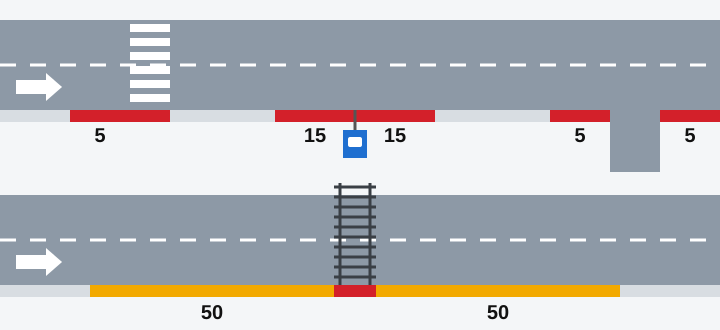
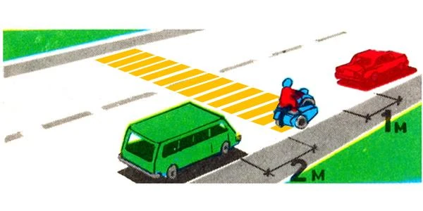
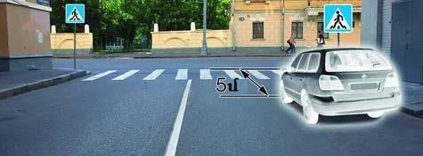
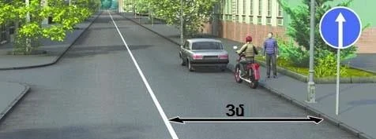
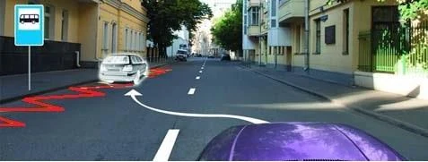
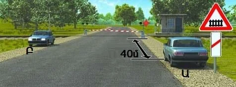

# مکان‌های ممنوع برای توقف

وسیله نقلیه‌ای که در جای نادرست ایستاده، دید یا راه بقیه را می‌بندد. این درس همه مکان‌ها و فاصله‌ها را در یک جدول جمع می‌کند، چون آزمون عدد دقیق می‌خواهد.

## این دو فهرست چگونه با هم جور می‌شوند؟

بند 84 جاهایی را فهرست می‌کند که **توقف** در آن‌ها ممنوع است. بند 86 می‌گوید **پارک کردن** در همه آن جاها ممنوع است و چند مورد دیگر هم اضافه می‌کند. پس هر جای فهرست اول برای هر دو بسته است.

دلیل توقف شما تغییری ایجاد نمی‌کند. سوار کردن مسافر هم توقف است.

## جدولی که باید یاد بگیرید

| مکان | توقف | پارک کردن |
|---|---|---|
| گذرگاه راه‌آهن | فقط روی گذرگاه ممنوع است | روی آن و نزدیک‌تر از **50 متر**، در هر دو طرف، ممنوع است |
| گذرگاه عابر پیاده | روی آن و نزدیک‌تر از **5 متر** پیش از آن ممنوع است | مانند توقف |
| تقاطع، از جمله میدان | داخل آن و نزدیک‌تر از **5 متر** از لبه سواره‌روی متقاطع ممنوع است | مانند توقف |
| ایستگاه وسایل نقلیه عمومی | در محدوده خط‌کشی 1.17 ممنوع است، و اگر خط‌کشی نباشد نزدیک‌تر از **15 متر** از نشانگرهای ایستگاه | مانند توقف |
| کنار خط ممتد (غیر از خط لبه)، نوار جداکننده یا لبه مقابل سواره‌رو | اگر کمتر از **3 متر** باقی بماند ممنوع است | مانند توقف |
| پیچ خطرناک با دید کمتر از **100 متر** | روی سواره‌رو ممنوع است | مانند توقف |
| تونل‌ها؛ روی و زیر پل‌ها، روگذرها و جاده‌های مرتفع | ممنوع است | مانند توقف |
| پیاده‌روها | ممنوع است | مانند توقف، مگر اینکه تابلوی 6.4 و تابلوی تکمیلی اجازه دهد |
| جایی که حرکت دیگران را غیرممکن می‌کند، مثلاً جلوی یک ورودی | ممنوع است | مانند توقف |
| سواره‌روی راه دارای تابلوی 2.1 «راه اصلی»، بیرون از محدوده شهری | مجاز است | ممنوع است |

*حرکت از چپ به راست است. قرمز یعنی توقف و پارک هر دو ممنوع، و نارنجی یعنی توقف مجاز است اما پارک نه. راه بالا: گذرگاه عابر پیاده، ایستگاه بدون خط‌کشی و یک راه فرعی. راه پایین: گذرگاه راه‌آهن.*

> **به یاد داشته باشید:** مقررات می‌گوید «نزدیک‌تر از» و «کمتر از». درست در 5، 15 یا 3 متری، بیرون از ممنوعیت هستید.

> **دام رایج:** عددها را جابه‌جا نکنید. 50 متر نزدیک گذرگاه راه‌آهن برای پارک کردن است، نه توقف. 15 متر مال ایستگاه‌هاست و 100 متر پیش از گذرگاه به سبقت مربوط است.

## گذرگاه عابر پیاده: پیش از آن، نه بعد از آن

5 متر فقط پیش از گذرگاه و در جهت حرکت شما اعمال می‌شود. درست بعد از گذرگاه، توقف مجاز است.

*ون خیلی نزدیک است و موتورسیکلت روی گذرگاه است. خودروی قرمز درست ایستاده، چون از گذرگاه گذشته است.*

تا لبه نزدیک گذرگاه اندازه بگیرید، یعنی لبه‌ای که به آن نزدیک می‌شوید.

*این 5 متر تا لبه دور می‌رسد، پس خود گذرگاه را هم در بر می‌گیرد. فاصله واقعی کمتر از 5 متر است، پس توقف ممنوع است.*

## قاعده 3 متر

این قاعده برای عبور دیگران جا می‌گذارد. از **وسیله نقلیه** تا خط را اندازه بگیرید، نه از جدول.

*کل این نوار 3 متر پهنا دارد. وقتی وسیله نقلیه‌ای در آن بایستد، کمتر از 3 متر می‌ماند، پس هیچ‌کس نمی‌تواند اینجا توقف کند. موتورسیکلت باریک‌تر است، اما باز هم کمتر از 3 متر باقی می‌گذارد.*

نواری به پهنای 4 متر هم وقتی خودرویی در آن بایستد به همین دلیل کافی نیست. فقط خط ممتد حساب می‌شود، آن هم خطی که لبه سواره‌رو را نشان ندهد. خط بریده چنین محدودیتی ایجاد نمی‌کند.

## ایستگاه‌ها

این محدوده برای حمل‌ونقل خطی نگه داشته می‌شود، پس فقط راننده وسیله نقلیه عمومی می‌تواند آنجا توقف کند.

*تابلوی 5.16 و خط‌کشی زیگزاگ 1.17 ایستگاه را نشان می‌دهند. توقف در امتداد این خط‌کشی ممنوع است.*

## پیچ‌ها و پل‌ها

قاعده پیچ فقط سواره‌رو را در بر می‌گیرد و تابلوی پیچ خطرناک به‌تنهایی چیزی را ممنوع نمی‌کند. پس حتی نزدیک پیچ می‌توانید بیرون از سواره‌رو، در لبه راه بایستید. در تونل و روی پل چنین راهی وجود ندارد.

مطلب تکمیلی: چرا خودروی ایستاده پیش از گذرگاه خطرناک است

*این مطلب از بانک سؤالات نیامده است.*

خودرویی که درست پیش از گذرگاه ایستاده، کسانی را که می‌خواهند وارد راه شوند پنهان می‌کند و وسایل نقلیه در حال نزدیک شدن را هم از دید آن‌ها می‌پوشاند. کودکان سخت‌تر از همه دیده می‌شوند. همان خودرو بعد از گذرگاه خیلی کمتر مانع دید است.

## خودتان امتحان کنید

**دو خودرو در مسیر نزدیک شدن به گذرگاه راه‌آهن ایستاده‌اند.** خودروی Ա (A) در فاصله 40 متری است و خودروی Բ (B) در طرف دیگر راه.

آیا یکی از آن‌ها مقررات توقف را نقض کرده است؟ **نه.** توقف فقط روی خود گذرگاه ممنوع است. اما اگر پارک کرده باشند، **هر دو** خطا کرده‌اند، چون داخل محدوده 50 متری هستند.

## نکات کلیدی

- هر جا توقف ممنوع است، پارک کردن هم ممنوع است.
- گذرگاه راه‌آهن: توقف روی آن ممنوع، و پارک کردن روی آن یا تا 50 متری در هر دو طرف ممنوع.
- گذرگاه عابر پیاده: هیچ‌چیز روی آن یا نزدیک‌تر از 5 متر پیش از آن. درست بعد از آن اشکالی ندارد.
- تقاطع: 5 متر. ایستگاه: خط‌کشی 1.17، یا 15 متر از نشانگرهای ایستگاه.
- تا خط ممتد دست‌کم 3 متر جا بگذارید، با اندازه‌گیری از وسیله نقلیه خودتان.
- در تونل و روی یا زیر پل توقف نکنید، حتی برای مسافر.

{{practice}}
