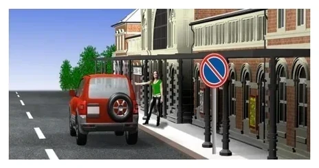
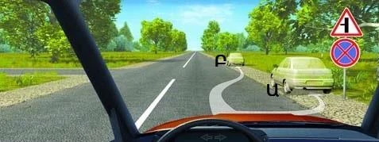
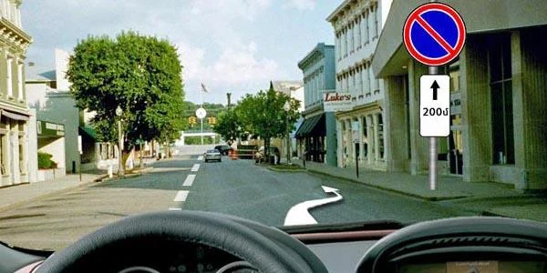
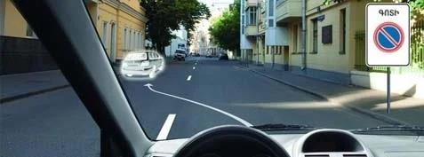
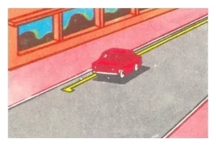
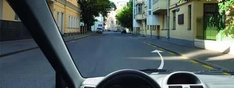
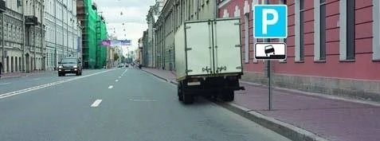
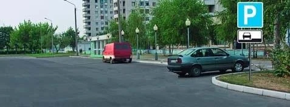
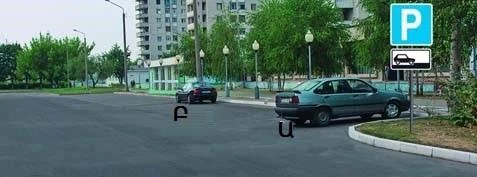
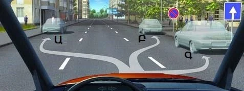

# تابلوها و خطوط توقف

بیشتر پرسش‌های توقف به خواندن درست یک تابلو یا خط زرد برمی‌گردد. یاد بگیرید هر کدام چه چیزی را ممنوع می‌کند، اثرش کجا تمام می‌شود و چه کسی معاف است، تا این پرسش‌ها نمره آسان شوند.

## تابلوها را چگونه از هم تشخیص بدهم؟

خط‌های روی دایره را بشمارید.

*تابلوی 3.27 «توقف ممنوع»: دو خط متقاطع. توقف و پارک کردن هر دو را ممنوع می‌کند.*

*تابلوی 3.28 «پارک ممنوع»: یک خط. فقط پارک کردن را ممنوع می‌کند.*

> **به یاد داشته باشید:** زیر تابلوی 3.28 همچنان می‌توانید توقف کنید. سوار کردن مسافر توقف است. تخلیه بار هم توقف است، هر چقدر که کار طول بکشد.

> **دام رایج:** آزمون برای تخلیه بار زیر تابلوی 3.28 گزینه «اگر تا 5 دقیقه طول بکشد مجاز است» را می‌آورد. این حد بی‌ربط است، چون ایستادن برای تخلیه بار هر چقدر طول بکشد توقف است.

*توقف در اینجا مجاز است. تابلوی 3.28 آن را ممنوع نمی‌کند، قاعده 3 متر خط ممتد را می‌شمارد نه خط بریده را، و این تابلوی روزهای فرد و زوج نیست.*

### روزهای فرد و زوج

*تابلوی 3.29 «پارک در روزهای فرد ماه ممنوع»: یک میله عمودی.*

*تابلوی 3.30 «پارک در روزهای زوج ماه ممنوع»: دو میله عمودی.*

جایی که این دو تابلو با هم و در دو طرف مقابل خیابان به کار می‌روند، وسایل نقلیه بین ساعت 19:00 تا 21:00 از یک طرف به طرف دیگر جابه‌جا می‌شوند. پس در روز فرد، پارک کردن در طرفی که تابلوی 3.29 دارد در طول روز ممنوع است و بعد از ساعت 19:00 ممکن می‌شود.

## اثر تابلو کجا شروع می‌شود و کجا تمام می‌شود؟

تابلوهای 3.27 تا 3.30 این‌طور عمل می‌کنند، مگر اینکه تابلوی تکمیلی یا خط‌کشی چیز دیگری بگوید:

- **از محل تابلو شروع می‌شوند.** جایی که پیش از تابلوست را در بر نمی‌گیرند.
- **فقط همان طرف راه را در بر می‌گیرند که در آن نصب شده‌اند.**
- **در نزدیک‌ترین تقاطع بعد از تابلو تمام می‌شوند.** راه فرعی‌ای که به راه شما می‌پیوندد هم تقاطع حساب می‌شود.
- **در محدوده شهری بدون تقاطع،** در پایان محدوده شهری تمام می‌شوند.

*تابلوی مثلثی بالای آن از راه فرعی در جلو خبر می‌دهد. Ա (A) داخل محدوده است. Բ (B) از راه فرعی گذشته و می‌تواند توقف کند.*

### تابلوهای تکمیلی که محدوده را تغییر می‌دهند

| تابلوی تکمیلی | چه می‌گوید |
|---|---|
| 8.2.2، پیکان رو به بالا و یک فاصله | محدوده تا این فاصله جلوتر از تابلو ادامه دارد |
| 8.2.3، یک پیکان رو به پایین | محدوده اینجا تمام می‌شود، پس ممنوعیت پشت سر شماست |
| 8.2.4، دو پیکان | داخل محدوده هستید، پس ممنوعیت پیش و پس از تابلو برقرار است |

*تابلوی تکمیلی 8.2.3: بعد از این تابلو آزاد هستید. پیش از آن هنوز داخل محدوده‌اید.*

*تابلوی تکمیلی 8.2.4: در هر دو طرف تابلو توقف ممنوع است.*

*تابلوی تکمیلی 8.2.2 با عدد 200 متر زیر تابلوی 3.28. اینجا همچنان می‌توانید برای سوار کردن مسافر توقف کنید.*

> **دام رایج:** تابلوی 3.27 با پیکان رو به پایین شبیه آغاز ممنوعیت است، اما برعکس است. بعد از تابلو پارک کردن مجاز است و ممنوعیت مربوط به راه پیش از آن است.

تابلوی 3.27 همراه با خط‌کشی زرد ممتد 1.4 قاعده ساده‌تری دارد: ممنوعیت فقط تا جایی ادامه دارد که خط‌کشی ادامه دارد.

### منطقه‌های پارک

*تابلوی 5.27 «منطقه با محدودیت پارک» آغاز منطقه‌ای با پارک محدود است.*

*تابلوی 5.28 «پایان منطقه با محدودیت پارک». تقاطع بعدی این منطقه را تمام نمی‌کند: فقط این تابلو تمام می‌کند.*

## چه کسانی معاف‌اند؟

**تابلوهای 3.28 تا 3.30** شامل این‌ها نمی‌شوند:

- وسایل نقلیه‌ای که افراد دارای معلولیت گروه‌های I و II آن‌ها را می‌رانند یا با آن‌ها حمل می‌شوند.
- تاکسی‌هایی که تاکسی‌مترشان روشن است.
- وسایل نقلیه پست و ارتباطات ویژه با طرح رنگی مقرر.

وسایل نقلیه عمومی در این فهرست نیستند.

**تابلوی 3.27** هیچ‌یک از این معافیت‌ها را ندارد. اگر زیر آن تابلوی تکمیلی نباشد، برای همه الزامی است. تابلوی تکمیلی می‌تواند این را تغییر دهد:

*تابلوی تکمیلی 8.18 «به‌جز افراد دارای معلولیت»: تابلو شامل خودروهایی که علامت شناسایی «معلول» دارند نمی‌شود. این تابلو به علامت روی خودرو نگاه می‌کند.*

*تابلوی تکمیلی 8.4.1 «نوع وسیله نقلیه»: تابلوی 3.28 با این تابلوی تکمیلی فقط کامیون‌های بیش از 3.5 تن را در بر می‌گیرد. خودرو و موتورسیکلت می‌توانند آنجا پارک کنند، اما کامیون 4 تنی نمی‌تواند.*

## خطوط زرد چه معنایی دارند؟

| خط | کجا آن را می‌بینید | چه چیزی را ممنوع می‌کند | همراه با |
|---|---|---|---|
| زرد ممتد، خط‌کشی 1.4 | در امتداد لبه سواره‌رو یا روی سطح بالای جدول | توقف و پارک کردن | به‌تنهایی یا با تابلوی 3.27 |
| زرد بریده، خط‌کشی 1.10 | در امتداد لبه سواره‌رو | فقط پارک کردن | به‌تنهایی یا با تابلوی 3.28 |

آن‌ها را جفت به خاطر بسپارید: خط ممتد با دو خط متقاطع جور است و خط بریده با یک خط.

*تابلو لازم نیست. خط زرد ممتد به‌تنهایی توقف را در اینجا ممنوع می‌کند.*

*زرد بریده: توقف برای همه وسایل نقلیه مجاز است.*

> **دام رایج:** با بالا رفتن از پیاده‌رو از خط زرد ممتد فرار نمی‌کنید. توقف روی پیاده‌رو هم ممنوع است و موتورسیکلت هم استثنا نیست.

## تابلوی محل پارک چگونه کار می‌کند؟

*تابلوی 6.4 «محل پارک». تابلوی تکمیلی زیر آن نشان می‌دهد چگونه بایستید و باید همان‌طور بایستید (بند 80).*

| تابلوی تکمیلی | شکل ایستادن | چه کسانی |
|---|---|---|
| 8.6.1 | روی سواره‌رو، در امتداد جدول | همه وسایل نقلیه |
| 8.6.2 تا 8.6.9 | با استفاده از لبه پیاده‌رو | خودروهای سواری و موتورسیکلت‌ها |

*تابلوی تکمیلی 8.6.1.*

*تابلوی تکمیلی 8.6.2.*

بند 81 لبه پیاده‌رو را فقط برای خودروهای سواری، موتورسیکلت‌ها، موتورگازی‌ها و دوچرخه‌ها مجاز می‌داند.

> **دام رایج:** آزمون گزینه «بله، اگر حداکثر جرم مجاز بیش از 3.5 تن باشد» را می‌آورد. این ممنوعیت به نوع وسیله نقلیه بستگی دارد، نه جرم آن. کامیون سبک‌تر از 3.5 تن هم نمی‌تواند در لبه پیاده‌رو پارک کند.

*تابلوی تکمیلی این شیوه را فقط برای خودرو و موتورسیکلت مجاز می‌داند، پس راننده کامیون خطا کرده است.*

## خودتان امتحان کنید

**یک خیابان با دو تابلوی تکمیلی متفاوت.** اول تابلوی تکمیلی 8.6.1.

چه کسی مقررات را نقض کرده است؟ **راننده خودروی سواری.** این تابلوی تکمیلی وسایل نقلیه را روی سواره‌رو و در امتداد لبه قرار می‌دهد. ون همین‌طور ایستاده و خودرو نه.

حالا تابلوی تکمیلی خودرویی را روی لبه پیاده‌رو نشان می‌دهد.

چه کسی مقررات را نقض کرده است؟ **Բ (B).** Ա (A) همان‌طور ایستاده که تابلوی تکمیلی نشان می‌دهد و Բ (B) نه.

**در راهی یک‌طرفه هستید و تابلوی 3.28 در سمت راست نصب شده است.**

کجا می‌توانید پارک کنید؟ **Ա (A) یا Գ (C).** Ա (A) در سمت چپ است که تابلو به آن نمی‌رسد و راه یک‌طرفه سمت چپ را مجاز می‌کند. Գ (C) پیش از تابلوست. Բ (B) بعد از تابلو و در همان طرف است.

## نکات کلیدی

- تابلوی 3.27 و زرد ممتد 1.4 توقف و پارک کردن را ممنوع می‌کنند. تابلوی 3.28 و زرد بریده 1.10 فقط پارک کردن را.
- تابلوهای 3.27 تا 3.30 از محل تابلو تا نزدیک‌ترین تقاطع اثر دارند و فقط در همان طرف راه.
- پیکان رو به پایین: محدوده اینجا تمام می‌شود. دو پیکان: داخل آن هستید. پیکان رو به بالا و فاصله: طول آن به جلو.
- افراد دارای معلولیت و تاکسی با تاکسی‌متر روشن از تابلوهای 3.28 تا 3.30 معاف‌اند. از 3.27 هیچ‌کس معاف نیست، مگر تابلوی تکمیلی بگوید.
- تابلوی 6.4 با تابلوی تکمیلی 8.6.1 برای همه وسایل نقلیه است. پارک در لبه پیاده‌رو هرگز برای کامیون نیست.

{{practice}}
