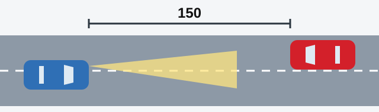
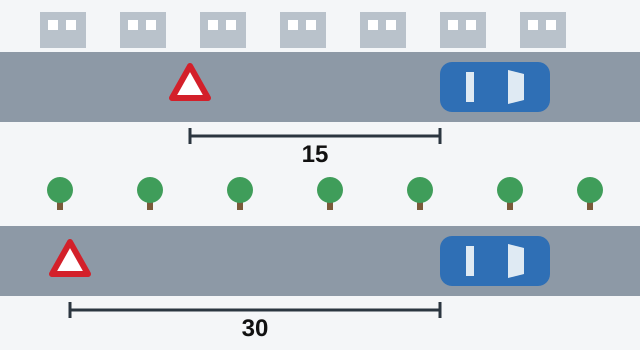

# استفاده از چراغ‌ها

چراغ‌ها دو کار می‌کنند: به شما کمک می‌کنند ببینید و به دیگران می‌گویند شما آنجا هستید و چه اتفاقی در جریان است. آزمون می‌سنجد کدام چراغ به کدام وضعیت مربوط است، پس این درس وضعیت‌ها را یکی‌یکی مرور می‌کند.

مقررات راهنمایی و رانندگی از نور پایین و نور بالا حرف می‌زند و پرسش‌های تمرینی هم همین نام‌ها را به کار می‌برند.

## در تاریکی به چه چراغی نیاز دارم؟

در تاریکی، و هر وقت دید ناکافی است، هر وسیله نقلیه مکانیکی در حال حرکت باید **نور بالا یا نور پایین** را روشن داشته باشد (بند 127). این حکم هر قدر هم راه روشن باشد برقرار است و در تونل‌ها هم صدق می‌کند. اتوبوسی که در مسیر مشخص‌شده حرکت می‌کند هم استثنا نیست.

> **دام رایج:** پاسخ‌هایی که می‌گویند «فقط نور پایین» یا «فقط نور بالا» نادرست‌اند. مقررات یکی از این دو را می‌خواهد و انتخاب را به شما واگذار کرده است.

## چه زمانی باید نور بالا را به نور پایین تغییر دهم؟

نور بالا تا دوردست می‌رسد و چشم هر کسی را که به آن نگاه کند خیره می‌کند. بند 128 می‌گوید چه زمانی باید به نور پایین بروید:

- در راه روشن داخل محدوده شهری.
- **در فاصله نه کمتر از 150 متر از وسیله نقلیه روبه‌رو**، یا دورتر اگر راننده آن با چراغ به شما علامت بدهد.
- هر جای دیگری که نور بالا ممکن است راننده دیگری را خیره کند.

*تا وقتی وسیله نقلیه روبه‌رو دست‌کم 150 متر فاصله دارد، نور را پایین بیاورید.*

## اگر نور چشمم را خیره کند چه کنم؟

نخستین کار شما روشن کردن **چراغ هشدار خطر** است (بند 129). بعد، بدون تغییر خط عبور، سرعت را کم کنید و در صورت لزوم بایستید. چراغ هشدار خطر به رانندگان پشت سر خبر می‌دهد که سرعت شما در حال کم شدن است.

> **دام رایج:** «تغییر به نور پایین» در اینجا قدم اول نیست. نور را *پیش از* رسیدن به وسیله نقلیه روبه‌رو پایین می‌آورید. علامت صوتی هم پاسخ درست نیست.

مطلب تکمیلی: وقتی نور چراغ‌ها چشمتان را می‌زند به کجا نگاه کنید

*این مطلب از بانک سؤالات نیامده است.*

به نور شدید خیره نشوید. به سمت لبه راست راه نگاه کنید و با کمک آن موقعیت خود را حفظ کنید. پس از رد شدن نور، چشم‌ها چند ثانیه زمان می‌خواهند تا به حالت عادی برگردند، پس فوراً سرعت نگیرید.

## کدام وسایل نقلیه در روز از نور پایین استفاده می‌کنند؟

بند 133 نور پایین را در روز الزامی کرده تا وسیله نقلیه در حال حرکت بهتر دیده شود:

- **موتورسیکلت و موتور گازی:** همیشه هنگام حرکت، بدون هیچ شرطی.
- **وسایل نقلیه حمل‌ونقل عمومی** در خط ویژه مخالف جریان اصلی.
- **وسایل نقلیه حامل گروه‌های سازمان‌یافته کودکان.**
- **وسیله نقلیه یدک‌کش** هنگام یدک‌کشی.

> **به یاد داشته باشید:** اتوبوس کودکان در روز از نور پایین استفاده می‌کند. نور بالا رانندگان دیگر را خیره می‌کند و چراغ هشدار خطر و چراغ‌های داخل سالن چیزی نیستند که مقررات خواسته باشد.

## چه زمانی می‌توانم از چراغ مه‌شکن و نورافکن استفاده کنم؟

**چراغ مه‌شکن عقب** فقط در شرایط دید ناکافی به کار می‌رود (بند 131). حرکت در کاروان، بودن در تونل یا تخلیه بار دلیلی برای روشن کردن آن نیست.

**نورافکن و چراغ جست‌وجو** فقط خارج از محدوده شهری به کار می‌روند، آن هم وقتی وسیله نقلیه روبه‌رو یا هم‌جهتی وجود نداشته باشد (بند 134). در داخل محدوده شهری فقط رانندگان وسایل نقلیه دارای چراغ گردان آبی، یا آبی و قرمز، و علامت صوتی ویژه می‌توانند هنگام انجام مأموریت رسمی از آن استفاده کنند. تاریکی یا دید کم به‌تنهایی این اجازه را نمی‌دهد و احساس نیاز خودتان هم همین‌طور.

## چه زمانی چراغ هشدار خطر باید روشن باشد؟

بند 22 چهار مورد را برمی‌شمارد:

| وضعیت | چه کسی آن را روشن می‌کند |
|---|---|
| سانحه رانندگی | وسیله نقلیه درگیر سانحه |
| توقف اجباری در جایی که توقف ممنوع است | وسیله نقلیه متوقف |
| خیره شدن از نور چراغ‌ها | راننده‌ای که چشمش خیره شده |
| یدک‌کشی | وسیله نقلیه مکانیکی یدک‌شونده |

ورود به تونل یا حرکت در کاروان سازمان‌یافته در این فهرست نیست.

> **دام رایج:** بسیاری از پرسش‌ها با «در هر دو مورد» یا «در همه موارد ذکرشده» تمام می‌شوند. اگر هر گزینه یکی از این چهار وضعیت باشد، همان گزینه آخر پاسخ درست است.

## علامت «توقف اضطراری» کجا قرار می‌گیرد؟

این علامت باید رانندگانی را که نزدیک می‌شوند به‌موقع آگاه کند (بند 23). چراغ قرمز چشمک‌زن هم می‌تواند همین کار را بکند.

*علامت را در محدوده شهری نه کمتر از 15 متر و خارج از محدوده شهری 30 متر دورتر از وسیله نقلیه بگذارید.*

یک حالت ویژه هم هست. اگر هنگام یدک‌کشی چراغ هشدار خطر وجود نداشته باشد یا خراب باشد، این علامت **در قسمت عقب وسیله نقلیه یدک‌شونده** نصب می‌شود (بند 24)، یعنی جایی که رانندگان پشت سر آن را می‌بینند.

مطلب تکمیلی: ایمن ماندن هنگام گذاشتن علامت

*این مطلب از بانک سؤالات نیامده است.*

همه را از سمت دور از ترافیک پیاده کنید و از خودرو دور ببرید. علامت را جلوی خود و رو به رانندگانی که نزدیک می‌شوند نگه دارید و نزدیک لبه راه بمانید. جلیقه شب‌رنگ در شب شما را بسیار بهتر نمایان می‌کند.

## خودتان امتحان کنید

**شب است و با نور بالا در راهی بدون روشنایی می‌رانید.** خودرویی از روبه‌رو پیدا می‌شود.

چه زمانی باید نور را پایین بیاورید؟ **در فاصله نه کمتر از 150 متر.** اگر راننده آن با چراغ علامت بدهد، زودتر این کار را بکنید.

**آن خودرو با نور بالا از کنارتان می‌گذرد و چشمتان چیزی نمی‌بیند.** اولین کار چیست؟ **چراغ هشدار خطر.** بعد در خط عبور خود بمانید، سرعت را کم کنید و در صورت لزوم بایستید.

## نکات کلیدی

- در تاریکی یا دید ناکافی: نور بالا یا نور پایین، هر قدر هم راه روشن باشد.
- نور بالا را در فاصله نه کمتر از 150 متر از وسیله نقلیه روبه‌رو پایین بیاورید.
- خیره شدن: اول چراغ هشدار خطر، ماندن در خط عبور، کم کردن سرعت و در صورت لزوم توقف.
- در روز، موتورسیکلت و موتور گازی همیشه با نور پایین حرکت می‌کنند؛ اتوبوس کودکان و حمل‌ونقل عمومی در خط مخالف جریان نیز همین‌طور.
- چراغ مه‌شکن عقب: فقط در دید ناکافی.
- چراغ هشدار خطر: سانحه، توقف اجباری در جای ممنوع، خیره شدن، وسیله نقلیه یدک‌شونده.
- علامت «توقف اضطراری»: نه کمتر از 15 متر در محدوده شهری و 30 متر در خارج از آن.

{{practice}}
