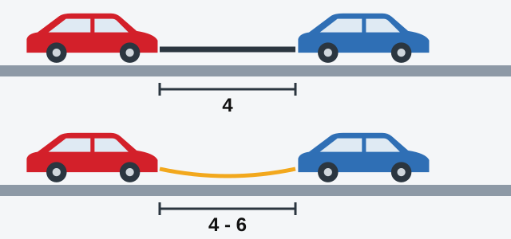
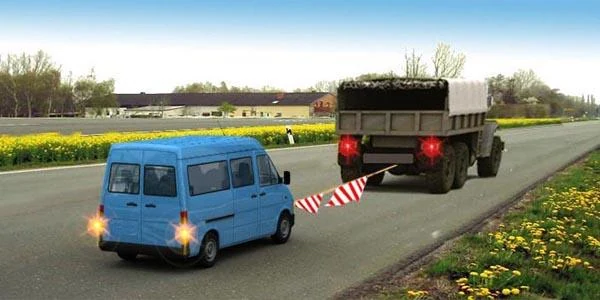

# یدک‌کشی

وسیله نقلیه یدک‌شونده موتوری ندارد که به ترمز و فرمانش کمک کند، پس حالا دو وسیله نقلیه به یک اتصال وابسته‌اند. آزمون چهار چیز را می‌سنجد: فاصله دو وسیله نقلیه، اینکه چه کسی می‌تواند سوار باشد، چه زمانی یدک‌کشی ممنوع است و از کدام چراغ‌ها باید استفاده کرد.

## سه روش یدک‌کشی کدام است؟

- **اتصال سخت:** یک میله محکم. هم فاصله و هم جهت دو وسیله نقلیه را ثابت نگه می‌دارد.
- **اتصال انعطاف‌پذیر:** طناب یا کابل. فقط می‌کشد.
- **روش بارگیری جزئی:** وسیله نقلیه یدک‌شونده بخشی از وزنش را روی وسیله نقلیه یدک‌کش می‌گذارد.

## فاصله دو وسیله نقلیه باید چقدر باشد؟

بند 140 فاصله را برای دو نوع اتصال تعیین می‌کند.

*اتصال سخت (بالا): حداکثر 4 متر. اتصال انعطاف‌پذیر (پایین): 4 تا 6 متر.*

اگر کوتاه باشد، دو وسیله نقلیه ممکن است به هم بخورند. اگر بلند باشد، وسیله نقلیه یدک‌شونده به‌سختی در همان مسیر می‌ماند.

> **به یاد داشته باشید:** هر دو اتصال در 4 متر به هم می‌رسند. اتصال سخت همان‌جا تمام می‌شود و اتصال انعطاف‌پذیر از همان‌جا شروع می‌شود و تا 6 متر می‌رود.

## چه کسی می‌تواند سوار باشد؟

دو پرسش بپرسید: از کدام روش استفاده می‌شود و این شخص در وسیله نقلیه یدک‌شونده است یا یدک‌کش؟ همه این‌ها در بند 139 آمده است.

| روش | محل | حمل افراد مجاز است؟ |
|---|---|---|
| سخت یا انعطاف‌پذیر | اتوبوس یا ترولی‌بوس یدک‌شونده | خیر |
| سخت یا انعطاف‌پذیر | اتاق بار کامیون یدک‌شونده | خیر |
| سخت یا انعطاف‌پذیر | کابین کامیون یدک‌شونده | بله |
| سخت یا انعطاف‌پذیر | خودروی سواری یدک‌شونده | بله |
| سخت یا انعطاف‌پذیر | اتوبوس یدک‌کش | بله |
| سخت یا انعطاف‌پذیر | اتاق بار کامیون یدک‌کش | بله |
| بارگیری جزئی | کابین یا اتاق بار وسیله نقلیه یدک‌شونده | خیر |
| بارگیری جزئی | اتاق بار وسیله نقلیه یدک‌کش | خیر |
| بارگیری جزئی | کابین وسیله نقلیه یدک‌کش | بله |

ممنوعیت حمل افراد در اتوبوس یدک‌شونده هیچ استثنایی ندارد. نوع اتصال آن را تغییر نمی‌دهد و تعداد نشیمنگاه‌ها یا مسافران هم همین‌طور. پشت فرمان وسیله نقلیه یدک‌شونده هم باید راننده باشد (بند 138).

*این مینی‌بوس یدک کشیده می‌شود، پس هیچ‌کس نمی‌تواند در سالن آن باشد، هر چند نشیمنگاه داشته باشد.*

> **دام رایج:** عدد 8 مسافر ربطی به یدک‌کشی ندارد و مربوط به حمل افراد با کامیون است. دو اتوبوس را هم با هم اشتباه نگیرید: اتوبوس *یدک‌شونده* هیچ‌کس را حمل نمی‌کند، اما اتوبوس *یدک‌کش* می‌تواند مسافر داشته باشد.

## چه زمانی یدک‌کشی ممنوع است؟

**در یخبندان،** اتصال انعطاف‌پذیر ممنوع است (بند 143). طناب نمی‌تواند روی سطح لغزنده وسیله نقلیه یدک‌شونده را در مسیر نگه دارد یا ترمز دو وسیله را هماهنگ کند. اتصال سخت و بارگیری جزئی مجاز می‌مانند و درباره اتوبوس یدک‌شونده هم همین حکم برقرار است.

**درباره موتورسیکلت،** همه‌چیز به کالسکه جانبی بستگی دارد. موتورسیکلت بدون کالسکه جانبی نه می‌تواند یدک بکشد و نه یدک کشیده شود. موتورسیکلت دارای کالسکه جانبی هر دو کار را می‌تواند بکند و مقررات شرطی درباره نوع اتصال برای آن نگذاشته است.

> **دام رایج:** «یدک‌کشی در یخبندان ممنوع است» بیش از حد کلی است و «یدک‌کشی در یخبندان مجاز است» هم همین‌طور. فقط اتصال انعطاف‌پذیر ممنوع است.

## از کدام چراغ‌ها استفاده می‌شود؟

- **وسیله نقلیه یدک‌شونده:** چراغ هشدار خطر (بند 22). نور بالا و نور پایین در اینجا پاسخ نیستند.
- **وسیله نقلیه یدک‌کش:** نور پایین در روز (بند 133).
- **نبود یا خرابی چراغ هشدار خطر:** علامت «توقف اضطراری» را در قسمت عقب وسیله نقلیه یدک‌شونده نصب کنید (بند 24). این محل ثابت است و به تشخیص راننده واگذار نشده، چون رانندگان پشت سر آن را در همین‌جا می‌بینند.

حد سرعت یدک‌کشی وسیله نقلیه مکانیکی در درس سرعت آمده است.

مطلب تکمیلی: یدک‌کشی نرم و بدون تکان

*این مطلب از بانک سؤالات نیامده است.*

پیش از حرکت، با راننده دیگر درباره نحوه علامت دادن به هم توافق کنید. خیلی آرام راه بیفتید تا طناب کشیده شود و زود و نرم ترمز کنید تا وسیله نقلیه یدک‌شونده از پشت به شما نزدیک نشود. اگر موتور وسیله نقلیه یدک‌شونده خاموش باشد، راننده آن برای ترمز و فرمان به نیروی خیلی بیشتری نیاز دارد.

## خودتان امتحان کنید

**با طناب اتوبوسی را یدک می‌کشید و راه جلو یخ زده است.** می‌توانید ادامه دهید؟ **خیر.** در یخبندان اتصال انعطاف‌پذیر ممنوع است. با اتصال سخت می‌توانستید، اما باز هم نباید مسافری در اتوبوس یدک‌شونده باشد.

**کامیونی را به روش بارگیری جزئی یدک می‌کشید و دوستی می‌خواهد با شما بیاید.** دوستتان کجا می‌تواند بنشیند؟ **فقط در کابین وسیله نقلیه یدک‌کش.** بارگیری جزئی همه جاهای دیگر را منتفی می‌کند، حتی اتاق بار وسیله نقلیه یدک‌کش را.

## نکات کلیدی

- اتصال سخت: حداکثر 4 متر. اتصال انعطاف‌پذیر: 4 تا 6 متر.
- هیچ‌کس در اتوبوس یا ترولی‌بوس یدک‌شونده یا در اتاق بار کامیون یدک‌شونده سوار نمی‌شود.
- با اتصال سخت یا انعطاف‌پذیر، خودروی سواری یدک‌شونده و کابین کامیون یدک‌شونده می‌توانند سرنشین داشته باشند.
- بارگیری جزئی: افراد فقط در کابین وسیله نقلیه یدک‌کش.
- در یخبندان اتصال انعطاف‌پذیر ممنوع است. اتصال سخت و بارگیری جزئی مجازند.
- موتورسیکلت بدون کالسکه جانبی نه یدک می‌کشد و نه یدک کشیده می‌شود.
- وسیله نقلیه یدک‌شونده چراغ هشدار خطر را روشن می‌کند. اگر کار نکند، علامت «توقف اضطراری» در عقب آن نصب می‌شود.

{{practice}}
