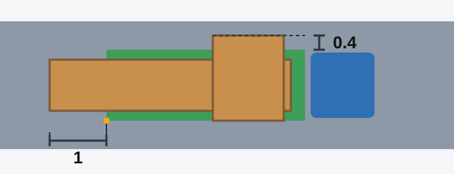

# حمل مسافر و بار

آنچه حمل می‌کنید رفتار وسیله نقلیه و آنچه رانندگان دیگر می‌بینند را تغییر می‌دهد. آزمون می‌پرسد چه کسی کجا می‌تواند باشد و برای بارهایی که بیرون زده‌اند عددهای دقیق می‌خواهد.

## افراد کجا می‌توانند باشند؟

**روی تریلر باری: هرگز.** بند 158 آن را به‌طور کامل ممنوع کرده است. هیچ استثنایی ندارد، حتی برای کسی که همراه بار است.

**در اتاق بار کامیونی که برای حمل افراد تجهیز نشده:** فقط کسی که همراه بار است یا برای تحویل گرفتن آن می‌رود، و فقط روی نشیمنگاهی پایین‌تر از سطح لبه‌های بدنه (بند 154). بند 153 جای این نشیمنگاه‌ها را دست‌کم 0.3 متر پایین‌تر از لبه بالایی بدنه و 0.3 تا 0.5 متر بالاتر از کف تعیین کرده است.

**در کامیونی که مقررات حمل افراد را رعایت می‌کند:** راننده دارای دسته‌های B و C می‌تواند تا **8 مسافر** حمل کند. بیشتر از آن به دسته D یا DE، یا زیردسته D1 یا D1E هم نیاز دارد (بند 150).

**در اتوبوس:** در مسیرهای بین‌شهری و گردشگری، و هنگام حمل گروه‌های سازمان‌یافته کودکان، تعداد افراد نباید از تعداد نشیمنگاه‌ها بیشتر باشد (بند 152).

> **دام رایج:** استثنای اتاق بار کامیون به تریلر نمی‌رسد. کسی که همراه بار است می‌تواند در کامیون لبه‌دار باشد، اما هرگز روی تریلر باری. این موضوع به نوع راه هم ربطی ندارد.

## کودکان چطور؟

کودکان زیر 12 سال را نباید در این جاها حمل کرد (بند 159):

- روی صندلی عقب موتورسیکلت.
- در اتاق بار کامیون دارای بدنه لبه‌دار. کامیون دارای بدنه بسته استثناست.

گروه سازمان‌یافته کودکان در اتوبوس دست‌کم به **یک همراه بزرگسال** در سالن نیاز دارد (بند 155). این اتوبوس در روز هم از نور پایین استفاده می‌کند. درس رانندگی ایمن به نشستن کودکان روی صندلی جلوی خودرو می‌پردازد.

## بار هرگز نباید چه کار کند؟

بار را توزیع و در صورت لزوم مهار کنید. بند 164 حمل باری را ممنوع می‌کند که:

- دید راننده را محدود کند.
- هدایت وسیله نقلیه را دشوار یا پایداری آن را کم کند.
- چراغ‌ها، بازتاب‌دهنده‌ها، پلاک‌ها یا علائم شناسایی را بپوشاند، یا دیدن علامت‌های دستی را دشوار کند.
- سر و صدای قابل توجه ایجاد کند، گرد و خاک بلند کند یا راه و محیط را آلوده کند.

> **به یاد داشته باشید:** اگر بار را نمی‌توان به این شکل حمل کرد، باید مشکل را برطرف کنید یا از ادامه حرکت خودداری کنید (بند 165). رساندن آن «فقط تا نزدیک‌ترین محل تخلیه» مجاز نیست.

مطلب تکمیلی: چیدن بار طوری که سر جایش بماند

*این مطلب از بانک سؤالات نیامده است.*

سنگین‌ترین چیزها را پایین و نزدیک مرکز وسیله نقلیه بگذارید. همه‌چیز را طوری ببندید که نلغزد، چون ترمز شدید بار شل را با نیروی زیاد به جلو پرتاب می‌کند. پس از مسافت کوتاهی بایستید و تسمه‌ها را دوباره بررسی کنید، چون بار جابه‌جا و نشست می‌کند.

## چه زمانی باید بار را علامت‌گذاری کرد؟

بند 162 دو آستانه دارد و بار باید از آن‌ها **بیشتر** باشد تا به علامت نیاز پیدا کند.

*بیش از 1 متر از جلو یا عقب وسیله نقلیه، یا بیش از 0.4 متر از پهلو نسبت به لبه بیرونی چراغ کناری.*

با گذشتن از هر یک از این آستانه‌ها، بار را این‌طور مشخص کنید:

- **در روز:** علامت شناسایی «بار بزرگ‌ابعاد».
- **در ساعات تاریکی شبانه‌روز و در شرایط دید ناکافی:** همان علامت، به‌علاوه چراغ سفید در جلو و چراغ قرمز یا بازتاب‌دهنده در عقب.

| میزان بیرون‌زدگی بار | آستانه | علامت لازم است؟ |
|---|---|---|
| 1.2 متر از عقب | 1 متر | بله |
| 0.6 متر از عقب | 1 متر | خیر |
| 0.5 متر از پهلو | 0.4 متر | بله |
| 0.3 متر از پهلو | 0.4 متر | خیر |

> **دام رایج:** مقررات برای عقب حد 0.8 متری ندارد و بالاتر زدن بار از لبه‌های سکو را هم ممنوع نکرده است. عدد 0.4 متر پهلو را برای عقب و عدد 1 متر عقب را برای پهلو به کار نبرید.

## خودتان امتحان کنید

**لوله‌هایی حمل می‌کنید که 1.2 متر از عقب کامیون بیرون زده‌اند.** هوا دارد تاریک می‌شود. به چه چیزی نیاز دارید؟ **علامت «بار بزرگ‌ابعاد»، به‌علاوه چراغ سفید در جلو و چراغ قرمز یا بازتاب‌دهنده در عقب.** 1.2 متر از آستانه 1 متر بیشتر است.

**در نیمه راه انبار، بار جابه‌جا می‌شود و چراغ‌های عقب را می‌پوشاند.** حالا چه کنید؟ **مشکل را برطرف کنید یا حرکت نکنید.** حتی برای مسافتی کوتاه هم نمی‌توانید ادامه دهید.

## نکات کلیدی

- هیچ‌کس روی تریلر باری سوار نمی‌شود.
- اتاق بار کامیونی که برای افراد تجهیز نشده: فقط افراد همراه بار، روی نشیمنگاه‌هایی پایین‌تر از سطح لبه‌ها.
- دسته‌های B و C: تا 8 مسافر در کامیون.
- کودکان زیر 12 سال: نه روی صندلی عقب موتورسیکلت و نه در اتاق بار کامیون لبه‌دار.
- گروه سازمان‌یافته کودکان در اتوبوس: دست‌کم یک همراه بزرگسال.
- باری را که بیش از 1 متر از جلو یا عقب یا بیش از 0.4 متر از پهلو بیرون زده علامت‌گذاری کنید.
- اگر بار خلاف مقررات باشد، آن را برطرف کنید یا حرکت نکنید.

{{practice}}
