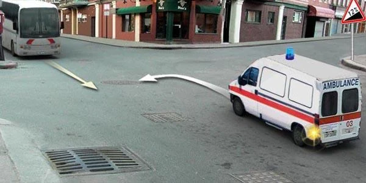
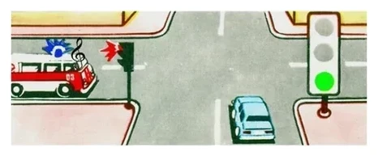
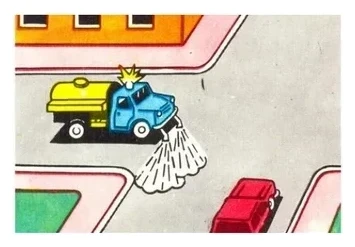
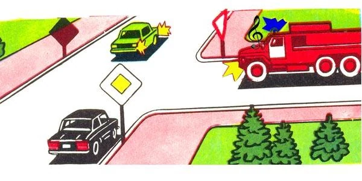
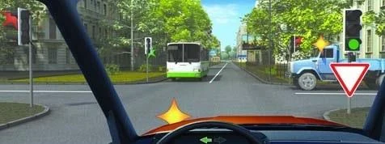
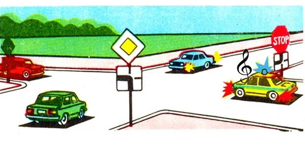

# وسایل نقلیه ویژه

چراغ‌های گردان چند رنگ دارند و هر کدام از شما چیز متفاوتی می‌خواهد. رنگ‌ها را یاد بگیرید تا بیشتر پرسش‌های این درس خودبه‌خود پاسخ داده شوند.

## هر چراغ گردان از من چه می‌خواهد؟

| آنچه می‌بینید | کاری که باید بکنید | بند |
|---|---|---|
| چراغ گردان آبی و علامت صوتی ویژه، در حال نزدیک شدن | راه بدهید تا بدون مانع عبور کند | 28 |
| چراغ‌های گردان آبی و قرمز و علامت صوتی ویژه، در حال نزدیک شدن | سرعت را کم کنید و به آن و وسایل نقلیه همراهش راه بدهید | 29 |
| وسیله نقلیه متوقف با چراغ گردان آبی، یا آبی و قرمز | سرعت را طوری کم کنید که بتوانید فوراً بایستید | 30 |
| وسیله نقلیه متوقف با چراغ گردان قرمز، در جهت حرکت شما | بایستید و فقط پس از گرفتن اجازه ادامه دهید | 31 |
| چراغ گردان زرد یا نارنجی | احتیاط کنید: درباره خطر هشدار می‌دهد و حق تقدم نمی‌دهد | 32 |
| چراغ‌های گردان سفید مهتابی و علامت صوتی ویژه | به این وسیله نقلیه حمله شده و افسران پلیس و افراد دیگر را خبر می‌کند. حق تقدم نمی‌دهد | 35 |

> **دام رایج:** «سرعت را کم کنید و راه بدهید» حکم چراغ آبی و قرمز است. برای چراغ آبی تنها، پاسخ فقط «راه بدهید» است. چراغ قرمز روی وسیله نقلیه متوقف یعنی بایستید، نه اینکه فقط سرعت را کم کنید.

حمل‌ونقل عمومی معاف نیست. حرکت در مسیر مشخص‌شده راننده اتوبوس را از هیچ‌یک از این وظایف معاف نمی‌کند.

## چه چیزی به وسیله نقلیه حق تقدم می‌دهد؟

**چراغ گردان آبی و علامت صوتی ویژه با هم** (بند 26). چراغ گردان به‌تنهایی حق تقدم نمی‌دهد و علامت صوتی به‌تنهایی هم همین‌طور. چراغ‌های گردان آبی و قرمز هم به همین شکل عمل می‌کنند، یعنی فقط همراه با علامت صوتی ویژه. راننده هم فقط پس از اطمینان از اینکه واقعاً به او راه داده می‌شود می‌تواند از این حق تقدم استفاده کند.

رنگ و ظاهر خودرو اهمیتی ندارد. «آمبولانسی» که چراغ گردان و علامت صوتی آن خاموش است یک وسیله نقلیه معمولی است، پس اتوبوس در این تصویر موظف نیست به آن راه بدهد.

وقتی هر دو روشن باشند، باید راه بدهید. فرقی نمی‌کند چراغ شما سبز باشد، در راه اصلی باشید، یا آن وسیله نقلیه از محوطه مجاور یا از پشت تابلوی ایست بیاید.

*چراغ خودرو سبز است، اما آمبولانس باز هم حق تقدم دارد. راننده خودرو باید راه بدهد.*

## چراغ گردان زرد و نارنجی واقعاً چه معنایی دارد؟

این چراغ‌ها درباره خطر هشدار می‌دهند و **حق تقدم نمی‌دهند** (بند 32). بند 34 به برخی از این وسایل نقلیه اجازه می‌دهد با تأمین ایمنی از بعضی مقررات، تابلوها و خط‌کشی‌ها پیروی نکنند، اما این اجازه حق تقدمی نسبت به شما به آن‌ها نمی‌دهد.

*ماشین راه‌سازی چراغ گردان زرد دارد، پس حق تقدمی ندارد و از قواعد معمولی پیروی می‌کند. حق تقدم عبور در اینجا با راننده خودروی سواری است.*

> **به یاد داشته باشید:** آبی به‌علاوه علامت صوتی یعنی راه بدهید. زرد، نارنجی و سفید مهتابی به هیچ‌کس حق تقدم نمی‌دهند.

مطلب تکمیلی: با آرامش راه باز کردن

*این مطلب از بانک سؤالات نیامده است.*

وقتی آژیر می‌شنوید، پیش از هر کاری آینه‌ها را نگاه کنید. راهنما بزنید، نرم کنار بروید و طوری حرکت کنید که راننده امدادی بتواند کار بعدی شما را حدس بزند. جایی نایستید که تقاطع را ببندید و پس از رد شدن آن، مراقب وسیله نقلیه دومی باشید که شاید پشت سرش می‌آید.

## ترتیب عبور از تقاطع را چگونه پیدا کنم؟

1. وسیله نقلیه‌ای که چراغ گردان آبی و علامت صوتی آن روشن است اول می‌رود.
2. بقیه از قواعد معمولی پیروی می‌کنند: چراغ راهنمایی، بعد تابلوها، بعد قاعده سمت راست.

وسیله نقلیه امدادی به وظایف دیگر شما اضافه می‌شود و جای آن‌ها را نمی‌گیرد. وقتی با چراغ سبز به چپ گردش می‌کنید، باید به وسایل نقلیه روبه‌رو **و** به وسیله نقلیه امدادی راه بدهید. اگر چراغ‌ها کار نکنند و گردش به چپ شما در امتداد یک راه اصلی پیچ‌دار باشد، کامیون راه فرعی باید منتظر شما بماند، اما خودروی پلیس با چراغ گردان و علامت صوتی روشن باز هم اول می‌رود.

## خودتان امتحان کنید

**شما خودروی سیاه هستید و در راه اصلی مستقیم می‌روید.** چراغ گردان و علامت صوتی یک خودروی آتش‌نشانی روشن است. خودروی سبز روبه‌رو راهنمای چپ زده است.

چه زمانی عبور می‌کنید؟ **دوم.** خودروی آتش‌نشانی اول می‌رود. خودروی سبز به چپ گردش می‌کند، پس منتظر شما می‌ماند.

**با چراغ سبز به چپ گردش می‌کنید.** اتوبوس از روبه‌رو می‌آید و کامیونی با چراغ گردان زرد از سمت راست.

به چه کسی راه می‌دهید؟ **فقط به اتوبوس.** در اینجا چراغ راهنمایی تعیین‌کننده است، پس تابلوی کنار آن اعمال نمی‌شود. هنگام گردش به چپ باید به وسایل نقلیه روبه‌رو راه بدهید. چراغ گردان زرد چیزی به کامیون نمی‌دهد.

**شما خودروی آبی در راه فرعی هستید.** خودروی پلیسی با چراغ گردان و علامت صوتی روشن کنار تابلوی ایست قرار دارد. خودروهای سبز و قرمز در راه اصلی هستند.

چه زمانی عبور می‌کنید؟ **آخر.** خودروی پلیس اول می‌رود، حتی از پشت تابلوی ایست. بعد دو خودروی راه اصلی می‌روند و شما پس از آن‌ها.

## نکات کلیدی

- چراغ گردان آبی و علامت صوتی: راه بدهید. برای آبی و قرمز سرعت را هم کم کنید.
- چراغ گردان قرمز روی وسیله نقلیه متوقف: بایستید و منتظر اجازه بمانید.
- حق تقدم به چراغ گردان و علامت صوتی با هم نیاز دارد. رنگ خودرو معنایی ندارد.
- این حق تقدم بر چراغ سبز، راه اصلی و تابلوی ایست مقدم است.
- چراغ‌های گردان زرد، نارنجی و سفید مهتابی حق تقدم نمی‌دهند.
- گردش به چپ با چراغ سبز: به وسایل نقلیه روبه‌رو و به وسیله نقلیه امدادی راه بدهید.

{{practice}}
