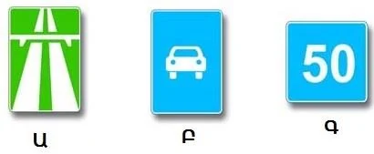

# آزادراه‌ها و راه‌های کوهستانی

آزادراه فقط وقتی کار می‌کند که همه چیز روی آن سریع حرکت کند. به همین دلیل مقررات وسایل نقلیه کند و عابران پیاده را کاملاً از آن دور نگه می‌دارد.

## چه کسانی از آزادراه منع شده‌اند؟

- **عابران پیاده.** راه رفتن در هر جهتی و در هر قطعه‌ای ممنوع است، چه داخل محدوده شهری و چه خارج از آن (بند 116). راه رفتن کنار راه و رو به ترافیک مربوط به راه‌های معمولی است، نه آزادراه.
- **وسایل نقلیه‌ای که سرعتشان بر پایه مشخصات فنی یا وضعیتشان از 40 کیلومتر بر ساعت بیشتر نمی‌شود** (بند 116). این ممنوعیت همه آزادراه را در بر می‌گیرد، پس ماندن در خط عبور سمت راست هم آن را مجاز نمی‌کند.

> **دام رایج:** این ممنوعیت از خود مقررات می‌آید، نه از تابلویی در راه. حتی اگر هیچ تابلوی «محدودیت حداقل سرعت» دیده نشود، این حکم برقرار است.

## کدام تابلوها این قواعد را با خود می‌آورند؟

دو تابلو این کار را می‌کنند، چون بند 117 الزامات آزادراه را به تابلوی 5.3 هم تعمیم می‌دهد.

*تابلوی الف، 5.1 «آزادراه» است. تابلوی ب، 5.3 «راه ویژه خودروها» است. هر دو وسایل نقلیه‌ای را که نمی‌توانند از 40 کیلومتر بر ساعت بیشتر بروند راه نمی‌دهند. تابلوی ج، مربع آبی عددار، 6.2 «سرعت توصیه‌شده» است که چنین ممنوعیتی ندارد.*

حد سرعت آزادراه در درس سرعت آمده است.

مطلب تکمیلی: ورود به راه سریع و خروج از آن

*این مطلب از بانک سؤالات نیامده است.*

از همه طول خط ورودی استفاده کنید تا سرعتتان به سرعت ترافیک برسد و زودتر دنبال فاصله مناسب بگردید. هنگام خروج به‌موقع جابه‌جا شوید و سرعت را در خط خروجی کم کنید، نه در سواره‌روی اصلی. پس از یک مسیر طولانی و سریع، سرعت کمتر از آنچه هست به نظر می‌رسد، پس به سرعت‌سنج نگاه کنید.

مطلب تکمیلی: سرازیری‌های طولانی در راه‌های کوهستانی

*این مطلب از بانک سؤالات نیامده است.*

پیش از شروع سرازیری دنده سنگین را انتخاب کنید و بگذارید موتور سرعت را نگه دارد. ترمز طولانی و پیوسته ترمزها را داغ می‌کند تا جایی که دیگر خوب کار نمی‌کنند. به‌جای آن، کوتاه و محکم ترمز کنید و سرعت را پیش از پیچ کم کنید، نه داخل آن. مراقب ریزش سنگ باشید و به یاد داشته باشید که پشت هر پیچ ممکن است وسیله نقلیه‌ای وسط راه باشد.

## خودتان امتحان کنید

**خودروی شما عیبی دارد و نمی‌تواند از 35 کیلومتر بر ساعت تندتر برود.** به راهی با تابلوی 5.3 می‌رسید. می‌توانید از آن استفاده کنید؟ **خیر.** به دلیل وضعیت وسیله نقلیه شما، همان ممنوعیت آزادراه اعمال می‌شود.

## نکات کلیدی

- عبور عابران پیاده از آزادراه در هر جهتی ممنوع است.
- وسایل نقلیه‌ای که نمی‌توانند از 40 کیلومتر بر ساعت بیشتر بروند ممنوع‌اند، چه به دلیل طراحی و چه به دلیل وضعیتشان.
- این ممنوعیت از مقررات می‌آید و به تابلوی جداگانه نیاز ندارد.
- تابلوهای 5.1 و 5.3 هر دو این ممنوعیت را دارند. تابلوی 6.2 ندارد.

{{practice}}
