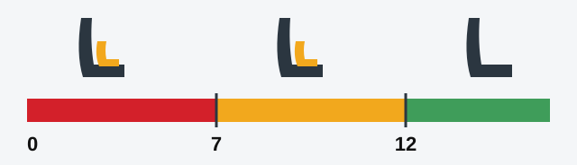

# رانندگی ایمن

دانستن مقررات گواهینامه را برایتان می‌آورد، اما عادت‌های شماست که شما را به خانه می‌رساند. این درس آنچه را آزمون درباره کمربند، کودکان و کلاه ایمنی می‌پرسد پوشش می‌دهد و مطالب تکمیلی پایین آن، عادت‌هایی را در بر دارند که شما را از دردسر دور نگه می‌دارند.

## چه کسی باید کمربند ایمنی ببندد؟

کارآموزی که پشت فرمان است راننده به حساب می‌آید، پس باید هنگام آموزش کمربند ببندد. ماده 24 قانون جمهوری ارمنستان «درباره تأمین ایمنی ترافیک جاده‌ای» فقط یک نفر را معاف می‌کند: آموزش‌دهنده رانندگی، آن هم فقط زمانی که کارآموز رانندگی می‌کند.

> **دام رایج:** «اگر رانندگی را دشوار کند موظف نیست» و «اگر آموزش‌دهنده اجازه بدهد موظف نیست» نادرست‌اند. قانون چنین شرط‌هایی ندارد.

## کودکان کجا می‌توانند بنشینند؟

کودک فقط از **12 سالگی** می‌تواند بدون وسیله مهار کودک روی صندلی جلوی خودروی سواری بنشیند (بند 159).

*زیر 7 سال (قرمز): وسیله مهار کودک الزامی است. از 7 تا 12 سال (زرد): صندلی جلو فقط با وسیله مهاری مجاز است که با وزن و قد کودک متناسب باشد. از 12 سال (سبز): صندلی جلو بدون آن هم مجاز است.*

## چه کسی به کلاه ایمنی نیاز دارد؟

هر کسی که با موتورسیکلت، موتور گازی یا دوچرخه در سواره‌رو حرکت می‌کند باید کلاه ایمنی بسته‌شده بر سر داشته باشد (ماده 24 قانون جمهوری ارمنستان «درباره تأمین ایمنی ترافیک جاده‌ای»). عینک محافظ الزامی نیست.

## خودتان امتحان کنید

**کودکی 10 ساله می‌خواهد جلوی خودروی شما بنشیند و وسیله مهار کودک ندارید.** مجاز است؟ **خیر.** تا 12 سالگی صندلی جلو به وسیله مهار نیاز دارد.

## عادت‌های خوب

این مطالب تکمیلی جزو مطالب آزمون نیستند، اما در هر رانندگی به کار می‌آیند.

مطلب تکمیلی: جلوی خودتان فضا بگذارید

*این مطلب از بانک سؤالات نیامده است.*

فاصله با خودروی جلویی همان زمان فکر کردن و ترمز کردن شماست. یک نقطه ثابت مثل تیر برق را انتخاب کنید. وقتی خودروی جلویی از آن گذشت، بشمارید چقدر طول می‌کشد تا به آن برسید و دست‌کم چند ثانیه فاصله بگذارید. در شب، باران، برف یا پشت خودروهای بزرگ فاصله بیشتری بگذارید. اگر کسی از پشت خیلی نزدیک شماست، آرام سرعت را کم کنید تا جلوی خودتان فضای بیشتری باز شود.

مطلب تکمیلی: خستگی

*این مطلب از بانک سؤالات نیامده است.*

راننده خسته دیر واکنش نشان می‌دهد و ممکن است لحظه‌ای خوابش ببرد بدون آنکه بفهمد. خمیازه، سنگین شدن پلک‌ها، منحرف شدن در خط عبور یا رد شدن از پیچ مورد نظر همگی هشدارند. باز کردن شیشه یا بلند کردن صدای رادیو این مشکل را حل نمی‌کند. در جایی امن بایستید و استراحت کنید و در سفرهای طولانی مرتب وقفه بگذارید.

مطلب تکمیلی: الکل و مواد مخدر

*این مطلب از بانک سؤالات نیامده است.*

الکل واکنش را کند و توجه را محدود می‌کند و به شما این احساس را می‌دهد که تواناتر از آنچه هستید. بسیاری از مواد مخدر و حتی برخی داروها هم همین اثر را دارند، پس بروشور دارو را بخوانید یا از داروساز بپرسید. قهوه، هوای سرد یا دوش گرفتن شما را هوشیار نمی‌کند و فقط زمان این کار را می‌کند. اگر قصد نوشیدن دارید، قصد رانندگی نداشته باشید.

مطلب تکمیلی: تلفن همراه و حواس‌پرتی

*این مطلب از بانک سؤالات نیامده است.*

یک نگاه به صفحه گوشی می‌تواند به معنای طی کردن مسافتی طولانی بدون نگاه کردن به راه باشد. حتی مکالمه بدون استفاده از دست هم توجه را از رانندگی می‌گیرد. گوشی را دور از دسترس بگذارید، مسیریاب را پیش از حرکت تنظیم کنید و اگر تماس یا پیامی واقعاً منتظر نمی‌ماند، بایستید.

مطلب تکمیلی: شب و هوای بد

*این مطلب از بانک سؤالات نیامده است.*

در شب فقط تا جایی را می‌بینید که نور چراغ‌هایتان می‌رسد، پس آن‌قدر سرعت را کم کنید که بتوانید در همان فاصله بایستید. در باران چسبندگی لاستیک‌ها کمتر می‌شود و دقایق اول بارندگی پس از یک دوره خشک لغزنده‌ترین زمان است. روی برف و یخ همه کارها را نرم انجام دهید: فرمان، ترمز و گاز را یکی‌یکی. در مه سرعت را کم کنید و لبه راه را در دید خود نگه دارید.

مطلب تکمیلی: ادب در راه

*این مطلب از بانک سؤالات نیامده است.*

زود راهنما بزنید، بگذارید دیگران وارد شوند و از کسی که کمکتان می‌کند تشکر کنید. اگر راننده دیگری اشتباه کرد یا عصبانی شد، با او رقابت نکنید و جواب ندهید. به او فضا بدهید و بگذارید برود. همیشه مراقب کسانی باشید که شاید شما را ندیده‌اند، مثل کودکان، عابران سالمند و دوچرخه‌سواران.

مطلب تکمیلی: صرفه‌جویی در سوخت و کاهش آلودگی

*این مطلب از بانک سؤالات نیامده است.*

رانندگی نرم سوخت کمتری مصرف می‌کند. دوردست را نگاه کنید، زود پایتان را از گاز بردارید و از شتاب‌گیری تند پرهیز کنید. باد لاستیک‌ها را در حد درست نگه دارید، باربند سقف و وزن اضافی را بردارید و در توقف‌های طولانی موتور را خاموش کنید. سرویس منظم دود خروجی را کم نگه می‌دارد. موتور سرد بیشترین آلودگی را تولید می‌کند، پس سفرهای کوتاه را با هم یکی کنید.

## نکات کلیدی

- کارآموز رانندگی باید کمربند ببندد. فقط آموزش‌دهنده معاف است، آن هم زمانی که کارآموز رانندگی می‌کند.
- کودکان از 12 سالگی بدون وسیله مهار به صندلی جلو می‌رسند.
- زیر 7 سال، وسیله مهار کودک الزامی است.
- موتورسواران، راکبان موتور گازی و دوچرخه‌سواران در سواره‌رو به کلاه ایمنی بسته‌شده نیاز دارند. عینک الزامی نیست.

{{practice}}
