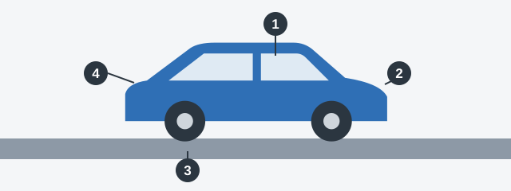
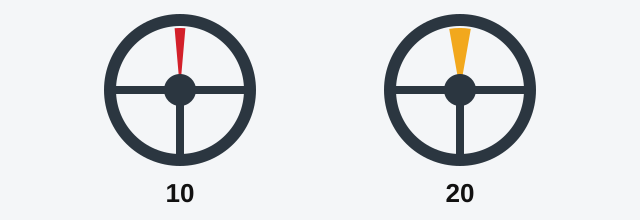

# ترمز و فرمان

عیبی که در پارکینگ پیدا می‌کنید فقط دردسر کوچکی است، اما همان عیب در سرعت بالا می‌تواند به تصادف تبدیل شود. این فصل فهرست عیب‌های آزمون را به بازدیدی تبدیل می‌کند که پیش از حرکت می‌توانید انجام دهید و از دو سامانه‌ای شروع می‌کند که خودرو را کنترل می‌کنند.

## این فهرست چگونه کار می‌کند؟

پیوست 2 مقررات راهنمایی و رانندگی عیب‌ها و شرایطی را فهرست کرده که بهره‌برداری از وسیله نقلیه را ممنوع می‌کنند. «بهره‌برداری» در اینجا یعنی استفاده از آن در راه. اگر عیبی در فهرست باشد، نباید از وسیله نقلیه استفاده کرد. اگر نباشد، به حساب نمی‌آید: مثلاً پخش‌کننده صوتی خراب در فهرست نیست.

*چهار ایستگاه بازدید. 1: از روی صندلی، ترمز و فرمان را آزمایش کنید (همین درس). 2: دور خودرو بچرخید و چراغ‌ها و شیشه‌ها را ببینید. 3: هر چرخ و لاستیک را نگاه کنید. 4: موتور و تجهیزات را مرور کنید.*

> **دام رایج:** بیشتر این پرسش‌ها با «در هر دو مورد» تمام می‌شوند. هر گزینه را جداگانه بسنجید. یک گزینه ممکن است کاملاً عادی باشد، مثلاً لاستیکی که هنوز بالاتر از حد خودش است.

## ایستگاه 1: ترمز

- **ترمز هیدرولیکی:** آب‌بندی خط ترمز باید سالم باشد. آب‌بندی خراب باعث نشت روغن می‌شود.
- **ترمز بادی:** فشارسنج باید کار کند.
- **ترمز پارک:** باید وسیله نقلیه را در شیب تعیین‌شده توسط استاندارد بی‌حرکت نگه دارد.

## ایستگاه 1: فرمان

فرمان مقداری لقی دارد: اینکه غربیلک چقدر می‌چرخد تا چرخ‌ها واکنش نشان دهند. اگر این لقی زیاد باشد، فرمان شما دیر عمل می‌کند.

*حد لقی برای خودروی سواری و اتوبوسی که بر پایه خودروی سواری ساخته شده 10 درجه و برای اتوبوس‌های دیگر 20 درجه است.*

> **به یاد داشته باشید:** پایه ساخت تعیین‌کننده است. لقی 15 درجه بهره‌برداری از اتوبوس ساخته‌شده بر پایه خودروی سواری را ممنوع می‌کند، اما در اتوبوس معمولی در حد مجاز است.

بهره‌برداری در این موارد هم ممنوع است:

- قطعات یا مجموعه‌های فرمان جابه‌جایی‌هایی داشته باشند که در ساختار پیش‌بینی نشده است.
- اتصالات پیچی سفت نشده یا به روش تعیین‌شده مهار نشده باشند.
- تقویت‌کننده فرمان که در طراحی پیش‌بینی شده معیوب باشد یا وجود نداشته باشد.

مطلب تکمیلی: حس کردن عیب‌ها از روی صندلی راننده

*این مطلب از بانک سؤالات نیامده است.*

با موتور روشن و چرخ‌های مستقیم، غربیلک را آرام به دو طرف بچرخانید تا چرخ‌ها شروع به حرکت کنند. فاصله خالی زیاد، صدای تق‌تق یا سفتی در بعضی نقاط کار تعمیرکار است. پدال ترمز را محکم فشار دهید: باید سفت باشد و آرام‌آرام تا کف پایین نرود. لکه‌های روغن زیر خودرو هم ارزش بررسی دارند.

## خودتان امتحان کنید

**گلگیرهای خودرویی با 12 درجه لقی فرمان وجود ندارند.** کدام عیب است؟ **هر دو.** حد خودرو 10 درجه است و نبود گلگیرها یا ضدپاشش‌های پیش‌بینی‌شده در ساختار هم در فهرست است.

## نکات کلیدی

- پیوست 2 یک فهرست است: عیب فقط وقتی بهره‌برداری را ممنوع می‌کند که در آن آمده باشد.
- خراب بودن آب‌بندی ترمز هیدرولیکی یا کار نکردن فشارسنج ترمز بادی بهره‌برداری را ممنوع می‌کند.
- حد لقی فرمان: 10 درجه برای خودرو یا اتوبوس بر پایه خودرو، 20 درجه برای اتوبوس‌های دیگر.
- اتصالات شل فرمان و تقویت‌کننده فرمان معیوب بهره‌برداری را ممنوع می‌کنند.

{{practice}}
