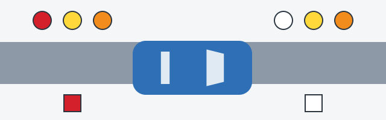

# چراغ‌ها و شیشه‌ها

شما باید ببینید و دیگران هم باید شما را ببینند و کار بعدی‌تان را بخوانند. این ایستگاه 2 بازدید است: یک دور آرام دور وسیله نقلیه، اگر بشود با کسی که کلیدها را می‌زند.

## چراغ‌ها کار می‌کنند؟

بخش 3 پیوست 2 بهره‌برداری از وسیله نقلیه را در این موارد ممنوع می‌کند:

- چراغ‌های بیرونی در حالت تعیین‌شده کار نکنند.
- چراغ‌های بیرونی یا بازتاب‌دهنده‌ها **کثیف** باشند.
- لامپ‌ها یا سرپوش‌های پخش‌کننده نور وجود نداشته باشند.
- لامپ‌ها یا سرپوش‌های پخش‌کننده نور با نوع آن چراغ مطابقت نداشته باشند.
- چراغ‌های مه‌شکن عقب به چراغ‌های ترمز متصل باشند.

اگر چراغ مه‌شکن به ترمز وصل باشد با هر بار ترمز روشن می‌شود و راننده پشت سر نمی‌تواند دو علامت را از هم تشخیص دهد.

> **دام رایج:** عیب، چراغ‌های مه‌شکن عقبی است که به چراغ‌های ترمز *متصل باشند*. چراغی که متصل نیست مشکلی ندارد. دستگاه‌های محافظ جلو و عقب کثیف هم عیب نیستند: فقط چراغ‌ها و بازتاب‌دهنده‌های کثیف در فهرست آمده‌اند.

## رنگ‌ها درست است؟

رنگ‌ها به رانندگان دیگر می‌گویند رو به کدام جهت هستید، پس دو سر خودرو را به خاطر بسپارید.

*دایره‌ها رنگ‌های مجاز چراغ را نشان می‌دهند و مربع‌ها تنها رنگ مجاز بازتاب‌دهنده را. جلو در سمت راست و عقب در سمت چپ است.*

| وسیله | جلو | عقب |
|---|---|---|
| چراغ‌ها | سفید، زرد یا نارنجی | قرمز، زرد یا نارنجی |
| بازتاب‌دهنده‌ها | فقط سفید | فقط قرمز |

سفید در عقب فقط دو جای درست دارد: چراغ دنده عقب و چراغ پلاک.

پس این‌ها **عیب** هستند: چراغ راهنمای قرمز در جلو، چراغ راهنمای سفید در عقب، چراغ دنده عقب قرمز، بازتاب‌دهنده زرد در هر دو سر و بازتاب‌دهنده سفید در عقب.

و این‌ها **عیب نیستند**: چراغ راهنمای زرد یا نارنجی در جلو، چراغ مه‌شکن زرد در جلو، چراغ دنده عقب سفید، چراغ پلاک سفید، بازتاب‌دهنده سفید در جلو و بازتاب‌دهنده قرمز در عقب.

> **به یاد داشته باشید:** چراغ‌ها در هر سر سه رنگ دارند. بازتاب‌دهنده‌ها یک رنگ: سفید در جلو، قرمز در عقب.

چراغ‌های مارک دیگری که روی وسیله نقلیه خارج‌شده از تولید نصب شده باشند، به‌خودی‌خود عیب نیستند.

## بیرون را می‌بینید؟

حالا شیشه‌ها را نگاه کنید:

- شیشه‌هایی که در طراحی پیش‌بینی شده‌اند باید وجود داشته باشند.
- شیشه‌شوی‌های پیش‌بینی‌شده در ساختار باید کار کنند.
- دستگاه‌های گرم‌کننده و دمنده شیشه‌ها که در طراحی پیش‌بینی شده‌اند باید کار کنند.
- نباید چیزی نصب شود که میدان دید راننده را از روی صندلی او محدود کند.

حکم پرده به شیشه بستگی دارد.

| شیشه | پرده مجاز است؟ |
|---|---|
| شیشه جلو یا شیشه‌های جانبی جلو | خیر |
| شیشه عقب یا شیشه‌های جانبی عقب | فقط اگر هر دو آینه جانبی وجود داشته باشند |

حالا که روی صندلی هستید، بوق را هم بزنید. باید کار کند.

مطلب تکمیلی: بررسی چراغ‌ها به‌تنهایی

*این مطلب از بانک سؤالات نیامده است.*

هنگام غروب با دنده عقب به دیوار یا ویترین مغازه‌ای نزدیک شوید تا بازتاب چراغ‌های ترمز و دنده عقب را ببینید. یک دستمال در جیب در بگذارید تا چراغ‌ها و پلاک را پاک کنید، چون در روزهای خیس ترشحات راه زود آن‌ها را می‌پوشاند. تیغه‌های فرسوده برف‌پاک‌کن را پیش از اولین باران پاییزی عوض کنید، نه پس از آن.

## خودتان امتحان کنید

**اتوبوس شما در عقب بازتاب‌دهنده سفید و دو گوه روی خودرو دارد.** بهره‌برداری ممنوع است؟ **بله، به خاطر بازتاب‌دهنده‌ها.** بازتاب‌دهنده عقب باید قرمز باشد.

## نکات کلیدی

- چراغ‌ها و بازتاب‌دهنده‌های معیوب یا کثیف، و لامپ‌ها و سرپوش‌های ناموجود یا نامناسب، بهره‌برداری را ممنوع می‌کنند.
- چراغ‌های مه‌شکن عقب نباید به چراغ‌های ترمز متصل باشند.
- چراغ‌های جلو: سفید، زرد یا نارنجی. چراغ‌های عقب: قرمز، زرد یا نارنجی.
- بازتاب‌دهنده‌ها: سفید در جلو، قرمز در عقب.
- شیشه‌های جلو هرگز نباید پرده‌دار باشند. شیشه‌های عقب می‌توانند، اگر هر دو آینه جانبی وجود داشته باشند.

{{practice}}
