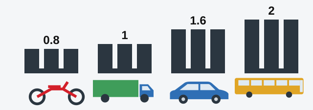

# چرخ‌ها و لاستیک‌ها

لاستیک‌ها تنها بخشی از وسیله نقلیه‌اند که با راه تماس دارند و هر کاری با فرمان و پدال‌ها می‌کنید از آن‌ها می‌گذرد. این ایستگاه 3 بازدید است: دور وسیله نقلیه بچرخید و هر چرخ را یکی‌یکی نگاه کنید.

## چقدر آج کافی است؟

آج همان نقشی است که روی لاستیک بریده شده. ارتفاع باقی‌مانده آن عددی است که آزمون بیشتر از همه به آن اهمیت می‌دهد و حد آن به نوع وسیله نقلیه بستگی دارد (بخش 4 پیوست 2).

*کمترین ارتفاع مجاز آج بر حسب میلی‌متر: موتورسیکلت 0.8، کامیون 1.0، خودروی سواری 1.6، اتوبوس 2.0.*

| وسیله نقلیه | حداقل (میلی‌متر) |
|---|---|
| موتورسیکلت | 0.8 |
| کامیون | 1.0 |
| خودروی سواری | 1.6 |
| اتوبوس | 2.0 |

تریلر از وسیله نقلیه یدک‌کش خود پیروی می‌کند، پس تریلر خودروی سواری هم به 1.6 میلی‌متر نیاز دارد.

این عدد حداقل است، پس لاستیکی که دقیقاً به آن رسیده هنوز مجاز است. فقط پایین‌تر از آن باید وسیله نقلیه را کنار گذاشت.

| لاستیک | حد (میلی‌متر) | ممنوع است؟ |
|---|---|---|
| خودرو با 1.8 میلی‌متر | 1.6 | خیر |
| خودرو با 1.6 میلی‌متر | 1.6 | خیر |
| کامیون با 1.6 میلی‌متر | 1.0 | خیر |
| کامیون با 1.4 میلی‌متر | 1.0 | خیر |
| موتورسیکلت با 1.6 میلی‌متر | 0.8 | خیر |
| موتورسیکلت با 0.6 میلی‌متر | 0.8 | بله |
| اتوبوس با 2.5 یا 2.2 میلی‌متر | 2.0 | خیر |
| اتوبوس با 1.8، 1.6 یا 0.8 میلی‌متر | 2.0 | بله |

> **دام رایج:** عدد 1.6 میلی‌متر مثل یک عدد جادویی به نظر می‌رسد، اما مال خودروی سواری است. برای اتوبوس 1.6 میلی‌متر کم است و برای کامیون یا موتورسیکلت کاملاً کافی.

## لاستیک آسیب دیده یا نامناسب است؟

بهره‌برداری ممنوع است اگر لاستیک:

- آسیب موضعی داشته باشد، مانند سوراخ‌شدگی، بریدگی یا پارگی، که **کورد را نمایان کند** یا بدنه را از هم جدا کند. چنین لاستیکی ممکن است در سرعت بترکد.
- از نظر **اندازه یا بار مجاز** با مدل وسیله نقلیه مطابقت نداشته باشد. چنین لاستیکی باری را حمل می‌کند که برای آن ساخته نشده است.

## لاستیک‌های هر محور با هم هماهنگ‌اند؟

دو چرخ یک محور باید یکسان بچسبند. اگر نچسبند، وسیله نقلیه هنگام ترمز به یک طرف کشیده می‌شود. پس روی یک محور نباید این‌ها باشد:

- اندازه، ساختار یا مدل متفاوت.
- نقش آج متفاوت.
- لاستیک نو همراه با لاستیک بازسازی‌شده.
- لاستیک مقاوم در برابر یخبندان همراه با لاستیک غیرمقاوم.

> **به یاد داشته باشید:** به عبارت «روی یک محور» دقت کنید. وقتی همراه با ناهماهنگی بیاید، نباید از وسیله نقلیه استفاده کرد.

## چرخ سالم است؟

بهره‌برداری ممنوع است اگر:

- روی رینگ یا دیسک چرخ ترک وجود داشته باشد.
- **حتی یکی** از پیچ‌ها یا مهره‌های اتصال چرخ وجود نداشته باشد. در این صورت به بقیه فشار زیادی می‌آید و چرخ ممکن است جدا شود.
- شکل و ابعاد سوراخ‌های اتصال خرابی قابل مشاهده داشته باشند.

مطلب تکمیلی: مراقبت از لاستیک‌ها

*این مطلب از بانک سؤالات نیامده است.*

فشار باد را وقتی لاستیک سرد است و با اعداد دفترچه راهنمای خودرو بررسی کنید. باد کم لبه‌های آج را می‌ساید و لاستیک را داغ می‌کند و باد زیاد چسبندگی را کم می‌کند. یک آج‌سنج ارزان عمق را بهتر از چشم اندازه می‌گیرد. دنبال برآمدگی روی دیواره لاستیک بگردید که اغلب نشانه آسیب پنهان است و زاپاس را هم فراموش نکنید.

## خودتان امتحان کنید

**خودرویی یک پیچ چرخ کم دارد و آج لاستیک‌هایش 1.8 میلی‌متر است.** مشکل چیست؟ **پیچ.** آج بالاتر از 1.6 میلی‌متر است، اما نبود یک پیچ به‌تنهایی کافی است.

**آج لاستیک‌های اتوبوسی 1.8 میلی‌متر است و آب‌بندی خط ترمز هیدرولیکی آن از بین رفته است.** کدام بهره‌برداری را ممنوع می‌کند؟ **هر دو.** اتوبوس به 2.0 میلی‌متر نیاز دارد و آب‌بندی خراب هم خودش عیب است.

**موتور با وقفه کار می‌کند و کورد یک لاستیک پیداست.** کدام بهره‌برداری را ممنوع می‌کند؟ **فقط لاستیک.** موتوری که با وقفه کار می‌کند در فهرست نیست.

## نکات کلیدی

- حداقل آج: موتورسیکلت 0.8، کامیون 1.0، خودرو 1.6 و اتوبوس 2.0 میلی‌متر.
- تریلر از وسیله نقلیه یدک‌کش خود پیروی می‌کند.
- لاستیکی که دقیقاً در حد حداقل است مجاز است.
- نمایان شدن کورد، یا اندازه و بار مجاز نامناسب، بهره‌برداری را ممنوع می‌کند.
- لاستیک‌های یک محور باید از نظر اندازه، ساختار، مدل و نقش آج یکسان باشند و نباید نو و بازسازی‌شده یا مقاوم و غیرمقاوم در برابر یخبندان با هم نصب شوند.
- نبود یک پیچ چرخ کافی است. ترک رینگ یا دیسک و خرابی سوراخ اتصال هم همین‌طور.

{{practice}}
