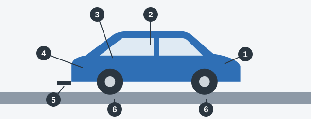

# موتور و تجهیزات

این طولانی‌ترین بخش فهرست و آخرین ایستگاه بازدید است. هر چیز دیگری را در بر می‌گیرد: آنچه نشت می‌کند، آنچه قفل می‌شود، آنچه از شما محافظت می‌کند و آنچه باید همراه داشته باشید.

سعی نکنید آن را مثل یک فهرست حفظ کنید. به ترتیب دور وسیله نقلیه بچرخید تا هر مورد جای خودش را پیدا کند.

*مسیر بازدید: 1 موتور و درپوش آن، 2 داخل اتاق خودرو، 3 درپوش باک و درها، 4 تجهیزات همراه، 5 قلاب یدک‌کش، 6 اطراف چرخ‌ها.*

## 1. درپوش موتور را باز کنید

بخش 5 پیوست 2 فقط چند عیب موتور را نام می‌برد، پس آن‌ها را دقیق یاد بگیرید:

- میزان مواد زیان‌آور در گازهای خروجی از حدود تعیین‌شده در قوانین جمهوری ارمنستان بیشتر است.
- آب‌بندی سامانه **تهویه کارتر** مختل شده است.
- آب‌بندی سامانه **سوخت‌رسانی** مختل شده است، که باعث نشت سوخت و خطر آتش‌سوزی می‌شود.
- صدای بیرونی موتور از حد استاندارد بیشتر است.

آب‌بندهای دیگر هم مهم‌اند. اگر کاسه‌نمدها یا اتصالات موتور، جعبه‌دنده، دیفرانسیل یا محور عقب آب‌بندی خود را از دست داده باشند هم بهره‌برداری ممنوع است.

قفل درپوش موتور که در طراحی پیش‌بینی شده باید کار کند.

> **دام رایج:** موتوری که با وقفه کار می‌کند، سخت روشن می‌شود یا دمای پایداری ندارد شاید نگرانتان کند، اما هیچ‌کدام در فهرست نیستند. عیب‌های موتور که به حساب می‌آیند به گاز خروجی، آب‌بندی یا صدا مربوط‌اند.

## 2. داخل بنشینید

از روی صندلی راننده، هر چیزی را که از شما محافظت می‌کند و به آن وابسته‌اید بررسی کنید:

- **کمربندهای ایمنی** پیش‌بینی‌شده در ساختار باید وجود داشته باشند، کار کنند و روی تسمه آن‌ها پارگی قابل مشاهده نباشد.
- **پشت‌سری‌ها**ی پیش‌بینی‌شده در ساختار باید وجود داشته باشند. این‌ها در تصادف از پشت از گردن محافظت می‌کنند.
- **تنظیم صندلی:** مکانیزم صندلی راننده باید کار کند.
- **سرعت‌سنج:** باید کار کند. تاکوگراف یا دستگاه ضدسرقت پیش‌بینی‌شده در ساختار هم همین‌طور.
- **بوق:** باید کار کند و با استاندارد مطابق باشد. این تنها راه شما برای هشدار صوتی است.
- **دید شما:** نباید چیزی نصب شود که دید شما را از روی صندلی راننده محدود کند.

| کار نمی‌کند | در فهرست هست؟ |
|---|---|
| سرعت‌سنج | بله |
| بوق | بله |
| نشانگر سطح سوخت | خیر |
| نشانگر دمای مایع خنک‌کننده موتور | خیر |
| چراغ داخلی خودروی سواری | خیر |
| چراغ داخلی اتوبوس | بله |
| پخش‌کننده صوتی | خیر |

> **به یاد داشته باشید:** از میان نشانگرهای داشبورد، سرعت‌سنج همان است که باید سالم باشد. نشانگر سوخت و دما در فهرست نیستند.

## 3. دور بدنه بچرخید

این قطعات مانع باز شدن یا افتادن چیزها می‌شوند:

- قفل درهای اتاق بار و کابین باید کار کند.
- درپوش باک سوخت که در طراحی پیش‌بینی شده باید کار کند.
- نگهدارنده چرخ زاپاس باید کار کند، چون زاپاس شل ممکن است در راه بیفتد.
- گلگیرها و ضدپاشش‌های پیش‌بینی‌شده در ساختار باید وجود داشته باشند.
- دستگاه محافظ عقب که در طراحی پیش‌بینی شده باید وجود داشته باشد.

بررسی به وجود داشتن آن‌ها مربوط است. کثیف بودن عیب نیست.

دو شرط دیگر هم به کل وسیله نقلیه مربوط است:

- نباید چیزی نصب شود که ممکن است به استفاده‌کنندگان از راه آسیب بزند.
- ساختار وسیله نقلیه نباید بدون اجازه مرجع ثبت وسایل نقلیه تغییر کند.

## 4. تجهیزات همراه را بررسی کنید

| وسیله | چه کسی باید همراه داشته باشد |
|---|---|
| جعبه کمک‌های اولیه | اتوبوس، خودروی سواری، کامیون، موتورسیکلت دارای سایدکار |
| کپسول آتش‌نشانی | اتوبوس (درس تجهیزات اتوبوس را ببینید) و کامیون |
| علامت «توقف اضطراری» | اتوبوس، خودروی سواری، کامیون، تراکتور چرخ‌دار |

موتورسیکلت بدون سایدکار به علامت «توقف اضطراری» نیاز ندارد. چراغ مه‌شکن الزامی نیست، پس نبودن آن عیب نیست.

## 5. اتصال یدک را بررسی کنید

اگر یدک می‌کشید، دستگاه یدک‌کشی یا اتصال یدک‌کش و تریلر باید سالم باشد. کابل‌ها یا زنجیرهای ایمنی پیش‌بینی‌شده در طراحی هم باید وجود داشته باشند و سالم باشند. خرابی در اینجا باعث جدا شدن تریلر می‌شود.

## موتورسیکلت‌ها و خودروهای آموزشی

در موتورسیکلت، بهره‌برداری در این موارد ممنوع است:

- رکاب‌های پیش‌بینی‌شده در ساختار وجود نداشته باشند.
- قوس‌های ایمنی پیش‌بینی‌شده در ساختار وجود نداشته باشند.
- دستگیره عرضی سرنشین روی زین وجود نداشته باشد.
- در محل اتصال شاسی موتورسیکلت و سایدکار لقی وجود داشته باشد.

وسیله نقلیه‌ای که با آن آموزش عملی رانندگی انجام می‌شود باید علامت شناسایی مربوطه را داشته باشد. علامت «پزشک» فرق دارد: به خواست خود راننده نصب می‌شود، پس نبودن آن عیب نیست.

مطلب تکمیلی: بازدید یک‌دقیقه‌ای روزانه

*این مطلب از بانک سؤالات نیامده است.*

به ابزار نیازی ندارید. یک بار دور خودرو بچرخید، زیر آن را برای چکه‌های تازه نگاه کنید و نگاهی به لاستیک‌ها و چراغ‌ها بیندازید. داخل خودرو، صندلی و آینه‌ها را تنظیم کنید و بعد کمربند را ببندید. هفته‌ای یک بار یا پیش از سفر طولانی، درپوش موتور را باز کنید و روغن، مایع خنک‌کننده، روغن ترمز و مایع شیشه‌شوی را با علامت‌هایشان مقایسه کنید. اگر هنگام رانندگی چراغ هشداری روشن شد، به محض آنکه امن بود بایستید و دفترچه راهنما را ببینید.

## خودتان امتحان کنید

**کامیونی در جلو بازتاب‌دهنده سفید دارد و دستگاه یدک‌کشی آن معیوب است.** مشکل کدام است؟ **فقط دستگاه یدک‌کشی.** سفید رنگ درست بازتاب‌دهنده جلو است.

**خودرویی جعبه کمک‌های اولیه ندارد و چراغ‌های دنده عقب آن قرمز است.** کدام بهره‌برداری را ممنوع می‌کند؟ **هر دو.** خودرو باید جعبه کمک‌های اولیه داشته باشد و چراغ دنده عقب باید سفید باشد.

**موتورسیکلت دارای سایدکاری آج 0.6 میلی‌متری دارد، جعبه کمک‌های اولیه ندارد و دستگیره سرنشینش هم نیست.** کدام بهره‌برداری را ممنوع می‌کند؟ **هر سه.** هر کدام به‌تنهایی دلیل کافی است.

## نکات کلیدی

- عیب‌های موتور در فهرست: گاز خروجی بیش از حد مجاز، خرابی آب‌بندی کارتر یا سوخت‌رسانی، صدای زیاد.
- موتوری که سخت روشن می‌شود، با وقفه کار می‌کند یا دمای ناپایدار دارد در فهرست نیست.
- کمربندها باید وجود داشته باشند، کار کنند و پاره نباشند. پشت‌سری‌ها باید وجود داشته باشند.
- سرعت‌سنج و بوق باید کار کنند. نشانگر سوخت و دما به حساب نمی‌آیند.
- قفل درها، قفل درپوش موتور، درپوش باک و نگهدارنده چرخ زاپاس باید کار کنند.
- اتوبوس، خودرو و کامیون جعبه کمک‌های اولیه و علامت «توقف اضطراری» دارند. اتوبوس و کامیون کپسول آتش‌نشانی دارند.
- تغییر ساختار وسیله نقلیه به اجازه مرجع ثبت نیاز دارد.

{{practice}}
