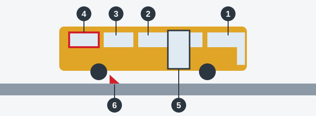

# تجهیزات اتوبوس

اتوبوس ده‌ها نفر را حمل می‌کند که به راننده و تجهیزات ایمنی آن تکیه کرده‌اند. به همین دلیل اتوبوس موارد اضافی خودش را در بازدید دارد و راه خروج مسافران در شرایط اضطراری یکی از آن‌هاست.

## اتوبوس چه چیزهایی باید همراه داشته باشد؟

*1: کابین راننده. 2: سالن. 3: علامت درخواست توقف. 4: خروجی اضطراری. 5: در و سامانه محرک آن. 6: گوه ضد غلتش.*

| وسیله | تعداد |
|---|---|
| کپسول آتش‌نشانی | دست‌کم 2: یکی در کابین راننده و یکی در سالن |
| جعبه کمک‌های اولیه پزشکی | باید موجود باشد |
| علامت «توقف اضطراری» | باید موجود باشد |
| گوه ضد غلتش، در اتوبوس بیش از 5 تن | دست‌کم 2 |

> **به یاد داشته باشید:** دوتایی فکر کنید. اتوبوس با یک کپسول آتش‌نشانی کم دارد و یک گوه هم از دو گوهی که مقررات تعیین کرده کمتر است. دو گوه یا بیشتر همان چیزی است که مقررات می‌خواهد، پس عیب نیست.

## چه چیزهایی باید کار کنند؟

سالن را از در جلو تا انتها طی کنید. همه این‌ها باید کار کنند:

- **خروجی‌های اضطراری** و وسایلی که آن‌ها را به کار می‌اندازند.
- **بازکننده‌های درِ اضطراری.**
- **سامانه محرک کنترل درها.**
- **علامت درخواست توقف.**
- **دستگاه‌های روشنایی داخلی سالن.**

اگر مسافران نتوانند بیرون بروند، تصادف بسیار خطرناک‌تر می‌شود. به همین دلیل این موارد در فهرستی آمده‌اند که موتوری را که سخت روشن می‌شود نادیده می‌گیرد.

> **دام رایج:** چراغ داخلی خراب بهره‌برداری از اتوبوس را ممنوع می‌کند، اما خودروی سواری را نه.

مطلب تکمیلی: یک دقیقه راننده اتوبوس پیش از باز شدن درها

*این مطلب از بانک سؤالات نیامده است.*

مطمئن شوید چیزی راهرو یا خروجی‌ها را نبسته و کپسول‌ها پلمب و فشار خود را دارند. بدانید هر خروجی اضطراری چگونه باز می‌شود. در یک تخلیه واقعی، مسافران اول به شما نگاه می‌کنند، پس صدای آرام و روشن به اندازه هر وسیله‌ای کمک می‌کند.

## خودتان امتحان کنید

**آج لاستیک‌های اتوبوسی 2.2 میلی‌متر است و جعبه کمک‌های اولیه ندارد.** بهره‌برداری ممنوع است؟ **بله، به خاطر جعبه.** حد اتوبوس 2.0 میلی‌متر است، پس لاستیک‌ها مشکلی ندارند.

**چراغ‌های پلاک اتوبوسی سفید است و علامت «توقف اضطراری» ندارد.** مشکل چیست؟ **فقط علامت.** سفید رنگ درست چراغ پلاک است.

## نکات کلیدی

- اتوبوس: دست‌کم دو کپسول آتش‌نشانی، یکی در کابین و یکی در سالن.
- جعبه کمک‌های اولیه و علامت «توقف اضطراری» باید موجود باشند.
- اتوبوس بیش از 5 تن: دست‌کم دو گوه ضد غلتش.
- خروجی‌های اضطراری، بازکننده‌های در، سامانه محرک درها، علامت درخواست توقف و چراغ‌های داخلی باید همگی کار کنند.
- حداقل آج اتوبوس: 2.0 میلی‌متر.
- چراغ دنده عقب باید سفید باشد و چراغ راهنمای جلو نباید قرمز باشد.

{{practice}}
