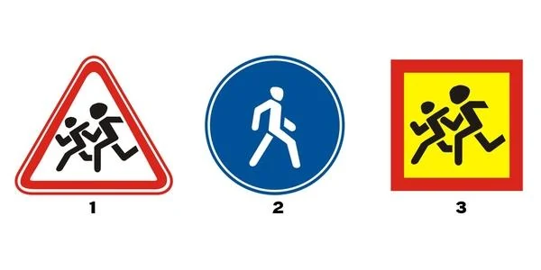
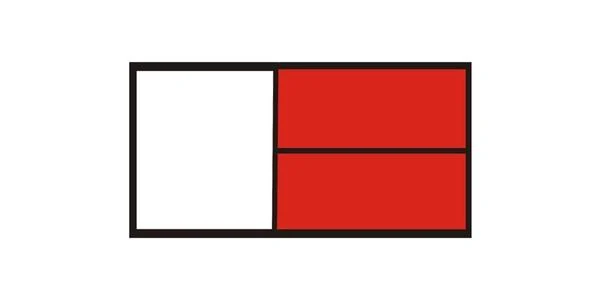
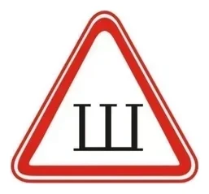
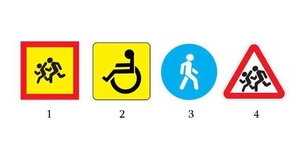
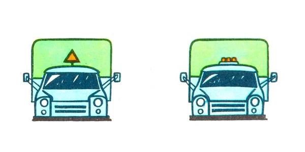

# علائم شناسایی وسایل نقلیه

بعضی علامت‌ها روی وسیله نقلیه نصب می‌شوند، نه کنار راه. این علامت‌ها چیزی درباره آن وسیله نقلیه، راننده یا بارش به شما می‌گویند تا بتوانید رانندگی خود را در اطراف آن تنظیم کنید.

## علامت شناسایی چیست؟

بند 175 و فرم شماره 3 مقررات راهنمایی و رانندگی این علامت‌ها را تعیین می‌کنند. آزمون ساده است: اگر روی وسیله نقلیه نصب شده، علامت شناسایی است. تابلوی راه کنار راه قرار می‌گیرد.

*شماره 1 تابلوی راه 1.23 «کودکان» است. شماره 2 تابلوی راه 4.5.1 «مسیر پیاده» است. فقط شماره 3، مربع زرد، روی وسیله نقلیه نصب می‌شود.*

> **دام رایج:** همان کودکان دونده در هر دو دیده می‌شوند. مثلث با حاشیه قرمز تابلوی راه است. مربع زرد با حاشیه قرمز علامت شناسایی «حمل کودکان» است.

## کدام علامت‌ها را باید بشناسم؟

| علامت | ظاهر | محل نصب | چه می‌گوید |
|---|---|---|---|
| «حمل کودکان» | مربع زرد، حاشیه قرمز، تصویر تابلوی 1.23 | جلو و عقب | گروه سازمان‌یافته کودکان سوار است |
| «راننده ناشنوا» | دایره زرد با سه دایره سیاه | جلو و عقب | راننده ناشنوا یا ناشنوا و لال است |
| «بار خطرناک» | صفحه مستطیلی که خطرات بار را نشان می‌دهد | جلو و عقب | وسیله نقلیه مواد خطرناک حمل می‌کند |
| «قطار جاده‌ای» | سه چراغ نارنجی در یک ردیف | سقف کابین | این وسیله کامیون دارای یدک، تراکتور چرخ‌دار یا اتوبوس مفصلی است |
| «میخ» | مثلث سفید، حاشیه قرمز، حرف Ш | عقب | لاستیک‌ها میخ‌دار هستند |

*«راننده ناشنوا».*

*«بار خطرناک». این علامت نشانه بار سنگین یا بزرگ نیست.*

*«میخ». شبیه تابلوی هشداردهنده است، اما چیزی درباره راه جلو نمی‌گوید.*

## کدام علامت‌ها الزامی‌اند؟

- **«حمل کودکان»:** هنگام حمل گروه‌های سازمان‌یافته کودکان الزامی است. نصب آن در جلو درست است، نه عیب.
- **علامت آموزش عملی رانندگی:** نباید از وسیله نقلیه آموزشی بدون آن استفاده کرد.
- **«بار بزرگ‌ابعاد»:** برای باری لازم است که از حدهای درس حمل بار بگذرد.
- **«پزشک» و «معلول»:** به خواست خود راننده نصب می‌شوند، پس نصب نکردن آن‌ها عیب نیست. علامت «معلول» مربع زردی با نماد تابلوی تکمیلی 8.17 است.

مقررات برای راننده با سابقه تا 3 سال علامتی ندارد.

> **به یاد داشته باشید:** بپرسید علامت کجاست. اگر روی وسیله نقلیه باشد، درباره همان وسیله نقلیه می‌گوید. اگر کنار راه باشد، درباره راه می‌گوید.

مطلب تکمیلی: رانندگی در اطراف وسایل نقلیه علامت‌دار

*این مطلب از بانک سؤالات نیامده است.*

به هر وسیله نقلیه حامل مواد خطرناک فضای بیشتری بدهید و کنار آن پارک نکنید. در اطراف اتوبوس کودکان سرعت را کم کنید و انتظار داشته باشید کودکی از پشت آن بیرون بیاید. لاستیک‌های میخ‌دار ممکن است سنگ‌ریزه پرتاب کنند، پس روی سطح شل یا یخ‌زده فاصله بیشتری بگیرید.

## خودتان امتحان کنید

**کدام علامت در جلو و عقب وسیله نقلیه حامل گروه سازمان‌یافته کودکان نصب می‌شود؟**

**شماره 1.** شماره 2 علامت «معلول» است. شماره‌های 3 و 4 تابلوی راه هستند.

**کدام کامیون نشان می‌دهد قطار جاده‌ای است؟**

**سمت راستی،** با سه چراغ نارنجی در یک ردیف.

## نکات کلیدی

- علائم شناسایی روی وسیله نقلیه نصب می‌شوند. تابلوهای راه کنار راه هستند.
- مربع زرد با حاشیه قرمز: کودکان. دایره زرد با سه دایره سیاه: راننده ناشنوا.
- سه چراغ نارنجی: قطار جاده‌ای. مثلث سفید با Ш: لاستیک میخ‌دار.
- «پزشک» و «معلول» اختیاری‌اند. علامت آموزش رانندگی الزامی است.

{{practice}}
