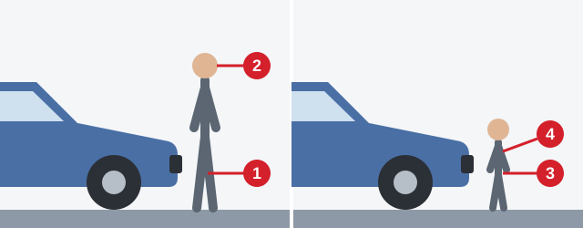

# پس از تصادف

نخستین دقیقه‌های پس از تصادف می‌تواند تعیین کند چه کسی زنده بماند، و کسی که با عجله برای کمک جلو برود ممکن است خودش مصدوم بعدی شود. این درس ترتیب کارها را به شما می‌دهد.

> **به یاد داشته باشید:** این درس جای دوره کمک‌های اولیه را نمی‌گیرد.

## راننده درگیر در تصادف چه باید بکند؟

ماده 24 قانون جمهوری ارمنستان «درباره تأمین ایمنی ترافیک جاده‌ای» هر سه کار را الزامی می‌کند:

1. بی‌درنگ وسیله نقلیه را متوقف کنید.
2. چراغ هشدار خطر را روشن کنید.
3. وسیله نقلیه و اشیای مرتبط با سانحه را همان‌جا که هستند رها کنید.

## اول چه کار کنم؟

1. **ایمنی را تأمین کنید.** موتور را خاموش کنید، چراغ‌های هشدار را روشن کنید، مثلث خطر را قرار دهید و خطر آتش‌سوزی، نشت سوخت یا برق را بسنجید.
2. **هوشیاری و تنفس را بررسی کنید.** راه هوایی بسته در چند دقیقه می‌کشد. استخوان شکسته نه.
3. **خون‌ریزی شدید را بررسی کنید، با آمبولانس تماس بگیرید و به آسیب‌ها رسیدگی کنید.**
4. **مصدوم را در وضعیت راحت قرار دهید.**

> **دام رایج:** حتی با استخوان بیرون‌زده هم پیش از تماس گرفتن یا بی‌حرکت کردن پا، هوشیاری و تنفس را بررسی کنید.

مطلب تکمیلی: اگر کس دیگری همراه شماست

*این مطلب از بانک سؤالات نیامده است.*

یک نفر را مشخصاً نشان دهید و از او بخواهید همان موقع با آمبولانس تماس بگیرد، و شما مصدوم را بررسی کنید.

## اگر نتوانم محل حادثه را ایمن کنم چه؟

کمک‌کننده نباید خودش مصدوم شود، و فرستادن شخص دیگری هم فقط او را در معرض همان خطر قرار می‌دهد.

1. نزدیک نشوید.
2. بی‌درنگ درخواست کمک کنید.
3. نگذارید افراد دیگر نزدیک شوند.

## اول به چه کسی کمک کنم؟

به کسی که وضعیتش زودتر از همه می‌تواند به مرگ بینجامد. فرد بیهوش نمی‌تواند راه هوایی خود را باز نگه دارد، پس بر شکستگی ساعد، خراشیدگی یا زن باردار وحشت‌زده مقدم است.

## چه زمانی مصدوم را از خودرو بیرون بیاورم؟

جابه‌جایی می‌تواند آسیب‌های ستون فقرات یا آسیب‌های داخلی را بدتر کند، پس فقط وقتی این کار را بکنید که ماندن خطرناک‌تر باشد:

- احتمال زیاد واژگونی، آتش‌سوزی یا انفجار خودرو وجود داشته باشد.
- مصدوم دچار کاهش دمای بدن، یا از دست دادن هوشیاری و تنفس شده باشد.
- دادن کمک‌های اولیه در کابین ممکن نباشد.

آسیب‌های جدی، خون‌ریزی شدید یا آسیب مغزی-جمجمه‌ای (جمجمه و مغز) به‌تنهایی دلیل جابه‌جایی نیستند.

> **دام رایج:** اگر سیم برق روی خودرو افتاده باشد، افراد باید تا قطع جریان برق داخل خودرو بمانند. درس شکستگی و سوختگی را ببینید.

مطلب تکمیلی: اگر مجبور به جابه‌جایی هستید

*این مطلب از بانک سؤالات نیامده است.*

مصدوم را تا جایی که می‌شود کم جابه‌جا کنید و سر، گردن و پشت را بدون چرخاندن در یک راستا نگه دارید.

## به اپراتور آمبولانس چه بگویم؟

- **محل:** خیابان، شماره خانه و نزدیک‌ترین نشانه‌ها.
- **مصدومان:** شمار، جنسیت و سن تقریبی آنان.
- **وضعیت:** هوشیاری، تنفس، گردش خون، خون‌ریزی شدید، شکستگی‌ها و آسیب‌های دیگر.

سپس صبر کنید تا اپراتور اعلام کند تماس پذیرفته شده است.

## آیا می‌توانم دارو بدهم؟

نه، حتی در صورت ضرورت شدید. شما از بیماری‌ها، حساسیت‌ها یا داروهای مصرف‌شده مصدوم خبر ندارید. به مصدومی که بیهوش است یا آسیب داخلی دارد اصلاً نباید چیزی از راه دهان داده شود.

## عابر پیاده در برخورد با خودرو کجایش آسیب می‌بیند؟

*برخورد خودروی کم‌ارتفاع با بزرگسالی با قد 1 متر و 55 سانتی‌متر و بیشتر، به اندام تحتانی (1) و سر (2) آسیب می‌زند. سر به کاپوت یا شیشه جلو و سپس به زمین می‌خورد. در کودک 3 تا 5 ساله، سپر به لگن (3) و قفسه سینه (4) می‌خورد.*

## خودتان امتحان کنید

**صدای موتور خودرویی را از گاراژ همسایه می‌شنوید،** در را باز می‌کنید و همسایه را افتاده روی زمین می‌بینید.

اول چه باید کرد؟ **درها را کاملاً باز کنید، موتور را خاموش کنید و در صورت امکان همسایه را از محل دور کنید.** موتور مونوکسید کربن تولید می‌کند، گازی بی‌بو و کشنده که شما را هم مسموم می‌کند.

## نکات کلیدی

- درگیر تصادف شدید: توقف کنید، چراغ هشدار خطر را روشن کنید، چیزی را جابه‌جا نکنید.
- اول محل حادثه را ایمن کنید. اگر نمی‌شود، نزدیک نشوید، درخواست کمک کنید و دیگران را دور نگه دارید.
- اول هوشیاری و تنفس را بررسی کنید. مصدوم بیهوش بر همه مقدم است.
- مصدوم را فقط وقتی جابه‌جا کنید که ماندن خطرناک‌تر باشد. هرگز دارو ندهید.

{{practice}}
