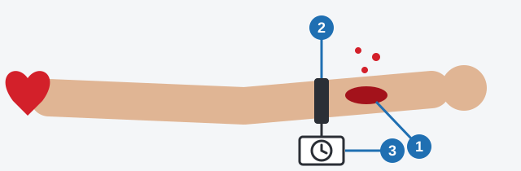
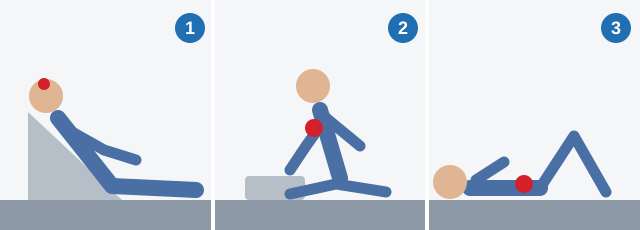

# خون‌ریزی و زخم‌ها

خون‌ریزی شدید می‌تواند در چند دقیقه جان فرد را بگیرد. این درس به شما یاد می‌دهد خون را بخوانید، آن را بند بیاورید و مصدوم را برای هر آسیب درست قرار دهید.

> **به یاد داشته باشید:** این درس جای دوره کمک‌های اولیه را نمی‌گیرد.

## چطور از خودم محافظت کنم؟

خون مصدوم می‌تواند عفونت منتقل کند. از تماس مستقیم با زخم بپرهیزید و از دستکش استریل استفاده کنید، یا اگر نبود، از هر مانعی که دم دست دارید. کمک نکردن محافظت نیست.

## این خون‌ریزی چقدر خطرناک است؟

| | شریان بزرگ: خطرناک‌ترین | سیاهرگ: خطرناک، اما کندتر |
|---|---|---|
| رنگ | قرمز روشن | تیره |
| جریان | جهشی یا مانند فواره بیرون می‌زند | یکنواخت یا آرام جاری است |

لخته شدن خون ظرف 10 دقیقه طبیعی است و نشانه خطر نیست.

## خون‌ریزی شریان بزرگ را چگونه بند بیاورم؟

1. **شریان آسیب‌دیده را با انگشتان فشار دهید.** این کار بی‌درنگ اثر می‌کند.
2. **تورنیکه را بالای زخم و تا حد ممکن نزدیک به آن ببندید.** خون از سمت قلب می‌آید، پس پایین‌تر از زخم بی‌فایده است.
3. **زمان بستن را روی آن یادداشت کنید.**

*زخم (1)، تورنیکه میان زخم و قلب (2)، و یادداشت زمان (3).*

تورنیکه جریان خون را قطع می‌کند، پس زمانش محدود است: **در هوای گرم نه بیشتر از 1 ساعت و در هوای سرد نه بیشتر از نیم ساعت.**

در خون‌ریزی شدید، پانسمان به‌تنهایی فقط خیس می‌شود. روی قسمت آسیب‌دیده پانسمان فشاری بگذارید و نقطه فشار شریان را بالای زخم فشار دهید. هرگز خاکستر نریزید.

> **دام رایج:** این زمان‌ها برعکس به نظر می‌رسند. اندام بدون خون در سرما زودتر آسیب می‌بیند، پس سرما یعنی نیم ساعت.

مطلب تکمیلی: فشار مستقیم و تورنیکه در دوره‌های کمک‌های اولیه

*این مطلب از بانک سؤالات نیامده است.*

بیشتر دوره‌ها با فشار محکم و مستقیم روی زخم با یک پد تمیز شروع می‌کنند و اگر خون از آن گذشت، پد دیگری رویش می‌گذارند. تورنیکه برای خون‌ریزی تهدیدکننده حیات در دست یا پاست که با فشار کنترل نمی‌شود. در این دوره‌ها یاد می‌دهند تورنیکه را پس از بستن خودتان شل نکنید و باز نکنید: این کار را به کادر پزشکی بسپارید و زمان را به آن‌ها بگویید.

## خون‌ریزی سیاهرگ یا شریان کوچک‌تر را چگونه بند بیاورم؟

1. اندام را بالاتر از سطح قلب ببرید تا فشار در زخم کم شود.
2. پانسمان فشاری را **در محل آسیب** بگذارید، نه بالاتر یا پایین‌تر از آن، تا روی رگ آسیب‌دیده فشار بیاورد.
3. ناخن زیر پانسمان را فشار دهید و رها کنید. اگر به‌سختی دوباره صورتی شد، گردش خون مختل است و پانسمان بیش از حد سفت است. درد و ناراحتی این را نشان نمی‌دهند.

## آیا باید زخم را تمیز کنم؟

یک قاعده واحد وجود ندارد. پرسش‌ها این موارد را جداگانه بررسی می‌کنند:

| وضعیت | چه باید کرد |
|---|---|
| زخم خطرناک | خون‌ریزی را بند بیاورید و زخم را پانسمان کنید. شستن وقت می‌گیرد و لخته را از بین می‌برد. |
| آسیب ناشی از تصادف، گام‌های نخست | دستکش پزشکی بپوشید. زخم را بدون تمیز کردن با دستمال گاز استریل بپوشانید. لبه‌ها را با چسب زخم محکم کنید یا آن را پانسمان کنید. |
| زخم کم‌خطرتر | با صابون و آب تمیز بشویید، سپس پانسمان کنید. |

پس در تصادف، خون‌ریزی را بند بیاورید و زخم را بپوشانید. شستن فقط درباره زخمی است که «کم‌خطرتر» نامیده شده، و پرسش‌ها این اصطلاح را تعریف نمی‌کنند، پس متن پرسش را با دقت بخوانید.

> **دام رایج:** ید، ودکا، عطر و ادکلن بافت را می‌سوزانند و برای خون‌ریزی کاری نمی‌کنند. آن‌ها را از زخم دور نگه دارید. پنبه هم نادرست است، چون می‌چسبد.

## اگر چیزی در زخم فرو رفته باشد چه؟

آن را بیرون نیاورید. این جسم اغلب رگ آسیب‌دیده را فشرده و بسته نگه داشته است، پس بیرون کشیدنش می‌تواند خون‌ریزی شدید ایجاد کند. دور آن پانسمان بگذارید تا بی‌حرکت بماند.

## خون‌ریزی بینی را چگونه درمان کنم؟

1. مصدوم را بنشانید.
2. سر را به جلو و پایین خم کنید تا خون به گلو نرود.
3. بینی را 10 تا 15 دقیقه فشار دهید.

سر را به عقب خم نکنید، تامپون پنبه‌ای نگذارید و رهایش نکنید تا خودش بند بیاید.

مطلب تکمیلی: کجای بینی را فشار دهیم

*این مطلب از بانک سؤالات نیامده است.*

در دوره‌های کمک‌های اولیه یاد می‌دهند قسمت نرم بینی را، درست زیر برآمدگی استخوانی، با انگشتان بفشارید و فرد از راه دهان نفس بکشد. اگر خون‌ریزی بند نیامد، کمک پزشکی بگیرید.

## آسیب سر، قفسه سینه و شکم را چگونه درمان کنم؟

*وضعیت‌های آسیب سر (1)، آسیب قفسه سینه (2) و آسیب شکم (3) از جدول زیر.*

| آسیب | چه باید کرد | چرا |
|---|---|---|
| آسیب سر | نیمه‌خوابیده، با سر و بالاتنه بالا آمده | فشار داخل جمجمه را محدود می‌کند. پاها را بالا نبرید و صاف نخوابانید. |
| آسیب قفسه سینه | بنشانید، تکیه‌داده به سمت آسیب‌دیده | ریه سالم آزاد می‌ماند. |
| آسیب شکم | بخوابانید، با پاهای خم‌شده از زانو | دیواره شکم شل می‌شود. |
| بیرون‌زدگی اندام‌ها از شکم | با پارچه تمیز مرطوب و فیلم پلی‌اتیلن بپوشانید | نباید خشک شوند. هرگز آن‌ها را به داخل برنگردانید. |
| احتمال خون‌ریزی داخلی شکم | بخوابانید و روی محل آسیب کمپرس سرد بگذارید | سرما رگ‌ها را تنگ می‌کند. کیسه آب گرم، پانسمان فشاری و مایعات زیاد نه. |
| آسیب بسته بافت نرم اندام، ساعت‌های اول | کمپرس سرد بگذارید و قسمت آسیب‌دیده را بالا ببرید | خون‌ریزی و تورم را محدود می‌کند. کمپرس گرم یا الکلی نه. |

در آسیب مغزی-جمجمه‌ای همراه با زخم در قسمت مودار سر:

1. خون‌ریزی را با فشار مستقیم روی زخم بند بیاورید.
2. روی آن پانسمان فشاری بگذارید.
3. در صورت از دست دادن هوشیاری، از وضعیت پایدار به پهلو استفاده کنید.
4. در صورت امکان روی آن ناحیه سرما بگذارید.

مطلب تکمیلی: اگر جمجمه فرورفته به نظر می‌رسد

*این مطلب از بانک سؤالات نیامده است.*

اگر جمجمه نرم یا فرورفته به نظر می‌رسد یا استخوان را می‌بینید، روی آن نقطه فشار زیاد نیاورید. به‌آرامی اطراف زخم را فشار دهید و با آمبولانس تماس بگیرید.

## خودتان امتحان کنید

**عابر پیاده‌ای روی ساعدش زخمی حدود 5 سانتی‌متری دارد.** خون تیره به‌طور یکنواخت از آن جاری است.

چه چیزی خون‌ریزی را بند می‌آورد؟ **دست را بالا ببرید و پانسمان فشاری بگذارید.** خون تیره و یکنواخت یعنی سیاهرگ. آب خون‌ریزی را بند نمی‌آورد و ید به بافت آسیب می‌زند.

## نکات کلیدی

- قرمز روشن و جهشی: شریان بزرگ. تیره و یکنواخت: سیاهرگ.
- شریان بزرگ: انگشتان، سپس تورنیکه بالای زخم با یادداشت زمان.
- تورنیکه: حداکثر 1 ساعت در هوای گرم و نیم ساعت در هوای سرد.
- سیاهرگ یا شریان کوچک‌تر: پانسمان فشاری در محل آسیب.
- در تصادف، خون‌ریزی را بند بیاورید و زخم را بپوشانید. اجسام خارجی را بیرون نیاورید و هرگز اندام‌ها را به داخل برنگردانید.

{{practice}}
