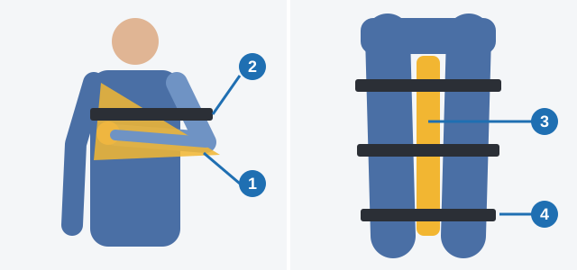

# شکستگی و سوختگی

کمکی که با نیت خوب انجام شود هم می‌تواند این آسیب‌ها را بدتر کند، از جابه‌جا کردن استخوان شکسته تا ترکاندن تاول. این درس نشان می‌دهد چه کنید و به چه چیزی دست نزنید.

> **به یاد داشته باشید:** این درس جای دوره کمک‌های اولیه را نمی‌گیرد.

## به شکستگی چگونه کمک کنم؟

در شکستگی باز، که زخم به استخوان راه دارد:

1. زخم را با دستمال استریل بپوشانید تا عفونت وارد نشود.
2. اندام را بی‌حرکت کنید تا تکه‌های استخوان به رگ‌ها و عصب‌ها آسیب نزنند.

اندام را بالا نبرید و فشار مستقیم نیاورید، چون تکه‌های استخوان جابه‌جا می‌شوند، و روی زخم کمپرس سرد نگذارید.

اگر آتل ندارید، دست خم‌شده را که روی روسری تکیه داده به تنه ببندید. پاها را با پارچه نرمی میانشان به هم ببندید تا برجستگی‌های استخوانی به هم فشار نیاورند.

*روسری (1)، نوار بستن به تنه (2)، پارچه نرم (3) و بندها (4).*

اگر احتمال آسیب ستون فقرات باشد، حرکت می‌تواند فلج دائمی ایجاد کند. مصدوم هوشیار را به پشت روی سطح سفت و صاف بخوابانید و جز در صورت ضرورت جابه‌جا نکنید. به پهلو نخوابانید، زیر گردن لوله نگذارید و پاها را بالا نبرید.

مطلب تکمیلی: خون‌ریزی و مراقبت از گردن در دوره‌های کمک‌های اولیه

*این مطلب از بانک سؤالات نیامده است.*

اگر شکستگی باز خون‌ریزی شدید دارد، با پانسمان تمیز اطراف زخم را فشار دهید، نه خود استخوان را، و با آمبولانس تماس بگیرید. اگر مصدوم هوشیار ممکن است آسیب ستون فقرات داشته باشد، از او بخواهید بی‌حرکت بماند و سرش را در همان وضعیتی که پیدایش کردید نگه دارید.

## سوختگی را چگونه درمان کنم؟

سوختگی حرارتی سطحی: قرمزی، تورم، تاول‌های پر از مایع شفاف و درد شدید.

1. **20 دقیقه با آب خنک کنید.** این کار از ادامه سوختن بافت جلوگیری می‌کند و درد را کم می‌کند.
2. **تاول‌ها را باز نکنید و لباس چسبیده را برندارید.** تاول سدی در برابر عفونت است.
3. **با دستمال استریل یا پارچه تمیز بپوشانید، بدون پانسمان کردن.**
4. **در صورت امکان سرما بگذارید و آب بنوشانید.**

> **دام رایج:** روغن گرما را در بافت نگه می‌دارد. باز گذاشتن سوختگی هم راه را برای عفونت باز می‌کند.

مطلب تکمیلی: آب خنک، نه یخ

*این مطلب از بانک سؤالات نیامده است.*

از آب روان خنک استفاده کنید، نه یخ، چون یخ می‌تواند به پوست آسیب بزند. فقط به کسی نوشیدنی بدهید که کاملاً هوشیار است.

## سرمازدگی و کاهش دمای بدن را چگونه درمان کنم؟

قسمت‌های آسیب‌دیده را گرم و بی‌حرکت کنید، مصدوم را با لباس گرم یا پتو بپوشانید، نوشیدنی گرم بدهید و او را به محیط گرم منتقل کنید. با برف یا پارچه پشمی مالش ندهید، الکل ندهید و از پماد، کمپرس گرم یا کیسه گرم استفاده نکنید.

## اگر سیم برق افتاده باشد چه؟

**روی خودرو:** از افراد داخل بخواهید تا قطع جریان برق همان‌جا بمانند. پیاده شدن یعنی لمس هم‌زمان خودرو و زمین، و جریان از بدن می‌گذرد.

**روی مصدوم:** مصدوم برق‌دار است، پس او را لمس نکنید. اول سیم را با جسم عایقی مانند چوب خشک بردارید. بررسی اولیه بعد از این کار است.

اگر نمی‌توانید محل حادثه را ایمن کنید، نزدیک نشوید. درخواست کمک کنید و نگذارید افراد دیگر نزدیک شوند.

مطلب تکمیلی: سیم افتاده ممکن است فشار قوی باشد

*این مطلب از بانک سؤالات نیامده است.*

ولتاژ را نمی‌توان با چشم دید. برق فشار قوی می‌تواند از چوب خشک بگذرد و زمین اطراف را برق‌دار کند، پس در دوره‌های کمک‌های اولیه یاد می‌دهند فاصله زیادی بگیرید، دیگران را هم دور نگه دارید و با خدمات اورژانس تماس بگیرید تا قطع برق تأیید شود. اگر آتش‌سوزی افراد را مجبور کرد از خودرو خارج شوند، باید با پاهای جفت بیرون بپرند، هرگز هم‌زمان خودرو و زمین را لمس نکنند و سپس کشان‌کشان با گام‌های کوتاه دور شوند.

## خودتان امتحان کنید

**خودرویی به تیر برق خورده و سیمی روی مصدوم بیهوش کنار آن افتاده است.** اگر بتوان محل را ایمن کرد، اول چه باید کرد؟ **سیم را با جسم عایق بردارید.** جابه‌جا کردن مصدوم یعنی لمس فردی برق‌دار.

## نکات کلیدی

- شکستگی باز: دستمال استریل، سپس بی‌حرکت کردن.
- ستون فقرات: به پشت روی سطح سفت و صاف. جز در صورت ضرورت جابه‌جا نکنید.
- سوختگی: 20 دقیقه آب، تاول‌ها بسته، پوشاندن بدون پانسمان کردن.
- سرمازدگی: گرم و بی‌حرکت کنید. مالش و الکل نه.
- سیم روی خودرو: داخل بمانید. سیم روی مصدوم: اول جسم عایق.

{{practice}}
