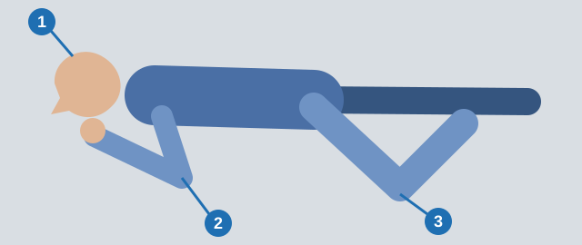

# مصدوم بیهوش

فرد بیهوش نمی‌تواند از راه هوایی خود محافظت کند، پس دقیقه نخست از همه مهم‌تر است. این درس بررسی تنفس، وضعیت پایدار به پهلو، غش، تشنج و بیماری ناگهانی را پوشش می‌دهد.

> **به یاد داشته باشید:** این درس جای دوره کمک‌های اولیه را نمی‌گیرد.

در حالت استراحت، **نبض** فرد بزرگسال **60-80 ضربه در دقیقه** و **تنفس** او **12-18 حرکت تنفسی در دقیقه** است.

## کسی را بیهوش پیدا کرده‌ام. حالا چه کنم؟

1. **راه هوایی را باز کنید.** یک دست روی پیشانی. با دو انگشت دست دیگر چانه را بالا ببرید و سر را به عقب خم کنید.
2. **10 ثانیه تنفس را بررسی کنید.** هوای بازدم را روی گونه خود حس کنید و قفسه سینه را نگاه کنید.
3. **اگر نفس می‌کشد،** از وضعیت پایدار به پهلو استفاده کنید.
4. **اگر نفس نمی‌کشد،** بی‌درنگ احیا را شروع کنید.

هرگز به فرد بیهوش آب ندهید: وارد ریه می‌شود.

> **دام رایج:** بدون خم کردن سر بررسی نکنید، چون ممکن است زبان راه هوایی را بسته باشد. نگاه کردن به قفسه سینه به‌تنهایی هم کافی نیست.

مطلب تکمیلی: احیا چگونه انجام می‌شود

*این مطلب از بانک سؤالات نیامده است.*

احیای قلبی-ریوی بزرگسال به شکلی که به‌طور گسترده آموزش داده می‌شود: مطمئن شوید با آمبولانس تماس گرفته شده و اگر دستگاه شوک در نزدیکی هست، کسی را به دنبالش بفرستید. پاشنه یک دست را روی مرکز قفسه سینه و دست دیگر را روی آن بگذارید و حدود 5 سانتی‌متر عمق، 100-120 بار در دقیقه فشار دهید. اگر آموزش دیده‌اید، پس از هر 30 فشار 2 تنفس نجات بدهید. اگر نه، فقط فشارها را ادامه دهید. تا رسیدن کمک یا برگشتن تنفس طبیعی ادامه دهید.

## وضعیت پایدار به پهلو چیست؟

وضعیتی برای مصدومی که بیهوش است اما نفس می‌کشد و گردش خون دارد.

*سر خم‌شده به عقب (1)، بازوی بالایی زیر گونه (2) و زانوی خم‌شده که زمین را لمس می‌کند (3).*

زبان نمی‌تواند راه هوایی را ببندد و استفراغ بیرون می‌ریزد. او را به پشت نخوابانید، زیر سرش لوله نگذارید و زبانش را بیرون نکشید.

## وقتی کسی غش می‌کند چه کنم؟

غش یعنی کاهش موقت خون‌رسانی به مغز. مصدوم را بخوابانید و پاهایش را بالا ببرید. او را ننشانید، روی صورتش آب سرد نریزید و سیلی نزنید.

مطلب تکمیلی: اگر به هوش نیامد

*این مطلب از بانک سؤالات نیامده است.*

اگر در حدود یک دقیقه به هوش نیامد، او را مصدوم بیهوش در نظر بگیرید و با آمبولانس تماس بگیرید.

## هنگام تشنج چه کنم؟

تشنج معمولاً خودبه‌خود در چند دقیقه پایان می‌یابد، پس بگذارید تشنج پایان یابد.

1. مصدوم را نگه ندارید: این کار باعث شکستگی و دررفتگی می‌شود.
2. دهان را باز نکنید، زبان را نگیرید و چیزی میان دندان‌ها نگذارید.
3. هنگام تشنج سر را به عقب خم نکنید. پس از آن، راه هوایی را باز کنید و تنفس را بررسی کنید.

مطلب تکمیلی: حفظ ایمنی فرد هنگام تشنج

*این مطلب از بانک سؤالات نیامده است.*

در دوره‌های کمک‌های اولیه این را هم یاد می‌دهند که اشیای خطرناک را دور کنید، زیر سر چیز نرمی بگذارید و مدت تشنج را زیر نظر بگیرید. اگر بیش از 5 دقیقه طول کشید، تکرار شد یا فرد درست به هوش نیامد، با آمبولانس تماس بگیرید.

## بیماری ناگهانی چطور؟

| وضعیت | چه کنید | چه نکنید |
|---|---|---|
| راننده درد شدید و فشارنده قفسه سینه و دشواری تنفس دارد | بی‌درنگ خودرو را متوقف کنید، چراغ خطر را روشن کنید و آمبولانس را به همان محل بخواهید | ادامه رانندگی تا بیمارستان، دادن والرین، یا راه رفتن برای هوای تازه |
| حمله آسم برونشی | وضعیت نیمه‌نشسته، با قفسه سینه آزاد | خواباندن او |
| دوست مبتلا به دیابت حالش خوب نیست و از انسولین مطمئن نیست | قند یا مایع شیرین بدهید، چون افت قند خون خطر محتمل است | توصیه به انسولین یا چند ساعت استراحت |

قند را فقط به کسی بدهید که هوشیار است: به مصدوم بیهوش نباید چیزی از راه دهان داده شود.

مطلب تکمیلی: اسپری‌های آسم

*این مطلب از بانک سؤالات نیامده است.*

بسیاری از افراد مبتلا به آسم اسپری تسکین‌دهنده دارند. در دوره‌های کمک‌های اولیه یاد می‌دهند به آن‌ها در استفاده از اسپری خودشان کمک کنید و اگر حمله شدید بود یا آرام نشد، با آمبولانس تماس بگیرید.

## خودتان امتحان کنید

**راننده‌ای مدت زیادی برای تعویض چرخ چمباتمه زده است،** ناگهان بلند می‌شود، هوشیاری‌اش را از دست می‌دهد و می‌افتد.

چه باید کرد؟ **پاهایش را بالا ببرید.** خون به مغز برمی‌گردد. نشاندن او برعکس عمل می‌کند.

## نکات کلیدی

- بیهوش: راه هوایی را باز کنید، سپس 10 ثانیه تنفس را بررسی کنید.
- نفس می‌کشد: وضعیت پایدار به پهلو. نفس نمی‌کشد: بی‌درنگ احیا.
- غش: خوابیده، پاها بالا.
- تشنج: مهار نکنید، چیزی در دهان نگذارید.
- آسم: نیمه‌نشسته. دیابت: قند یا مایع شیرین.

{{practice}}
